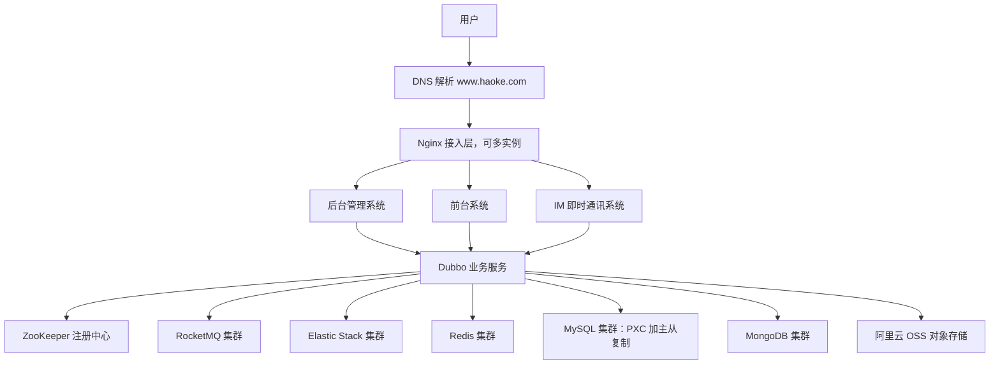

# 一张部署全景图：用户请求从域名到基础服务的四层落位

代码写完只是起点。租房项目横跨前台、后台、即时通讯等多个系统，底下还压着消息队列、搜索引擎、三套数据库，真要上线，第一个问题是：用户在浏览器敲下域名之后，这个请求会经过哪些层、落到哪个服务？答不清这个问题，部署就无从下手。

部署架构图就是这张作战地图。它先回答「有哪些服务、谁调用谁」，再回答「每个服务要不要做集群」，至于每个服务具体落在哪台机器、占用哪个端口，属于后面部署计划的事。

## 先给结论

- 整个部署自上而下分四层：用户接入层（Nginx）、业务系统层（后台、前台、即时通讯）、服务层（Dubbo 业务服务 + 注册中心）、基础服务层（MySQL、Redis、MongoDB、RocketMQ、Elastic Stack、OSS）。
- 接入层的 Nginx 与业务系统层的每个系统都可以多实例集群化，图中节点数只是示意，实际按机器资源定。
- 业务服务是前面用 Dubbo 开发的那批服务，统一注册到 ZooKeeper，与 RocketMQ 做消息通信。
- MySQL 集群内部又分 PXC 强一致集群与主从复制两类，这一点沿用数据层已有的成果。
- 静态图片这类文件不走自建存储，直接使用阿里云 OSS 对象存储服务。

## 一、把请求从用户走到存储，四层各就各位

看部署图最好的方式是跟着一个请求走一遍，哪一层都绕不过去：



用户访问的 `www.haoke.com` 是一个虚拟域名，DNS 解析得到的 IP 指向 Nginx 所在的服务器；Nginx 可能不止一个实例，构成接入层的集群。请求进入业务系统层后，后台管理系统、前台系统、即时通讯系统各自承接一类流量，这一层的每个系统也都能水平扩成多实例。再往下是服务层，也就是前面用 Dubbo 开发的那批业务服务，它们靠 ZooKeeper 完成注册与发现。最底层是基础服务层，所有数据与消息最终都落在这里。

这张图有两个读法值得记住。**从上往下看是依赖关系**：上层的每个箭头都意味着下层必须先活着；**从下往上看是部署顺序**：先把基础服务搭稳，再起服务层与业务系统，最后挂接入层，这个顺序在部署计划一课会正式定下来。

## 二、接入层与业务系统：可集群的入口

Nginx 在这套架构里承担反向代理与负载均衡：对外收口一个域名，对内把请求分给各个业务系统。后台、前台、即时通讯三个系统都可能部署多个实例，由 Nginx 做分发。按本课架构补一份接入层分发示例：

```nginx
# 示例：接入层按路径把请求分给三个系统，按本课机器分工补全
http {
    upstream manage { server 192.168.1.7:8081; server 192.168.1.7:8082; }
    upstream web    { server 192.168.1.7:8091; }
    upstream im     { server 192.168.1.7:8092; }

    server {
        listen 80;
        server_name www.haoke.com;

        location /manage/ { proxy_pass http://manage/; }
        location /im/     { proxy_pass http://im/; }
        location /        { proxy_pass http://web; }
    }
}
```

`upstream` 定义一组同角色的后端实例，一个系统扩实例时只需要往 `upstream` 里加一行，入口地址永远不变。这就是把「接入」独立成一层的好处：扩容、下线、替换实例，用户都感知不到。

业务系统层的三个角色分工明确：`haoke-manage` 是给运营人员用的后台管理系统，`haoke-web` 是面向租客与房东的前台系统，`haoke-im` 是买卖双方即时沟通的微聊系统。图中只画了这三个，并不是系统全集，搜索等其余系统同样存在，画图时做了取舍。

## 三、服务层：Dubbo 服务、注册中心与消息

服务层是前面整个项目开发阶段反复打交道的那批 Dubbo 服务，例如广告服务。部署视角下它们有三个固定动作：启动时把自身地址注册到 ZooKeeper，调用时从 ZooKeeper 拉取提供者列表，异步场景下与 RocketMQ 收发消息。注册与发现的配置落在服务自己的配置文件里：

```yaml
# 示例：Dubbo 服务的注册中心配置，按本课写法补全
dubbo:
  registry:
    address: zookeeper://192.168.1.7:2181
  protocol:
    name: dubbo
    port: 20880
```

服务本身无状态，天然适合多实例部署：同一份服务起两个容器，注册中心里就有两个提供者地址，消费者自动负载均衡。这也解释了为什么 ZooKeeper 是架构里的关键依赖，它一挂，新上线的服务没法注册，存量调用虽然能靠本地缓存撑一阵，但扩缩容全部停摆。

## 四、基础服务层：每个角色都要集群化

架构图底层一排基础服务，部署时的共同关键词是「集群」。

**Elastic Stack 集群**，承担两条职责：房源搜索走 Elasticsearch，运行日志通过 Beats 与 Logstash 汇进来做监控，一条链路两用。**RocketMQ 集群**，NameServer 与 Broker 都要多实例，广告服务等业务与它收发消息，削峰填谷靠它。**Redis 集群**，缓存与部分热点数据的承载体，分片加主从保证可用。**MongoDB 集群**，微聊消息这类文档型数据存放在这里，集群搭建在后续课程单独展开。**MySQL 集群**，内部又细分两套：对一致性要求高的数据（如房源）走 PXC 强一致集群，其余数据走主从复制，具体规划在后面两课落表。**OSS** 是唯一不自建的角色，静态图片直接上传到购买的阿里云对象存储服务上，省掉自建文件集群的运维成本。

落到机器上，这套架构会分布到三台服务器：数据库集群占用其中两台，应用服务与中间件合占一台。谁占哪个端口、用哪个数据卷，部署计划与 MySQL 规划两课给出完整清单。

## 五、看图的两点说明

架构图是示意，不是施工图，有两处「图和现实不等价」要心里有数。

**第一，节点数不代表真实部署数。** 图中 MySQL 只画了两个节点，实际部署远不止，具体几个实例、怎么分组，取决于机器资源与数据量；其他中间件同理。**第二，系统没有画全。** 图中只罗列了部分业务系统，搜索等其余系统同样要部署，只是没在图上占位置。读任何一张部署图都该带着这两条疑问去看，图省略了什么、节点数是示意还是确数，动手前必须问清楚。

## 常见误区

- **把图上的节点数当成实际部署数。** 示意图里两个 MySQL 节点只是画图省事，真实部署按机器与数据量定。照着示意图买机器，多半买错。
- **以为业务系统只能单实例。** 后台、前台、即时通讯每个系统都是普通进程，多起一份实例、Nginx 的 `upstream` 加一行，就是水平扩容，不需要改任何代码。
- **把 OSS 当成自建文件服务器。** 项目里的静态图片上传走的是购买的阿里云 OSS 服务，不占自己机器的磁盘，也没有自建 FTP 那套东西。
- **忽略注册中心这根线。** Dubbo 服务之间的调用靠 ZooKeeper 牵线，部署时注册中心必须先于业务服务就绪，否则服务起一个失败一个。

## 面试可能被问到的问题

1. 面试官追问：「画一下你这个项目的部署架构，说说分层。」
   答：自上而下四层：Nginx 接入层对外收口域名；业务系统层放后台、前台、即时通讯等系统；服务层是 Dubbo 业务服务，注册到 ZooKeeper，消息走 RocketMQ；基础服务层是 MySQL、Redis、MongoDB、Elastic Stack 等数据与中间件。每层都可以独立扩实例，上层只认下层地址，不感知实例数变化。

2. 面试官追问：「为什么要单独一层 Nginx，应用直接对外不行吗？」
   答：应用直接对外，实例地址就得暴露给用户，扩缩容都要改 DNS。Nginx 收口一个域名，反向代理到多个实例，还能做健康检查、静态资源与证书统一管理。入口收敛后，后端怎么扩用户都无感知。

3. 面试官追问：「服务为什么要注册到 ZooKeeper，不注册行不行？」
   答：不注册的话，服务消费者必须写死提供者地址，扩缩容都要改配置重启。注册中心把「谁在哪」动态化，消费者按服务名取可用地址列表并自动负载均衡，宕机实例会被剔除。这是微服务之间稳定互相调用的基础设施。

4. 面试官追问：「哪些组件必须做集群，判断依据是什么？」
   答：依据是它挂了影响多大、是不是单点。MySQL 这类存数据的，单点故障就是数据事故，必须集群；RocketMQ、ZooKeeper 这类承上启下的中间件，单点会放大成全局故障，也要集群；Nginx 做接入层入口，同样多实例。无状态的普通应用实例天然可水平扩展，加机器就行。

5. 面试官追问：「图片这类静态资源为什么用阿里云 OSS，不自己存？」
   答：自建文件存储要考虑磁盘扩容、备份、带宽与多机同步，运维成本高。OSS 是对象存储服务，按量付费，自带冗余与 CDN 加速能力，图片上传与访问直接走它的接口。项目把文件这类低价值密度数据交给云服务，自己的机器留给计算与数据库。

## 配套资料

- 本课无配套源码包：`materials/code/03/day18-项目发布以及各种服务集群搭建/` 目录下仅有解压清单
  `_extracted.json`（记录解压文件数为 1，内容为房源抓取测试数据 `data.json`）。
- 部署分层、系统角色与集群化说明整理自本课讲解与画面；`nginx` 分发配置与 Dubbo 注册配置为按本课架构补全的示例。
