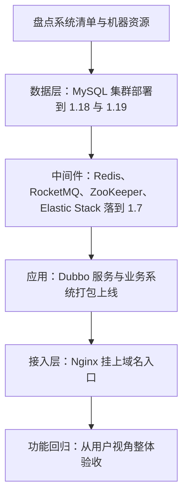

# 上线前的部署计划：盘点三台服务器，排定自下而上的部署顺序

架构图看懂了，动手之前还差一步计划。拿到服务器就开装，装到一半发现内存不够、端口撞车、依赖的服务还没就位，返工的成本比计划本身高得多。真实项目里这一步叫部署计划：把要部署的东西数清楚，把手里的资源摸清楚，再把两者对上。

课程环境没有真实的用户量与采购流程，但计划的思路一样要走：数一数系统与服务，量一量机器，然后给出一份「谁在哪、按什么顺序装」的清单。

## 先给结论

- 部署计划四件事：盘点系统与服务、摸清服务器资源、预估用户数与并发、考虑数据备份。
- 课程环境用三台虚拟机：192.168.1.7、192.168.1.18、192.168.1.19，硬件配置完全相同。
- 每台配置为 4 核 CPU、6G 内存、100G 磁盘，用 `top`、`free -m`、`df -h` 三个命令逐一确认。
- 机器分工：数据库集群占用 1.18 与 1.19 两台，应用服务与中间件落在 1.7 一台。
- 部署顺序自下而上：先装 MySQL 集群，再装中间件，最后应用打包上线，被依赖者永远先行。

## 一、真实项目上线前，计划要盘点什么

把项目发布上线，动手前的盘点有四项，缺一项后面就多一次返工。

**第一，盘点系统与服务。** 业务系统有几个、Dubbo 服务有几个、中间件各是什么版本，列成清单。这份清单直接来自部署架构图，图上每一个方框都要在清单里有名字。**第二，摸清服务器资源。** 有几台机器、每台多少核多少内存多少磁盘，决定哪些服务合得下、哪些必须独占。**第三，预估用户数与并发。** 预期多少用户、峰值多少并发，据此推算每类服务需要几个实例、数据库扛多大的量，这是「资源够不够」的计算依据。**第四，考虑数据安全。** 备份策略、集群方案都要在计划期定好，上线后数据丢了再想备份，已经晚了。

真实项目里，服务器往往由开发人员提出需求，公司走采购流程来满足；学习阶段资源有限，反过来做：在现有资源上做分配。两条路的计划动作完全一样，只是约束条件不同。

## 二、三台服务器长什么样：三条命令摸家底

课程环境手上有三台虚拟机：192.168.1.7、192.168.1.18、192.168.1.19，都是同一台宿主机上开出来的，配置完全相同。摸清一台机器的家底用三条命令：

```bash
top
# 按 1 展开各核：Cpu0 ~ Cpu3，共 4 核

free -m
#               total   used   free
# Mem:           5967    130   5251
# 总内存 6G，当前仅用 130M，空闲 5G

df -h
# /dev/sda1   97G   已用约 20%
# 分配 100G 磁盘（机械硬盘），使用率两成左右
```

`top` 按数字 1 能展开每一颗 CPU 的占用，确认核数；`free -m` 以兆为单位给出内存总量与占用；`df -h` 看磁盘挂载与使用率。三条命令跑完，这台机器「能装多少东西」就心里有数了：4 核 6G 的机器，跑一组数据库容器或者一组应用服务都够，但两头全压一台就紧张了。

动手部署前可以给三台机器各做一次同样的盘点，留档对照：

```bash
# 示例：逐台盘点三台机器的资源，按本课命令组合补全
for host in 192.168.1.7 192.168.1.18 192.168.1.19; do
  echo "== $host =="
  ssh "$host" "nproc; free -m | head -2; df -h / | tail -1"
done
```

盘点结果记下来，后面每一项部署决策都能回溯到它：为什么 MySQL 集群要占两台机器、为什么应用只起有限的实例，答案都在这串数字里。

## 三、机器分工与部署顺序：被依赖者先行

三台同配置的机器怎么分？原则是让吃资源的互相错开。数据库是内存与磁盘大户，6 个 MySQL 实例分两台放：4 个 PXC 节点放 192.168.1.18，主从两个节点放 192.168.1.19，顺带把 MyCat 与 HAProxy 这层数据库中间件也放 19 上，数据库侧自成一体。应用服务、Nginx 接入层与 Redis、RocketMQ、ZooKeeper 等中间件合占 192.168.1.7 一台。

分工定了，顺序也就定了。整条部署线自下而上推进：



这样排的理由藏在依赖关系里。**应用依赖中间件与数据库**，反过来不成立：数据库起好之后哪怕没有应用连它，也能用客户端连上去做一致性验证，每一层的完成度都能独立确认。**中间件依赖机器资源与网络**，先把它们安顿好，应用打包时配置文件里该指向谁就都明确了。**接入层最后挂**，前面全通了再开大门，测试期间的报错不会暴露给「用户」。

顺序的另一个价值是故障域隔离。装 MySQL 阶段出的连不上、起不来，一定在数据层找原因；如果一上来把所有东西全铺开，报错日志里数据库、中间件、应用的堆栈混在一起，定位成本成倍上升。

## 四、从下一课开始实施

计划落定后，实施从数据层开始：MySQL 集群的 6 个实例怎么分组、占哪些端口、用哪些数据卷，下一课先出一份规划表；随后的课程按表把 PXC 集群、主从复制、MyCat、HAProxy 逐个搭起来，数据层通了再回中间件与应用。每一步都对应计划表上的一行，做完勾一行，部署进度一目了然。

## 常见误区

- **跳过资源盘点直接开装。** 不知道内存剩多少就往上压容器，OOM 之后再回头腾挪，比先花十分钟跑一遍 `free -m` 与 `df -h` 代价大得多。
- **部署顺序随机。** 先起应用再补数据库，应用反复报连接失败，日志刷屏还容易掩盖真正的配置错误。被依赖的服务先行，是部署顺序的硬原则。
- **忽略数据安全这一项。** 计划只排「装什么」，不排「怎么备份」，集群搭完才算上线一半。备份策略要在计划期定，部署期落地。
- **把学习环境的配置当生产依据。** 三台 4 核 6G 的虚拟机是课程环境的约束产物，真实项目要先按用户数与并发推算资源，再提采购需求，两者的量级完全不同。

## 面试可能被问到的问题

1. 面试官追问：「项目上线前你会做哪些准备？」
   答：先盘点系统与服务清单，摸清服务器资源；再按预期用户数与并发推算各服务的实例数与机器分配，同步确定备份策略；然后排定自下而上的部署顺序，数据层先行、中间件次之、应用最后；上线后从用户视角做功能回归。每一步都有可核对的产出。

2. 面试官追问：「怎么快速了解一台 Linux 服务器的资源状况？」
   答：`top` 看实时负载，按数字 1 展开各核确认 CPU 核数；`free -m` 看内存总量与占用；`df -h` 看磁盘挂载与使用率；`nproc` 直接给核数。这几条命令几秒钟跑完，机器能承载什么服务就有判断依据。

3. 面试官追问：「为什么部署顺序要先数据库再应用？」
   答：因为依赖是单向的：应用依赖数据库与中间件，反过来不成立。先起数据库，每装完一层都能用客户端独立验证，故障域清晰；顺序颠倒的话，应用起不来时分不清是代码问题、配置问题还是依赖没就绪，排查成本陡增。

4. 面试官追问：「多台机器上怎么分配服务，有什么原则？」
   答：按资源画像错开，数据库这类内存磁盘大户独占机器或集中一组，避免与计算密集型应用争抢；有调用关系的中间件尽量同机或同网段降低延迟；入口层与数据层分开，方便分别扩容。核心是让单机故障的影响面可预估。

5. 面试官追问：「服务器资源不够又必须上线，怎么办？」
   答：按服务的重要性做裁剪与合并在所难免，但要守住底线：有状态的核心数据服务不能省集群，无状态应用可以合并部署、降低实例数；同时把扩容路径留好，机器到位后按计划逐层扩展。省资源不能省在数据安全上。

## 配套资料

- 本课无配套源码包：`materials/code/03/day18-项目发布以及各种服务集群搭建/` 目录下仅有解压清单
  `_extracted.json`（记录解压文件数为 1，内容为房源抓取测试数据 `data.json`）。
- 三台服务器的 IP、硬件配置与 `top`、`free -m`、`df -h` 的输出整理自本课讲解与画面；批量盘点脚本为按本课命令组合补全的示例。
