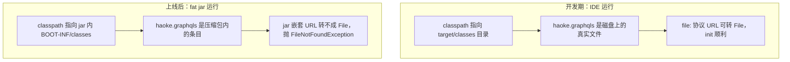

# 打包后 haoke.graphqls 读取失败排查记

上一篇三个 jar 首航，房源与广告两个 dubbo 服务顺利在注册中心报了名，api-server 却在启动时当场翻车。报错的主角是 `haoke.graphqls`：这份 SDL 文件明明随工程打进了 jar，启动时却抛 `FileNotFoundException`。同一份代码在 IDE 里跑了几个星期都没事，打成 jar 就读不到，这类「开发正常、上线就坏」的问题最值得把根因挖透，因为它的变体会出现在读任何 classpath 资源的场景里。

## 先给结论

- 根因一句话：`ResourceUtils.getFile` 只能把「文件系统上的真实文件」变成 File 对象，fat jar 里的 `haoke.graphqls` 是压缩包内的条目，jar 嵌套 URL 转不成文件路径。
- 修法：换类加载器读流，`getResourceAsStream("haoke.graphqls")` 拿到 InputStream，`IOUtils.toString` 转成字符串，`SchemaParser.parse(String)` 直接解析内容。
- 方法签名跟着换：`buildGraphQlSchema` 的参数从 File 改为 String，目标从「拿到文件」变成「拿到内容」。
- 服务器上的源码目录做增量修改，替换一个 Java 文件后重跑 `mvn install`，换 jar 重启，启动干净、接口返回数据。
- 「读流转字符串」的写法在 IDE 与 jar 两种环境都成立，读 classpath 资源应养成这个默认习惯。

## 报错现场：三层异常指向同一个根

把启动日志里的异常链完整铺开：

```text
2019-02-28 22:29:55.681 ERROR 11774 --- [main] o.s.boot.SpringApplication : Application run failed
org.springframework.beans.factory.UnsatisfiedDependencyException:
  Error creating bean with name 'graphQLController':
  Unsatisfied dependency expressed through field 'graphQL';
  nested exception is org.springframework.beans.factory.BeanCreationException:
  Error creating bean with name 'graphQLProvider':
  Invocation of init method failed;
  nested exception is java.io.FileNotFoundException:
  class path resource (haoke.graphqls) cannot be resolved as absolute file path
  because it does not reside in the file system:
  jar:file:/haoke/publish/haoke/haoke-manage-api-server-1.0-SNAPSHOT.jar!/BOOT-INF/classes!/haoke.graphqls
```

从外往里读这条链：创建 `graphQLController` 需要注入 `graphQL` bean；这个 bean 由 `GraphQLProvider` 的 `@Bean` 方法提供；而 Provider 的 `@PostConstruct` 初始化方法在执行时抛了异常，容器拉不起来，整个应用启动失败。外面两层都是连带伤害，真正的病灶在最里层的 `FileNotFoundException`。

最里层那句话把原因写得清清楚楚：`cannot be resolved as absolute file path because it does not reside in the file system`，资源无法解析为绝对文件路径，因为它不在文件系统上。末尾的 `jar:file:...jar!/BOOT-INF/classes!/haoke.graphqls` 是铁证：这个带 `!` 的嵌套 URL 说明资源确实在，只是被压缩在 jar 包里，不再是文件系统上一个能打开的文件。

## 原理：开发期与打包后的 classpath 是两种形态

出问题的旧写法长这样：

```java
@PostConstruct
public void init() throws FileNotFoundException {
    File file = ResourceUtils.getFile("classpath:haoke.graphqls");
    this.graphQL = GraphQL.newGraphQL(buildGraphQlSchema(file)).build();
}
```

`ResourceUtils.getFile` 的行为边界很窄：拿到资源的 URL 后，只有 `file:` 协议才会转成 File 返回，其他协议一律抛异常，并在异常消息里提示资源不在文件系统上。它在 IDE 里能用，纯粹是因为开发期的 classpath 形态恰好满足了这个前提：



打包把类与资源一起塞进了 `BOOT-INF/classes`，对 JVM 来说它们还在 classpath 上，`getResourceAsStream` 这类按流读的方式完全正常；但对 `getFile` 来说，「文件」已经不存在了，存在的只是压缩包里的一个条目。spring 官方对 `ResourceUtils.getFile` 的注释里也写明它只建议在调试时使用，生产代码按文件读 classpath 资源，从一开始就是踩在边界上。

## 修复：从拿文件改为拿内容

最终目的是拿到 SDL 文件的内容交给 `SchemaParser` 解析，解析器只关心内容本身，不关心内容原来住在哪。把读取方式换成类加载器流：

```java
@PostConstruct
public void init() throws Exception {
    // 用类加载器按 classpath 根读取资源流，jar 内同样可用
    InputStream inputStream = GraphQLProvider.class.getClassLoader()
            .getResourceAsStream("haoke.graphqls");
    // 流转字符串，编码显式指定为 UTF-8
    String content = IOUtils.toString(inputStream, "UTF-8");
    this.graphQL = GraphQL.newGraphQL(buildGraphQlSchema(content)).build();
}

private GraphQLSchema buildGraphQlSchema(String content) {
    // SchemaParser 有接收字符串的重载，直接解析内容
    TypeDefinitionRegistry typeRegistry = new SchemaParser().parse(content);
    return new SchemaGenerator().makeExecutableSchema(typeRegistry, buildWiring());
}
```

三处变化对应三个认知修正。**第一，`init` 的目标从文件变成流。** `getClassLoader().getResourceAsStream` 一律从 classpath 根开始找，没有包相对路径的歧义，IDE 与 jar 两种形态下行为一致。**第二，内容与文件解耦。** `IOUtils` 来自 commons-io 工具包，`toString` 把输入流按指定编码读成字符串；拿到字符串后，`buildGraphQlSchema` 的参数类型顺势从 File 换成 String，`SchemaParser.parse` 换用接收字符串的重载，装配逻辑一行没多。**第三，`buildWiring` 不用动。** 取数器集合 `List<MyDataFetcher>` 的注册逻辑与资源读取无关，重构后的 Provider 只改读 Schema 的入口。

## 重打包与复测

服务器上留的是解压好的源码目录，改一个类不需要重新上传整个工程，把修改后的 `GraphQLProvider.java` 上传覆盖，增量重打包：

```bash
# 替换 api-server 模块里的 GraphQLProvider.java 后，回到父工程根目录
cd /haoke/publish/haoke-manage
mvn install -Dmaven.test.skip=true

# 拷贝新 jar 到发布目录
cp haoke-manage-api-server/target/haoke-manage-api-server-1.0-SNAPSHOT.jar /haoke/publish/haoke/
cd /haoke/publish/haoke
java -jar haoke-manage-api-server-1.0-SNAPSHOT.jar &
```

这次启动日志要盯两处：一是全程无 ERROR，GraphQL 装配悄然完成；二是 Elasticsearch 的三个节点逐个加入，dubbo 对 `ApiHouseResourcesService` 与 `ApiAdService` 的引用建立起来，说明下游服务全都在线。接口层面的验证用一条 GET：

```bash
curl "http://192.168.1.7:18080/house/resources?currentPage=3&pageSize=10"
```

响应里返回了房源数据与分页信息，翻页参数换成 `currentPage=3` 数据照常吐出。HTTP 进门、GraphQL 装配、dubbo 调用、MySQL 取数这条链彻底打通。至于通过域名访问并交给 Nginx 统一管理，放到后面的部署收尾一起做。

## 常见误区

- **以为把文件放进 resources 就万事大吉。** 资源在不在 jar 里没有争议，出事的是读取方式：按文件读在打包后必挂，按流读两种形态通吃。
- **用 `Class.getResourceAsStream` 传相对路径。** 类对象的这个方法以「当前类所在包」为基准解析相对路径，在非根包下写 `getResourceAsStream("haoke.graphqls")` 会按包路径拼出错误位置，读不到任何东西。要么走 `ClassLoader` 的方法，要么在路径前补 `/` 明确从 classpath 根找。
- **改了代码不重新打包、或打包了不替换旧 jar。** 发布目录里躺着的还是旧包，重启十次也是老异常。增量打包后核对 jar 的时间戳再启动。
- **怀疑是资源没被打进 jar。** 用 `jar tf xxx.jar | grep graphqls` 一查便知，资源一直在 `BOOT-INF/classes` 下，错误的只是获取方式。

## 面试可能被问到的问题

1. 面试官追问：「Class.getResourceAsStream 和 ClassLoader.getResourceAsStream 有什么区别？」
   答：类对象的方法以当前类所在包为基准解析相对路径，路径以 `/` 开头才表示 classpath 根；类加载器的方法一律从 classpath 根开始找。跨包读固定资源用类加载器的写法更稳，不会因类挪了包而失效。

2. 面试官追问：「为什么 jar 包里的资源不能当 File 读？」
   答：File 对应文件系统上的真实文件，而 fat jar 里的资源是压缩包内的条目，URL 形态是 `jar:file:...!/` 的嵌套协议，没有独立的磁盘路径可映射。JDK 的 JarFile API 能按流读条目，但无法把条目还原成 File，除非把资源解压到临时目录。

3. 面试官追问：「Spring Boot fat jar 的内部结构是什么样的？」
   答：manifest 的 Main-Class 指向 JarLauncher，自身 class 在 `BOOT-INF/classes`，第三方依赖在 `BOOT-INF/lib`，每个依赖 jar 独立存放。JarLauncher 负责构造嵌套 classpath 并反射调用 Start-Class，这就是 27M 大小的服务 jar 能脱离 IDE 独立运行的原因。

4. 面试官追问：「除了类加载器，Spring 里还有哪些读 classpath 资源的方式？」
   答：Spring 把资源抽象成 `Resource` 接口，常用的有 `ClassPathResource`，调用 `getInputStream()` 读流；也可以注入 `ResourceLoader` 按前缀加载任意位置的资源。它们都遵循「按流读」的思路，天然兼容 jar 内资源，与直接读文件的 `ResourceUtils.getFile` 是两条路线。

5. 面试官追问：「这类问题在 war 包部署下会出现吗？」
   答：传统 war 包会被 Servlet 容器解压成目录结构，resources 变成磁盘上的真实文件，`ResourceUtils.getFile` 恰好能工作，所以一些老项目用 war 部署时踩不到这个坑。Spring Boot 内嵌容器的 jar 部署不解压，问题就暴露了。判断依据永远是资源的实际形态，而不是代码在哪个环境碰巧能跑。

## 配套资料

- 本教学日无源码包：`materials/code/03/day18-项目发布以及各种服务集群搭建/` 下仅有解压清单 `_extracted.json`（解压文件数为 1，内容为房源抓取测试数据 `data.json`）。
- 报错日志与修复前后代码抄录自本课画面线，包名已改为本系列中性命名；`curl` 验证命令按本系列房源接口写法补全。
- `GraphQLProvider` 的初版实现见 `0092-实现根据id查询房源数据的GraphQL服务.md`，`MyDataFetcher` 化的重构见 `0094-优化改进GraphQLProvider实现逻辑.md`。
