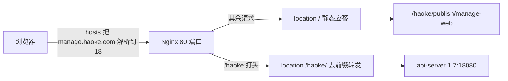

# manage-web 上线：产物上传、server 配置与 /haoke 代理

上一课 Nginx 在 1.18 上跑了起来，conf 里还是那份默认站点。这一课把两件事接上：把 umi 构建出的静态产物传到服务器，把默认 server 整块换成项目自己的配置。前端的「生产环境代理」也在这里补齐，开发期 `config.js` 里的 proxy 讲过不能跟着构建产物上线，等价能力要在 Nginx 里重建。

中间还埋着一条本课最值得记的口播重点：`proxy_pass` 的尾斜杠。一个字符，决定接口请求转发到后端时带不带 `/haoke` 前缀，写错了页面能开、数据全挂，症状还极具迷惑性。

## 先给结论

- 产物整体上传到 `/haoke/publish/manage-web`，文件平铺，`index.html` 是唯一入口。
- 默认 server 块整段替换：`listen 80` 不变，`server_name` 换成 `manage.haoke.com`，一个 `location` 管静态文件，一个管接口代理。
- `/haoke` 前缀是人为约定的分流标记：打头的请求是接口，转给 1.7 上的 api-server；其余按静态文件应答。
- 代理转发时前缀要去掉，靠的就是 `proxy_pass` 的尾斜杠；丢了它，后端收到 `/haoke/house/resources` 这种不存在的路径，直接 404。
- 域名是虚拟的，本机 hosts 把 `manage.haoke.com` 指到 18，改完配置 `nginx -s reload` 生效。

## 产物上传：publish 目录

发布位按讲义规划在 `/haoke/publish` 下，`manage-web` 目录建好，把构建产物整体放进去。构建那一课的示例里产物还停在 `dist` 子目录、域名暂写 `www.haoke.com`，本课讲义的实际落法是文件平铺进 `manage-web`、域名定为 `manage.haoke.com`，以下以本课为准：

```text
/haoke/publish/manage-web
├── index.html            # 唯一入口，重点就是它
├── umi.js                # 框架与公共代码
├── index.css
├── 1.chunk.css ... 5.chunk.css
├── 55.async.css ... 59.async.css
├── 60.async.js ... 66.async.js
├── asset-manifest.json   # 产物清单
└── color.less
```

文件名里的 `async` 与 `chunk` 在构建那一课解释过：按页面切分的异步模块与共享代码块。这一堆文件里真正要记住的是 `index.html`，浏览器要访问的入口就是它，其余文件都由入口按需引出。

## 替换默认 server：一份配置管两件事

默认的 server 长这样，指向 Nginx 自带的 `html` 目录：

```nginx
server {
    listen       80;
    server_name  localhost;

    location / {
        root   html;
        index  index.html index.htm;
    }
}
```

项目要的不是它。按讲义把整块换成（讲义原稿用正则匹配 `location ~ ^/haoke/`，而正则 location 里的 `proxy_pass` 不允许携带 URI 部分，照抄会被 Nginx 拒绝加载，下面给出可加载的前缀写法，语义与讲义一致）：

```nginx
server {
    listen       80;
    server_name  manage.haoke.com;

    # 把原始 Host 与转发链带给后端
    proxy_set_header X-Forwarded-Host $host;
    proxy_set_header X-Forwarded-Server $host;
    proxy_set_header X-Forwarded-For $proxy_add_x_forwarded_for;

    # 接口请求：/haoke 打头，转发给 api-server 并去掉前缀
    location /haoke/ {
        proxy_pass http://192.168.1.7:18080/;
        proxy_connect_timeout 600;
        proxy_read_timeout 600;
    }

    # 其余请求：按静态文件应答
    location / {
        root /haoke/publish/manage-web;
    }
}
```

拆开看，这份 server 干了两件事：

**第一，静态托管。** `location /` 接住所有不以 `/haoke` 打头的请求，`root` 指到产物目录，请求 `/` 回到 `index.html`，页面引用的 js、css 也从这里取。

**第二，接口代理。** `location /haoke/` 把接口请求接住，转发给 1.7 上的 api-server。三条 `X-Forwarded-*` 头是替后端记下真实来路：经过代理之后，后端看到的 TCP 连接来自 Nginx，不把这些头传过去，后端就不知道原始 Host 与客户端 IP 链。

## 尾斜杠决定前缀的去留

为什么给接口请求加一个 `/haoke` 前缀，转发时又把它去掉？加，是因为要区分两类长得一模一样的 URL 请求，Nginx 得有个标记才知道该给文件还是该转发；不去，是因为后端 api-server 的路由里根本没有 `/haoke` 这个路径，`/house/resources` 才是真身，前缀透传过去就是一片 404。

去掉的动作就藏在 `proxy_pass` 的尾斜杠里：

```text
location /haoke/ + proxy_pass http://192.168.1.7:18080/
  请求 /haoke/house/resources  转发为  /house/resources

location /haoke/ + proxy_pass http://192.168.1.7:18080  （无尾斜杠）
  请求 /haoke/house/resources  转发为  /haoke/house/resources，404
```

这正是开发期 `config.js` 里 `pathRewrite: { '^/haoke': '' }` 的生产版。课程口播里反复强调这个斜杠「非常非常关键」，因为错出这一个字符，表象是页面正常打开、点任何功能都拿不到数据，极易误判成后端服务挂了。

## hosts 与验证

`manage.haoke.com` 是一个不存在的虚拟域名，想让浏览器认它，得在开发机 hosts 里手工指路。课程用 SwitchHosts 这类工具维护 hosts 条目，加一行：

```text
192.168.1.18 manage.haoke.com
```

配置改完进入 `sbin` 目录热加载：

```bash
cd /usr/local/nginx/sbin/
./nginx -s reload
```

浏览器访问 `manage.haoke.com`，静态页面出来了。首页顶部的当前用户接口并未实现，报错可忽略；点进房源管理，列表数据正常加载。这份数据的来路值得点名：它来自 1.7 上 18080 端口的 api-server，是 `location /haoke/` 那条代理把请求送过去的。整条分拣链路如下：



`proxy_connect_timeout` 与 `proxy_read_timeout` 都被调到 600：开发调试阶段接口偶尔慢，把代理超时放宽，排查时少一个干扰因素。新增房源操作下来与开发环境一致，前端这一层就算上线了。

## 常见误区

- **把 `server` 敲成 `serve`。** 课程现场真实踩过：从讲义拷配置，`server` 少了个 `s`，reload 直接语法报错。区块关键字拼错是最便宜的错误，改完配置先 `nginx -t` 再 reload，一秒就能抓出来。
- **照抄讲义的正则写法。** 讲义截图是 `location ~ ^/haoke/` 配带尾斜杠的 `proxy_pass`，而 Nginx 规定正则 location 里的 `proxy_pass` 不能带 URI 部分，直接报 `cannot have URI part in location given by regular expression`。前缀匹配 `location /haoke/` 才是能加载且语义相同的写法。
- **尾斜杠时有时无。** 前缀透传后端必 404，而页面一切正常，问题极易被推给后端。接口 404 时先看这条斜杠，再去看服务。
- **hosts 没配或指错机器。** 域名必须指向 Nginx 所在的 18，不是后端 1.7；hosts 不生效时浏览器按真实 DNS 解析，域名根本打不开。

## 面试可能被问到的问题

1. 面试官追问：「location 的匹配优先级是怎样的？」
   答：先看精确匹配 `=`，命中即停；再看 `^~` 前缀匹配，命中则跳过正则；普通前缀匹配记下最长命中但继续查正则，正则按声明顺序取第一个命中的，都没有才回到最长前缀。本题用前缀 `/haoke/` 就能完成分流，还避开了正则 location 与 `proxy_pass` URI 的组合限制。
2. 面试官追问：「X-Forwarded-For 是干什么的，可以伪造吗？」
   答：它记录请求经过的客户端与代理 IP 链，每经一代理向末尾追加一跳，后端取第一段可还原发起方。它只是普通请求头，客户端可以伪造初始值，安全敏感场景要结合与代理直连的 `remote_addr` 校验，或在可信边界重置。
3. 面试官追问：「生产环境用反向代理解决跨域，而不是让后端开 CORS，理由是什么？」
   答：反向代理让页面与接口同源，浏览器完全无感，前后端独立部署互不牵连；CORS 要后端逐个放行来源并处理预检请求，凭据与头部策略复杂易错。代理方案还顺带收拢了超时、日志与后续负载均衡的入口。
4. 面试官追问：「reload 和 restart 有什么区别？」
   答：reload 重读配置文件，起新 worker、旧 worker 处理完存量请求后退出，不中断服务；restart 是整个进程重启，存量连接被切断。改配置用 reload，升级二进制才考虑重启。
5. 面试官追问：「这套静态托管还能顺手做哪些优化？」
   答：开 gzip 压缩 js 与 css（zlib 依赖已备）；对带 hash 文件名的产物设置长 `expires` 缓存，`index.html` 明确不缓存；必要时配置访问日志采样与限流。都是入口层一两行配置的收益。

## 配套资料

- 本教学日无源码包：`materials/code/03/day18-项目发布以及各种服务集群搭建/` 下仅有解压清单 `_extracted.json`（解压文件数为 1，内容为房源抓取测试数据 `data.json`）。
- 产物清单、默认 server 与项目 server 配置抄录自本课画面线；讲义正则 location 写法按上文说明改为可加载的前缀写法，转发端口按 api-server 实际部署端口取 18080。
- 构建产物的来历见 `0298-通过umi构建-haoke-manage-web系统.md`，开发期 proxy 与生产代理的对应关系也在该篇展开；api-server 的 18080 部署与验证见 `0296-解决读取haoke.graphqls文件失败的问题.md`。
