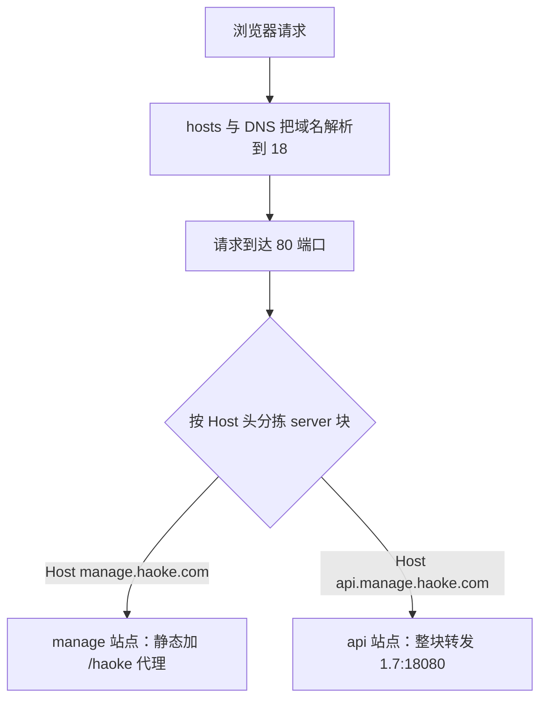

# 接口域名 api.manage.haoke.com：一个 Nginx 分出两个站点

后台前端有了正式门牌 `manage.haoke.com`，接口却还停在 `http://192.168.1.7:18080` 这种 IP 加端口的裸奔状态：开发期与此前课程示例里都是这么直连的。接口服务要成为正式的一环，得有自己的域名，这一课加上 `api.manage.haoke.com`。

域名有了，问题跟着来：Nginx 只有一个 80 端口，前端站点已经占着它，接口域名往哪放？答案是放同一个端口里。Nginx 的虚拟主机机制允许多个 server 块共享一个端口，按请求头里的 Host 分拣，这正是它做统一入口的底气。

## 先给结论

- 再加一个 server 块，`listen 80` 与前端站点相同，`server_name` 换成 `api.manage.haoke.com`。
- 接口 server 只有一个 `location /`，全部请求转发给 1.7 上的 api-server，没有静态分支，也没有前缀增删。
- Nginx 按 Host 头选 server 块，与端口无关，两个域名可以共存于同一个 80。
- hosts 里补一行 `api.manage.haoke.com` 指到 18，再由 Nginx 转往 1.7，不是直指后端。
- 验证方式：直连 IP 与走域名访问同一接口，返回同一份 JSON。

## 新增的 server 块

配置仍然在 `/usr/local/nginx/conf/nginx.conf` 的 http 块里，紧挨着前一课的 manage 站点再加一段：

```nginx
server {
    listen       80;
    server_name  api.manage.haoke.com;

    proxy_set_header X-Forwarded-Host $host;
    proxy_set_header X-Forwarded-Server $host;
    proxy_set_header X-Forwarded-For $proxy_add_x_forwarded_for;

    location / {
        proxy_pass http://192.168.1.7:18080/;
        proxy_connect_timeout 600;
        proxy_read_timeout 600;
    }
}
```

与 manage 站点对比着看，差异一目了然：`listen` 还是 80，`server_name` 换成接口域名；`location` 只剩一个 `/`，静态托管的分支不见了，所有请求一律转发。前缀处理也自然消失了，接口域名下请求的路径就是后端真实路径，无需增删。

## 同一个 80 端口怎么分拣

HTTP 请求头里自带 `Host` 字段，浏览器访问 `api.manage.haoke.com/house/resources` 时，发出去的请求头里有 `Host: api.manage.haoke.com`。Nginx 收到请求，先按目标 IP 与端口圈定候选的 server 块（这里 80 端口上有两个），再用 Host 值与各块的 `server_name` 匹配，命中哪个块，请求就交给哪个块处理：



这张图的关键在「同一个端口、两种去向」：分拣依据不是端口也不是路径，而是域名。这就是基于域名的虚拟主机，一台机器、一个 Nginx、一个端口，对外可以是任意多个站点。

`server_name` 的匹配有明确的优先级：精确名最先，其次是 `*` 开头的通配名、`*` 结尾的通配名，然后是正则形式，全都不中就走默认 server（通常是第一个块或显式标记 `default_server` 的块）。两个域名都是精确名，互不干扰；要是哪天把 `server_name` 拼错了一个字母，请求会悄悄落到默认块上，表象是「接口域名打开了前端页面」，遇到这类现象就往这里查。

## hosts 映射与验证

开发机 hosts 里再补一行，继续用 SwitchHosts 维护：

```text
192.168.1.18 manage.haoke.com
192.168.1.18 api.manage.haoke.com
```

注意接口域名同样指向 18 这台 Nginx，而不是 1.7：域名先找到 Nginx，Nginx 再按配置转给后端。域名直指后端虽然也能通，但代理层就形同虚设了。

reload 之后验证。直连与走域名各请求一次同一接口：

```bash
# 直连后端
curl "http://192.168.1.7:18080/house/resources?currentPage=1&pageSize=2"

# 走接口域名
curl "http://api.manage.haoke.com/house/resources?currentPage=1&pageSize=2"
```

两次返回同一份房源 JSON，接口域名生效。课程里是在浏览器中对照验证的，先用 IP 直连拿到数据，再换域名访问，效果一致。生产环境里 hosts 换成 DNS 解析，Nginx 配置一字不用改，这正是域名层解耦的价值：换机器、加负载均衡，动的都是解析，不是配置。

## 常见误区

- **以为两个 server 监听同一端口会冲突。** 端口不是 server 块的唯一标识，同一 IP、同一端口上的多个 server 依靠 Host 区分，这是虚拟主机的基本盘。真正会出问题的是两个块写了相同的 `server_name`，Nginx 会告警并只认先声明的那个。
- **hosts 把接口域名指到后端 1.7。** 域名解析必须落到代理层，否则流量绕过 Nginx，转发规则、超时控制、后续的负载均衡全都落空。
- **`server_name` 拼写与请求域名对不上。** 匹配不上会落到默认 server，出现「访问接口域名却出了前端页面」的现象，检查配置与 hosts 两边的拼写。
- **改完配置忘了 reload。** 新增 server 块不 reload 就不生效，而且不报任何错，服务照旧跑着旧配置，最容易造成「配了没用」的错觉。

## 面试可能被问到的问题

1. 面试官追问：「虚拟主机有哪几种实现方式？」
   答：基于域名的虚拟主机，多个域名共用一个 IP 与端口，靠 Host 头区分，生产最常用；基于 IP 的虚拟主机，一块网卡绑多个 IP 各服务一个站点；基于端口的虚拟主机，同一 IP 用不同端口区分。Nginx 与 Apache 都完整支持这三种。
2. 面试官追问：「Nginx 收到一个请求，怎么决定交给哪个 server 块？」
   答：先按请求的目标 IP 与端口圈定候选块，再对 Host 头做 `server_name` 匹配，顺序是精确名、`*` 前缀通配、`*` 后缀通配、正则，全不中走默认块。两轮筛选后命中唯一的 server，再进入其内部的 location 匹配。
3. 面试官追问：「经过 Nginx 转发后，后端怎么拿到真实客户端 IP？」
   答：靠 `X-Forwarded-For` 头，它把途经的每一跳 IP 依次追加，后端取第一段即发起方；`X-Forwarded-Host` 记录原始 Host。这些头需要代理显式设置，配置里的三条 `proxy_set_header` 干的就是这件事。
4. 面试官追问：「hosts 文件和 DNS 是什么关系？」
   答：域名解析时 hosts 先于 DNS 被查询，命中即用。开发阶段用 hosts 模拟正式域名，免去 DNS 配置；生产环境由 DNS 提供解析，应用与 Nginx 配置对两者无感知，切换环境只动解析层。
5. 面试官追问：「接口单独用一个域名，与和页面混在一个域名下相比好在哪？」
   答：职责边界清晰，缓存、超时、限流、证书等策略可以按域名独立设置；接口可以独立扩容与迁移，只要域名不变，前端零改动；安全上也便于对接口域名单独做鉴权与访问控制。
6. 面试官追问：「为什么不直接把 1.7:18080 暴露给前端用？」
   答：直连把后端拓扑暴露给了客户端，换机、扩容都要动前端配置；经域名与代理收口后，后端怎么部署、部署几台，前端一概不知也不必知道，代理层还顺手承担了超时、日志与安全控制。

## 配套资料

- 本教学日无源码包：`materials/code/03/day18-项目发布以及各种服务集群搭建/` 下仅有解压清单 `_extracted.json`（解压文件数为 1，内容为房源抓取测试数据 `data.json`）。
- 新增 server 块与 hosts 条目抄录自本课画面线；画面线中转发端口两处抄作 18000，按口播与 api-server 实际部署端口（`0296-解决读取haoke.graphqls文件失败的问题.md` 验证为 18080）取 18080。
- 前一课的 manage 站点配置见 `0300-部署后台系统的前端系统(nginx配置).md`，两个 server 块同属一份 nginx.conf。
