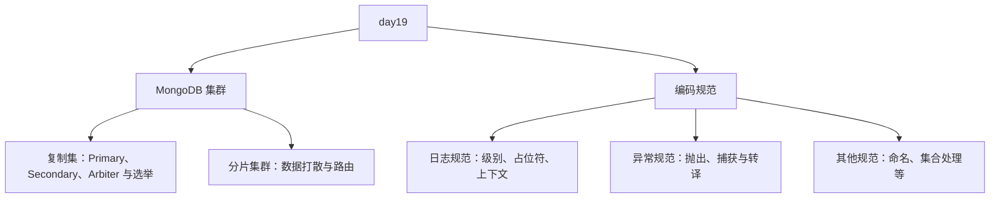

# day19 导览：补上 MongoDB 集群这块短板，再给日志与异常立规矩

day18 收官时留了一个缺口：部署图上五套基础服务全部集群化，唯独 MongoDB 还是单节点。不是忘了，而是时候未到，复制集那时还没讲，强行搭就是照抄命令不明就里。day19 把这块补上，部署架构才算真正闭环；集群讲完，还要停下来谈一件写代码时最容易放飞的事：日志和异常怎么打、怎么抛。

很多项目功能上没毛病，一进生产就露出底子薄：日志要么不打、要么刷屏、要么出了问题翻遍日志找不到线索；异常要么层层吞掉、要么乱抛一气，调用方拿到一堆不知所云的报错。这两个规范点看着不起眼，恰恰是区分「能跑」和「能维护」的分水岭。

## 先给结论

- MongoDB 集群有两种形态：复制集与分片集群，前者对齐 MySQL 主从复制的思路，后者对齐 MyCat 分片的思路。
- 复制集是生产环境标配：一主多从，主挂了自动选新主，单点故障不再致命，day18 部署图上最后一个单点由此消灭。
- 日志与异常是编码规范里滥用重灾区：打了等于没打、抛了没人接，都有标准化的解法。
- 规范不用自己发明，参照公开发布的《Java 开发手册》逐条落地即可。
- 学完这天的内容，项目的数据层、接入层、代码质量三条线全部到位。

## 一、为什么 MongoDB 集群是部署闭环的最后一块

回看 day18 的部署清单：MySQL 有 PXC 与主从，Redis 有三主三从，Elasticsearch 有三节点，RocketMQ 两主两从，ZooKeeper 三节点，每套都能扛住单机故障。轮到 MongoDB 时停了手，原因很简单：集群形态还没讲，知其然不知其所以然的部署留不得。

微聊功能的消息数据就存在 MongoDB 里，单节点意味着这台机器一宕机，聊天记录全丢、微聊全挂。对生产环境来说这不是可以接受的取舍，复制集必须补上。

MongoDB 的集群有两种搭法，各自在 MySQL 世界里都有对照物：

| MongoDB 集群形态 | 解决的问题 | MySQL 里的对照 |
|---|---|---|
| 复制集 | 数据冗余与高可用，主挂自动切换 | 主从复制（MS 结构） |
| 分片集群 | 数据量太大，单机存不下、扛不住 | MyCat 编排的分片集群 |

复制集先讲，它解决的是「机器会坏」；分片后讲，它解决的是「数据会多」。两条思路叠起来，才是分布式数据存储的完整拼图。

## 二、日志与异常：最熟悉的两个陌生人

日志和异常是每个写 Java 的人都天天碰的东西，也是最能暴露工程功力的两块。常见的病态写法三例：用 `System.out.println` 打日志，上线后既没有时间戳也没有级别，日志文件里混着调试输出根本没法查；用 `e.printStackTrace()` 处理异常，堆栈打到了标准错误流而不是日志系统，出了问题事后无迹可循；捕获异常后什么都不做，错误被静默吞掉，上层调用方毫不知情。

规范的价值在于把这些「凭手感」的动作变成「照章办事」：

```java
// 反例：调试输出混进标准流，无级别、无位置、无上下文
System.out.println("订单处理失败");
e.printStackTrace();

// 正例：slf4j 门面 + 占位符，级别明确，异常对象交给日志框架打印堆栈
log.error("订单处理失败, orderId={}, userId={}", orderId, userId, e);
```

占位符写法比字符串拼接省掉无谓的拼接开销，日志级别关掉时连参数求值都不发生；异常对象作为最后一个参数传进去，完整堆栈落进日志系统，排查时才有据可查。异常规范同理：什么该抛、什么该接、接住之后怎么转译成对调用方有意义的错误，都有章可循。

## 三、这一天的知识地图

把 day19 的内容连起来看，是一条从「基础设施」到「代码质量」的完整线：



复制集部分从概念讲到架构再到动手搭建：Primary 与 Secondary 的分工、仲裁节点的作用、大多数原则下的选举与心跳，最后落成一个可运行的复制集环境，替换掉部署图上的单节点。分片集群则回答数据量涨上来之后的横向拆分问题。规范部分以《Java 开发手册》为底本，重点掰开日志与异常两章，其余规范点到为止。

## 四、带着什么问题进入正课

三个问题值得带着听课。复制集里的主从和 MySQL 的主从像在哪、不像在哪？MySQL 主从要靠人工或中间件做故障切换，MongoDB 复制集把选举做进了内核，这个差异后面会反复出现。仲裁节点不存数据，那它存在的意义是什么？答案藏在「大多数」原则里，是复制集最容易考也最容易错的知识点。连接 MongoDB 的应用代码要不要感知主从切换？答案是不感知，但前提是连接串写得对。这三条在正课里都会一一兑现。

## 常见误区

- **把复制集当分片。** 复制集是同一份数据的多个副本，解决高可用；分片是把数据切开存多台，解决容量。两者正交，大生产环境常常同时用。
- **以为规范是格式洁癖。** 日志与异常规范直接决定线上排查效率，一次故障定位快慢的差距，往往就是日志规范执行好坏的差距。
- **拿单节点 MongoDB 应付生产。** 微聊消息这类有价值的数据存在单节点上，宕机即丢，复制集是底线配置。
- **规范靠背不靠用。** 手册条文很多，真正要内化的是手边每天发生的动作：打日志用占位符、不吞异常、抛异常带上下文。

## 面试可能被问到的问题

1. 面试官追问：「MongoDB 复制集和分片集群分别解决什么问题？」
   答：复制集把同一份数据存多份，主节点可写、从节点同步，主故障时自动选举切换，解决高可用与读扩展；分片集群把数据按片键水平拆到多个分片上，解决单机存储与写入瓶颈。两者可以叠加，每个分片内部再是复制集。
2. 面试官追问：「日志为什么要用占位符而不是字符串拼接？」
   答：占位符把参数求值推迟到日志框架确认要输出之后，级别未开启时零成本；字符串拼接在调用前就完成，无论日志是否输出都白做。占位符写法还统一了格式，异常对象作为末参数传入可完整打印堆栈。
3. 面试官追问：「捕获异常后不处理会有什么后果？」
   答：错误被静默吞掉，上层调用方以为一切正常，问题被推迟到更远的地方才暴露，排查时既没有日志也没有堆栈。要么处理掉（降级、重试、补偿），要么转译成业务异常继续抛，唯独不能什么都不做。
4. 面试官追问：「生产环境的日志规范通常约定哪些内容？」
   答：统一日志门面与实现、按严重程度选级别、输出包含时间与上下文标识、异常必须带堆栈入日志、敏感信息脱敏、按天与容量滚动归档。核心目标是出问题时能凭日志还原现场。

## 配套资料

- 本教学日无源码包：`materials/code/03/day19-MongoDB集群以及日志、异常规范/` 下仅有解压清单 `_extracted.json`，解压文件数为 0，文中日志正反例与连接串示例为按本课写法补全。
- 本课大纲（复制集、分片集群、日志规范、异常规范、其他规范）抄录自本课画面线；MySQL 主从与 MyCat 分片的对照，见 `0287-MySQL集群部署之部署MS集群(主从复制).md` 与 `0288-MySQL集群部署之部署MyCat集群.md`。
- MongoDB 单节点在项目中的使用（微聊消息存储）见 day08 相关篇目。
