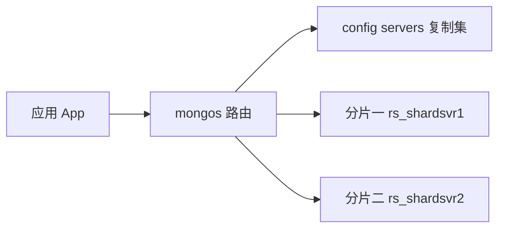
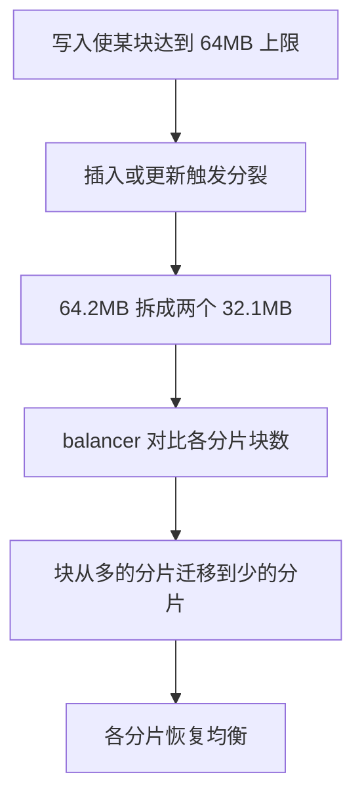

# MongoDB 分片集群入门：单机扛不住之后的水平扩展方案

MySQL 集群那几节里做数据库分片，动用的是 MyCat 这个外挂中间件，路由规则、分片算法都要自己配。MongoDB 把这套东西做进了内核：告诉它哪个库、哪个集合要分片，路由、分裂、迁移、均衡全部自动完成。这一课把分片集群从动机讲到架构与数据分布，再用 Docker 把一个最小集群搭起来。

## 先给结论

- 分片（Sharding）解决单机的两个天花板：存储容量与读写吞吐。数据按分片键拆到多个分片，请求压力同步摊开。
- 集群由三类角色组成：config server 存元数据（默认 3 个组复制集）、mongos 做统一入口路由（自身不持久化数据）、shard 存数据（至少 2 个，生产环境每个分片配成复制集）。
- 与 MyCat 这类外挂中间件最大的区别：分片是 MongoDB 的内置能力，声明分片规则即可，其余自动。
- 数据以 chunk（默认 64MB）为单位管理：超限自动分裂，分片间由 balancer 自动迁移保持均衡。
- 搭建顺序固定：config server 复制集，再两个 shard 复制集，最后起 mongos 并 `sh.addShard`。

## 一、为什么分片：垂直扩展到头之后

数据量与吞吐量对数据库服务器的压力，最终都会落到磁盘 IO 上。单机方案下，大量查询吃 CPU，海量写入吃磁盘，怎么扩都有极限。解决这类问题的路子只有两条：

**垂直扩展**：增加更多 CPU、内存、磁盘，从硬件上解决。直接有效，但天花板明显，单机规格到头就无路可走，成本曲线也陡。

**水平扩展**：把数据分布到多台服务器上，用软件的方式扩展，这就是分片。1TB 的集合拆到 4 个分片，每个分片只存 256GB；拆到 40 个分片，每个分片只有 25GB。请求也是同样的除法：请求数除以分片数，分片越多，每个分片分到的请求越少。插入一条数据时，应用只需要访问存这条数据的那个分片，不必惊动整个集群。

MySQL 时代做分片要借 MyCat 这类中间件，MongoDB 把这件事内置了：只需要告诉它对哪个库、哪个 collection 分片，数据在不同服务器之间的平衡由它自己维护。这个分片思想来源于关系数据库的分区，但自动化程度完全是另一个量级。

## 二、三个优势：不可见、总可写、易扩展

**第一，对集群做了抽象，让集群不可见。** 客户端连接的不是某个数据节点，而是 mongos 这个专有路由进程。mongos 把请求准确路由到集群中的一台或一组服务器，再把响应拼装起来发回客户端。这个角色与 MyCat 的代理定位非常像：应用只认一个入口，后端拓扑怎么变与它无关。

**第二，保证集群总是可读写。** 真正存数据的每个分片，内部采用复制集来保障数据可靠性。分片集群建立在复制集的基础上，复制集的自动选主、故障转移能力被每个分片直接继承，这也是课程先讲复制集再讲分片的原因，学习顺序同理。

**第三，使集群易于扩展。** 系统需要更多空间与性能时，按需增加分片即可扩容。MongoDB 最擅长的是存海量数据，而海量数据的前提就是容量能持续扩。

## 三、架构：三类角色与一次请求的路径

| 组件 | 职责 |
|---|---|
| config server | 存储集群所有节点、分片数据路由信息（元数据），默认 3 个节点组复制集 |
| mongos | 对外提供访问入口，所有操作均通过它执行；一般部署多个；负责数据迁移与自动平衡 |
| mongod（shard） | 存储应用数据记录；多个 mongod 节点达到数据分片目的 |



这张图是分片集群的完整骨架：应用只连 mongos，mongos 与 config server、各分片通信。一次请求的完整路径是：应用连 mongos 发起操作；mongos 自己不存数据，启动时从 config server 加载元数据，据此知道每条数据在哪个分片；随后把请求分发到对应分片，拿到结果拼装返回。写入时按分片键的设计决定落点，比如按某个键的哈希值确定数据存到哪个分片；查询时按数据分布计算目标，直接去对应分片取数，而不是全集群广播。分片至少要两个，只有一个数据服务谈不上分片；每个分片可以是复制集，也可以是单节点实例。

## 四、数据怎么分布：分片键、chunk、分裂与迁移

**分片键（shard key）决定一条数据的归属。** 常见两种策略：范围分片（range）按键的区间切，范围查询友好，但写入容易集中在最新区间形成热点；哈希分片（hash）按键的哈希值散列，分布均匀，代价是范围查询要扫多个分片。策略取舍是通用原理，本课实操用的是最常用的哈希方式，对集合的 `_id` 做哈希。

**chunk 是分片内部组织数据的块单元。** 每个分片服务器的数据不是一整块，而是切成多个 chunk 存储，默认大小 64MB（chunk size）。chunk 的存在有两个用途：

**分裂（split）。** 数据不断写入，某个 chunk 超过 64MB 上限时，MongoDB 自动把它切成更小的块，比如 64.2MB 拆成两个 32.1MB。块太大，读写都费劲，分裂是避免单块过大的机制。注意分裂只在插入和更新数据时触发，读取不会。

**迁移（balance）。** 分裂持续发生，各分片的 chunk 数量会失衡，比如 A、B 各有 3 个块而 C 只有 1 个。后台的 balancer 进程负责把块从多的分片迁移到少的分片，让每个分片上的块数基本持平。



**chunk size 只分裂、不合并。** 把 chunk size 调大，现有块的数量不会减少，只是随写入增长慢慢逼近新上限；调小则分裂和迁移明显变频繁，数据分布更均匀，但消耗更多服务器资源。设置过大，分裂少了，每次迁移要搬的数据量却更大，IO 压力更高。分裂与迁移都非常消耗 IO 资源，没有特殊需求就保持默认的 64MB，要改必须连同它带来的分裂迁移行为一起评估。

## 五、用 Docker 搭一个最小分片集群

课程用单机 Docker 模拟完整拓扑：3 个 config 节点、两个分片各 3 个数据节点、1 个 mongos，共 10 个容器。先把之前在跑的复制集容器 mongo01 到 mongo04 停掉，腾出资源。

**第一步，创建三个 config server。** `--configsvr` 参数让 mongod 默认监听 27019，所以宿主机端口 17000 到 17002 映射到容器内的 27019，数据挂载到 `/data/configdb`：

```bash
docker create --name configsrvr01 -p 17000:27019 -v mongoconfigsvr-data-01:/data/configdb mongo:4.0.3 --configsvr --replSet "rs_configsvr" --bind_ip_all
docker create --name configsrvr02 -p 17001:27019 -v mongoconfigsvr-data-02:/data/configdb mongo:4.0.3 --configsvr --replSet "rs_configsvr" --bind_ip_all
docker create --name configsrvr03 -p 17002:27019 -v mongoconfigsvr-data-03:/data/configdb mongo:4.0.3 --configsvr --replSet "rs_configsvr" --bind_ip_all
docker start configsrvr01 configsrvr02 configsrvr03
```

进入任一容器连接后初始化，配置里比普通复制集多一个 `configsvr: true`，声明这个复制集的身份是配置服务器：

```javascript
rs.initiate({
  "_id": "rs_configsvr",
  "configsvr": true,
  "members": [
    { "_id": 0, "host": "172.16.55.185:17000" },
    { "_id": 1, "host": "172.16.55.185:17001" },
    { "_id": 2, "host": "172.16.55.185:17002" }
  ]
})
```

执行返回 `ok : 1`，用 `rs.status()` 确认 17000 当选 PRIMARY，另外两个是 SECONDARY，config server 集群就绪。

**第二步，创建两个分片复制集。** 每个分片 3 个数据节点，`--shardsvr` 参数让 mongod 默认监听 27018，宿主机端口 37000 到 37005。分片一用 `rs_shardsvr1`，分片二用 `rs_shardsvr2`：

```bash
docker create --name shardsvr01 -p 37000:27018 -v mongoshardsvr-data-01:/data/db mongo:4.0.3 --replSet "rs_shardsvr1" --bind_ip_all --shardsvr
docker create --name shardsvr02 -p 37001:27018 -v mongoshardsvr-data-02:/data/db mongo:4.0.3 --replSet "rs_shardsvr1" --bind_ip_all --shardsvr
docker create --name shardsvr03 -p 37002:27018 -v mongoshardsvr-data-03:/data/db mongo:4.0.3 --replSet "rs_shardsvr1" --bind_ip_all --shardsvr
docker create --name shardsvr04 -p 37003:27018 -v mongoshardsvr-data-04:/data/db mongo:4.0.3 --replSet "rs_shardsvr2" --bind_ip_all --shardsvr
docker create --name shardsvr05 -p 37004:27018 -v mongoshardsvr-data-05:/data/db mongo:4.0.3 --replSet "rs_shardsvr2" --bind_ip_all --shardsvr
docker create --name shardsvr06 -p 37005:27018 -v mongoshardsvr-data-06:/data/db mongo:4.0.3 --replSet "rs_shardsvr2" --bind_ip_all --shardsvr
```

连同前面的 config server，此时共 9 个容器。启动后分别初始化两个复制集，这一步与普通复制集初始化完全一样，没有额外参数。分片一写法如下，分片二把 `_id` 换成 `rs_shardsvr2`、members 换成 37003 到 37005 即可：

```javascript
rs.initiate({
  "_id": "rs_shardsvr1",
  "members": [
    { "_id": 0, "host": "172.16.55.185:37000" },
    { "_id": 1, "host": "172.16.55.185:37001" },
    { "_id": 2, "host": "172.16.55.185:37002" }
  ]
})
```

**第三步，创建 mongos。** mongos 默认端口 27017，宿主机用 6666 映射。创建容器时通过 `--entrypoint mongos` 指定入口程序，再用 `--configdb` 告诉它 config server 的复制集名与三个节点地址，最后照常绑定 IP：

```bash
docker create --name mongos -p 6666:27017 --entrypoint mongos mongo:4.0.3 --configdb "rs_configsvr/172.16.55.185:17000,172.16.55.185:17001,172.16.55.185:17002" --bind_ip_all
docker start mongos
```

**第四步，把两个分片注册进 mongos。** 连接 6666 端口后，用 `sh.addShard` 分别登记两个分片，复制集名在前、成员地址在后：

```javascript
sh.addShard("rs_shardsvr1/172.16.55.185:37000,172.16.55.185:37001,172.16.55.185:37002")
sh.addShard("rs_shardsvr2/172.16.55.185:37003,172.16.55.185:37004,172.16.55.185:37005")
```

两条命令都返回 `{ "ok" : 1 }`，集群骨架就搭完了。此时 mongos 已经指向 config server、挂上了两个分片，但数据库与集合还没开启分片，怎么启用、怎么验证数据真的摊开了，放在下一篇展开。

## 常见误区

- **把分片集群当高可用方案。** 数据冗余由每个分片内部的复制集保障；分片解决的是容量与吞吐，单节点分片坏一台就丢数据。
- **以为 mongos 存数据。** mongos 只做路由，自身不持久化；用户数据在 shard 上，集群元数据在 config server 上。
- **搭一个分片就想看效果。** 分片至少要两个，只有一个 mongod 节点谈不上分片，数据没有可去之处。
- **随手改 chunk size。** 调大不会合并历史块，调小会让分裂迁移激增，默认 64MB 是稳妥值。
- **端口一律写 27017。** `--configsvr` 让 mongod 默认监听 27019，`--shardsvr` 让它监听 27018，端口映射按容器内实际端口写，照抄 27017 会连不上。

## 面试可能被问到的问题

1. 面试官追问：「分片集群由哪几部分组成，各自职责？」
   答：config server 存集群元数据，即节点与分片路由信息，默认 3 个组复制集；mongos 是统一入口路由，所有操作经它执行，自身不存数据，负责请求分发与数据平衡；shard 存用户数据，至少两个，生产上每个分片用复制集保证可靠性。
2. 面试官追问：「mongos 挂了集群怎么办？」
   答：mongos 无状态，元数据从 config server 加载，可以部署多个；应用侧换一个 mongos 地址即可，不涉及数据丢失，一般前置负载均衡对外暴露。
3. 面试官追问：「range 分片和 hash 分片怎么选？」
   答：range 按键区间切分，范围查询只命中相关分片，但写入可能集中在某一区间形成热点；hash 按哈希值散列，分布均匀、写入摊得开，范围查询要扫多个分片。点查多、写入重选 hash，范围查询多选 range 或组合键。
4. 面试官追问：「chunk 是什么，什么时候分裂和迁移？」
   答：chunk 是分片内组织数据的块，默认 64MB。插入或更新导致块超限时自动分裂，读取不触发；分片间块数失衡时由 balancer 后台迁移。chunk 只分裂不会合并，改 chunk size 前要评估这些影响。
5. 面试官追问：「MongoDB 分片和用 MyCat 分 MySQL 的区别？」
   答：MyCat 是外挂中间件，路由规则与分片算法要自己配置维护；MongoDB 把分片做进内核，声明数据库与集合的分片规则后，路由、chunk 分裂、迁移与均衡全部自动完成。

## 配套资料

- 本教学日无源码包：`materials/code/03/day19-MongoDB集群以及日志、异常规范/` 下仅有解压清单 `_extracted.json`，解压文件数为 0；分片定义、组件职责表、架构图与全部 `docker create`、`rs.initiate`、`sh.addShard` 命令抄录自本课画面线（讲义 2.1 简介、2.2 优势、2.3 架构、2.4 集群中数据分布各节与搭建步骤文档），mongos 的 `--entrypoint` 与 `--configdb` 写法按声音线讲解整理。
- range 与 hash 两种分片策略的取舍对比为通用原理补充，本课实操采用 `_id` 哈希分片；1TB 拆 4 个分片各 256GB 的算例来自本课画面线原文。
- 对照阅读：MyCat 分 MySQL 的思路见 `0267-1.MyCat中间件之实现数据分片.md`；复制集基础见本阶段 `0306-MongoDB复制集之简介.md` 起的系列；分片集群的使用与数据验证见 `0313-MongoDB分片集群之集群使用以及操作.md`。
