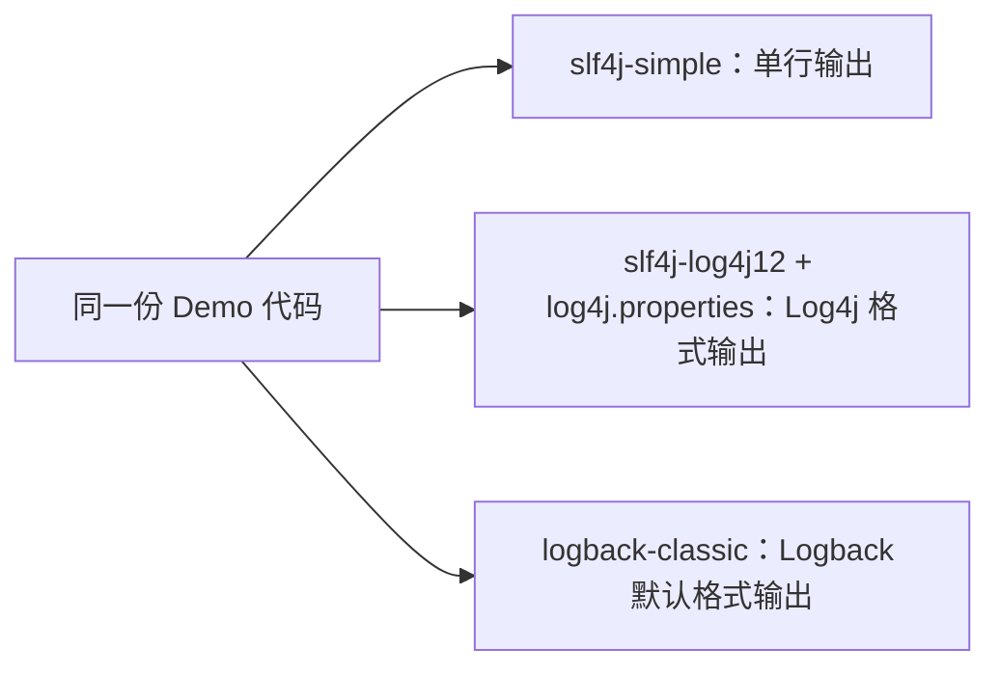

# SLF4J 绑定 Log4j 与 Logback：一个配置文件引发的排障

JUL 和 Simple 是轻量演示，生产里更常见的是 Log4j 与 Logback。换成这两个实现时，会遇到本节最有价值的坑：依赖导入正确、代码一字不改，日志却一条都不打，因为 Log4j 还缺一个配置文件。

## 先给结论

- 绑定 Log4j 用 `slf4j-log4j12`（1.7.26），它把 SLF4J 调用桥接到 Log4j 1.2.x。
- 绑定 Logback 用 `logback-classic` 加 `logback-core`（1.1.9），Logback 不需要任何 SLF4J 适配包，`logback-classic` 本身就是 SLF4J API 的原生实现。
- Log4j 没有 `log4j.properties` 会拒绝输出，只在控制台留一条 No appenders 警告，配置文件必须放在 `src/main/resources` 下。
- Demo 代码全程零修改，换框架只换依赖，这正是门面模式要兑现的承诺。
- 两者之间，新项目更推荐 Logback：与 SLF4J 同作者、原生衔接、配置能力更强。

## 一、绑定 Log4j：先撞一次静默失败

沿用前一节的 Demo 代码，注释掉 Simple 绑定，换成 Log4j 适配包：

```xml
<dependency>
    <groupId>org.slf4j</groupId>
    <artifactId>slf4j-log4j12</artifactId>
    <version>1.7.26</version>
</dependency>
```

刷新 Maven，直接运行，期待中的日志没有出现，控制台只有 Log4j 自己的警告：

```text
log4j:WARN No appenders could be found for logger (com.example.log.Demo).
log4j:WARN Please initialize the log4j system properly.
```

原因不在绑定，而在 Log4j 自身：它是一个完整框架，输出位置、输出格式全靠配置文件决定，没有配置就没有任何 appender，日志只能被丢弃。SLF4J 已经把调用桥接过去了，Log4j 收到请求却无处可写。

课堂仍然选择 Log4j 1.2.x，是因为大量存量系统与老教程都在用它，接手旧项目时绕不开；而且理解了它「配置文件决定一切」的模型，再去读 Logback 的 XML 配置时几乎是平移过去的。

## 二、log4j.properties：没有它 Log4j 不干活

在 `src/main/resources` 下新建 `log4j.properties`（注意文件名一个字母都不能错）：

```properties
log4j.rootLogger=DEBUG,A1
log4j.appender.A1=org.apache.log4j.ConsoleAppender
log4j.appender.A1.layout=org.apache.log4j.PatternLayout
log4j.appender.A1.layout.ConversionPattern=%d{yyyy-MM-dd HH:mm:ss,SSS} [%t] [%c] - %p %m%n
```

逐行拆开看：

**第一行 `log4j.rootLogger=DEBUG,A1`。** 根 Logger 的级别设为 DEBUG，给它挂一个名叫 A1 的 appender，名字可以自取，后面几行都在配置这个 A1。

**第二行 `log4j.appender.A1=org.apache.log4j.ConsoleAppender`。** A1 是控制台 appender，日志打到控制台；换成 `RollingFileAppender` 就是写文件加滚动。

**第三行与第四行。** 布局用 `PatternLayout`，输出格式由 `ConversionPattern` 定义：`%d` 是时间（大括号里是格式模板），`%t` 是线程名，`%c` 是 Logger 名（通常是类全名），`%p` 是级别，`%m` 是日志内容，`%n` 是换行符。

配置就位后再运行，日志按定义的格式完整输出，Log4j 绑定成功。

顺带把级别的语义补齐：DEBUG 是这里最宽松的常用级别，低于它的 trace 也会被放过，实际项目里根 Logger 一般收紧到 INFO，把 DEBUG 留给开发环境单独打开；级别同时决定了所有 appender 的输出门槛，改一处 `log4j.rootLogger` 的第一个值，全工程日志的详略立刻变化，不需要逐个文件调整。

## 三、绑定 Logback：连配置文件都可以先不写

注释掉 `slf4j-log4j12`，这次导入的依赖不是 SLF4J 提供的适配包，而是 Logback 自己的依赖：

```xml
<dependency>
    <groupId>ch.qos.logback</groupId>
    <artifactId>logback-core</artifactId>
    <version>1.1.9</version>
</dependency>
<dependency>
    <groupId>ch.qos.logback</groupId>
    <artifactId>logback-classic</artifactId>
    <version>1.1.9</version>
</dependency>
```

直接运行，Demo 代码依旧一字未改，日志立刻输出。对比 Log4j 的曲折，Logback 有两个得天独厚的地方：

**第一，不需要适配包。** `logback-classic` 内部就包含 `org.slf4j.impl.StaticLoggerBinder`，它本身就是按 SLF4J API 实现的，SLF4J 与 Logback 同出 Ceki Gülcü 之手，门面与实现的衔接零缝隙。

**第二，没有配置文件也有默认输出。** `logback.xml` 缺席时 Logback 使用内置的默认配置（DEBUG 级别输出到控制台），不会像 Log4j 那样静默失败。

两个依赖的分工要分清：`logback-core` 提供基础设施，`logback-classic` 在其上实现 SLF4J API 并对外暴露 Logger，两者版本必须保持一致。实际使用时会在 resources 下补一个 `logback.xml`，结构与 `log4j.properties` 一一对应：appender 节点对应输出器，pattern 属性对应 `ConversionPattern`，root 节点对应 rootLogger，从 Log4j 迁移过来的配置经验可以直接复用。

三次绑定切换的路径放在一起看：



三次切换改动只有 pom 和一个 properties 文件，业务代码从头到尾没动过。开发手册把「必须使用 SLF4J API」写成强制条款的底气，就来自这张图：实现随时可换，代码永远稳定。

对比三次绑定的依赖构成还能看出一个差异：JUL 与 Log4j 都需要适配包做桥接，Logback 省掉了这一层，依赖链少一个环节，出问题时排查范围也小一圈；加上它从设计之初就按 SLF4J 的接口实现，配置能力也更完善，新工程把它作为默认选择是合理的。

## 常见误区

- **忘写 `log4j.properties` 或文件放错位置。** 文件必须在 `src/main/resources` 下，放错目录等于没有，控制台只有 No appenders 警告，日志全部丢失。
- **只引 `logback-core` 不引 `logback-classic`。** core 只是基础设施，SLF4J 的绑定接口与 Logger 实现全在 classic 里，少一个就绑定失败。
- **把 `slf4j-log4j12` 里的 12 当版本号。** 它指的是适配 Log4j 1.2.x 系列，不是某个 12 版的适配包。
- **换框架时旧绑定包忘记注释。** 新旧绑定共存触发 multiple bindings 警告，实际用哪个不确定，切一次绑定就注释掉上一次的依赖。

## 面试可能被问到的问题

1. 面试官追问：「Logback 为什么不需要像 slf4j-log4j12 那样的适配包？」
   答：logback-classic 直接实现了 SLF4J 的 API，内部自带 org.slf4j.impl.StaticLoggerBinder，SLF4J 能原生绑定它，不需要额外的桥接层。
2. 面试官追问：「Log4j 依赖都配好了，日志却一条不打，怎么排查？」
   答：优先查 log4j.properties 是否存在、是否在 resources 目录下、文件名是否拼写正确，控制台会出现 No appenders could be found 的警告，补上配置即可恢复。
3. 面试官追问：「slf4j-log4j12 中的 12 是什么含义？」
   答：代表它适配的是 Log4j 1.2.x 系列。Log4j2 则有独立的 log4j-slf4j-impl 桥接包，两套体系不要混用。
4. 面试官追问：「Log4j 和 Logback 怎么选？」
   答：新项目选 Logback。它与 SLF4J 同作者、原生实现衔接最稳，功能上支持异步 appender、条件配置等能力，Spring Boot 默认日志实现也是它；Log4j 1.x 已停止维护。
5. 面试官追问：「log4j.properties 里 rootLogger 的 DEBUG,A1 分别指什么？」
   答：DEBUG 是根 Logger 的输出级别，A1 是给根 Logger 挂的 appender 名称，后续几行通过这个名称定义 appender 的类型与输出格式。

## 配套资料

- 本教学日无源码包：`materials/code/03/day19-MongoDB集群以及日志、异常规范/` 下仅有解压清单 `_extracted.json`，解压文件数为 0；`slf4j-log4j12` 与 `logback-core`、`logback-classic` 依赖，`log4j.properties` 全部配置项以及 Demo 类抄录自本课画面线（讲义 3.3.5 与 Log4j 整合、3.3.6 与 Logback 整合两节），包名统一改为中性的 `com.example.log`。
- No appenders 警告文本与运行输出为按 Log4j 默认行为整理的示例。
- JUL 与 Simple 的绑定见 `0316-日志规范之slf4j整合JDK14以及Simple的使用.md`；手册强制条款的逐条展开见下一篇。
