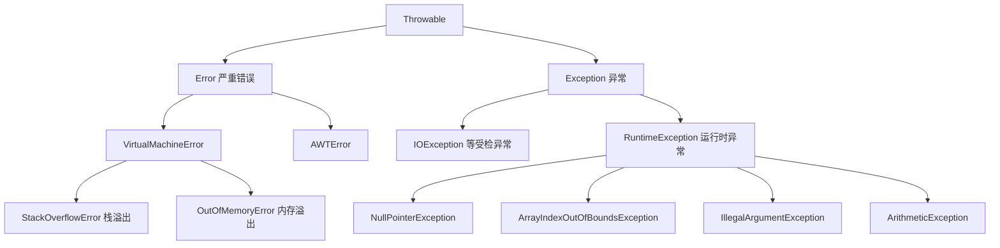
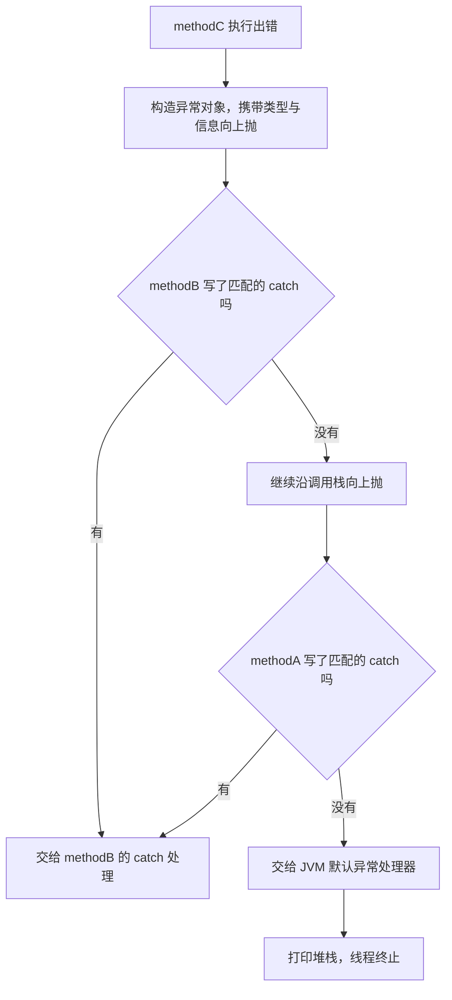

# 异常是什么、归谁管：Throwable 体系、受检与非受检、抛出与捕获

写业务代码时最常见的两种现场：编译器红线死活不让过，提示「未处理异常 IOException」；或者程序跑着跑着一行红字砸出来，`NullPointerException` 直接把整条请求打断。前者是受检异常在编译期拦人，后者是非受检异常在运行期发难，两类行为差异的根源都挂在 `Throwable` 这棵继承树上。day19 的异常规范部分从这里开讲：先把概念地基打牢，后面 Java 开发手册（公开版）里的 13 条规约才有落点。

## 先给结论

- 异常是发生在程序执行过程中、阻碍程序正常执行的错误事件。程序出错分语法错误、运行时错误、逻辑错误三种，异常机制要处理的是运行时错误。
- 异常体系的根是 `Throwable`，向下分 `Error` 与 `Exception` 两支：`Error` 是 JVM 层面的严重错误，程序不捕获、不处理；`Exception` 才是编码时面对的对象。
- `Exception` 内部再分两派：`RuntimeException` 及其子类是非受检异常，编译器不强制处理；`IOException`、`ClassNotFoundException` 这类是受检异常，不 catch 也不 throws 就编译不过。
- 处理异常的两条路：抛出是把异常类型与异常信息向上传递，由运行时系统沿调用栈寻找处理代码；捕获是写好匹配的 catch 块就地处理。
- 空指针、数组越界这类运行时异常，正道是写代码时预检查规避，而不是靠 catch 兜底，这条预告就是 Java 开发手册（公开版）规约的第一条。

## 一、程序出错的三种情况，异常机制只管一种

**语法错误。** 代码格式或拼写写错，编译阶段就过不去，`System.out.prontln` 打错一个字母，根本轮不到运行。

**运行时错误。** 编译没有问题，在特定输入或环境下运行才会出错。空指针、数组越界、除数为零都是典型：

```java
// 编译能通过、运行才出问题的典型现场（示例按本课写法补全）
int[] arr = new int[3];
System.out.println(arr[3]);         // ArrayIndexOutOfBoundsException：下标越界

String name = null;
System.out.println(name.length());  // NullPointerException：空指针

int divisor = 0;
System.out.println(10 / divisor);   // ArithmeticException：除数为零
```

**逻辑错误。** 程序正常跑完，结果却与预期不一致，比如折扣算错、金额对不上。它不抛任何异常，是最难调试的一类，只能回头修改编码逻辑。

三种情况里，异常机制处理的是运行时错误：把「这段代码可能出问题」显式建模成异常对象，让错误可以被抛出、传递、捕获，而不是让进程无声无息地崩掉。

## 二、Throwable 家族：Error 与 Exception 分家

Java 把一切可抛出的对象收拢在 `Throwable` 根类之下，第一层就分成两个方向：



这张图是异常体系的完整家谱：上半段 `Error` 一支，`VirtualMachineError` 下挂的 `StackOverflowError` 与 `OutOfMemoryError` 是 JVM 已经无法正常运转的信号；下半段 `Exception` 才是日常要面对的，`IOException`、`EOFException`、`FileNotFoundException` 与 `ClassNotFoundException` 代表编译期就要求处理的受检异常，`RuntimeException` 代表运行期才暴露的非受检异常。

**Error 这一支不写处理代码。** 内存溢出抛出时内存已经耗尽，栈溢出抛出时调用栈已经满，catch 住也没有恢复手段，交给 JVM 终止进程反而干净。

**Exception 才分受检与非受检，划分依据是编译器管不管。** 摆在一起看：

| 对比项 | 受检异常 checked | 非受检异常 unchecked |
|---|---|---|
| 代表类 | `IOException`、`ClassNotFoundException`、`SQLException` | `RuntimeException` 及其子类 |
| 典型场景 | 文件读写失败、类加载失败等外部条件问题 | 空指针、数组越界、除零、非法参数 |
| 编译器态度 | 强制处理，不写 catch 或 throws 直接报错 | 不强制，运行期才暴露 |
| 应对思路 | 捕获或声明，给调用方明确预期 | 预检查、改代码规避 |

受检异常多与外部条件有关：程序无法保证文件一定存在、网络一定可达，编译器逼着你在编译期就把失败路径写清楚。非受检异常多数源自编码缺陷，最好的处理方式是让它根本不发生。

## 三、抛出与捕获：异常的两条处理路径

**抛出。** 方法内部发生异常且不在本方法处理，就把异常向上抛，抛出的内容包括异常类型与异常信息。运行时系统负责寻找处理异常的代码并执行，而这个「寻找」由 JVM 沿调用栈逐层回溯完成。

**捕获。** 方法抛出异常后，运行时系统转而寻找合适的异常处理器（exception handler），也就是类型匹配的 catch 块，找到就交给它处理。



关键路径在图中看得很清楚：异常对象从出错点出发一路向上，任何一层写了类型匹配的 catch 都能把它拦下；全程无人接手，最终由 JVM 兜底打印堆栈并终止线程。抛出与捕获是同一件事的两端：抛出方声明问题，捕获方解决问题。

## 四、try-catch-finally 的执行顺序

```java
// 执行顺序演示（示例按本课写法补全）
public static int divide() {
    try {
        int result = 10 / 0;               // 出错点，之后的代码被跳过
        return 1;                           // 永远执行不到
    } catch (ArithmeticException e) {
        System.out.println("catch 捕获除零异常");
        return 2;                           // 记下返回值，先去执行 finally
    } finally {
        System.out.println("finally 必然执行");
    }
}
```

执行顺序是：try 中出错点之后的代码直接跳过，匹配到 catch 执行，catch 的 return 触发之前先执行 finally，方法才真正返回。即使 try 或 catch 里已经写了 return，finally 依旧执行，它只在两种情况下缺席：`System.exit` 直接退出，或者 JVM 本身崩溃。这套顺序正是后面「finally 里关资源、不写 return」两条规约的执行模型基础。

## 常见误区

- **用 catch 兜运行时异常。** 反例 `try { obj.method() } catch (NullPointerException e) {...}`，空指针应该用 `if (obj != null)` 预检查规避；catch 只留给无法预检查的场景，例如解析外部传来的数字字符串时捕获 `NumberFormatException`。
- **连 Error 也想 try 一下。** `OutOfMemoryError` 抛出时内存已经耗尽，catch 块里再造对象只会雪上加霜，Error 不在处理范围内。
- **把语法错误当异常。** 编译不过的代码不存在运行，异常机制与此无关，该改代码而不是加 try。
- **指望 try-catch 拦住逻辑错误。** 结果算错不会抛异常，包再多层 try 也拦不住，只能修逻辑。

## 面试可能被问到的问题

1. 面试官追问：「Error 和 Exception 有什么区别？」
   答：两者都继承 `Throwable`。`Error` 是 JVM 层面的严重错误，如 `StackOverflowError`、`OutOfMemoryError`，程序无法也不应该处理；`Exception` 是程序可以捕获处理的异常，是编码时要面对的对象。
2. 面试官追问：「受检异常和非受检异常怎么划分？」
   答：`RuntimeException` 及其子类是非受检异常，编译器不强制处理，多为编程缺陷，应通过预检查规避；`IOException`、`ClassNotFoundException` 等是受检异常，编译期强制要求 catch 或用 throws 声明。
3. 面试官追问：「异常抛出后，JVM 是怎么处理的？」
   答：出错点构造异常对象，沿调用栈逐层向上传递，运行时系统在每一层寻找类型匹配的异常处理器；找到则交给对应 catch 执行，一路无人处理就交给 JVM 默认处理器，打印堆栈并终止线程。
4. 面试官追问：「finally 块一定会执行吗？」
   答：除 `System.exit` 直接退出和 JVM 崩溃两种情况外都会执行，即使 try 或 catch 中已有 return；catch 的 return 会先记下返回值，执行完 finally 再真正返回。
5. 面试官追问：「空指针异常应该怎么防？」
   答：空指针属于可预检查规避的运行时异常，调用对象前先做 null 判断；解析外部数字字符串这类无法预检查的场景，才用 catch `NumberFormatException` 兜底。

## 配套资料

- 本教学日无源码包：`materials/code/03/day19-MongoDB集群以及日志、异常规范/` 下仅有解压清单 `_extracted.json`，解压文件数为 0；异常分类树与手册第一条预览抄录自本课画面线（讲义 4.1 异常概念一节），全部代码示例为按本课写法补全。
- 概念收束后，手册异常规约 13 条细则在下一篇展开。
