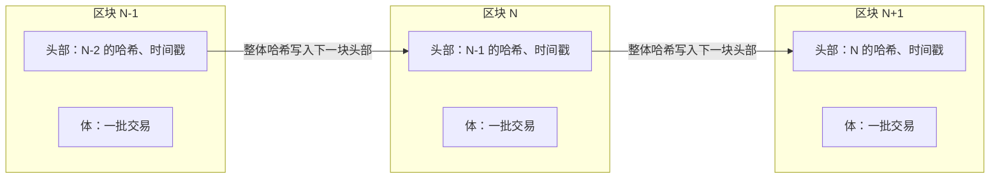

# 什么是区块链：四项老技术拼出的分布式超级账本

聊技术的时候，区块链三个字人人会说，再追问一句「到底什么是区块链」，对话往往就停在「去中心化」四个字上。这个概念之所以难答，是因为它不是一项单独的技术，而是一组成熟技术按新方式组合出的应用模式。把定义、区块加链的结构、改动规则与监管背景拆开讲清楚，之后无论谁问起，都能给出一段有层次的话。

## 先给结论

- 区块链是一种计算机技术的新型应用模式：在现有计算机技术基础上，把分布式数据存储、点对点传输、共识机制、加密算法组合到一起使用。
- 英文 Blockchain 就是 Block 加 Chain：交易数据打包成区块，每个区块记录前一区块的哈希，像链条一样一环扣一环。
- 本质是一个去中心化的数据库，也可以理解成分布式超级账本：大量节点各持一本相同的账，改任何一本都必须获得其他节点认可。
- 区块链因比特币走红而被大众知晓，但比特币白皮书里并没有 Blockchain 一词，用的是 chain of blocks，「区块链」是中文翻译造就的词。
- 国家网信办 2019 年 1 月 10 日发布《区块链信息服务管理规定》，同年 2 月 15 日施行，技术学习与工程落地都要在这一框架内。

## 一、定义拆开看：不是新技术，是老技术的新组合

一句话定义：区块链是计算机技术的一种新型应用模式。落点在「应用模式」，它没有凭空发明全新的存储或传输技术，而是把四项早已存在的技术按一种新方式组织起来：

| 组件 | 一句话解释 | 回答的问题 |
|---|---|---|
| 分布式数据存储 | 数据不只放在一台服务器上 | 单点损坏就失联 |
| 点对点传输 P2P | 端点到端点直接传输数据 | 请求全部挤向中心 |
| 共识机制 | 多数节点认可后才生效 | 谁说了算 |
| 加密算法 | 密码学保证数据完整与归属 | 数据被偷改怎么办 |

四个组件组合起来，得到一个没有单一权威、人人可验证的数据系统。每一项单拎出来都不算新，组合方式才是新意所在。这也解释了为什么理解区块链不需要先学某种新语言，需要的是把旧知识按新结构摆一遍。

## 二、Block 与 Chain：区块怎么串成链

Block 是数据块，Chain 是链。在比特币的世界里，区块链是底层技术：一串使用密码学方法生成的数据块，每个数据块里打包了一批比特币交易信息，用来验证交易的有效性，并继续生成下一个区块。

串联的机关在一个字段：每个区块头都写入前一个区块的哈希值。这张图展示的就是区块内部结构与链条走向：



关键路径在这里：想改区块 N 里的一笔交易，区块 N 的哈希就会变化，区块 N+1 头部记录的前块哈希对不上，链条在这一环断开。要掩盖这次修改，就得把 N 之后的所有区块全部重算并重新获得认可，成本随链长不断放大。这就是「不可篡改」的结构性来源，不是靠道德，是靠结构。

## 三、人人一本账：为什么谁也改不动

把区块链想象成一个分布式超级账本。账本上记录账户数据，很多节点上都有一本，规则只有一条硬约束：任何节点都不能擅自修改数据，必须获得其他节点的认可，修改才成立。以前数据由中央机构或中央数据库统一管理，现在不需要这个中央角色，每个端点都能参与管理，这就是去中心化数据库。

day20 资料包没有源码，下面按主流写法补全一份区块结构与链校验示例（示例，可直接运行）：

```json
{
  "header": {
    "height": 105,
    "previous_hash": "0000a1b2c3d4e5f60000a1b2c3d4e5f60000a1b2c3d4e5f6",
    "timestamp": 1547321000,
    "nonce": 382165
  },
  "body": {
    "transactions": [
      { "from": "甲", "to": "乙", "amount": 0.5 }
    ]
  }
}
```

```python
# 示例：把前一块的头部重新做一次哈希，验证下一块头部里的 previous_hash 是否对得上
import hashlib, json

def block_hash(block: dict) -> str:
    header = json.dumps(block["header"], sort_keys=True, ensure_ascii=False)
    return hashlib.sha256(header.encode()).hexdigest()

def verify_link(prev: dict, cur: dict) -> bool:
    return cur["header"]["previous_hash"] == block_hash(prev)

# previous_hash 对不上，说明前块数据被改过，或者本块是伪造的
```

`previous_hash` 是整条链的信任锚点。任何一个节点的账本对不上这个字段，问题就立刻暴露；全网节点都验一遍，伪造的链条没有任何藏身之处。

## 四、词源与监管：chain of blocks 和 2019 年的管理规定

两个看起来像花边的知识点，在面试与合规场景里都会被问到。

**第一，词源。** 比特币白皮书原文是英文，通篇没有出现 Blockchain 这个词，用的是 chain of blocks，区块组成的链。「区块链」三个字是中文翻译时产生的，这解释了为什么两类表述在资料里常被混用，也说明这个概念从诞生起就是「区块加链」的结构直觉，而不是一个封闭的商业名词。

**第二，监管。** 国家互联网信息办公室 2019 年 1 月 10 日发布《区块链信息服务管理规定》，自 2019 年 2 月 15 日起施行。国家专门为这项技术出台管理规定，说明它已经进入正式的管理视野，学习技术、设计落地方案都要先确认合规边界。

顺带把「区块链因什么而火」交代清楚：比特币早期用普通计算机反复计算，就能算出体系里一个全球唯一的哈希字符串，俗称挖矿，几乎没有成本；后来币价一路走高，录制课程时一枚比特币约合三万元人民币，关注的人迅速变多，作为底层技术的区块链跟着走进大众视野。

## 常见误区

- **把区块链等同于比特币。** 区块链是底层技术，比特币是它的第一个大规模应用；记账之外，存证、溯源等领域同样在用区块链。两者是技术与首个爆款应用的关系，不是一回事。
- **以为不可篡改等于数据绝对改不了。** 结构上改单块会断链、改账要多数认可，前提是多数节点诚实；如果有人控制了网络中的多数节点或算力，历史记录在理论上仍有被改写的风险。不可篡改是机制上的极难，不是物理上的不可能。
- **以为去中心化就是没有管理。** 去中心化去掉的是「唯一说了算的中心」，共识规则依然存在，而且比中心化更严格：改动必须获得多数节点认可才能生效。
- **把区块链当普通数据库用。** 它为可信牺牲了性能与存储效率，每个节点都要存全量账本；只有多方互不信任又需要共同记账的场景才值得上区块链，普通增删改查用 `MySQL` 这类数据库更合适。

## 面试可能被问到的问题

1. 面试官追问：「用几句话解释什么是区块链？」
   答：区块链是一种计算机技术的新型应用模式，把分布式数据存储、点对点传输、共识机制、加密算法组合到一起。形态上是一串用密码学方法生成、首尾相连的数据块，每个块打包一批交易信息并记录前一块的哈希。本质上是一个去中心化的数据库，也可以理解成多方共同维护的分布式超级账本，任何修改都要获得其他节点认可。
2. 面试官追问：「区块链为什么难以被篡改？」
   答：每个区块头写入前一个区块的哈希，修改历史区块会让该块哈希变化，后续区块记录的前块哈希对不上，链条断开。要掩盖修改必须重算其后所有区块并让多数节点接受，成本随链长与共识门槛放大，因此实践中被认定为极难篡改。
3. 面试官追问：「区块链和比特币是什么关系？」
   答：区块链是比特币的底层技术，比特币是区块链的第一个大规模应用。比特币白皮书里没有 Blockchain 这个词，用的是 chain of blocks，区块链是中文翻译产生的说法。比特币币价走高之后，这项底层技术才随之走红。
4. 面试官追问：「去中心化到底去掉了什么？」
   答：去掉的是唯一负责管理数据的中央机构或中央数据库，管理权分散到每个端点。规则没有去掉，共识机制仍在，数据修改需要多数节点认可，所以去中心化不是无管理，而是换了一种更分散的信任来源。
5. 面试官追问：「国内对区块链有什么监管要求？」
   答：国家互联网信息办公室 2019 年 1 月 10 日发布《区块链信息服务管理规定》，自 2019 年 2 月 15 日起施行，区块链信息服务纳入监管。做区块链相关的系统设计前，要先确认业务是否落在规定范围内。

## 配套资料

- 本教学日无源码包：`materials/code/03/day20-了解区块链以及Hyperledger fabric/` 下仅有解压清单 `_extracted.json`，解压文件数为 0；区块结构与哈希链接校验均为按主流写法补全的可运行示例。
- 区块链定义、四项技术组件、《区块链信息服务管理规定》的表述抄录自本课画面线（讲义 1.1 什么是区块链一节）。
- 同章节延伸：货币演进如何指向可信记账见 `0324-认识区块链之货币的发展.md`；分布式账本的完整推演见 `0325-认识区块链之什么是分布式账本.md`；中心化与去中心化的对比见 `0326-认识区块链之中心化和去中心化.md`。
