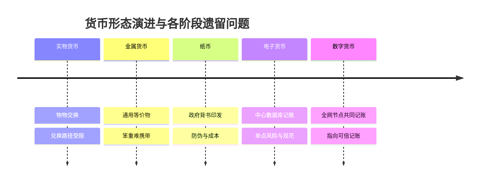

# 货币的发展：从物物交换到数字货币，每一步都在解决记账问题

区块链绕不开比特币，比特币是一种货币，所以要看懂区块链为什么长成那个样子，得先把货币的发展史走一遍。五代货币形态各有各的痛点，每一代都在修上一代的短板，又留下新的问题，整条演进线最后指向同一个方向：让记账变得可信。

## 先给结论

- 货币走过五个阶段：实物货币、金属货币、纸币、电子货币、数字货币，每一次形态更替都是对上一代缺陷的回应。
- 电子货币不是数字货币：支付宝、微信、银行卡里的钱是中心数据库里的一条记录，背后对应法币；数字货币以比特币为代表，本质是链上的一串记账数据。
- 电子货币留下三大隐患：中心化安全问题、交易验证问题、双花问题，每一个都和「中心」有关。
- 数字货币没有中心服务存储数据，每个节点存储相同的数据，靠共识对齐账本。
- 演进的落点：需要一个不依赖单一中心的可信记账方式，这正是区块链要解决的问题。

## 一、实物货币：物物交换的路径困境

最早的货币就是物品本身，交易靠两两交换。讲义里的例子是一圈商品：红珍珠换牛奶，牛奶换盐，盐换毛，毛换咖啡，咖啡换红珍珠。箭头连成一圈看着热闹，实际用起来立刻碰到问题：想拿红珍珠直接换盐，换不了，必须先红珍珠换牛奶，再牛奶换盐；咖啡想换盐，也得绕同样的大圈子。

缺陷一句话：交易成立要求双方恰好需要对方的东西，经济学里叫需求双重耦合，兑换路径被限得很死。这是人类最早期的货币形态，能成交，但效率低。

## 二、金属货币与纸币：等价物登场，防伪与成本跟着登场

金属货币把交换从「找路径」里解放出来。金银铜本身有价值，充当通用等价物。讲义图里，原来商品两两互连的箭头消失了，取而代之的是一个中心 M（Money），商品 A、B、C、D 全部与它相连：拿着金属货币可以买任何商品。这一步进化大幅提升了交换效率。

金属货币的问题出在物理属性上：笨重、携带非常不方便，路上还容易被劫匪强盗盯上。于是纸币出现：由政府背书、印发的货币，比如人民币由中国人民银行发行，政府承认即可通行。纸币与金属货币的作用一致，能购买各种商品、正常流通，重量问题解决了。

纸币的四个缺陷，讲义列得很清楚：

| 缺陷 | 具体表现 |
|---|---|
| 不便于携带 | 相对金属货币进步很大，但带一百万现金体积仍然巨大 |
| 不便于防伪 | 防伪技术在升级，伪造技术也跟着升级，假钞始终存在 |
| 不环保 | 纸张源自树木，印钞需要砍伐森林 |
| 制作成本高 | 讲义给出的量级：一张百元人民币的制造成本可能达四五十元 |

## 三、电子货币：旧问题全解，新问题三个

电子货币是纸币之上的升级：支付宝、微信、银行卡支付。超市买完东西，不用带纸质人民币，手机扫码完成付款。四项旧缺陷同时消失：携带方便，一部手机就够了；防伪问题不存在了，因为没有伪币一说；环保；制作成本低，因为每一次余额变动只是数据库里的一条记录。

新问题三个，每一个都长在「中心」上。

**第一，中心化安全问题。** 无论支付宝、微信还是银行卡，交易数据都发往各自的后台：支付宝的数据在阿里，微信的数据在腾讯，银行卡的数据在各银行。数据都由一个中心服务存储，中心一旦出问题，电子货币的数据直接紊乱。

**第二，交易验证问题。** 扫码之后我们只看「是否成功」，交易本身是否被伪造，验证依赖中心：中心说成功才算成功。验证权收在中心手里，本身就是安全隐患。

**第三，双花问题。** 同一份余额在同一时刻被花两次。拿一个付款码，在 A 超市买方便面，同时刻在 B 超市买火腿肠，两笔支付同时提交到中心服务，各自查询余额，都读到 100，都判断余额充足，两笔都成功，一笔钱买了两份货。

day20 资料包无源码，先补一份电子货币的余额表结构（示例，按本课写法补全），它的关键在于余额只是一行数据：

```sql
-- 示例：电子货币的本质，是中心数据库里的一行余额记录
CREATE TABLE account_balance (
  user_id    BIGINT        PRIMARY KEY,
  balance    DECIMAL(12,2) NOT NULL COMMENT '余额背后对应法币',
  updated_at DATETIME      NOT NULL
);

INSERT INTO account_balance (user_id, balance, updated_at) VALUES (1001, 100.00, NOW());
```

再用一段可运行的 Python 脚本复现双花的竞态（示例，按本课写法补全）：

```python
# 示例：双花问题的最小复现，两笔支付并发读到同一个余额
import threading, time

balance = 100  # 中心账本中该用户的余额，只有这一行记录

def pay(amount: int, result: list) -> None:
    global balance
    seen = balance           # 读取余额
    time.sleep(0.01)         # 模拟中心服务校验的网络耗时
    if seen >= amount:       # 两笔支付都基于旧的 seen 做判断
        balance = seen - amount
        result.append("支付成功")

results = []
threads = [threading.Thread(target=pay, args=(100, results)) for _ in range(2)]
for t in threads:
    t.start()
for t in threads:
    t.join()
print(results, balance)      # ['支付成功', '支付成功'] 0，一笔余额买了两份货
```

中心化系统当然不是放任双花，数据库事务、行锁、幂等校验都在防它，但要注意它们成立的前提：锁和事务都由那个可信的中心执行。中心可信，双花只是工程问题，加锁就能压住；中心本身不可信、可以单方面改数据时，这些手段全部失效，需要的就是另一种记账方式。

## 四、数字货币：把记账权交给每个节点

数字货币以比特币为代表，两个特征把它与电子货币划清界限。

**第一，去中心化。** 没有中心服务存储数据，每个节点存储一份数据，而且每个节点上的数据是一样的。账本对不对，不看某一家服务器，看全网节点的一致意见。

**第二，币本身就是一串记账数据。** 电子货币里支付宝的 100 元是充值换来的：向支付宝充 100 元，数据库里多出一条记录，这 100 元背后对应法币。数字货币不是记录，它本身就是链上那串数据，这一点是电子货币与数字货币的本质区别，很多人分不清：扫码支付用的不是数字货币，背后是银行账户与中心数据库。

国内央行的数字货币在课程录制的时期已开始试点运行，数字货币正在从概念走向法定货币形态，因为它解决了前面几代货币留下的很多问题。

五代形态放在一起，演进逻辑一目了然：



时间线里每一代的第三项就是它留给下一代的作业：路径问题被金属货币解决，笨重问题被纸币解决，防伪与成本被电子货币解决，单点风险与双花留给数字货币收尾。所谓可信记账，就是记账这件事不再依赖任何一家机构说了算，这正是区块链登场的位置。

## 常见误区

- **把电子货币当成数字货币。** 判断标准一句话：离开那个中心机构，这笔钱还在吗？支付宝余额随记录存在，机构没了记录就没了，它是法币的电子化记录；数字货币是链上数据本身，不依赖任何一家机构。
- **以为中心化系统不存在双花问题。** 事务与锁防的是并发事故，防不了中心自身作恶。双花在中心化环境里是工程问题，在去中心化环境里是信任问题，没有中心担保时必须靠共识机制解决。
- **以为数字货币就是央行数字货币。** 两者发行主体、记账方式、法律地位都不同：央行数字货币由央行发行，有法偿地位；比特币类数字货币由网络共识发行，没有中心发行方。
- **把制作成本高理解成纸张贵。** 制造成本包含防伪工艺与专用材料，百元纸币成本可达四五十元的量级，高成本本身也是防伪能力的一部分。

## 面试可能被问到的问题

1. 面试官追问：「电子货币和数字货币的本质区别是什么？」
   答：电子货币是法币在中心数据库里的电子化记录，比如支付宝余额只是表里的一行数据，由中心维护，背后对应银行账户与真实货币；数字货币以比特币为代表，币本身就是区块链账本上的一串记账数据，没有中心服务，每个节点各存一份相同的账本。
2. 面试官追问：「什么是双花问题，区块链怎么解决？」
   答：双花指同一份余额在同一时刻被消费两次。中心化系统靠事务与锁防它，前提是中心可信；去中心化网络没有可信中心，靠共识机制让多数节点认可同一笔交易，交易写入不可篡改的链后，同一笔钱的两笔花费只有一笔能获得多数认可。
3. 面试官追问：「货币演进各阶段分别解决了什么问题？」
   答：实物货币受限于需求双重耦合，金属货币用通用等价物解决兑换路径，纸币解决笨重问题但留下防伪与成本，电子货币解决携带、防伪、环保、成本却引入中心化安全、验证与双花问题，数字货币尝试用去中心化的共同记账收尾。
4. 面试官追问：「扫码支付用的是数字货币吗？」
   答：不是。支付宝、微信、银行卡支付都是电子货币，余额是中心数据库里的记录，背后是银行账户与法币。数字货币是链上数据本身；国内试点的央行数字货币由央行发行，与比特币类加密货币在发行机制上完全不同。
5. 面试官追问：「为什么讲区块链要先讲货币发展史？」
   答：区块链因比特币走入大众视野，比特币是一种货币形态。货币史每一步都在解决上一代的记账与信任痛点，走到电子货币时暴露出中心化风险与双花，这才引出「没有中心也能可信记账」的区块链方案。

## 配套资料

- 本教学日无源码包：`materials/code/03/day20-了解区块链以及Hyperledger fabric/` 下仅有解压清单 `_extracted.json`，解压文件数为 0；余额表结构与双花复现脚本均为按本课写法补全的可运行示例。
- 货币五阶段、纸币四缺陷、电子货币三缺陷、金属货币与纸币的中心 M 连接 A、B、C、D 的图示结构抄录自本课画面线（讲义 1.2 货币的发展一节）。
- 延伸阅读：区块链总定义见 `0323-认识区块链之什么是区块链_.md`；「可信记账」如何落地成分布式账本见 `0325-认识区块链之什么是分布式账本.md`。
