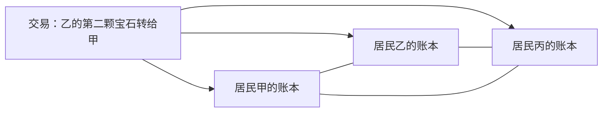

# 分布式账本：人人持有一本相同的账，改一本就露馅

分布式账本的定义背过很多遍，还是说不出它好在哪，这种困惑很常见。概念课的解法是从头推一遍：先有搬不动的货币，再有脑子里的账本，再有篡改与对账，最后才落到定义。走完这趟推演，共享、复制、同步三个词就不再是术语，而是三个具体动作。

## 先给结论

- 分布式账本（Distributed Ledger）是在网络成员之间共享、复制、同步的数据库，记录网络参与者之间的交易，比如资产或数据的交换。
- 每个节点都持有一份完整且相同的账本；一笔交易要在多数节点的账本上同步变更，归属才算成立。
- 单节点篡改账本会立即与多数节点不一致，多数一致即为对，篡改无法生效。
- 与中心记账对照：把账交给唯一中介省事，但中介会成为篡改、收费、宕机、隐私泄露的集合点。
- 与分布式数据库不同：分布式数据库追求分片与效率，数据各存一部分；分布式账本追求多方互信，每个节点存全量账本，写入没有唯一权威节点。

## 一、一颗两吨重的货币：故事从搬不动开始

假设一个小岛，岛上的居民把一种名贵的红色宝石当货币使用。这颗宝石大得离谱：长、宽、高都是三米，一间普通房子放不下；重量两千千克，整整两吨。课程给它起了个绰号叫「台币」，理由是抬不走。

货币太大，交易时总不能抬着走。居民想出一个办法：宝石原地不动，每个人记一本账，记录宝石的归属，谁名下有几颗，全部记下来。只要大家记的账一致，宝石归谁就有公认答案，交易不再受搬运能力限制。

## 二、交易怎么落账：动的是账，不是宝石

居民甲有一颗宝石，居民乙有两颗。乙把自己名下的第二颗转给甲，交易发生时宝石没有移动，移动的是账本：每个居民的账上都记下同一笔变更，甲变成两颗，乙变成一颗，变更同步到所有人的账本之后，这笔交易才真正成立。这笔变更落在账本上就是一条记录：

```json
{
  "tx_id": "tx-000123",
  "asset": "red_gemstone",
  "from": "居民乙",
  "to": "居民甲",
  "quantity": 1,
  "note": "乙名下第二颗宝石转移给甲"
}
```



这张图在讲账本之间的同步关系：三本账之间没有主从，两两相连、互相校验，任何一本都要与另外两本对得上。共享、复制、同步三个词对应的正是这三件事，账本对所有人开放，每本都是全量的副本，变更在副本间对齐。

## 三、改一本就露馅：篡改为什么无效

假设某个居民动了心思，把账上的归属改成了对自己有利的样子。其他人的账都没动，他这一本立刻成为孤本：所有人记的都是甲两颗、乙一颗、丙一颗，只有他不一致。裁决方式朴素而有效，多数一致即为对，多数派一眼就能定位是谁改了账。

**第一，篡改无法绕过多数。** 每个人记的账相同，只有一个人改，改动必然与多数不一致；要让改动成立，得让多数人都改，这就不再是偷偷改账，而是公开的合谋，成本与难度完全不是一个量级。

**第二，宝石丢了账不用改。** 设想一场海啸把其中一颗宝石卷进海底，打捞无望，岛上的账要不要变更？只要全体居民达成共识：账本记录的是归属关系，宝石总数在账面上不变，账就不动。资产在物理世界存在与否，与账本记录解耦，账本的权威来自共识，不来自宝石本身。

**第三，记账载体升级成计算机。** 记在脑子里会出问题：有人离开小岛，记忆跟着走，账本就缺了页。于是每个人用一台计算机记下宝石分布与全部交易记录，这就是分布式账本的最终形态：整体看是一大本账，拆开看是每人一本、内容相同的账。

比特币正是这个原型的落地：没有实物币，只有计算机中的一条数据。花几万块钱买一个比特币，账本上多一条记录，写着某人转给你一个比特币；将来你卖掉，再加一条记录。转移记录一环接一环，保存在许多人的计算机里，这就是分布式账本。

## 四、换成中心记账行不行：两种方案的对照

有人会想到更省事的方案：岛民都不记了，把账交给一位公认诚实守信的人记，账本只有一本，权威、高效。这就是中心化账本。但它的问题在时间维度上：今天诚实不等于永远诚实。讲义点出它的风险：账本在他手里可以悄悄改；记账可以变成收费生意，坐地起价；交出账本等于交出数据，隐私由他一人掌握。

day20 资料包无源码，下面按本课写法补全多数派校验脚本（示例，可直接运行）：

```python
# 示例：多数派校验，任何一条账本记录都要与多数节点的账本一致才有效
from collections import Counter

node_ledgers = [
    {"甲": 2, "乙": 1, "丙": 1},   # 节点 1 的账本
    {"甲": 2, "乙": 1, "丙": 1},   # 节点 2 的账本
    {"甲": 1, "乙": 1, "丙": 1},   # 节点 3 的账本，被篡改过
]

def majority_ledger(ledgers: list) -> tuple:
    counts = Counter(tuple(sorted(l.items())) for l in ledgers)
    state, votes = counts.most_common(1)[0]
    return dict(state), votes

ledger, votes = majority_ledger(node_ledgers)
print(ledger, votes)   # {'甲': 2, '乙': 1, '丙': 1} 2
# 节点 3 与多数派不一致，被判定为篡改方，其记录不生效
```

两种方案摆在一起看差别更直观：

| 维度 | 中心化账本 | 分布式账本 |
|---|---|---|
| 账本份数 | 一本 | 每个节点一本 |
| 谁说了算 | 记账人 | 多数一致 |
| 篡改成本 | 改一处即可生效 | 需让多数节点同意 |
| 单点故障 | 记账人宕机即停摆 | 个别节点损失不影响账本 |
| 对账开销 | 无需对账，但要信任它 | 靠共识对齐，省掉多方对账 |

## 五、回到定义：与分布式数据库的区别

讲义对分布式账本的定义收在这里：一种在网络成员之间共享、复制和同步的数据库，记录网络参与者之间的交易，比如资产或数据的交换；这种共享账本降低了因调节不同账本所产生的时间和开支成本。最后一句值得咀嚼：传统多方合作，各方各记一本账，定期对账既费时间又费钱，共享账本让所有参与方看同一份账，对账环节直接消失。

项目课里搭过 MongoDB 复制集，一主两从、数据多副本，看起来与分布式账本很像，差别却是根本性的：

- 复制集的写入收口在 Primary，从节点无条件复制主节点的数据，主节点就是权威中心；分布式账本没有唯一权威节点，写入要获得多数节点认可。
- 复制集的目标是高可用与冗余，前提是信任主节点；分布式账本的目标是多方互信，设计假设是任何节点都可能不可信。
- 分片式的分布式数据库为了效率把数据切分存储，每个节点只存一部分；分布式账本为了互信让每个节点存全量账本。

一句话概括：分布式数据库解决的是「数据放哪、怎么扛量」，分布式账本解决的是「谁来记账、凭什么信」。

## 常见误区

- **把分布式账本等同于分布式数据库。** 前者每个节点存全量、没有权威节点、靠共识写入；后者常见分片或主从架构，有明确的权威写入点。MongoDB 复制集形态再像，也只是一个信任主节点的高可用方案。
- **以为节点间是实时强同步。** 副本之间短暂不一致是常态，以共识确认后的多数一致为准，「同步」指的是账本副本对齐的机制，不是数据库主从那种毫秒级追平。
- **以为资产实物丢了账就该改。** 账本记录的是归属关系，权威来自共识；宝石沉海、账面不动，除非全体节点达成新的共识。
- **以为比特币有实物形态或账户余额。** 它没有实物币，也不存在某个机构账户里的余额字段，只有链上一条条转移记录。

## 面试可能被问到的问题

1. 面试官追问：「什么是分布式账本？」
   答：一种在网络成员之间共享、复制、同步的数据库，记录网络参与者之间的交易，比如资产或数据的交换。每个成员持有一份完整账本，交易要在多数成员的账本上达成一致；相比各方各记一本再互相调节，共享账本省掉了对账的时间与开支。
2. 面试官追问：「分布式账本和分布式数据库的区别？」
   答：目标不同。分布式数据库解决存储容量与高可用，常见分片或主从架构，写入有权威中心；分布式账本解决多方互信，每个节点存全量账本，写入需要多数认可，默认假设节点可能不可信。MongoDB 复制集有 Primary 作为唯一写入点，分布式账本没有这样的角色。
3. 面试官追问：「单节点篡改账本为什么会被发现？」
   答：每个节点持有相同的副本，一个节点改了自己的账，立刻与多数派不一致，多数一致即为对，篡改方直接暴露。要让篡改成立需要让多数节点同时修改，等于公开合谋，成本与难度完全不同。
4. 面试官追问：「共享账本降低了什么成本？」
   答：降低了因调节不同账本所产生的时间和开支成本。多方合作场景下各记各的账、定期对账是持续开销，共享账本让所有参与方看同一份账，对账环节被消除。
5. 面试官追问：「比特币与分布式账本是什么关系？」
   答：比特币是分布式账本思想的落地实例：没有实物币，资产就是账本上一条条转移记录，账本副本保存在全网许多节点的计算机里，记账权通过共识机制分配而不是由某一家机构独占。

## 配套资料

- 本教学日无源码包：`materials/code/03/day20-了解区块链以及Hyperledger fabric/` 下仅有解压清单 `_extracted.json`，解压文件数为 0；交易记录结构与多数派校验脚本均为按本课写法补全的可运行示例。
- 分布式账本定义（共享、复制、同步的数据库）、红宝石岛故事设定（长宽高三米、重 2000KG）、中心化账本对照图抄录自本课画面线（讲义 1.3 什么是分布式账本一节）。
- 对照阅读：MongoDB 复制集的主从与选举机制见 `0306-MongoDB复制集之简介.md`，用来理解「有权威中心的复制」与「无权威中心的共识」的差别。
