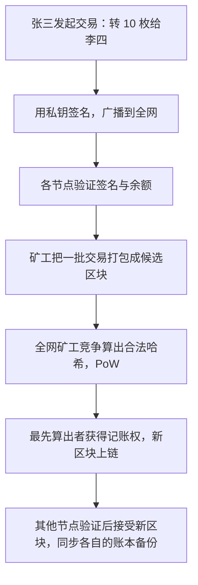

# 比特币是什么：去中心化账本的第一次大规模落地

一提比特币，话题往往立刻滑向涨跌与买卖，技术本身反而没人说清。面试里被问到「比特币和区块链是什么关系」，答一句「比特币就是区块链」基本等于答错。把四个问题讲清楚：它是谁提出的、账本怎么记、挖矿到底在算什么、它的价值判断落在哪里。搞懂这四件事，再看后面区块链的演化与应用才有抓手。

## 先给结论

- 比特币是一种 P2P 形式的数字货币，点对点传输意味着它同时是一个去中心化的支付系统；概念由中本聪在 2008 年提出，2009 年 1 月正式诞生。
- 它不依靠任何特定货币机构发行，而是依据特定算法、通过大量计算产生：算出来的那个全网唯一的哈希字符串就是一枚币，密码学设计保证流通各环节的安全。
- 每个参与者（俗称矿工）都保存一整套总账备份，实时同步、实时对账；每笔交易都广播到整个网络，全网见证。
- 比特币本身只是一个字符串，谈不上内在价值；它的历史地位在于第一个用去中心化的分布式信任系统完成了价值转移。
- 比特币是区块链的第一个大规模应用，业内把这一阶段称为区块链 1.0；它是区块链的一种实现，不是区块链的全部。

## 一、定义拆开：一种不靠机构发行的数字货币

先分清两个容易混的词。电子货币是人民币的电子化，扫码付的还是法定货币；数字货币则本身就是一个新的货币形态，不依附于某国法币。比特币属于后者，而且是其中第一个跑通全局的。

它的几个关键性质，每一条都对应一个「没有中心」：

| 性质 | 说明 | 去掉了什么中心 |
|---|---|---|
| P2P 点对点 | 节点与节点直接传输 | 支付清算机构的居中转发 |
| 不靠机构发行 | 依据特定算法、大量计算产生 | 央行式的货币发行权 |
| 密码学保证安全 | 签名证明归属，哈希保证记录不可改 | 可信第三方的账目仲裁 |
| 全网备份账本 | 每个参与者都存一整套总账 | 唯一的记账服务器 |

因为不依赖任何机构背书，它早期主要被用来购买虚拟物品，比如网络游戏里的衣服、帽子、装备。2017 年 1 月起，国内主要比特币交易平台开始收取交易手续费，交易生态走向常规化；此后市场经历多轮牛熊，价格从来不是技术视角的重点，重点是一个没有发行方、没有中心服务器的系统，真的在全网跑起来了。

## 二、挖矿在算什么：PoW 工作量证明

挖矿这个词有误导性，它不是挖，是算。全网节点共同竞争一件事：把一批待确认交易打包成候选区块，再找一个数字（nonce），让区块头整体哈希的结果满足难度要求，比如以若干个 0 开头。谁先算出来，谁就获得这一轮的记账权，并得到系统新发行的一枚枚比特币作为奖励。这就是工作量证明（Proof of Work，PoW）。

这套机制的巧妙之处在于难与易的不对称：算出来极难，只能暴力枚举；验证却极快，别人重算一次哈希就能确认。day20 资料包没有源码，下面按主流写法补全一个最小 PoW 演示（示例，可直接运行）：

```python
# 示例：工作量证明的最小演示，按主流写法补全
import hashlib

DIFFICULTY = 4  # 要求哈希以 4 个 0 开头；难度越高，枚举次数越多

def mine(prev_hash: str, txs: str) -> tuple:
    nonce = 0
    while True:
        text = f"{prev_hash}{txs}{nonce}"
        digest = hashlib.sha256(text.encode()).hexdigest()
        if digest.startswith("0" * DIFFICULTY):
            return nonce, digest   # 算出即获得本轮记账权
        nonce += 1

nonce, block_hash = mine("000a1b2c", "张三转给李四 10 枚")
print(nonce, block_hash)   # nonce 就是工作量证明，全网一次重算即可验证
```

难度还会动态调整：全网算力越强，目标难度越高，从而把出块节奏稳定在约 10 分钟一个区块。算出的哈希全网唯一，这就是讲义里那句「确保这个串在整个计算中唯一产生」的含义。

## 三、账本怎么记：每个矿工一本全量账

要纠正一个直觉：比特币并不是像人民币那样的货币，它本质上是一个分布式总账系统。电子总账在每个参与者的电脑上备份，实时同步、实时对账。每个参与者都可以称为矿工，手上保存着一整套账本；总账记录的是一定数量的比特币如何从一个参与者转移到另一个参与者，每次记录都会广播到整个网络，全网每一份备份里都会留下这笔交易数据。

一条交易长什么样？day20 无源码，按比特币主流通用结构补全一份简化示例（示例）：

```json
{
  "txid": "6f7cf9d1e2a8",
  "vin": [
    { "prev_txid": "a1b2c3d4e5f6", "signature": "张三用私钥对本次交易的签名" }
  ],
  "vout": [
    { "address": "李四的地址", "value": 10 },
    { "address": "张三的找零地址", "value": 90 }
  ]
}
```

一笔交易声明的是「花掉之前收到的哪笔钱、付给谁、找零多少」，签名证明这次转移由币的持有者发起，这是密码学保证流通安全的第一环。交易从发起到全网记账的完整路径如下：



关键路径在 E 到 F 这一步：记账权不靠职务和身份，靠算出来的工作量；其余节点验证通过才会接受新区块。正因如此，任何人想改历史账目，就要在全网无数份备份同时做假并重算后续所有区块，实际不可能完成。

## 四、价值判断：字符串不值钱，信任机制才值钱

一枚比特币就是一个字符串，字符串本身有什么价值？没有。它的价值在另一个层面：第一个通过去中心化的方式、以分布式的信任系统实现了价值转移。转账不再需要银行确认，全网共识本身就是确认，这套信任机制的诞生才是真正的里程碑。

同理，挖矿算出的是支付串，不是金子。把它理解成「在电脑里挖金矿」会带偏对整套机制的认知：奖励是新账本的记账权加上系统发行的新币，价值来自全网对这套账本的信任，而不是字符串本身稀有。

把这条放进系列里看：区块链是底层技术，比特币是它的第一个爆款应用，也就是区块链 1.0。下一节的演化三级跳，就从这一级开始。

## 常见误区

- **把比特币等同于区块链。** 区块链是底层技术，比特币只是它的一种实现、第一个大规模应用。账本之外，存证、溯源等领域同样在用区块链。
- **把它当成人民币那样的货币。** 人民币背后是国家信用与央行发行机制；比特币背后没有发行方，本质是分布式总账系统里的记账单位，两种「货币」的信任来源完全不同。
- **以为挖矿是挖虚拟金子。** 挖矿是竞争记账权的计算过程：算出满足难度的哈希并让全网认可，奖励随之而来；离开账本语境谈「挖」没有意义。
- **以为总账存在某个中心服务器上。** 每个参与者都备份全量账本并实时对账，不存在唯一的那一台；单点损坏或单点作恶都不会影响整体账本。

## 面试可能被问到的问题

1. 面试官追问：「比特币和区块链是什么关系？」
   答：区块链是底层技术，比特币是它的第一个大规模应用，业内称为区块链 1.0。比特币验证了去中心化分布式账本可以真实运转，之后这项技术才被提炼出来用到更多领域，两者是实现与应用的关系，不能画等号。
2. 面试官追问：「挖矿的原理是什么，为什么要有挖矿？」
   答：挖矿是工作量证明机制的执行过程：矿工把交易打包成候选区块，暴力枚举 nonce 使区块哈希满足难度要求，最先算出者获得记账权和奖励。它同时解决两个问题：谁有资格记账由算力竞争决定，作假则需要付出巨大算力成本，因此账本难以被篡改。
3. 面试官追问：「比特币为什么说是去中心化的？」
   答：它不依靠特定货币机构发行，由算法和算力产生；账本在每个参与节点都有全量备份并实时同步对账，交易全网广播；没有任何一个节点拥有单方修改账目的权力，修改必须获得其他节点认可。
4. 面试官追问：「一个字符串凭什么有价值？」
   答：从技术视角看，价值不在字符串本身，而在这套去中心化分布式信任系统首次实现了不依赖中介的价值转移。全网共识即确认，这个信任机制是它全部价值的来源，价格波动只是市场对这个机制的定价。
5. 面试官追问：「每个节点都存全量账本，这套设计换来什么、付出什么？」
   答：换来的是极强的容错与防篡改能力：任何单点故障、单点作恶都不影响整体账本，伪造必须同时骗过多数节点。付出的是存储与性能：每个节点存全量数据，出块与确认速度远低于中心化系统，这也是后来联盟链重点改进的方向。

## 配套资料

- 本教学日无源码包：`materials/code/03/day20-了解区块链以及Hyperledger fabric/` 下仅有解压清单 `_extracted.json`，解压文件数为 0；文中 PoW 演示与交易结构均为按主流写法补全的可运行示例。
- 比特币定义、比特金别称、去中心化支付系统的表述抄录自本课画面线（讲义 1.5 什么是比特币一节）。
- 同章节延伸：区块与链式结构见 `0323-认识区块链之什么是区块链_.md`；中心化与去中心化的取舍见 `0326-认识区块链之中心化和去中心化.md`；三阶段演化见 `0328-认识区块链之区块链的演化.md`。
