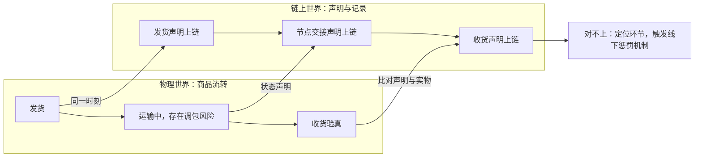

# 区块链常见疑问拆解：调包、能耗、中心化机构与三个收束追问

学完区块链的基本概念，真正的疑问往往不在概念本身，而在三个听起来直击要害的「那岂不是」：溯源被中途调包，不可更改不就白说了？挖矿这么耗电，这技术是不是天生低效？去中心化要革命，中心化机构必然反扑，它注定失败？这三问拆开后会发现它们共享同一类错误：把比特币当成区块链的全部，把线上账本当成线下世界。day20 前半段留下的三个收束追问，数据公开、性能、与分布式数据库的区别，也在此一并回答。

## 先给结论

- 溯源场景里实物被调包，链上「不可更改」依然成立：链钉住的是「谁在何时声明了什么」，调包发生在物理世界，是另一层问题，要靠线下规范与惩罚机制解决。
- 挖矿耗能是事实，但低效的是比特币的 PoW，不是区块链：比特币只是区块链的一种实现，2.0 与 3.0 大量操作是执行智能合约，共识机制还有 PoS、DPoS、PoET 可选。
- 区块链去中心化，但不必然颠覆中心化机构：机构完全可以自建私有链，把信用体系建得更健全；它是工具，没有好坏，看拿它做什么。
- 账本人人一份带来的数据公开，在行业场景由私有链的权限控制解决，该公开的公开，该封闭的封闭。
- 区块链不是数据库也不必是：分布式数据库解决存得快、查得快、坏一台不断服，区块链解决多方互不信任下的账本一致，目标不同，选型不冲突。

## 一、疑问一：中途调包实物，「不可更改」不就无效了

疑问原样是：区块链用于溯源，如果供应链上的参与方自己造假，中途把实物替换掉，区块链宣称的不可更改不就无效了吗？

拆解这句话的关键，是分清两层世界。区块链的本质是把线下的信用体系搬到线上，它管的是线上：谁在什么时间声明了什么、货物状态在节点之间如何交接。而调包发生在物理世界，商品被人换掉了，链上任何一条记录都没有被修改，两者根本不在一个层面。也就是说，调包不影响链上交易记录的真实性，它暴露的是「线上不可改」防不住「线下动手脚」。

链在这一幕里做什么？把每个环节的声明钉死并公开，让调包无处隐身。day20 无源码，按主流写法补全一份溯源声明记录（示例）：

```json
{
  "height": 501,
  "prev_hash": "0000c3f9a1b2",
  "records": [
    { "node": "生产基地", "action": "出厂声明：批次 A，数量 200 箱", "ts": "2025-06-01 09:00" },
    { "node": "物流节点", "action": "接收声明：批次 A，数量 200 箱", "ts": "2025-06-03 14:20" },
    { "node": "门店",     "action": "验货声明：批次 A，实收 198 箱", "ts": "2025-06-05 10:05" }
  ]
}
```

门店实收 198 箱，前两个环节的声明都是 200 箱，差异环节立刻锁定在物流段。链没有拦住调包，但让调包无法隐身，追责有据。

那怎么真正保证商品不被调包？靠链之外的规范手段。对照电商场景：淘宝卖家发货后发的是假冒伪劣商品，平台有一整套惩罚机制，关闭店铺、罚款、扣积分。线下规则加上链上留痕，才构成完整闭环。所以「不可更改因此无效」这个说法不成立：链管记录，规则管实物，各司其职。



图里左右两条线是平行的：左边是可能被动手脚的实物流，右边是不可更改的声明链，两线在「比对」处汇合，差异指向哪个环节，哪个环节就要面对线下的惩罚规则。

## 二、疑问二：挖矿浪费能源，区块链是不是低效机制

疑问原样是：区块链挖矿消耗大量能源，是低效的机制。

先承认事实部分：比特币挖矿确实耗电。矿机不停地做哈希计算，越到后面矿越难挖，需要更长的时间、更多的机器才能挖到，电力消耗是实打实的。

错在推理的跳跃：把比特币当成区块链的全部。比特币只是区块链的一种实现，它的 PoW 恰好是所有共识机制里最耗能的一种。区块链 2.0 和 3.0 的绝大多数操作不是挖矿，而是执行智能合约做业务逻辑；共识机制除了 PoW，还有 PoS（权益证明）、DPoS（委托权益证明），以及 Intel 提出的 PoET（流逝时间证明，依托可信执行环境，能耗远低于 PoW）。到了 Fabric 这一类的联盟链，「算力军备竞赛」整个被换成了「许可成员之间的高效共识」，能源问题自然消失，性能反而上了一个数量级。所以「低效」这顶帽子扣不到区块链头上，只能扣给比特币的 PoW。

## 三、疑问三：去中心化革命，必然颠覆中心化机构

疑问原样是：区块链是一场去中心化的革命，必然颠覆当前的中心化机构，因此必然受到中心化机构的阻击而失败。

前半句对了一半。区块链的确要去中心化，比特币做的就是这件事。但「必然颠覆中心化机构」不成立：中心化机构不是只能等着被颠覆，它们可以借助区块链技术自建私有链，重新建立自己的信用体系，让这套体系更加健全。房管局、银行、公安这类机构的数据上私有链，就是典型的正向用法：机构没有消失，它用新技术把自己的信任基础加固了。

两者不是直接的矛盾。讲义里给了一个好用的类比：区块链好比一件杀伤力很强的武器，落到好人手里，好人更强大；落到坏人手里，坏人也更强大。技术本身没有立场，效果取决于拿它做什么。既然中心化机构可以拿来把自己做得更好，「必然受到阻击而失败」的结论自然不成立。讲义 1.9 的「现状」一页画的是企业分层管理演进出企业分层管理与本土管理，组织形态是在原有结构上叠加，而不是推倒重来，与这个结论互相印证。

## 四、收束 day20 前半段的三个追问

### 数据人人都有，公开了怎么办

公有链账本人人可同步、没有隐私可言，这是 1.0 的特性而不是缺陷，它用透明换共识。行业数据需要权限，就走私有链：账本有权限控制，只有被许可的机构才能接入和查询。day20 无源码，按 Fabric 主流写法补全一份通道与组织权限示意（示例，简化，非完整配置）：

```yaml
# 示例：Fabric 通道与组织权限示意，按主流写法补全（简化）
channels:
  credit-channel:            # 征信业务通道
    organizations:
      - OrgBank              # 银行
      - OrgHousingAuthority  # 房管局
      - OrgPolice            # 公安
organizations:
  OrgBank:
    mspid: OrgBankMSP        # 身份由 MSP 成员服务管理，未授权组织进不了通道
  OrgHousingAuthority:
    mspid: OrgHousingMSP
```

未在通道里的组织拿不到账本数据，公开与私密由组网方式决定，这正是私有链存在的意义。

### 性能到底行不行

数据摆一遍：比特币每 10 分钟一个区块、原始区块 1MB，理论上每秒约 7 笔，实际更低；以太坊每秒约 15 笔；Fabric 每分钟可达百万笔量级。公有链的低性能是全网共识与安全付出的代价，联盟链用许可成员加更高效的共识换回性能，达到实际项目可用的水平。选型时先问要公有链的开放，还是要联盟链的性能。

### 和分布式数据库到底差在哪

| 维度 | 分布式数据库 | 区块链 |
|---|---|---|
| 要解决的问题 | 存得多、查得快、坏一台不断服 | 多方互不信任时账本一致且可审计 |
| 信任来源 | 统一管理员与权限体系 | 共识机制加多数节点认可 |
| 写入方式 | 高并发增删改查 | 打包出块、共识确认，慢 |
| 改历史数据 | 管理员可修改删除 | 结构上极难，需重算后续区块并获多数认可 |

互不信任的多方共同记账才用区块链；自己公司内部的存储需求，用数据库，别用大炮打蚊子。

## 常见误区

- **把「不可篡改」理解成「现实不受骗」。** 链保证线上记录不可改，管不了线下实物被调包；两者要靠链上留痕加线下规则共同兜住。
- **把比特币的缺点当成区块链的缺点。** 能耗问题属于比特币的 PoW 共识；换共识机制或换到联盟链，这个问题就不是问题。
- **把去中心化当成反中心口号。** 去中心化去掉的是唯一说了算的单点，不是要消灭一切中心化机构；机构自建私有链反而是当前最主流的落地形态。
- **以为区块链必然失败或必然成功。** 它是一件工具，好人坏人都能用，成败取决于使用者的目的与配套规则，不取决于技术本身站队。

## 面试可能被问到的问题

1. 面试官追问：「溯源系统里商品被中途调包，区块链的不可更改还有意义吗？」
   答：有意义。链钉住的是每个环节的声明与交接记录，调包发生在物理世界，链上记录并没有被修改；收货验真时声明与实物对不上，就能立刻锁定出问题的环节。防调包要靠线下规范与惩罚机制，链的价值是让调包无法隐身、追责有据。
2. 面试官追问：「挖矿耗能严重，区块链是不是不可持续的低效技术？」
   答：不是。耗能是比特币 PoW 共识的特性，不是区块链的共性。2.0、3.0 的主要操作是执行智能合约，共识还有 PoS、DPoS、PoET 等选择；Fabric 这类联盟链不挖矿，性能反而达到实际项目可用水平。把比特币等同于区块链是这题的常见错误。
3. 面试官追问：「区块链会颠覆银行这类中心化机构吗？」
   答：不必然。区块链的确强调去中心化，但中心化机构可以借助区块链自建私有链，把信用体系建得更健全，比如银行、房管局的数据在许可链上共享。技术与机构不是你死我活的关系，机构完全可能成为区块链的使用者而变得更强。
4. 面试官追问：「公有链数据人人可得，隐私怎么办？」
   答：需要隐私与权限的场景应选择私有链或联盟链。以 Fabric 为例，账本有权限控制，组织通过 MSP 管理身份、通过通道划分数据可见范围，未授权的组织进不了通道、拿不到账本数据，公开透明与权限隔离由组网方式决定。
5. 面试官追问：「区块链和分布式数据库怎么选？」
   答：看信任模型。分布式数据库解决存储容量、读写性能与单点故障，信任由统一管理员保证，适合内部系统；区块链解决多方互不信任下的账本一致与可审计，写入慢、存储冗余，只在多方共同记账且没有共同信任的管理方时使用。把区块链当数据库用是用大炮打蚊子。
6. 面试官追问：「为什么 Fabric 的性能比比特币高这么多？」
   答：三点：不采用 PoW，没有算力竞争的等待；成员是经过许可的机构，共识在少量可信节点间高效完成；账本有权限，数据规模与验证范围可控。比特币每秒约 7 笔、以太坊约 15 笔，Fabric 可达每分钟百万笔量级。

## 配套资料

- 本教学日无源码包：`materials/code/03/day20-了解区块链以及Hyperledger fabric/` 下仅有解压清单 `_extracted.json`，解压文件数为 0；文中溯源声明记录与 Fabric 通道权限示意均为按主流写法补全的示例。
- 三个疑问的原文表述与「现状」一页的企业分层管理图抄录自本课画面线（讲义 1.8 区块链的一些疑问、1.9 现状两节）。
- 同章节延伸：共识机制与性能数据见 `0328-认识区块链之区块链的演化.md`；场景真伪判断见 `0329-认识区块链之区块链应用场景.md`；区块链基础定义见 `0323-认识区块链之什么是区块链_.md`。
