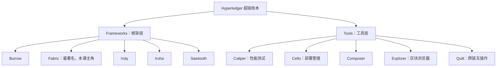
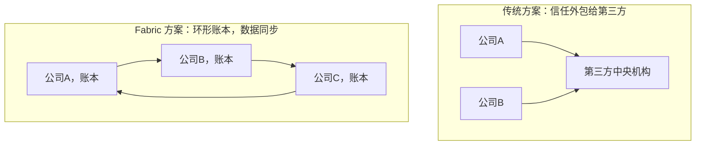
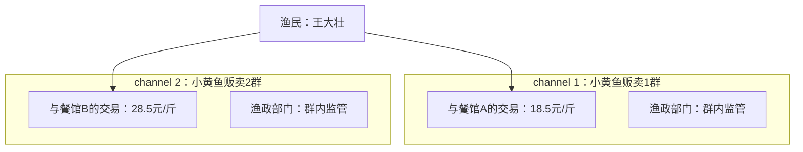
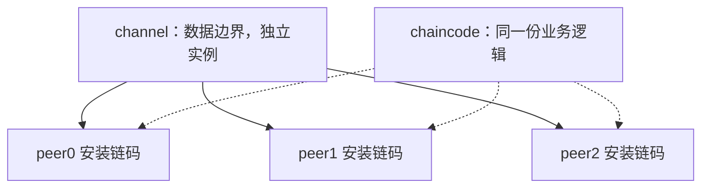
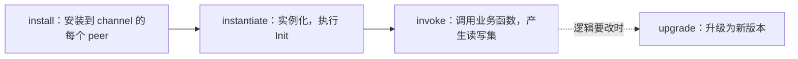
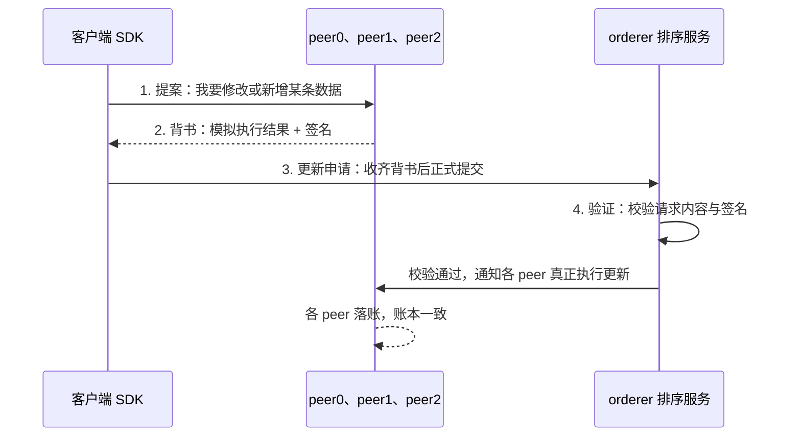
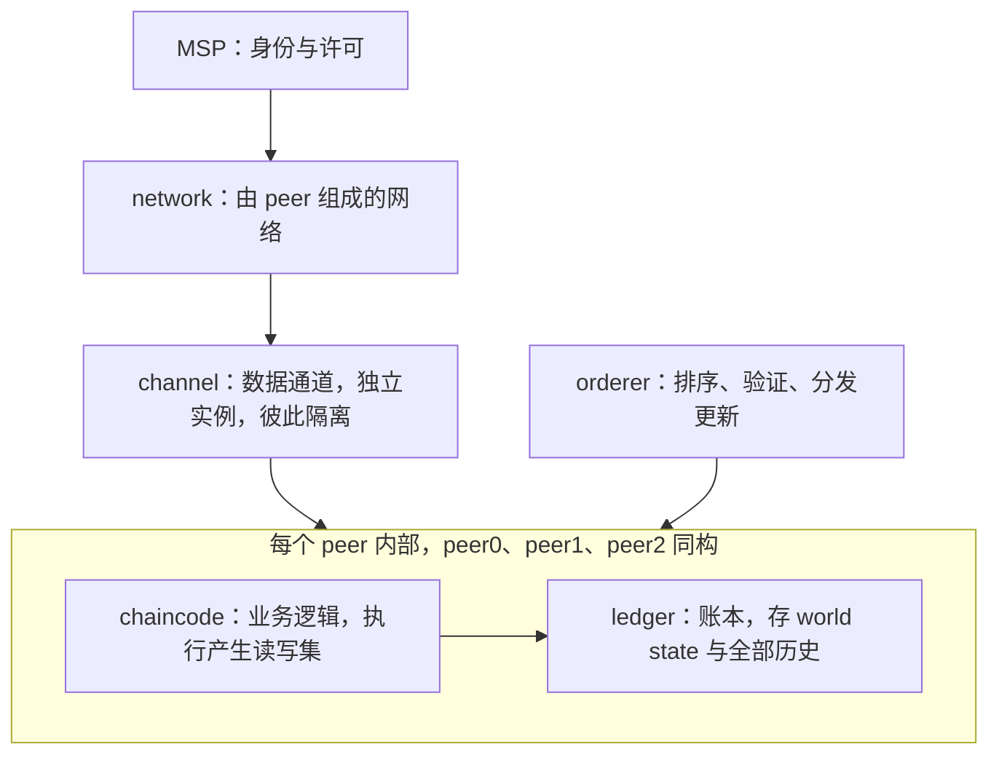

# Hyperledger fabric入门之三讲：超级账本定位、Chaincode 链码与交易工作流程

## 先给结论

Hyperledger Fabric 入门三讲把联盟链的第一个框架讲通：它是超级账本温室里最出名的一个框架，用全量冗余与链式结构解决互不信任双方的记账问题，渔业监管案例把 channel 的隔离作用落到实处的业务里。
三讲层层递进：简介篇立定位与信任问题的解法；chaincode 篇讲清账本读改数据的唯一入口，install、instantiate、invoke 的生命周期与骨架 API；工作流程篇用提案、背书、排序、提交四步走完一笔交易，解释排序防双花，收束 day20 全部术语。组网前提也先立住：同一 channel、相同 MSP，这是后面动手部署的门槛。
学习时盯住一个矛盾即可：多方互不信任与账本不可篡改，全部设计都围绕它展开。
三讲依次是：
- 简介：超级账本定位、数据完整与安全、信任问题的解法与监管案例。
- chaincode 链码：唯一入口、与 channel 和 peer 的关系、生命周期与 API 概览。
- 工作流程：提案背书排序提交四步、防双花原理、组网前提与术语总表。

## 第1部分：Hyperledger Fabric 入门：超级账本的定位、信任问题的解法与渔业监管案例

day20 后半程从「区块链是什么」进入「企业怎么用它」。第一个拦路的问题就是名字：Hyperledger、超级账本、Fabric 三个词混着说，Fabric 到底是不是一种币？这个平台到底替企业解决什么问题？真实项目长什么样？这三个问题答清楚，Fabric 的大门就算推开了。

### 一、Fabric 是什么：温室里最出名的一个框架

**先拆名字。** Hyperledger 一般译作超级账本，Fabric 是它的本质：一个分布式账本，基于模块化架构实现解决方案的平台。由 IBM 牵头发起联盟项目，2015 年底移交给 Linux 基金会，成为开源项目。基金会成员阵容豪华，IBM、Intel、思科都在其中。官网与文档都可以直接查，公开透明。

**基金会的家底。** 官网有一张著名的「超级账本温室」（Hyperledger Greenhouse）图，把旗下项目分成两层：



框架层负责底层账本本身，工具层负责测试、部署、浏览这些外围活。基金会孵化了很多区块链项目，其中 Fabric 最著名、使用最多，以至于日常提「超级账本」时，指的基本都是 Fabric。把这两层关系记住，后面听到 Burrow、Sawtooth 就不会误以为是 Fabric 的组件。

**不是货币技术。** Fabric 是区块链技术，但不发币、没有挖矿的概念，共识不需要算力竞争，所以说是绿色环保的技术。性能定位课上用三只动物讲得直白：区块链 1.0 比特币是乌龟，出块要等十分钟；2.0 以太坊升级为兔子；3.0 以 Fabric 为代表变成豹子，性能提升到企业业务可用的量级。

### 二、数据完整与数据安全：全量冗余换来不可篡改

**第一，分布式账本存储。** 每一个节点都保存完整的数据。任何一个节点想篡改，改完的数据与其他所有节点对不上，立刻暴露。不可篡改不是给数据上了锁，而是全量冗余加交叉校验带来的结果：想改账本，得同时改掉所有节点的副本。

**第二，只增不删。** 区块链中的数据不能被删除，只能添加和修改；变化之后数据的最新状态有个专有名词，叫 World State，世界状态。历史上的每一次变化都被链式记录保留着，随时可查。这两条合在一起，就是数据完整性与数据安全性的来源，也是后面所有企业场景敢把账本放上去的底气。

### 三、解决什么现实问题：互不信任的双方如何对账

场景从一张图开始：公司 A 和公司 B 有业务往来，各自的数据都存在自己的服务器上。数据一致则万事大吉；现实是账目常常对不上，于是就要对账，而人工对账非常消耗人力。

**银行把这件事的规模演示得最清楚。** 课程截取了一份银行公告：为完成年终结算工作，本月 28 号 15 点后停办同城或异地转账、托收、电汇等业务，ATM 个人取款 31 号下午 4 点后停止。公告背后就是「对账」两个大字：银行与众多银行有业务往来，最终还要通过人民银行做数据交互；有的交易 T+0 到账、有的 T+1 到账，时间差让部分账目对不上，必须停下来核对。银行如此，企业之间同样如此。

**传统解法：找双方都信的第三方。** 理论上可行：A、B 都信任某个第三方中央机构，把数据都放到它那里，它说什么大家信什么。实际问题有两条。一是成本高，认证费、服务费层层收；二是第三方自身的安全，它一旦挪用资金、篡改交易数据，A、B 一起受损。信任问题只是被转移给了第三方，并没有被解决。

**Fabric 的解法：环形账本。** 把各个机构全部上链组成一个环，每个机构都有自己的账本，Fabric 保证数据在环内同步：一家写入，家家一致。谁想篡改，改出来的数据立刻与其他机构的账本不一致，当场暴露；画面原话是「fabric 拒绝数据篡改」。数据由机制保证一致，各方认可同一份账本，对账这个动作直接消失。



两张图的差别不在形状，在信任来源：三角方案里信任集中在第三方一家身上，环形方案里信任由「所有节点数据一致」这个机制产生。所以 Fabric 本质上解决的是信任问题；信任问题一解决，互不信任导致的对账成本随之消失。

### 四、案例拆解：渔证监管系统里的 channel

**背景与目标。** 案例来自江苏省渔业主管部门的区块链渔证管理系统，要打击的是非法捕捞。法律层面对非法捕捞的定义，画面原文是：在内水、近海从事捕捞业的单位和个人，必须按照捕捞许可证关于作业类型、场所、时限和渔具数量的规定进行作业；不得在禁渔区和禁渔期捕捞，不得使用禁用的渔具、捕捞方法和小于规定最小网目尺寸的网具。课程目标一句话：使用 Fabric 消除非法、未报告和无管制的捕捞活动。

**为什么必须全链条。** 只抓捕捞者治标不治本：没有买卖就不会有捕捞。只有立足源头，从非法捕捞、收购、贩卖的每一个环节实施全链条打击，才能从根本上遏制。

**参与人。** 渔业供应链精选四个角色：渔民王大壮负责捕捞；政府渔政部门负责监管；消费者是餐馆 A 和餐馆 B。监管要覆盖两端：既监管王大壮的捕捞行为，也监管餐馆的购买行为。

**隐私冲突引出 channel。** 王大壮把小黄鱼卖给餐馆 A 是 18.5 元一斤，卖给餐馆 B 是 28.5 元一斤。如果所有交易记在同一条链上，两家餐馆都能看到全部价格，餐馆 B 马上会问：凭什么卖我贵？定价隐私没了。Fabric 的答案是把不同交易放进不同的 channel。

**channel 是什么。** 通道可以理解为独立的 Fabric 实例，通道里的参与者叫 peer。最直观的类比是微信群：拉两个群，「小黄鱼贩卖 1 群」拉进王大壮、餐馆 A 和渔政部门，「小黄鱼贩卖 2 群」拉进王大壮、餐馆 B 和渔政部门。群内消息人人可见，两个群之间互相隔离：餐馆 A 看不到餐馆 B 的价格，反之亦然；渔政部门两个群都在，两条交易线都监管得到，全链条打击在隐私保护的前提下成立。



**上链的数据长什么样。** day20 无源码，按主流写法补全一条渔获交易记录（示例）：

```json
{
  "txId": "e4f1c2ab",
  "channel": "fish-channel-a",
  "from": "渔民-王大壮",
  "to": "餐馆A",
  "goods": "小黄鱼",
  "price": "18.5元/斤",
  "ts": "2025-07-01 09:30:00",
  "endorsed_by": ["peer0.org1", "peer0.org2"]
}
```

对应两个通道与参与组织的划分示意（示例，简化，非完整配置）：

```yaml
# 示例：渔证监管系统的通道划分，按主流写法补全（简化）
channels:
  fish-channel-a:            # 王大壮 与 餐馆A 的交易通道
    organizations:
      - OrgFisherman
      - OrgRestaurantA
      - OrgRegulator         # 渔政部门：两个通道都进，负责全链条监管
  fish-channel-b:            # 王大壮 与 餐馆B 的交易通道
    organizations:
      - OrgFisherman
      - OrgRestaurantB
      - OrgRegulator
organizations:
  OrgFisherman:
    mspid: OrgFishermanMSP
  OrgRestaurantA:
    mspid: OrgRestaurantAMSP
  OrgRestaurantB:
    mspid: OrgRestaurantBMSP
  OrgRegulator:
    mspid: OrgRegulatorMSP
```

未进通道的组织拿不到通道里的账本数据，隐私边界由成员资格决定。这个项目后续怎么搭、链码怎么写，会在后面用贯穿的方式继续讲，这里先把概念立住。
## 第2部分：Chaincode 链码：Fabric 账本读改数据的唯一入口

账本和通道都认识过了，一个绕不开的问题浮出来：每个节点都存着完整账本，那数据到底由谁来改？靠什么保证所有节点算出同一个结果？Fabric 给出的答案是 chaincode，中文叫链码。它是智能合约在 Fabric 里的形态，也是整个平台里唯一能读写账本的入口。

### 一、为什么读写必须收敛到「唯一入口」

**分布式账本的一致性前提。** channel 里每个 peer 都保存完整账本。假设读写账本的代码不统一：同一笔「转账 100 元」的请求，peer0 上的实现扣 100 元，peer1 上的实现算错扣 101 元，两本账立刻分叉。Fabric 靠全量冗余加交叉校验保证不可篡改，代码不统一会让这个机制反过来放大灾难。

**唯一入口的含义。** 所以 Fabric 把读写账本的能力收进链码：所有 peer 对同一笔交易执行同一份代码，输入相同、逻辑相同，结果必然相同。背书阶段各节点给出的读写集一致，签名才有意义；提交阶段落进各家的账本自然一致。链码不是可选项，它是账本一致性的起点。

**类比延续。** channel 像微信群，链码就是群规：群里所有人（peer）都装同一份群规，群内任何信息变更（账本变化）都必须按群规流程走，谁也不能私发「我说了算」的公告。

### 二、chaincode、channel、peer 的关系

**归属关系。** 链码属于某个 channel；channel 中的每一个 peer 都需要安装它。不安装会怎样？背书时这个节点算不出读写集；装的是不同版本，算出的结果对不上。两种情况最终都指向画面里那句话：否则会导致数据不一致。这就是 channel 与 chaincode 必须分清楚的原因：channel 决定数据和逻辑的边界，chaincode 决定边界内的账本怎么变。



图里要盯住的是链码到每个 peer 的虚线：同一份逻辑分发到通道内所有节点，一条都不能漏。漏装的那台机器算不出与其他节点一致的读写集，交易就过不了背书这一关。

### 三、生命周期：install、instantiate、invoke

**install，安装。** 把链码包分发安装到 channel 的每个 peer 上，这一步只解决「代码到位」。

**instantiate，实例化。** 在 channel 上激活链码，执行一次 Init 函数完成初始化（比如写入初始数据），同时绑定背书策略。实例化在通道级别只做一次。

**invoke，调用。** 实例化之后的日常操作，客户端通过 invoke 调用链码里的业务函数，执行过程产出读写集。业务逻辑要变更时走 upgrade，升级为新版本，相当于一次带版本号的重新实例化。



图里关键路径是三步的顺序：install 是装到每台机器，instantiate 是在通道里激活一次，invoke 是天天在跑的业务。前两步任何一步没有覆盖所有 peer，数据不一致的种子就埋下了。

### 四、骨架示例与账本交互 API 概览

day20 无源码，按 Fabric 主流写法补全一份渔获记录链码的骨架（示例）。Go 版：

```go
// 示例：按 Fabric 主流写法补全的链码骨架（Go，shim 风格）
package main

import (
	"fmt"

	"github.com/hyperledger/fabric/core/chaincode/shim"
	sc "github.com/hyperledger/fabric/protos/peer"
)

// FishChaincode 管理渔获交易记录
type FishChaincode struct{}

// Init 实例化时执行一次
func (t *FishChaincode) Init(stub shim.ChaincodeStubInterface) sc.Response {
	return shim.Success(nil)
}

// Invoke 日常调用入口，按函数名分发
func (t *FishChaincode) Invoke(stub shim.ChaincodeStubInterface) sc.Response {
	fn, args := stub.GetFunctionAndParameters()
	switch fn {
	case "record": // 写：登记一笔渔获交易
		return t.record(stub, args)
	case "query": // 读：查询交易记录
		return t.query(stub, args)
	default:
		return shim.Error("未知函数: " + fn)
	}
}

func (t *FishChaincode) record(stub shim.ChaincodeStubInterface, args []string) sc.Response {
	if len(args) != 2 {
		return shim.Error("参数应为: 交易ID, 交易内容JSON")
	}
	if err := stub.PutState(args[0], []byte(args[1])); err != nil {
		return shim.Error("写入失败: " + err.Error())
	}
	return shim.Success(nil)
}

func (t *FishChaincode) query(stub shim.ChaincodeStubInterface, args []string) sc.Response {
	data, err := stub.GetState(args[0])
	if err != nil {
		return shim.Error("查询失败: " + err.Error())
	}
	if data == nil {
		return shim.Error("记录不存在: " + args[0])
	}
	return shim.Success(data)
}

func main() {
	if err := shim.Start(new(FishChaincode)); err != nil {
		fmt.Printf("链码启动失败: %v\n", err)
	}
}
```

Java 版同构，换成 ChaincodeBase 的继承写法：

```java
// 示例：按 Fabric 主流写法补全的链码骨架（Java，fabric-chaincode-java shim）
public class FishChaincode extends ChaincodeBase {

    @Override
    public Response init(ChaincodeStub stub) {
        return newSuccessResponse();          // 实例化时执行一次
    }

    @Override
    public Response invoke(ChaincodeStub stub) {
        switch (stub.getFunction()) {
            case "record":                    // 写：登记一笔渔获交易
                return record(stub, stub.getParameters());
            case "query":                     // 读：查询交易记录
                return query(stub, stub.getParameters());
            default:
                return newErrorResponse("未知函数: " + stub.getFunction());
        }
    }

    private Response query(ChaincodeStub stub, List<String> args) {
        String json = stub.getStringState(args.get(0));   // GetState：按 key 读世界状态
        if (json.isEmpty()) {
            return newErrorResponse("记录不存在: " + args.get(0));
        }
        return newSuccessResponse(json);
    }

    private Response record(ChaincodeStub stub, List<String> args) {
        stub.putStringState(args.get(0), args.get(1));    // PutState：写世界状态
        return newSuccessResponse();
    }

    public static void main(String[] args) throws Exception {
        new FishChaincode().start(args);
    }
}
```

两份骨架里出现的 `GetState`、`PutState` 就是链码与账本交互最常用的两个 API。常用的一组摆在一起看：

| API（Go / Java 同名近似） | 作用 |
|---|---|
| `GetState(key)` / `getStringState` | 按 key 读当前世界状态 |
| `PutState(key, value)` / `putStringState` | 写入或更新世界状态 |
| `DelState(key)` / `deleteState` | 删除 key，世界状态里抹掉，历史仍在账本里 |
| `GetHistoryForKey(key)` | 查某个 key 的全部历史版本 |
| `GetQueryResult(query)` | 富查询，走 CouchDB 的 JSON 查询 |
| `CreateCompositeKey` | 组复合键，配合前缀查询一类数据 |
| `GetCreator` / `GetTxID` | 拿调用者身份与交易 ID，做权限与审计 |

注意 `DelState` 那一行：删除操作只影响世界状态的当前值，`GetHistoryForKey` 依然能把历史翻出来，这正是「数据不能被删除，只能添加和修改」在 API 层面的体现。
## 第3部分：Fabric 工作流程全解：提案、背书、排序、提交，收束 day20 术语

channel、chaincode、账本这些概念都单独认识过了，但一笔数据从客户端发起到落到每个节点的账本，中间经过谁的手、每一步产出什么，串不成一条线等于没学。这节课把 Fabric 最精简的工作流程完整走一遍，再用一张术语表把整个 day20 收束。

### 一、全流程总览：四步走完一笔交易

架构图是这样的：SDK 在客户端一侧，对面是同一条 channel 里的 peer0、peer1、peer2，再往右是 orderer 排序服务，orderer 内部还有 verify 校验环节。图上标了四个编号：提案、背书、更新申请、验证。



最关键的一条线是「背书回 SDK 再去 orderer」：账本的正式更新不在提案阶段发生，peer 收到提案只做模拟执行，真正写入要等排序提交之后。

#### 第一步，提案与模拟执行

SDK 是为客户端提供操作的 API，和实现语言无关：Node.js 写的客户端用 Node.js 的 SDK，Java 客户端用 Java SDK。客户端通过 SDK 发起提案，提案内容说白了是一句话：我要修改某条数据了，或者我要新增一条数据。提案发给 channel 中的 peer，各个 peer 接到后不直接写账本，而是模拟执行：假设这笔交易成立，账本会变成什么样。模拟执行会产生读写集，内部采用 version 机制记录修改前后的状态。

读写集长什么样，按主流写法补全一份示意（示例）：

```json
{
  "txId": "7a1f9c02",
  "reads": [
    { "key": "fish_tx_0001", "version": "block501:2" },
    { "key": "wallet_wangdz", "version": "block488:7" }
  ],
  "writes": [
    { "key": "fish_tx_0001", "value": { "to": "餐馆A", "price": "18.5元/斤" } },
    { "key": "wallet_wangdz", "value": { "balance": "2600.00" } }
  ]
}
```

reads 里每个 key 都带着读到它那一刻的版本号。提交时如果账本里该 key 的版本已经往前走了，说明期间有别人改过，这笔交易会因版本冲突被拒：用版本号挡住并发写坏账，这就是 version 机制的作用。

#### 第二步，背书

各个 peer 将模拟执行后的结果以及自己的签名发送给 SDK。SDK 收集到一定数量的背书之后，才有资格发起正式更新。背书数量对应背书策略要求的份数，它是「多少个节点认可这笔交易」的门槛，收不够就走不到下一步。

#### 第三步，更新申请与排序

SDK 将正式的更新申请发送给 orderer。orderer 做两件事：对请求的内容以及签名做校验，即图中 verify 环节；确认请求合法后，把请求排定全网统一的执行顺序。

#### 第四步，验证提交

校验完成没有问题，orderer 发送真正的更新给各个 peer，各个 peer 这时才真正执行更新。到此为止，每一个 peer 中的账本数据保持一致，这正是 Fabric 数据同步的落点。

还有一个容易被忽略的细节：如果请求不合法，orderer 不会把它悄悄丢掉，而是同样保存到 blockchain 中，方便后续审查。哪个节点发起了错误请求、错在什么地方，有据可查。

### 二、排序为什么能防住双花

双花问题在货币演化里埋过伏笔：电子数据可以复制，同一笔钱可能被花两次。Fabric 里这个问题的解法就藏在 orderer 的「排序」两个字里。

多笔请求并行到达时，如果允许各节点各自执行，两笔冲突的交易可能同时生效，双花就发生了。orderer 把所有请求排成一条全序，并行问题转化成串行执行：排在前面的先提交，排在后面的到了校验环节，发现读写集里的版本对不上，直接被拒。同一时刻、同一份数据，全网只有一条执行顺序，双花从机制上被堵死。

所以这段流程的价值要记全：既实现了每个节点数据同步，又通过 orderer 的排序与校验保证了请求的有效性，顺带解决了双花问题，最终落到「每个节点中的数据保持一致」。

### 三、组网前提：同一 channel，相同 MSP

画面原文给了两条硬性前提：peer0、peer1、peer2 在同一个 channel 中；多个 peer 必须有相同的 MSP（Membership Service Provider）才能进行通信。MSP 负责管理成员的身份与访问许可，相同 MSP 意味着大家的身份由同一套信任根签发，验证得过，通信才有基础。这也解释了为什么提案、背书都只在同一 channel 内流转：边界内的人身份可验证，数据才可共享；边界外的人既进不来也看不到。

### 四、术语总表：把 day20 收进一张表

工作流程走通之后，前面出现过的术语可以互相咬合了。按画面抄录整理：

| 术语 | 一句话定义 | 在流程中的位置 |
|---|---|---|
| channel | 数据通道，可理解成独立的 Hyperledger Fabric 实例；不同通道数据完全隔离，保证隐私，类似微信群聊 | 提案广播与背书的边界 |
| peer | 参与者节点 | 模拟执行、背书、最终落账 |
| chaincode | 链码，即智能合约，定义 business logic；Ledger 的变化只能通过调用 chaincode 完成 | 模拟执行时产出读写集 |
| ledger | 账本，记录当前世界状态并链式记录所有历史世界状态；具有授权管理的共享账本系统，底层设计保证一致性、有效性、不可篡改性 | 最终落账的地方 |
| world state | 当前 ledger 中存放的数据，key-value 形式；读写集用 version 做并发校验；当前实现有 LevelDB 与 CouchDB 两种 | 链码 GetState、PutState 的读写对象 |
| ordering service | 排序服务：排序，验证 transaction，最终提交 invocation，把数据写入 peer 的 ledger | 第三、四步的执行者 |
| network | 由多个 peer 组成的网络，实时同步记账，保证 ledger 数据一致 | 整个流程的载体 |
| MSP | Membership Service Provider，成员服务；管理 peer 的身份与访问许可，相同 MSP 才能通信 | 全程的身份底座 |

用一张概念图把关系连起来：



图后读法：channel 圈定边界，边界内的每个 peer 都装着同一套链码、持有同一份完整账本；orderer 在边界上把排序后的更新喂进去；MSP 给整个 network 发身份。这些术语会贯穿后续所有 Fabric 内容，动手环节看到 peer0 这类名字时，回来翻这张表即可。
## 常见误区

- **把 Fabric 当成一种币。** 它不发币、不挖矿，是构建企业级区块链应用的框架；市面上宣称「Fabric 币」的本身就是骗局信号。
- **把 Fabric 等同于超级账本全部。** 超级账本是基金会项目族的统称，还有 Burrow、Indy、Iroha、Sawtooth 等框架和 Caliper、Explorer 等工具。
- **以为数据上链就等于对全社会公开。** channel 之间完全隔离，看得到什么由通道成员资格决定；案例里两家餐馆互相看不到对方的价格。
- **以为上链后对账需求全部消失。** 链上保证的是各机构认可的账本一致；线下实物、统计口径的差异仍要靠业务规则处理，链不解决物理世界的问题。
- **以为可以绕过链码直接改账本。** 不行，账本变化只能通过调用 chaincode 完成，Fabric 里没有直接写账本的入口；链码就是业务逻辑的家。
- **只在部分 peer 上安装链码，或各 peer 版本不一致。** 背书时读写集对不上，轻则交易不被采纳，重则数据不一致，这正是画面点名的问题。
- **把链码当成能直接落账的代码。** 链码执行产生的是读写集，真正写进账本要等提案、背书、排序、提交走完，流程细节见工作流程一篇。
- **以为 `DelState` 能抹掉历史。** 它只删世界状态的当前值，历史交易仍在区块链上，`GetHistoryForKey` 可查。
- **以为提案一发出，账本就改了。** 提案只触发模拟执行，产出读写集；真正落账要等排序校验之后 orderer 通知各 peer 执行更新。
- **以为不合法请求会被直接丢弃。** orderer 也会把它保存进区块链，留作审查依据，让错误请求有据可查。
- **以为背书可有可无。** SDK 收集不到一定数量的背书，正式的更新申请发不出去，交易走不完流程。
- **以为同一个网络里的 peer 可以随意互通。** 必须在同一 channel 中且具有相同 MSP，才能进行通信。
- **把 world state 当成账本全部。** 账本包含世界状态（当前值）与链式历史，两者合在一起才完整；世界状态只有当前值。

## 面试可能被问到的问题

1. 面试官追问：「Hyperledger Fabric 是什么？和比特币有什么区别？」
   答：Fabric 是 Linux 基金会 Hyperledger 项目下最著名的企业级区块链框架，本质是基于模块化架构的分布式账本平台，由 IBM 牵头发起、2015 年底开源。与比特币的区别：它是许可链，成员需授权准入；不发币、不挖矿；面向企业协作场景而非公开记账。

2. 面试官追问：「超级账本基金会里有哪些项目？Fabric 处在什么位置？」
   答：基金会项目分框架与工具两层，框架有 Fabric、Burrow、Indy、Iroha、Sawtooth，工具有 Caliper、Cello、Composer、Explorer、Quilt。Fabric 是其中最著名、使用最广的框架，日常说超级账本基本都指它。

3. 面试官追问：「两家公司互不信任又要合作，Fabric 怎么解决？」
   答：把双方上链组成环形账本，每家持有一份完整账本，Fabric 保证数据同步；任何一方篡改数据都会与其他节点的账本不一致而当场暴露。信任由机制产生，互不信任导致的对账成本随之消失。

4. 面试官追问：「channel 是什么？它怎么兼顾隐私和监管？」
   答：channel 是独立的 Fabric 实例，不同通道数据完全隔离，类似微信群，群内可见、群间隔离。把有隐私要求的交易放进不同通道，监管方同时加入多个通道，就能在保护交易隐私的同时完成全链条监管。

5. 面试官追问：「为什么说 Fabric 没有挖矿？它的共识代价是什么？」
   答：Fabric 不靠全网算力竞争出块，共识由许可成员之间的背书与排序完成，没有挖矿能耗，所以性能高出公链几个量级。代价是它是许可链，开放性低于公链，成员管理与准入本身有运维成本。

6. 面试官追问：「什么是 World State？」
   答：世界状态是账本中数据的最新状态。区块链数据只增不删，每次变化都留下历史，变化后当前生效的值就是 World State，业务读写面对的就是它。

7. 面试官追问：「什么是 chaincode？它和智能合约是什么关系？」
   答：chaincode 中文叫链码，就是 Fabric 中的智能合约，定义了具体业务逻辑，是读取、修改账本数据的唯一途径。以太坊语境叫智能合约，Fabric 语境习惯叫链码，指同一类东西。

8. 面试官追问：「为什么 channel 中每个 peer 都要安装同一份 chaincode？」
   答：链码是账本一致性的起点。所有 peer 对同一笔交易执行同一份代码，结果才一致，背书才有意义；缺装或版本不一致会导致各节点算出的读写集不同，最终数据不一致。

9. 面试官追问：「chaincode 的生命周期有哪些阶段？」
   答：install 安装到通道的每个 peer，instantiate 实例化并执行一次 Init、绑定背书策略，之后通过 invoke 调用业务函数；逻辑变更走 upgrade 升级版本。

10. 面试官追问：「链码里读写账本最常用的 API 有哪些？」
   答：读用 GetState 按 key 取当前世界状态，写用 PutState；删除用 DelState；查历史用 GetHistoryForKey；富查询用 GetQueryResult，需要 CouchDB 状态库支撑。

11. 面试官追问：「删除一个 key 之后，账本里还有它的记录吗？」
   答：有。DelState 只影响世界状态的当前值，区块链上记录的历史交易不可删除，用 GetHistoryForKey 仍能查到全部历史版本，这是 Fabric「只增不删」设计的体现。

12. 面试官追问：「描述一笔 Fabric 交易的完整流程。」
   答：客户端通过 SDK 发起提案；同一 channel 的各 peer 模拟执行并产生读写集，把结果和签名作为背书回给 SDK；SDK 收集到足够背书后向 orderer 发正式更新申请；orderer 校验请求与签名并排序，通过后通知各 peer 真正执行更新，全网账本一致。

13. 面试官追问：「读写集和 version 机制是干什么的？」
   答：peer 模拟执行时记录读了哪些 key 及其版本、要写哪些 key 和值。提交时比对版本，若 key 在模拟之后被别人改过，版本对不上，交易因冲突被拒。它挡住并发写坏账。

14. 面试官追问：「orderer 的排序为什么能解决双花？」
   答：orderer 把并行到达的请求排成全网统一的全序，并行问题转成串行执行。同一时刻同一份数据只有一笔交易生效，冲突的后续交易在校验时被拒，双花从机制上被堵死。

15. 面试官追问：「背书是什么？为什么 SDK 要收集背书？」
   答：背书是各 peer 对模拟执行结果的签名认可。SDK 收集到背书策略要求的一定数量背书后才能发起正式更新，这保证一笔修改是被足够多的节点验证过的，而不是客户端单方面声明。

16. 面试官追问：「MSP 是什么？为什么相同 MSP 才能通信？」
   答：MSP 是 Membership Service Provider，管理成员的身份与访问许可。相同 MSP 表示身份由同一套信任根签发、证书可以互相验证，通信与数据共享才有安全基础；不同 MSP 的组织需要通过配置互认才能协作。

17. 面试官追问：「world state 和 ledger 是什么关系？底层怎么存？」
   答：ledger 包含两部分：world state 存数据的当前值，链式结构存全部历史。world state 以 key-value 形式存放，当前实现有 LevelDB 和 CouchDB 两种，CouchDB 支持富查询。

## 配套资料

- 本教学日无源码包：`materials/code/03/day20-了解区块链以及Hyperledger fabric/` 下仅有解压清单 `_extracted.json`，解压文件数为 0；文中渔获交易记录 JSON 与通道划分 YAML 均为按 Fabric 主流写法补全的示例，非课程代码。
- Fabric 定位、Greenhouse 项目图、对账场景、环形账本方案与渔业案例均抄录自本课画面线（讲义 2.1 简介、2.2 数据完整与数据安全、2.3 如何解决现实问题、2.4 案例分析四节）。
- 同章节延伸：chaincode 链码见 `0333-Hyperledger fabric入门之chaincode.md`；提案、背书、排序、提交流程见 `0334-Hyperledger fabric入门之工作流程.md`；信任与分布式账本基础见 `0323-认识区块链之什么是区块链_.md`、`0325-认识区块链之什么是分布式账本.md`。
- 本教学日无源码包：`materials/code/03/day20-了解区块链以及Hyperledger fabric/` 下仅有解压清单 `_extracted.json`，解压文件数为 0；文中 Go 与 Java 链码骨架均为按 Fabric 主流写法补全的可编译示例，非课程代码。
- 链码定义、归属关系与三步生命周期抄录自本课画面线（讲义 2.5 chaincode 一节）。
- 同章节延伸：channel 与渔业案例背景见 `0332-Hyperledger fabric入门之简介.md`；提案、背书、排序、提交流程见 `0334-Hyperledger fabric入门之工作流程.md`。
- 本教学日无源码包：`materials/code/03/day20-了解区块链以及Hyperledger fabric/` 下仅有解压清单 `_extracted.json`，解压文件数为 0；文中读写集 JSON 为按主流写法补全的示例，非课程代码。
- 工作流程架构图与逐条说明、术语回顾全部抄录自本课画面线（讲义 2.6 工作流程、2.7 术语回顾两节）。
- 同章节延伸：链码生命周期与账本 API 见 `0333-Hyperledger fabric入门之chaincode.md`；channel 与渔业案例见 `0332-Hyperledger fabric入门之简介.md`；双花问题的提出见 `0328-认识区块链之区块链的演化.md`。
