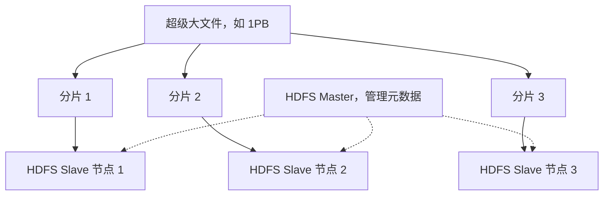
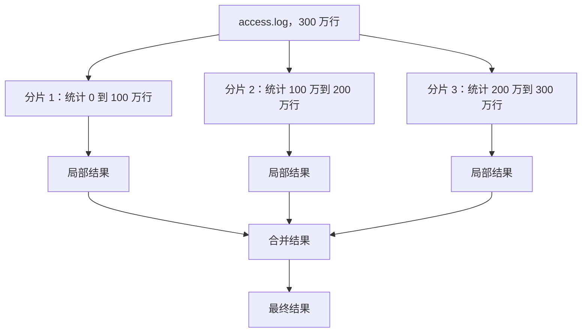

# Hadoop 入门：一套框架同时回答「存不下」和「算不动」

一个 1PB 的文件，单块硬盘最多按 TB 算，怎么放？一份 300 万行的访问日志要统计每个独立 IP 出现的次数，一台机器算到什么时候？Java 后台转大数据的第一课不碰安装、不敲命令，先回答这两个问题：Hadoop 就是用来同时解决大数据的存储问题和计算问题的分布式基础框架。官方说法是「使用简单的编程模型，跨大型计算机集群实现分布式处理的系统」，翻译成人话就是：把一堆普通机器攒成一个整体，存得下、算得动。

今日课程四块内容：Hadoop 介绍、集群环境搭建的准备工作、Linux 命令与 Shell 脚本增强、搭建集群环境。这里集中讲第一块，后三块在环境搭建篇展开。

## 先给结论

- Hadoop 主要解决两个问题：大数据的存储（HDFS，分布式文件系统）和大数据的计算（MapReduce，分布式计算）。
- HDFS 的思路是分块：大文件切成默认 128MB 的 block，分散存到多台机器，对外提供统一访问接口，用起来像本地文件。
- MapReduce 的思路是分而治之：把大计算任务拆成小任务并行算，再把局部结果汇总成最终结果。
- YARN 负责资源调度：Master 接收并分配计算任务，Slave 运行任务，MapReduce 跑在 YARN 之上。
- Hadoop 由四部分组成：HDFS、Hadoop Common、MapReduce、YARN；课程环境使用 3.1.1 版本。

## 一、大数据到底在干什么

大数据说的是对海量数据进行采集、存储、计算与分析，从中得到有价值的信息，帮助企业做判断和决策。听着玄，拆开就三步：

| 步骤 | 干什么 | 依赖什么 |
|---|---|---|
| 数据采集 | 先有数据，日志、埋点、爬虫、业务库 | Flume、Kafka 等采集工具 |
| 存储与计算 | 把数据放到集群上处理分析 | Hadoop 集群，即本课的主角 |
| 结果展示 | 把分析结果呈现出来支撑决策 | 报表、BI 工具 |

Hadoop 在第二步，是大数据处理里最基础的框架。后面课程里的 Hive、Flume 以及各种采集链路，都建立在它之上。

## 二、问题一：PB 级文件怎么存

先感受一下单位：1TB 等于 1024GB，1PB 等于 1024TB。单块硬盘撑死按 TB 计，一个 PB 级文件在任何一台单独的计算机上都放不下。HDFS（Hadoop Distributed File System）给出的答案是三步：切分、分散、统一访问。



**第一，文件分块。** 文件被切成一个个 block（也叫分片），Hadoop 2.x 起默认块大小 128MB（1.x 时代是 64MB）。一个 130MB 的文件会占 2 个 block，但实际落盘 130MB 而不是 256MB，块只按实际内容占用。块大小可以在 `hdfs-site.xml` 里调整（配置项出自课程讲义）：

```xml
<property>
    <name>dfs.block.size</name>
    <value>134217728</value>
</property>
```

**第二，块分散到不同节点。** 集群就是「一台存不下，就用一堆机器当一个整体」：128MB 一块，一块放在第一台机器，另一块放在第二台，机器数量足够多，多大的文件都存得下。

**第三，统一访问接口。** 对访问者来说看到的是一个完整文件，而不是一堆碎片；访问集群里的文件就像访问本地文件一样。这背后靠 HDFS Master 承担管理职责：它保存整个系统的文件信息，所有文件元数据的修改都从 Master 开始，其他机器作为 Slave 负责存数据块。这套 Master 与 Slave 的角色在课程讲义里对应 NameNode 与 DataNode：NameNode 存元数据（内存中），DataNode 存文件内容（磁盘上），文件内容的读写流量不经过 NameNode，否则它会成为瓶颈。

## 三、问题二：海量数据怎么算

数据存下了，还要算。典型任务：一份 nginx 访问日志 `access.log`，记录了一个月 300 万行访问记录，统计每个独立 IP 出现的次数。让一台计算机算，撑不住。

MapReduce 的思路是把大计算任务分成小任务并行计算，再汇总。300 万行拆成三个分片，每个分片 100 万行，各自跑一份统计程序得到局部结果，最后把局部结果合并成整体结果：



计算任务被分担给不同主机并行执行，效率成倍提升。这个「拆任务、并行算、再汇总」的模式就是分而治之，也是 MapReduce 这个名字里 Map（映射拆分）与 Reduce（归并汇总）的由来。

## 四、问题三：这些计算任务谁来调度

拆出来的小任务放到集群里跑，总得有人分配：哪台机器跑哪个分片、内存给多少、磁盘占多少。YARN 集群就是干这个的分布式计算资源调度系统：

- YARN 集群有一个 Master，负责接收计算任务、分配资源，管理任务的分配与资源的调度；
- 有多个 Slave，负责真正运行任务，最后由 Master 侧完成结果整合。

MapReduce 是基于 YARN 的大数据并行处理系统：计算模型归 MapReduce，跑在集群上靠 YARN 调度。两者分工记住一句话：MapReduce 管怎么算，YARN 管在哪算、用多少资源。

## 五、Hadoop 的组成与版本

把三个问题合起来，Hadoop 的四大组成就齐了：

| 组成 | 一句话定位 |
|---|---|
| HDFS | 分布式文件系统，解决存储，提供高吞吐量访问 |
| MapReduce | 基于 YARN 的大型数据并行处理系统，解决计算 |
| YARN | 作业调度和集群资源管理的框架 |
| Hadoop Common | 支撑其他模块的 Java 库和实用程序，含启动 Hadoop 所需的脚本 |

版本上，1.x 只有 HDFS 加 MapReduce，资源调度耦合在计算里；2.x 拆出了 YARN，块大小也从 64MB 演进到 128MB；3.x 是当前主线，课程环境用的就是 3.1.1。环境搭起来之后，命令行操作是第一件事，先混个脸熟（命令出自课程讲义）：

```bash
# 查看 HDFS 根路径下的文件或文件夹
hdfs dfs -ls /

# 将本地文件放到 HDFS 上
hdfs dfs -put localDir hdfsDir

# 递归创建文件夹
hdfs dfs -mkdir -p /xx/xxx
```

## 常见误区

- **以为 Hadoop 是一门编程语言或一个数据库。** 它是分布式基础框架，存储靠 HDFS、计算靠 MapReduce、调度靠 YARN；结构化查询是后来 Hive 这些工具在做的事。
- **把 block 理解成按 128MB 对齐占满。** 130MB 的文件占 2 个 block，实际占盘 130MB，块大小只决定切分粒度，不是按块填充。
- **以为读写文件都要过 Master。** 元数据（文件名、块位置）由 Master 管理，但文件内容的读写直接走存数据的 Slave 节点，Master 只负责「告诉你去哪拿」，否则必成瓶颈。
- **忽略副本机制谈可靠性。** 普通机器随时可能坏，HDFS 默认每份数据存三个副本：本地一份、同机架另一节点一份、不同机架一节点一份，靠副本而不是靠硬件保障数据安全。

## 面试可能被问到的问题

1. 面试官追问：「Hadoop 解决了大数据的哪两个核心问题？」
   答：存储和计算。HDFS 把大文件分块分散存到多台廉价机器上并提供统一访问接口；MapReduce 提供分而治之的并行计算模型，YARN 负责把计算任务调度到集群资源上运行。
2. 面试官追问：「HDFS 的 block 为什么从 64MB 演进到 128MB？」
   答：块太大，单个任务处理的数据多，失败重试代价大，且减少并发度；块太小，元数据量暴涨，NameNode 内存吃不消。128MB 是在任务粒度与元数据规模之间重新权衡的结果，HDFS 2.x 起默认 128MB。
3. 面试官追问：「NameNode 和 DataNode 各存什么？」
   答：NameNode 存元数据，即文件、block、DataNode 之间的映射关系，元数据保存在内存中；DataNode 存文件内容本身，在磁盘上，并维护 block id 到本地文件的对应关系，周期性向 NameNode 发心跳和块状态报告。
4. 面试官追问：「MapReduce 的分而治之具体指什么？」
   答：把大任务拆成可在不同节点并行执行的小任务，各分片独立计算得到局部结果，再对局部结果归并汇总成最终结果。以统计日志里独立 IP 次数为例，300 万行拆三片各算 100 万行，最后合并三份局部结果。
5. 面试官追问：「YARN 的作用是什么？没有它行不行？」
   答：YARN 负责作业调度与集群资源管理，Master 接收分配任务，Slave 运行任务，内存、CPU 等资源由它统一仲裁。Hadoop 1.x 没有它，资源管理与计算耦合在 MapReduce 里，只能跑 MapReduce 作业；2.x 拆出 YARN 后，Spark、Flink 等计算框架都能跑在同一资源层上。
6. 面试官追问：「为什么 Hadoop 能用廉价机器搭集群？」
   答：它的可靠性不靠硬件靠软件：数据多副本（默认三份）容忍节点故障，任务失败自动重试调度，NameNode 与 DataNode 分工让扩容只需加机器。硬件坏是常态假设，框架负责在故障下继续正确工作。

## 配套资料

- 讲义：`materials/code/04/day02-HDFS/day02/讲义/Note02.md`，HDFS 设计目标、NameNode 与 DataNode 架构对照表、block 块大小（1.x 64MB、2.x 起 128MB）、`hdfs-site.xml` 块大小配置、三副本存放策略、`hdfs dfs` 命令均出自该讲义，课程环境为 Hadoop 3.1.1。
- 本教学日（day01 介绍部分）无配套源码包；文中分片拆分与统计任务的描述按本课画面线（HDFS 架构图与 access.log 拆分流程图）整理。
