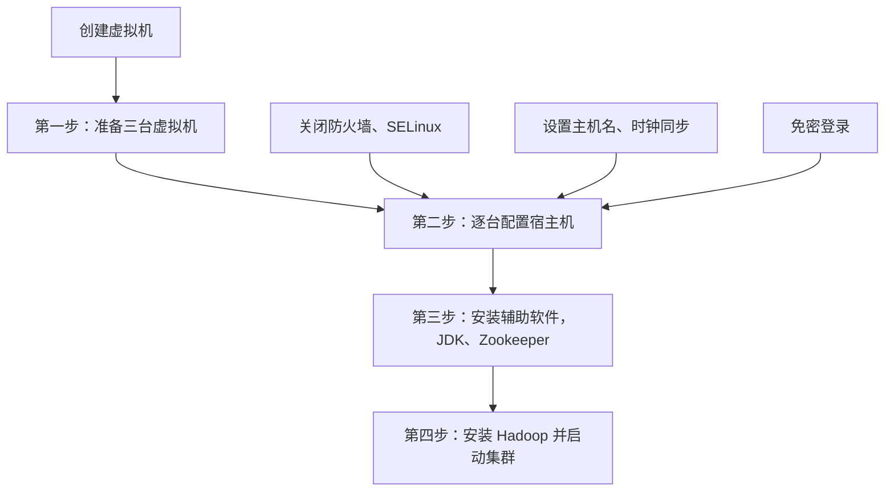

# 大数据集群第一步：在 VMware 里备好 node01 到 node03 三台虚拟机

学 Hadoop 绕不开集群，集群需要多台机器。个人电脑上没有服务器可买，标准做法是用虚拟机模拟：在一台 Windows 上跑出三台 Linux 主机组集群。环境搭建看似体力活，坑却集中在开工之前：虚拟机服务没起、网段没摸清、`.vmx` 版本号对不上，随便一个都能让人卡一下午。这一课把三台虚拟机备出来，为后面的 Linux 配置、JDK 与 Zookeeper 安装、Hadoop 部署铺路。

## 先给结论

- 环境搭建四步走：准备虚拟机、逐台配置、安装 JDK 与 Zookeeper 等辅助软件、安装 Hadoop；本课只走第一步。
- 创建虚拟机推荐复制现成镜像而不是从 ISO 逐步安装：资料包里已装好 CentOS 6.9，复制三份改名即用。
- 开箱前两个检查：Windows 里 VM 开头的服务全部正在运行；VMnet8 网卡与 NAT 网关配置在同一网段（本课网段 174）。
- 三台虚拟机按 node01、node02、node03 命名，磁盘至少预留 100GB；node04 作备份机可选。
- 虚拟机打不开多数是 VMware 版本不匹配，改 `.vmx` 里的 version 字段即可。

## 一、环境搭建四步走，本课只走第一步

整套环境搭建的路线图如下，第一步是今天的全部任务：



课程 PPT 把第二步拆成了七件小事：关闭防火墙、关闭 SELinux、设置主机名、重启、设置时钟同步服务、配置用户权限、免密登录；第四步则是下载并解压、修改配置、分发到每个节点、格式化 HDFS、启动集群五连。后面每一步都会单独展开，这里先建立全局地图，避免装着装着不知道自己在哪一步。

## 二、两种创建方式：复制优先于安装

创建虚拟机有两种方式：

**方式一，ISO 镜像逐步安装。** 挂载镜像、分区、设密码、装系统一步步走。过程全是基础操作，费时且毫无技术增量，课程明确不推荐。

**方式二，复制现成虚拟机。** 资料包里提供了一个已经装好 CentOS 6.9 的「干净机」虚拟机文件夹，内含 `.vmx`、`.vmdk` 等文件。把整个文件夹复制出来就能开机使用，课程采用这种方式。

用这种方式前有个准备工作要做足：确认 Windows 系统里所有 VMware 的服务都已开启。打开任务管理器的「服务」标签，找 VM 开头的服务，包括 VMware Authorization Service、VMware DHCP Service 等几个，全部要处于「正在运行」状态。有任何一个停止，环境搭完虚拟机可能不能正常联网，甚至虚拟机窗口都打不开。没运行的右键「开始」即可。

## 三、摸清网段：NAT 网关与 VMnet8 网卡

第二个检查是网络。VMware 里打开「编辑」菜单的「虚拟网络编辑器」，选中 VMnet8，模式是 NAT（网络地址转换，虚拟机通过宿主机转发上网，对外不直接暴露）。点开下面的「NAT 设置」，能看到网关地址，本课环境是 192.168.174.1。要记住两件事：

- **记住网段。** 本课是 174 网段，后面给每台虚拟机配 IP 都必须落在这个网段里，网关与子网掩码（255.255.255.0）以编辑器里看到的为准。
- **宿主机网卡配静态 IP。** 在「更改适配器选项」里找到 VMnet8 这块 VMware 虚拟网卡，IPv4 属性里设置固定 IP，网段同为 174，网关与刚才保持一致；DNS 统一填 8.8.8.8（Google 公共 DNS）。

宿主机与虚拟机同网段，后面才能从 Windows 直接 SSH 到各节点，这是集群操作的基础。

## 四、复制三份，起名 node01 到 node03

网络底座确认后开始复制：把资料包里那个现成虚拟机文件夹复制三份（有余力可复制第四份 node04 当备份机，以后做额外实验用），文件夹分别重命名为 node01、node02、node03。虚拟机文件动辄几十 GB，**磁盘至少预留 100GB** 给这几台机器，不然复制到一半空间告急。

每台的使用方式：双击文件夹里的 `.vmx` 文件，VMware 会自动加载这个虚拟机。加载后在 VMware 左侧列表里右键重命名，把显示名改成与文件夹一致的 node01、node02、node03，三台机器的名字与后续配置里出现的主机名一一对应，别让列表里挂着三个「CentOS 6.9」分不清谁是谁。

## 五、虚拟机打不开：改 .vmx 的版本号

最常见的故障：双击 `.vmx` 后 VMware 直接报错。原因是资料制作者的 VMware 版本（课程里用的是 10）与你本机的版本（可能是 12 或 14）不一致，`.vmx` 里记录的硬件版本高于或低于本机支持范围。

解法是文本编辑器打开 `.vmx` 文件，找到 version 一行，把值改成本机 VMware 对应的版本号：你是 10 就写 10，是 12 写 12，是 14 写 14。改完保存再双击就能正常加载：

```properties
# .vmx 文件中记录虚拟机硬件版本的一行，值要与本机 VMware 版本匹配（示例）
virtualHW.version = "10"
```

这一行不匹配，虚拟机就是打不开，排查顺序应当放在所有玄学问题之前。

## 六、接下来的路线：IP、主机名与 SSH 铺垫

三台机器开起来只是把「硬件」备好，离能装 Hadoop 还差一层网络与主机层的配置。按课程路线，后续会给每台机器设静态 IP、改主机名、配置 hosts 映射、再做免密登录。本课网段下的一套常见规划如下（示例，按本课写法补全）：

| 主机名 | IP 地址 | 角色 |
|---|---|---|
| node01 | 192.168.174.10 | 集群节点 1 |
| node02 | 192.168.174.11 | 集群节点 2 |
| node03 | 192.168.174.12 | 集群节点 3 |
| 宿主机网关 | 192.168.174.1 | NAT 网关 |

三台机器之间与宿主机之间靠主机名互相访问，hosts 映射是前提，每台机器的 `/etc/hosts` 都要写全三行（示例）：

```bash
# /etc/hosts，三台机器都配，一行一台
192.168.174.10 node01
192.168.174.11 node02
192.168.174.12 node03
```

配好之后，`ssh node02` 这样的命令在 node01 上直接可用，不用记 IP。再往后，PPT 路线里的免密登录（SSH 公钥互信）是 Hadoop 分发配置、远程启停集群进程的前提：启动脚本靠 SSH 免密到各节点拉起进程，密码交互一次都过不去。这些内容在后面几篇逐台落实。

## 常见误区

- **服务没全开就急着搭环境。** VM 开头的服务缺一个在运行，轻则虚拟机不能联网，重则直接打不开；排查永远从任务管理器的服务列表开始。
- **IP 配出了网段。** 虚拟机 IP 必须与 NAT 设置里的网段一致（本课 174），配成其他网段后宿主机 ping 不通，Hadoop 节点之间也互相看不见。
- **复制虚拟机后不改名。** 文件夹、VMware 列表名、系统主机名三处保持一致的 node01 到 node03 命名，后面写脚本和看日志才不会张冠李戴。
- **忽略 .vmx 的版本字段。** 双击报错先怀疑版本号不匹配，改 `virtualHW.version` 成本机版本，比重装 VMware 或重装虚拟机省一个下午。

## 面试可能被问到的问题

1. 面试官追问：「NAT 模式下虚拟机是怎么上网的？」
   答：虚拟机不直接接入物理网络，而是通过宿主机的 VMnet8 虚拟网卡与 NAT 设备做地址转换，以宿主机的身份访问外部网络。虚拟机之间和宿主机之间在同一个私有网段内互通，本课网段是 192.168.174.0。
2. 面试官追问：「搭 Hadoop 集群为什么要至少三台机器？」
   答：HDFS 默认每个数据块存三个副本，需要三个数据节点才能完整落盘三副本；主从架构下 NameNode、DataNode、ResourceManager、NodeManager 等角色也要分布在不同机器，三台是能体现集群语义的最小规模。
3. 面试官追问：「hosts 映射解决了什么问题？」
   答：把主机名解析到 IP，让节点之间用 node01、node02 这类名字互相访问。Hadoop 的配置文件里写的是主机名，集群扩容换 IP 只改 hosts 不动配置，脚本与日志也按主机名可读。
4. 面试官追问：「SSH 免密登录的原理是什么？」
   答：基于公钥认证。本机生成密钥对后把公钥分发到目标节点的授权列表里，SSH 握手时目标节点用公钥验证本机私钥的签名，验证通过即登录，全程不传密码。Hadoop 的启动与分发脚本依赖它批量操作各节点。
5. 面试官追问：「虚拟机复制出来的集群，和云上的真实集群差别在哪？」
   答：架构与操作流程一致，差别在资源与容错：虚拟机共享宿主机 CPU、内存与磁盘 IO，性能数据不可信；云上集群面对真实的网络分区与硬件故障，副本与调度机制才真正接受考验。学习阶段用虚拟机足够，生产结论要回到真实环境验证。

## 配套资料

- 本教学日无配套源码包，`materials/code/04/` 下没有 day01 目录；文中 IP 规划表、hosts 配置、`.vmx` 版本行均为按本课写法补全的示例。
- 主机名与集群命名印证：`materials/code/04/day02-HDFS/day02/讲义/Note02.md`，后续讲义中的 HDFS API 与配置均以 `hdfs://node01:8020`、node01 等 host 名访问集群，与本课的 node01 到 node03 命名一致。
- 环境搭建四步与「配置宿主机」七件事、「安装 Hadoop」五步清单抄录自本课画面线（PPT 环境搭建页）。
