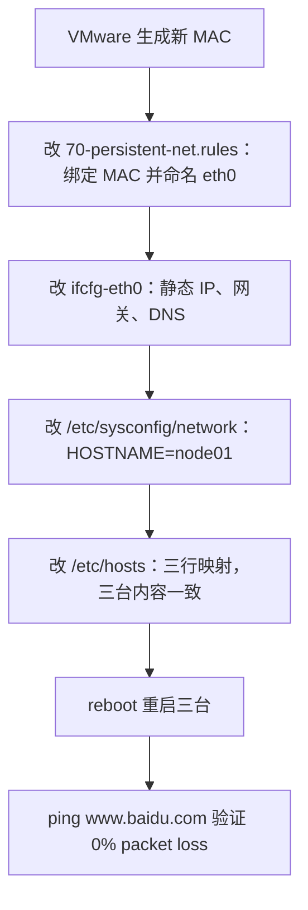

# 克隆机的网络改造：MAC、静态 IP、主机名与 hosts 一次配齐

三台虚拟机是同一份镜像复制出来的，系统里的网络配置一模一样：MAC 地址相同、网卡名混乱、主机名相同。直接开机入网，MAC 冲突会让网络时通时断，主机名全是同一个也让后续集群配置无从下手。这一课按固定套路改四个文件，改完重启，三台机器各自拥有唯一身份，并且都能上网。

## 先给结论

- 克隆机网络改造只碰四个文件：`/etc/udev/rules.d/70-persistent-net.rules`（MAC 与网卡名）、`/etc/sysconfig/network-scripts/ifcfg-eth0`（静态 IP）、`/etc/sysconfig/network`（主机名）、`/etc/hosts`（IP 与主机名映射）。
- MAC 地址必须在 VMware 设置里点「生成」拿新的，前缀 00:50:56 固定，后六位才是身份差异；三台绝不能相同。
- 网关必须与虚拟网络编辑器 NAT 设置里的网关一致（本课 192.168.174.1），否则上不了外网。
- 每台配完执行 `reboot`，用 `ping www.baidu.com` 验证，0% packet loss 即达标。

## 一、改 MAC：让三台机器在网络里各有各的身份

克隆带来的第一个问题是三台机器的 MAC 地址完全相同。MAC 是网卡的唯一标识，两块网卡同 MAC 就会在网络里撞车。解法分两半：在虚拟化层生成新 MAC，在系统里让规则文件认这个新 MAC。

VMware 里右键虚拟机 → 设置 → 网络适配器 → 高级，点一次「生成」，得到一个新地址，前缀 00:50:56 是 VMware 固定的，后六位才是机器之间的差异，把它抄下来。然后修改 udev 的网卡规则文件（文件路径与命令出自课程讲义）：

```bash
vim /etc/udev/rules.d/70-persistent-net.rules
```

克隆机里这个文件通常有两三条网卡绑定记录，把多余的整行删掉只留一条，改成下面这个样子（示例取 node01，MAC 换成自己生成的那串）：

```bash
# 只保留一条规则：绑定新 MAC，并把网卡名定为 eth0
SUBSYSTEM=="net", ACTION=="add", DRIVERS=="?*", ATTR{address}=="00:50:56:33:86:4d", ATTR{type}=="15", KERNEL=="eth*", NAME="eth0"
```

两个关键点：ATTR 里的地址必须与刚生成的 MAC 完全一致；行尾 NAME 改成 `eth0`，因为克隆残留的记录常挂在 eth1 上，不归位的话，下一步的 ifcfg-eth0 配置文件就对不上网卡。三台机器依次做一遍，每台各生成一次。

## 二、配静态 IP：ifcfg-eth0 的八个关键项

IP 地址写在网卡的配置文件里：

```bash
vim /etc/sysconfig/network-scripts/ifcfg-eth0
```

按集群规划表把 node01 的文件改成（node02、node03 仅 IPADDR 换成 120 与 130，HWADDR 换成各自生成的 MAC）：

```bash
DEVICE=eth0                     # 第一块网卡，与 udev 规则里的 NAME 一致
HWADDR=00:50:56:33:86:4d        # 必须与刚写入 udev 的 MAC 一致
ONBOOT=yes                      # 开机即激活网卡
BOOTPROTO=static                # 静态 IP，写死不租借
IPADDR=192.168.174.100          # 本机 IP，照集群规划表填
GATEWAY=192.168.174.1           # 网关，必须与 NAT 设置一致
NETMASK=255.255.255.0           # 子网掩码
DNS1=8.8.8.8                    # 域名解析服务器
```

最容易错的是网关。打开 VMware 的「编辑 → 虚拟网络编辑器 → NAT 设置」，里面显示的网关是 192.168.174.1，`GATEWAY` 必须照抄这个值，抄错一格三台机器都上不了外网。`ONBOOT=yes` 与 `BOOTPROTO=static` 也是常漏的两行：前者不设，开机网卡不激活，机器根本没有 IP；后者不设成 static，IP 由 DHCP 动态分配，集群规划表里的地址就作废了。

## 三、主机名与 hosts：集群里互相认得出对方

主机名写进 `/etc/sysconfig/network`，重启后永久生效：

```bash
vi /etc/sysconfig/network
HOSTNAME=node01     # node02、node03 分别改为 node02、node03
```

`/etc/hosts` 负责把主机名解析成 IP，三台机器写的内容完全一样，集群里任何一台都能用名字访问另外两台：

```bash
vim /etc/hosts
192.168.174.100 node01.hadoop.com node01
192.168.174.120 node02.hadoop.com node02
192.168.174.130 node03.hadoop.com node03
```

一行写两个名字是刻意为之：`node01.hadoop.com` 是域名风格的全名，`node01` 是短名，名字与 IP 等价，以后浏览器访问、Hadoop 配置引用直接用短名就行。hosts 配齐之后，节点间相互访问、后面的免密登录按主机名执行，才都成为可能。

## 四、重启与验证

四个文件全部改完，每台执行 `reboot`（主机名的永久生效也依赖这次重启），登录后逐台验证外网连通性：

```bash
ping www.baidu.com
# 4 packets transmitted, 4 received, 0% packet loss, time 395ms
```

四发四收、丢包 0%，说明静态 IP、网关、DNS 全链路正确。三台都过这一关，网络配置收工。整个改造流程串起来是这样：



图中任何一步跳过，后果各不相同：少第一步网络冲突，少第二步没有 IP，少第三步节点同名，少第四步 `ssh node02` 这类命令解析不了。排查时按图从上往下逐项核对，比瞎试快得多。

## 常见误区

- **三台都不点「生成」，沿用克隆来的同一个 MAC。** 网络里 MAC 冲突，时通时断的怪象多半源于此；生成后还要同步写进 udev 规则与 ifcfg 的 HWADDR。
- **网关自己编一个。** 网关必须等于 NAT 设置里显示的 192.168.174.1，凭感觉写 192.168.174.2 会直接断外网。
- **hosts 只改了自己这台。** 三台的 hosts 内容必须一致，只配 node01 一台，node02 上照样 ping 不到 node03。
- **改完不重启也不重启网络服务。** 主机名要 reboot 才永久生效，网络不生效就急着配下一步，后面全部白干。

## 面试可能被问到的问题

1. 面试官追问：「集群为什么必须静态 IP，DHCP 不行吗？」
   答：DHCP 租约到期会换 IP，而 hosts 映射、Hadoop 配置、运维脚本全部绑定主机名与 IP 的对应关系，IP 一变集群互访就断。生产集群一律静态 IP 或在 DHCP 里做地址保留。
2. 面试官追问：「克隆出来的虚拟机不改 MAC 会出什么问题？」
   答：多台机器持有相同 MAC，交换机的地址学习表会在两个端口之间来回漂移，表现为丢包、时通时断。克隆后必须在虚拟化层重新生成 MAC，并同步更新系统内的网卡规则文件。
3. 面试官追问：「hosts 文件和 DNS 什么关系？」
   答：hosts 是本机的静态解析表，优先于 DNS 查询，适合小集群内固定映射；DNS 是分布式解析服务，负责外网域名。集群内部用 hosts 稳定可控，访问公网才走 DNS1 指定的解析服务器。
4. 面试官追问：「ping 百度通了就能说明集群网络配好了吗？」
   答：只能说明外网链路与 DNS 正常。还要节点之间互 ping 主机名验证 hosts 映射，再 ssh 一次确认节点可达，三样都通，网络层才算就绪。
5. 面试官追问：「ONBOOT 和 BOOTPROTO 分别控制什么？」
   答：ONBOOT 决定系统启动时是否激活该网卡，默认 no 会导致开机后没有 IP；BOOTPROTO 决定 IP 获取方式，dhcp 自动租借，static 手工指定。配 static 时必须同时给出 IPADDR、NETMASK、GATEWAY 三件套。

## 配套资料

- 本教学日无配套源码包；四个文件的路径与修改清单出自本课画面线（PPT「设置 IP 和 Mac 地址」页、NAT 设置与 hosts 编辑截图），配置文件内容为按本课写法补全的可运行示例。
- 主机名命名印证：`materials/code/04/day02-HDFS/day02/讲义/Note02.md`，后续讲义与代码均按 node01 等主机名访问集群。
