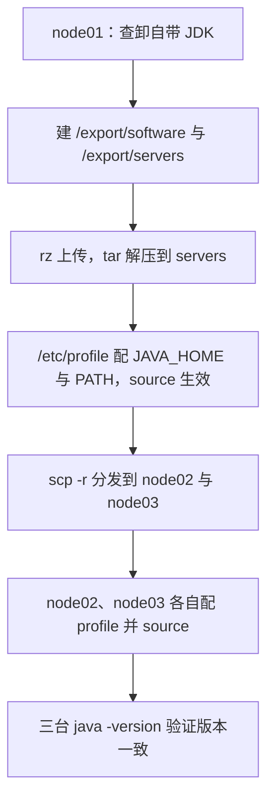

# 给三台机器装 JDK：统一目录、上传解压与环境变量分发

Hadoop 由 Java 编写，每个节点都要有可用的 JDK，集群进程才起得来。装 JDK 本身只是解压加环境变量，真正的功夫在三台机器如何保持一致：目录约定统一、压缩包只传一次、其余靠 scp 分发。这一课把 node01 装好配好，再把结果复制到 node02 和 node03。

## 先给结论

- 先用 `rpm -qa | grep java` 查系统自带 JDK，有就 `rpm -e 包名` 卸掉，避免版本打架。
- 目录约定贯穿整个课程：`/export/software` 放安装压缩包，`/export/servers` 放解压后的软件。
- 上传用 `rz`（先 `yum -y install lrzsz`），解压 `tar -zxvf 包名 -C /export/servers`，大写 C 指定目标目录，漏写必出错。
- 环境变量配 `JAVA_HOME` 与 `PATH` 两行，`source /etc/profile` 生效；node02、node03 用 `scp -r` 拷过去后照抄 profile 配置。
- 验证一律 `java -version`，三台都要过一遍。

## 一、先清场：查卸系统自带的 JDK

CentOS 镜像里常带 OpenJDK 残留，与手工安装的 JDK 并存时，编译和 Hadoop 启动都可能用到非预期版本。三台机器各查一遍：

```bash
rpm -qa | grep java
# 有输出则按下例卸载，包名以查询结果为准
rpm -e java-1.8.0-openjdk-1.8.0.141-1.el6_8.x86_64
```

查询结果为空就直接进入下一步；有输出则逐个卸载，包名照抄 `rpm -qa` 里看到的那一串。

## 二、目录约定：software 放包，servers 放软件

安装位置不统一，后期排查和分发都要多花一倍力气。课程全程遵守一个约定，在根目录下建两层：

```bash
mkdir -p /export/software   # 存放各类安装压缩包
mkdir -p /export/servers    # 存放解压安装后的软件
```

后面 Hadoop 3.1.1 也装在 `/export/servers` 之下，整套课程共用这套路径。node02、node03 开工前同样先把这两个目录建好，分发时路径才能一一对齐。

## 三、上传与解压

`rz` 命令走 Zmodem 协议，从 Windows 直接把文件拖进 Linux，需要先装支持包：

```bash
yum -y install lrzsz    # 一次性安装，rz 上传，sz 下载
```

传压缩包时先 `cd /export/software` 再执行 `rz`，文件直接落在当前目录；在别处传完再用 `mv` 挪过去也可以，只是多一步。解压用 `-C` 把目的地指到 servers：

```bash
cd /export/software
rz                                       # 选择 jdk-8u141-linux-x64.tar.gz
tar -zxvf jdk-8u141-linux-x64.tar.gz -C /export/servers
```

`-zxvf` 四个字母分别是解 gzip 压缩、显示过程、指定文件名；`-C` 大写，指定解压目的地。漏写 `-C` 是这一步的经典坑：解压目标不对，课程里现场就报了错，补上大写 C 才顺利解到 servers。解压完成后 `/export/servers/jdk1.8.0_141` 就是 JAVA_HOME 要指向的目录，目录名带小版本号，以 `ls` 看到的真实名字为准。

版本选择上课程用 JDK 8 配 Hadoop 3.1.1，这是经过大量验证的稳定组合；JDK 8 之后的版本模块化改动大，追新装反而容易踩兼容坑，学习环境跟课程版本走最省事。

## 四、环境变量与生效

编辑 `/etc/profile`，在文件末尾追加两行：

```bash
export JAVA_HOME=/export/servers/jdk1.8.0_141
export PATH=$PATH:$JAVA_HOME/bin
```

`JAVA_HOME` 声明 JDK 安装目录，Hadoop 的启动脚本后面也要读它；`PATH` 把 `$JAVA_HOME/bin` 追加到既有路径尾部，`java`、`javac` 才能在任意目录直接敲。保存后执行 `source /etc/profile` 让配置立即生效，然后验证：

```bash
java -version
# 输出 java version "1.8.0_141" 即安装成功
```

顺手治一个刷屏小毛病：每执行几条命令就弹一句 `You have new mail in /var/spool/mail/root`，这是系统的邮件检查提醒，与集群无关。在 `/etc/profile` 里加一行 `unset MAILCHECK`，再 source 一次即可关掉。

## 五、分发到 node02 与 node03

node01 已经有完整可用的 JDK，另外两台不必重新上传，直接远程拷贝：

```bash
scp -r /export/servers/jdk1.8.0_141/ node02:$PWD
scp -r /export/servers/jdk1.8.0_141/ node03:$PWD
```

`-r` 递归拷贝整个目录，少它必报 omitting directory；`$PWD` 是 shell 的当前目录环境变量，放在目标位置表示拷到对端的同名路径下。执行前先站在 `/export/servers` 里，两端路径自动对齐，第二节目录约定的价值就在这里兑现。前提是上一篇的 SSH 免密已配好，否则每台都要输一次密码。

拷完在 node02、node03 上各自补 `/etc/profile` 的两行环境变量并 `source /etc/profile`，路径必须与本地 `ls` 出来的 JDK 目录一致。三台全部 `java -version` 过一遍，版本一致才算收工。



图里最值得学的是「只传一次包」：上传和解压只发生在 node01，其余机器靠内部分发，比三台各自上传省时间，也不容易出版本差异。

## 常见误区

- **`JAVA_HOME` 路径照模板抄。** 目录名带小版本号，jdk1.8.0_141 换个版本就变，抄错一个字符 `java -version` 就提示找不到命令；以 `/export/servers` 下的真实目录名为准。
- **只配 `JAVA_HOME` 不追加 PATH。** 变量声明了但命令不在搜索路径里，敲 `java` 依旧 command not found。
- **改完 profile 忘了 source。** 当前会话读不到新变量，误以为配置失败又去乱改；改完立刻 `source /etc/profile`。
- **scp 漏 `-r`。** 拷目录不递归直接报 omitting directory，JDK 是整个目录树必须带 `-r`；免密没配好还会卡在输密码。

## 面试可能被问到的问题

1. 面试官追问：「为什么不用 yum 直接装 OpenJDK？」
   答：生产与学习环境更常用官方二进制包：版本完全可控、统一装在约定目录、多节点分发与回滚简单。yum 装的 OpenJDK 路径分散、版本随仓库走，集群环境一致性差，出问题时排查成本高。
2. 面试官追问：「JAVA_HOME 是给谁用的？」
   答：除了把 bin 目录加进 PATH 方便人敲命令，Hadoop 的启动脚本也依赖 JAVA_HOME 定位 JVM，变量缺失时 hadoop 命令直接报错要求设置。它是集群级变量，不是可有可无的个人偏好。
3. 面试官追问：「source /etc/profile 和重新登录有什么区别？」
   答：source 在当前 shell 里读取并执行脚本，变量立即写入当前会话；重新登录是父进程重新初始化一份环境。改完 profile 用 source 免去登出登入，效果等价。
4. 面试官追问：「scp 命令里 $PWD 起什么作用？」
   答：$PWD 是当前目录变量，放在目标路径位置表示拷到远端的同名绝对路径下，前提是本地此刻正站在对应目录里。它省去对端路径的重复书写，也倒逼两端目录结构保持一致。
5. 面试官追问：「三台机器 JDK 版本不一致会出什么事？」
   答：Hadoop 各节点的进程由各自节点的 JVM 运行，字节码版本与 GC 行为差异可能造成部分节点启动失败或行为不一致，排查极其困难。集群软件版本统一是环境搭建的基本纪律，分发式安装正是为此。

## 配套资料

- 讲义：`materials/code/04/day02-HDFS/day02/讲义/Note02.md`，其中 Hadoop 3.1.1 安装于 `/export/servers` 的路径写法与本课目录约定一致，后续 `hdfs-site.xml` 等配置均基于该环境。
- shell 与 profile 配置写法实例：`materials/code/04/day02-HDFS/day02/资料/test.sh`。
- day01 无源码包；文中 jdk-8u141-linux-x64.tar.gz 包名与 profile 两行配置，为按本课画面线（解压目录 jdk1.8.0_141 与 profile 编辑截图）补全的可运行示例。
