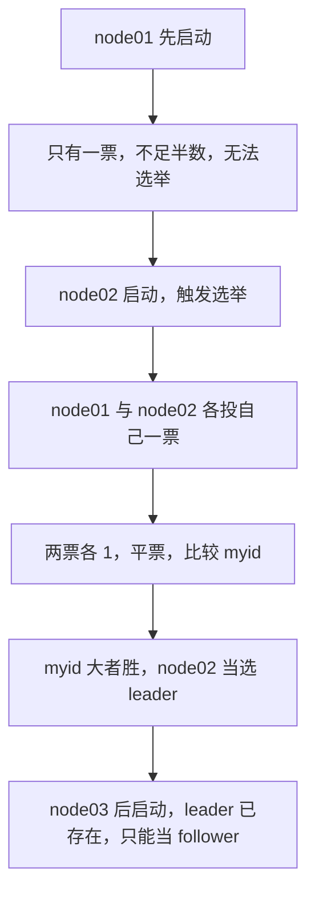
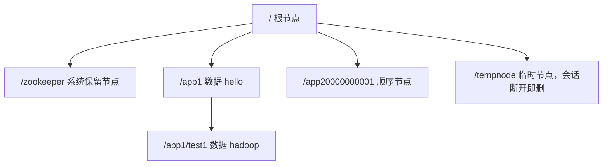
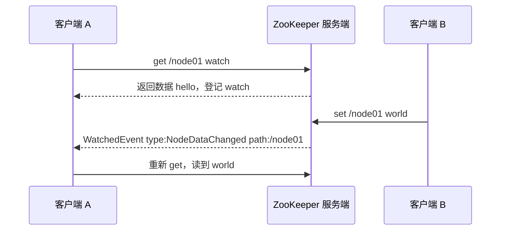
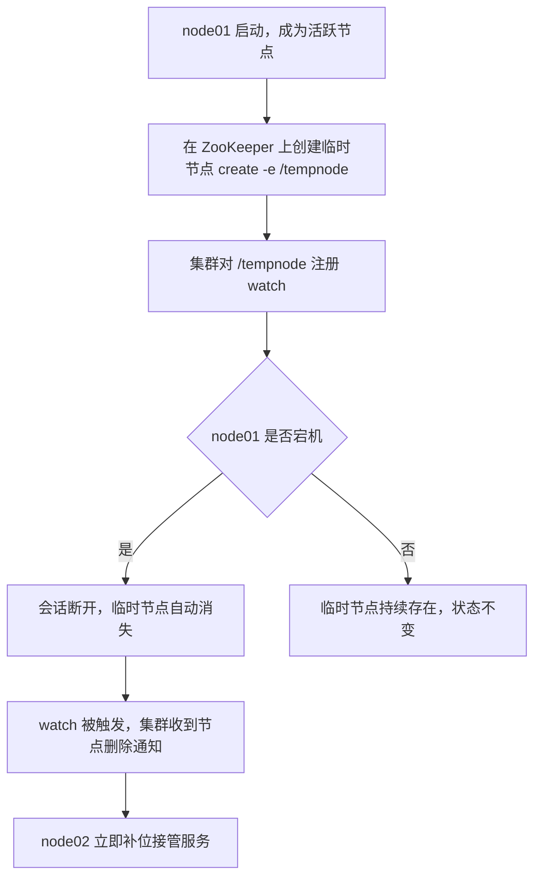

# Zookeeper的协调之道：集群搭建、Znode 节点操作与 watch 机制

## 先给结论

- 系列定位：大数据阶段的分布式协调入门，三篇依次解决「ZooKeeper 是什么怎么装、节点怎么操作、变化怎么感知」三个问题。
- 定位与安装：ZooKeeper 是开源分布式协调服务框架，本质是只存小文件（上限 1M）的分布式文件系统；安装六步里 myid 与 `server.N` 编号一一对应是成败关键。
- 集群角色两类：leader 处理读写、follower 只读并转发写请求；三台依次启动时 myid 最大的当选 leader，启动顺序影响选举结果。
- 节点操作把 ZooKeeper 当文件系统用：Znode 既是目录又是文件，`create` 的 `-s` 与 `-e` 组合出四种节点类型；delete 删空节点、rmr 递归删除，临时节点绑定会话、断开即消失。
- watch 机制是协调能力的核心：节点创建、删除、数据修改或子节点变化时主动通知，通知一次性、不含新数据，持续监听要在收到通知后重新注册。
- 两大典型应用：发布订阅适合配置变更这类低频协调事件；临时节点加 watch 撑起高可用的单点故障切换，活跃节点宕机、临时节点自动删除、备节点接管。
- 全系列命令基于 zookeeper-3.4.9 的 zkCli 实操画面整理，zkServer.sh 与 zkCli.sh 分别是服务端与客户端脚本，别敲混。
- 后续 Hadoop HA 章节的故障切换就落在这套临时节点加 watch 的机制上。

## 第1部分：ZooKeeper 是什么、怎么装：分布式协调器定位与三节点集群搭建

Hadoop 集群是一堆主机组成的整体对外提供服务，绕不开一个问题：一份配置文件要让所有节点看到的内容完全相同，谁来保证？改配置时一个节点改完、另一个还没来得及改，读到的值就不一样。这类「让集群各节点协调一致」的事，就是 ZooKeeper 的职责。它还是后续 Hadoop 高可用、Kafka、HBase 等框架的共同地基，必须先把它装起来。

### 一、分布式协调器：它到底协调什么
**ZooKeeper 的定位是集群的管理者。** 它是开源的分布式协调服务框架，主要用来管理集群、为应用系统提供一致性服务。它源自 Google 的 Chubby，Chubby 是谷歌内部解决分布式一致性问题的组件，ZooKeeper 把这套思想做成了开源实现。

理解它最省力的角度是文件系统：**ZooKeeper 本质上是一个分布式文件系统，里面主要存小文件。** 它有根目录 `/`，根下有子目录，结构很像 Linux；数据实际分布在集群的不同节点上，对外却呈现为一个统一的文件系统视图。里面存的东西叫 Znode，Znode 有路径，例如 `/data/host1`，路径可以理解为名字；Znode 也能携带数据，例如 `/data/host1` 的值是一台主机的 IP `192.168.6.1`。正因为这套特性，可以用操作文件系统的方式操作 ZooKeeper，完成协调动作。数据量有上限（1M 级别），所以它放的是配置、状态、主机列表这类小数据，不是业务大文件。

**角色划分上，ZooKeeper 自己也是一个集群。** 常见规模是三台主机，节点分两类：一个集群的管理者叫 leader，其余的从机叫 follower，一个集群只有一个 leader。客户端有 Java 客户端、shell 命令客户端等多种，请求直接访问 ZooKeeper 集群。拿一个具体场景看读写两条路径：Hadoop 集群有一份配置，某个 Znode 里存着 `ip=192.168.174.100`，三个 ZooKeeper 节点保存的信息相同，客户端从任意节点读到的值都一致，这是读请求。客户端要把它改成 `192.168.174.110` 时，写请求发给了 follower，follower 没有能力处理事务操作，只能转发给 leader。


图里要盯住写请求这条线：leader 先改自己的数据，再让所有 follower 跟着改；全部节点更新完成之前，另一个客户端的读请求必须等待，不会读到只改了一半的中间状态。这就是 ZooKeeper 保证数据一致性的方式：写请求执行完了，读请求才能执行，操作具备原子性。支撑这套规则的是它背后的 ZAB 协议，协议里有一个全局的事务生成者，就是 leader，所有修改必须由 leader 发起。

**leader 怎么产生？靠选举。** 三台机器互相投票，谁得票多谁当 leader，选举算法与启动顺序的关系在第四节用实操验证。至于 ZooKeeper 能干什么：发布订阅、命名服务、分布式锁、分布式协调，后面的课程会逐个落地；当下最要紧的是先把集群装好。

### 二、安装规划：一张表定三台机器
安装前先定下三台机器的角色编号，这张表贯穿整个安装过程：

| 服务器 IP | 主机名 | myid 的值 |
|---|---|---|
| 192.168.174.100 | node01 | 1 |
| 192.168.174.110 | node02 | 2 |
| 192.168.174.120 | node03 | 3 |

myid 可以理解成每个 ZooKeeper 节点的编号，配置文件里的 `server.1`、`server.2` 与它一一对应。版本用 zookeeper-3.4.9，安装包可从 Apache 官方地址 `archive.apache.org/dist/zookeeper/` 下载，路径约定沿用前面的课程环境：压缩包放 `/export/software`，软件解压到 `/export/servers`。

### 三、动手：六步搭起三节点集群
**第一步，上传并解压。** 压缩包传到 node01，解压到 servers 目录：

```bash
cd /export/software
rz                                    # 上传 zookeeper-3.4.9.tar.gz
tar -zxvf zookeeper-3.4.9.tar.gz -C /export/servers
```

**第二步，准备配置文件与数据目录。** 解压出来只有模板 `zoo_sample.cfg`，先拷一份正式的 `zoo.cfg`，再建一个存放 ZooKeeper 数据的目录：

```bash
cd /export/servers/zookeeper-3.4.9/conf
cp zoo_sample.cfg zoo.cfg
mkdir -p /export/servers/zookeeper-3.4.9/zkdatas
```

**第三步，修改 `zoo.cfg`。** 指定数据目录、快照保留数量、日志清理周期，并把三台服务器登记进去：

```properties
# 通信与投票的基础参数
initLimit=10
syncLimit=5
# 数据存放目录，必须与上一步创建的 zkdatas 路径一致
dataDir=/export/servers/zookeeper-3.4.9/zkdatas
# 客户端连接端口
clientPort=2181
# 快照保留数量
autopurge.snapRetainCount=3
# 日志清理周期，单位小时，0 表示关闭自动清理
autopurge.purgeInterval=1
# 集群服务器列表：编号=主机名:follower 与 leader 通信端口:选举端口
server.1=node01:2888:3888
server.2=node02:2888:3888
server.3=node03:2888:3888
```

server 后面的数字就是 myid，表示第几台 ZooKeeper；2888 与 3888 是约定俗成的固定端口，前者用于 follower 与 leader 同步数据，后者用于选举投票。

**第四步，给 node01 写 myid。**

```bash
echo 1 > /export/servers/zookeeper-3.4.9/zkdatas/myid
```

执行完可以 `more` 一下这个文件确认内容是 1，也可以直接打开文件手写，效果相同。

**第五步，分发安装目录并修改另两台的 myid。** 整个目录远程拷贝到 node02 与 node03，再把它们的 myid 分别改成 2 和 3：

```bash
scp -r /export/servers/zookeeper-3.4.9/ node02:/export/servers/
scp -r /export/servers/zookeeper-3.4.9/ node03:/export/servers/
# 在 node02 上执行
echo 2 > /export/servers/zookeeper-3.4.9/zkdatas/myid
# 在 node03 上执行
echo 3 > /export/servers/zookeeper-3.4.9/zkdatas/myid
```

改 myid 必须用单箭头 `>`。两个尖括号 `>>` 是追加，旧值会留下来，文件里就成了 12、13，节点编号直接错乱。

**第六步，三台启动并验证。** 三台机器依次执行启动命令：

```bash
/export/servers/zookeeper-3.4.9/bin/zkServer.sh start
jps                                   # 出现 QuorumPeerMain 即服务进程
/export/servers/zookeeper-3.4.9/bin/zkServer.sh status
```

`jps` 是 JDK 自带的进程查看工具，`ps` 列出的是系统全部进程，`jps` 专列 JVM 进程，更直观。三台都出现 QuorumPeerMain，说明服务都起来了。

### 四、谁是 leader：选举与启动顺序有关
`status` 输出的 Mode 一栏就是角色。课程环境的实测结果是 node02 为 leader，node01 与 node03 都是 follower，这个结果与启动顺序直接相关：



解读这条线的关键是「过半」：三台机器要凑齐两票才算过半，所以第一台启动时永远选不出来。第二台启动后各有自己的一票、票数相等，只能比较 myid，值大的当选 leader。第三台赶来时大局已定，注定是 follower。谁先启动谁有主动权，换一台先启动，leader 就可能换人。

## 第2部分：把 ZooKeeper 当文件系统操作：Znode 四种类型与增删改查命令

集群装好只是第一步，ZooKeeper 真正的日常用法是通过客户端对它的文件系统做增删改查。刚连上 zkCli 时容易犯迷糊：这里面没有文件与目录之分，路径既像目录又像文件，还能带数据。这一篇把 Znode 的结构、四种节点类型、常用命令一次讲透，后面所有框架对 ZooKeeper 的使用都建立在这套操作上。

### 一、Znode：既是目录又是文件
ZooKeeper 文件系统的布局与 Linux 非常相似：最上面有根节点 `/`，根下面挂子节点，例如 `/app1`、`/app2`，子节点下面还可以继续挂，比如 `/app1` 下有 `/app1/a`、`/app1/b`。每个节点都用路径表示，如根下的 `app1` 写作 `/app1`。这些节点在 ZooKeeper 里统一称为 Znode，它是整个文件系统的基本组成单位。

Znode 与 Linux 的节点像，但不同点更重要：**它同时具备目录与文件两种特性。** 说它像目录，是因为 Znode 下面还可以再有子节点；说它像文件，是因为 Znode 本身可以存数据。数据量一般有限制，最大不能超过 1M，主要放配置信息。概括成几条特性：想选取一个 Znode 必须用路径形式，例如 `/test1/test11`；Znode 本身既不是文件也不是文件夹，只因带有路径才能在逻辑上构成树状文件系统；ZooKeeper 保证 Znode 之间操作的原子性，不会出现部分节点更新成功、部分更新失败的问题。

**每个 Znode 由三部分组成**：状态信息 stat（版本号、时间戳等）、数据 data（Znode 携带的内容）、子节点 children（它下面的节点列表）。



这张图是后面实操做完之后的命名空间样子：根下挂系统节点、普通节点与顺序节点，普通节点下还能继续挂子节点。

### 二、连上客户端：zkCli.sh
bin 目录下有两个脚本：`zkServer.sh` 管服务端启停，`zkCli.sh` 是 shell 命令行客户端。进到交互终端后随便敲一次回车，会打印全部可用命令，这就是最方便的帮助文档：

```bash
cd /export/servers/zookeeper-3.4.9/bin
./zkCli.sh
ls /
# [zookeeper]
```

根下默认只有一个 `/zookeeper`，它是系统保留节点，删除不了。自己创建的节点都会出现在这一层列表里。

### 三、四种创建方式
`create [-s] [-e] path data` 是创建节点的命令，`-s` 表示顺序节点，`-e` 表示临时节点，都不加就是普通持久节点。四种组合逐个来。

**普通节点**：

```bash
create /app1 hello
# Created /app1
ls /
# [zookeeper, app1]
```

**顺序节点**，加 `-s`，名字后面的编号由系统自动追加：

```bash
create -s /app2 world
# Created /app20000000001
create -s /app3 world
# Created /app30000000002
ls /
# [zookeeper, app1, app2000000001, app3000000002]
```

明明写的是 `app2`，创建出来却叫 `app20000000001`，这就是顺序节点：编号单调递增，再创建一个就从 02 往后排。并发创建同名节点互不冲突的场景靠它。

**临时节点**，加 `-e`：

```bash
create -e /tempnode java
# Created /tempnode
ls /
# [zookeeper, app1, app2000000001, app3000000002, tempnode]
quit
# 退出客户端后重新进入
ls /
# tempnode 消失了，其余节点都在
```

临时节点的生命周期挂在会话上：客户端与服务器断开，这个节点就自动消失。重新进入后根下只剩之前创建的持久节点，`tempnode` 已经没了。它非常有用，后一篇的 watch 机制与高可用故障切换都靠它。

**临时顺序节点**，`-s` 与 `-e` 同时加：

```bash
create -s -e /tempnode2 aaa
# Created /tempnode2000000004
```

既是顺序节点（自动加编号），又是临时节点（会话断开即删），两种特性叠加。

### 四、查、改、删
**获取节点数据用 `get`**，它会把数据与状态信息一起输出：

```bash
get /app1
# hello
# cZxid = 0x100000012
# dataVersion = 0
# numChildren = 0
# ephemeralOwner = 0x0
```

输出的上半部分是节点数据 `hello`，下半部分是状态信息。几个字段值得记住：`dataVersion` 是数据版本号，每次修改自动加 1，可以做乐观锁；`numChildren` 是子节点数量；`ephemeralOwner` 为 `0x0` 表示持久节点，临时节点这里存的是所属会话 id。

**给节点挂子节点，再验证父子关系**：

```bash
create /app1/test1 hadoop
# Created /app1/test1
get /app1
# numChildren = 1
get /app1/test1
# hadoop
```

注意路径规则：取子节点数据要写全路径 `/app1/test1`，漏掉父节点路径找不到节点。

**修改数据用 `set`**：

```bash
set /app1 ok
get /app1
# ok
```

**删除节点有两个命令**。`delete` 删除时要求节点为空：

```bash
delete /app1
# Node not empty: /app1 has one child
```

`/app1` 下还有 `test1`，直接删会报 Node not empty。非删不可就换递归删除 `rmr`，不管多少层子节点一并清掉：

```bash
rmr /app1
ls /
# [zookeeper, app2000000001, app3000000002]
history
```

`history` 列出本次会话执行过的全部命令，方便回看或用编号重做。常用命令到此就齐了：`ls` 看子节点、`create` 建、`get` 读、`set` 改、`delete` 与 `rmr` 删、`history` 回溯。

### 五、临时节点为什么值得单独记住
普通节点删了才没有，临时节点的消失是自动的：只要客户端会话结束，服务端就把它清掉。这个特性天然适合回答「谁还活着」这类问题：进程启动时创建一个临时节点，进程挂掉、会话断开，节点跟着消失，集群里其他进程一眼就能看出它下线了。下一篇的 watch 机制加上这一篇的临时节点，就是 Hadoop 高可用单点故障切换的完整雏形。

## 第3部分：ZooKeeper 的 watch 机制：一次性通知如何撑起发布订阅与故障切换

节点数据被别人改了，客户端怎么第一时间知道？自己每隔几秒去 get 一次，是轮询，费时又滞后。ZooKeeper 提供了反向方案：客户端注册一个 watch，服务端在节点发生变化时主动推一条通知。这个机制在大数据体系里随处可见，Hadoop 高可用的主备切换就是靠它实现的，值得把它的一次性语义吃透。

### 一、一次性通知的语义
watch 是 ZooKeeper 的通知机制：它可以监控一个节点的变化，当节点发生删除、修改、创建，或者子节点发生改变时，通知相应的客户端。理解它抓住两个关键词。

**第一，触发即失效。** watch 是一次性触发器，客户端注册的 watch 被触发通知一次后就销毁了，第二次数据变化不会再有通知。想持续监听，就得在收到通知后重新注册一遍。这也决定了 watch 适合变化不频繁的场景，配置变更、节点上下线都符合，秒级高频写入不适合。

**第二，通知不带新值。** 客户端收到的 WatchedEvent 只有三项信息：连接状态 state、事件类型 type、节点路径 path。数据变成了什么，通知里没有，客户端收到通知后需要再发一次 get 去读最新值。这样设计让通知本身足够轻量，服务端不必把数据塞进事件里。



时序图把完整闭环串起来了：A 注册监听，B 修改数据，服务端推通知给 A，A 再读新值。中间任何一环断了，A 都感知不到变化，这正是要重新注册的原因。

### 二、动手验证：两个客户端一次触发
开两个终端连同一个集群，一个注册监听，一个修改数据。先在客户端一上准备节点并注册 watch：

```bash
create /node01 hello
# Created /node01
get /node01 watch
# hello
# cZxid = 0x100000014
# dataVersion = 0
```

get 后面加 `watch` 参数，表示这次读取的同时注册一个数据变化监听。然后切到客户端二，修改同一个节点：

```bash
set /node01 world
```

客户端一的终端立刻打印出通知：

```bash
# WatchedEvent state:SyncConnected type:NodeDataChanged path:/node01
```

`NodeDataChanged` 表示节点数据被改变，`path` 指明是 `/node01`，watch 被触发，注册的监听到此失效。再改一次 `/node01`，客户端一不会收到第二条通知，除非重新执行 `get /node01 watch`。新版客户端命令形式为 `get -w /node01`，语义完全一致。

### 三、典型应用一：发布订阅
发布订阅模型里有主题、发布者、订阅者：订阅者关注某个主题，主题内容发生变化时，所有订阅者都会收到通知。对应到 ZooKeeper：主题是一个 Znode，订阅者是对它注册 watch 的多个客户端，发布者就是 set 数据的客户端。发布者一改，全部订阅者同时收到通知。

与专业消息队列相比，这套发布订阅是轻量级的：通知不含消息体、一次性触发、不持久化不堆积，适合配置下发、元数据变更这类低频关键事件，不适合海量消息投递。很多框架拿它做配置中心，原因正在于此。

### 四、典型应用二：高可用的单点故障切换
Hadoop 集群后面要搭高可用：两个节点互为主备，一个挂掉另一个顶上。核心难题是怎么第一时间判断活跃节点宕机了。方案就是临时节点加 watch 的组合：



流程的关键在临时节点上：node01 启动时在 ZooKeeper 里 `create -e` 创建一个临时节点，把自己当成 ZooKeeper 的一个客户端；备用的 node02 一直 watch 这个节点。node01 一旦宕机，它与 ZooKeeper 的会话断开，临时节点随之消失，watch 监控到节点变化，通知集群 node01 已经下线，node02 立刻作为替补接管。整条链路全自动，不需要人工干预，这就是单点故障切换的基本原理，后续搭 Hadoop 高可用时直接沿用。

## 常见误区

- **myid 与 server.N 编号对不上。** node02 的 myid 写成 1，`zoo.cfg` 里却是 `server.2=node02`，节点身份错乱，集群起不来。myid 的值必须与配置里的编号严格一致。
- **用 `>>` 追加写 myid。** 文件内容变成旧值拼新值，正确做法是单箭头覆盖写入，写完 `more` 确认只有一个数字。
- **dataDir 用模板默认值。** 模板里的 dataDir 指向临时目录，数据不可靠；必须指向自己创建的 zkdatas 目录，且路径与实际一致。
- **只启动一台就查状态。** 单节点凑不齐过半数，集群拒绝对外服务，status 会报连接错误；三台全部 start 之后再查。
- **delete 报 Node not empty 就束手无策。** `delete` 只能删空节点，有子节点要用 `rmr` 递归删除；动手前想清楚递归删的是不是真的全不要了。
- **把 Znode 当存储用。** 单个 Znode 数据上限 1M，超限直接报错。ZooKeeper 的定位是协调元数据，大文件该进对象存储或 HDFS。
- **zkServer.sh 与 zkCli.sh 敲混。** 前者是服务端启停脚本，后者是命令行客户端；在 zkCli 终端里敲启动命令、在 shell 里敲 `create`，都会直接报命令不存在。
- **手动给路径拼编号。** 顺序节点的编号由系统自动追加，路径里不要自己写 `000000001`；重复执行同名 `create -s` 也不会冲突，编号自然错开。
- **以为注册一次就永久有效。** watch 一次性触发后即失效，持续监听要在收到通知后重新注册；依赖旧 watch 的代码会在第二次变化时静默失联。
- **以为通知里带着新数据。** WatchedEvent 只有 state、type、path 三项，不含新值；收到通知后必须再 get 一次才能读到最新内容。
- **混淆数据 watch 与子节点 watch。** `get path watch` 只监听本节点数据变化，子节点的增删要用 `ls path watch` 监听，两类 watch 触发的事件类型不同。
- **故障探测忘了用临时节点。** 切换方案的前提是宕机后节点自动消失，用持久节点做活跃标记，节点不会跟着会话一起消失，备节点永远等不到通知。

## 面试可能被问到的问题

1. 面试官追问：「ZooKeeper 是什么？解决什么问题？」
   答：开源的分布式协调服务框架，为分布式集群提供一致性服务。它本质上是一个只存小文件的分布式文件系统，通过 Znode 的路径与数据对外提供类似文件系统的操作方式，典型用途包括配置管理、发布订阅、命名服务、分布式锁与集群协调。

2. 面试官追问：「为什么写请求必须交给 leader 处理？」
   答：ZooKeeper 采用 ZAB 协议，协议中 leader 是全局唯一的事务生成者，所有事务由 leader 发起并按顺序同步给 follower，这样才能保证集群数据一致与操作原子性。follower 收到写请求只能转发，不能自行处理。

3. 面试官追问：「三台机器的 ZooKeeper 集群，为什么 node02 当了 leader？」
   答：与启动顺序有关。第一台启动时只有一票、不足半数，无法选举；第二台启动触发投票，两节点各投自己、票数相等，按规则比较 myid，值大的当选；第三台启动时选举已结束，只能当 follower。

4. 面试官追问：「myid 文件是干什么的？放在哪里？」
   答：myid 是节点的唯一编号，存放在 dataDir 指向的目录下，本课是 `/export/servers/zookeeper-3.4.9/zkdatas/myid`，内容只有一个数字，且必须与 `zoo.cfg` 中 `server.N` 的 N 对应，服务端用它确认自己是集群中的哪一台。

5. 面试官追问：「怎么确认 ZooKeeper 服务真的起来了？」
   答：两步验证。用 JDK 自带的 jps 查看进程，能看到 QuorumPeerMain；再用 `bin/zkServer.sh status` 查看角色，输出 `Mode: leader` 或 `Mode: follower`，两条都通过才算启动成功。

6. 面试官追问：「ZooKeeper 有哪四种节点类型？」
   答：持久节点、持久顺序节点、临时节点、临时顺序节点，分别对应 `create` 不带参数、带 `-s`、带 `-e`、同时带 `-s -e`。持久节点一直存在直到手动删除；顺序节点由系统追加单调递增编号；临时节点随客户端会话消失。

7. 面试官追问：「临时节点什么时候会消失？」
   答：与创建它的客户端会话绑定。客户端主动退出或网络断开导致会话失效，服务端就会删除该客户端创建的所有临时节点。只要会话还在，临时节点即使长时间不操作也不会被清理。

8. 面试官追问：「Znode 为什么限制 1M？」
   答：ZooKeeper 的设计目标是分布式协调，所有数据全量驻留在各节点内存中，还要随写请求在集群间同步，大对象会拖垮一致性与性能。它存配置、状态这类小数据，大文件应交给文件系统或对象存储。

9. 面试官追问：「delete 和 rmr 有什么区别？」
   答：delete 只能删除没有子节点的空节点，非空时报 Node not empty；rmr 递归删除，子节点连同父节点一起清掉。新版客户端中 rmr 已由 deleteall 替代，语义相同。

10. 面试官追问：「get 输出里的 dataVersion 有什么用？」
   答：它是数据版本号，节点每被修改一次就加 1。set 与 delete 可以带版本参数，只有版本匹配才执行，相当于乐观锁，用来避免并发修改相互覆盖。

11. 面试官追问：「说说 ZooKeeper watch 机制的工作原理。」
   答：客户端在读取或列出节点时注册 watch，服务端把该监听登记在该节点上；节点发生创建、删除、数据修改或子节点变化时，服务端向注册的客户端推送 WatchedEvent 通知。通知是一次性的，触发后失效，客户端需重新注册才能继续监听。

12. 面试官追问：「WatchedEvent 里有什么？为什么不带新数据？」
   答：只有连接状态 state、事件类型 type、节点路径 path 三项。服务端不为通知携带数据，客户端收到后自行读取最新值，这让通知保持轻量，也避免了通知在传输途中数据已经又被改掉造成的语义混乱。

13. 面试官追问：「临时节点和 watch 怎么配合实现高可用切换？」
   答：活跃节点启动时创建临时节点占位，备节点对该节点注册 watch；活跃节点宕机后其会话失效，临时节点被服务端自动删除，watch 触发节点删除事件，备节点收到通知后接管服务。整个过程不依赖人工探测。

14. 面试官追问：「客户端断线重连后，之前注册的 watch 还在吗？」
   答：分两种情况。会话未超时的重连，watch 依然有效，事件照常送达；会话已经过期的重连等于新建会话，旧 watch 全部失效，且不会被新会话继承，需要重新注册。

15. 面试官追问：「用 ZooKeeper 做发布订阅，和消息队列有什么区别？」
   答：ZooKeeper 的通知是一次性、不持久化、不含消息体的，适合配置变更、节点上下线这类低频协调事件；消息队列支持持久化堆积、消费组、重试与高吞吐投递。高频消息场景用消息队列，协调元数据的变更通知用 ZooKeeper。

## 配套资料

- day01 无配套源码包与讲义；文中的 `zoo.cfg`、myid 命令与启动命令为按本课画面线（PPT 安装步骤与终端实操截图）补全的可运行示例，版本 zookeeper-3.4.9。
- 集群环境（node01 至 node03、`/export/servers` 目录约定）与本阶段后续课一致，可对照 `materials/code/04/day02-HDFS/day02/讲义/Note02.md` 中基于同一环境的 Hadoop 配置写法。
- day01 无配套源码包；文中命令与回显为按本课画面线（zkCli 实操截图与命令清单）补全的可运行示例，基于 zookeeper-3.4.9 的 shell 客户端。
- 节点树图形化查看可参考 `materials/code/07/day02 探花交友-实现首页功能/day02/资料/ZooInspector/`，课程资料包内附带的 ZooKeeper 节点查看器源码，连接集群即可浏览 Znode 树与节点数据。
- day01 无配套源码包；文中双客户端演示为按本课画面线（两个终端的实操截图）补全的可运行示例，命令基于 zookeeper-3.4.9，新版客户端写法已并列标注。
- 临时节点操作细节见上一篇节点操作；高可用切换在本阶段后续 Hadoop HA 章节落地，可对照 `materials/code/04/day02-HDFS/day02/讲义/Note02.md` 熟悉同一套 node01 至 node03 集群环境。
