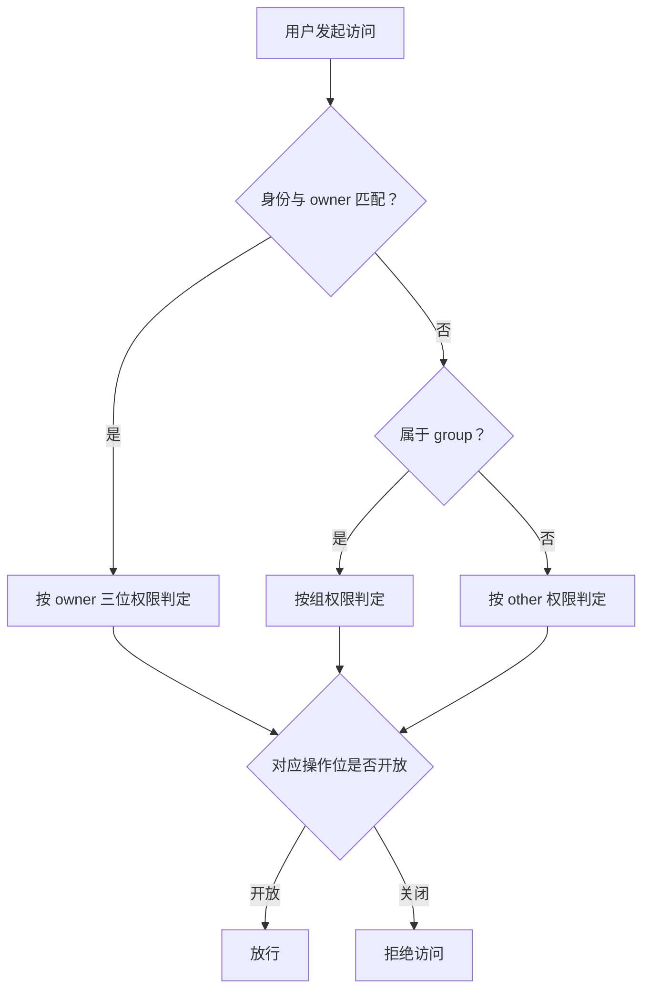

# 热点块进内存、权限学 Linux：HDFS 的块缓存与文件权限模型

join 操作反复读的那张小维表，每次都从 DataNode 磁盘上捞，速度上不去；另一头，HDFS 上的文件谁都能看、谁都能删吗？这两个问题分别指向 HDFS 的两个周边特性：块缓存与文件权限。

## 先给结论

- 访问频繁的块可以被显式缓存在 DataNode 的堆外内存里，作业调度器把计算任务安排到缓存所在节点执行，读性能直接提升。
- 缓存不是自动发生的：用户通过缓存指令告诉 NameNode 要缓存哪些文件、存多久，缓存池负责管理权限与资源。
- HDFS 的权限模型与 Linux 一致：`r w x` 三种位，owner、group、other 三段判定，谁创建文件谁就是 owner。
- `x` 权限对文件忽略不计，对目录表示能否进入其内容。
- 权限的定位是防止好人做错事，而不是阻止坏人做坏事；本课集群 `dfs.permissions.enabled=false`，校验处于关闭状态。

## 一、块缓存：把热点块搬进内存

DataNode 默认从磁盘读块，磁盘再快也快不过内存。于是 HDFS 给高频访问的数据留了一条捷径：被频繁访问的文件，其对应的块可以显式缓存在 DataNode 的内存中，以堆外块缓存的形式存在。缓存之后读请求不再走磁盘 IO，延迟和吞吐都有肉眼可见的改善。

缓存的管理走两步。**第一，声明缓存意图。** 用户或应用通过在缓存池中添加一条 Cache Directive，告诉 NameNode 需要缓存哪些文件以及缓存多久。**第二，NameNode 统一调度。** 默认情况下一个块只缓存在一个 DataNode 的内存里，也可以按文件指定缓存的 DataNode 数量；作业调度器知道哪些块在哪些节点有缓存，把计算任务安排到缓存所在节点上运行，计算与数据同节点，读操作的性能优势被吃到最满。

什么样的数据配得上这份待遇？讲义给的典型例子是 join 操作里用到的那个小查询表：体量不大、每次计算都要全量参与，缓存一次收益持续整个作业周期，这类小维表是块缓存的最佳候选。MapReduce 里 join 的具体玩法，到对应章节再展开。

顺带补一个块相关的账目问题：130M 的文件按 128M 上限切成两个块，第二个块只占 2M 磁盘，两块合计仍是 130M 而不是 256M，块始终是描述切分份数的逻辑单位。

## 二、权限模型：和 Linux 同一套思路

HDFS 也是一个文件系统，目录结构和 Linux 很像：一个根目录，根下挂 test1、test2 这样的子目录，test1 里再套 demo1、demo2，层层展开。权限语义也照搬了 Linux。

浏览器访问 `node01:50070` 打开 NameNode 的 Web UI，进 Utilities 里的 Browse the file system，浏览到根目录就能看到每个目录左侧的 permission 列，还有 owner 与 group 两列，本课集群里所有者显示为 root。可读、可写、可执行三种权限位分别对应 `r`、`w`、`x`，含义与 Linux 相同，唯一要单独记的是 `x` 的特殊语义：对文件它被忽略，对目录它表示是否有权限访问其内容。

判定顺序和 Linux 完全一致：



归属规则只有一条：如果 Linux 用户 zhangsan 用 Hadoop 命令创建了一个文件，这个文件在 HDFS 里的 owner 就是 zhangsan。创建者即所有者，之后由所有者决定别人能干什么。

## 三、开关、命令与一个真实被拒的例子

权限校验有一个总开关，本课集群的实际配置是关着的（取自集群 hdfs-site.xml）：

```xml
<property>
  <name>dfs.permissions.enabled</name>
  <value>false</value>
</property>
```

开关关闭时任何操作都不做权限校验，实验环境图省事可以这么配，生产环境必须打开。开启后的日常管理就两条命令（出自讲义命令清单）：

```bash
# 递归修改权限，与 Linux chmod 用法一致
hdfs dfs -chmod -R 777 /xxx

# 递归修改所有者与所属组
hdfs dfs -chown -R hadoop:hadoop /xxx
```

另一个要点是超级用户的界定。HDFS 里的超级用户不是某个写死的账号，而是启动 NameNode 进程的那个用户，本课集群以 root 启动，root 就是超级用户，Web UI 里满屏的 owner root 也印证了这一点。

权限开着的时候会发生什么，讲义 1.9.8 节给了一套完整实测：开启 `dfs.permissions.enabled` 后，把某个配置文件权限改成 600，再用代码指定另一个用户去下载（示例改编自讲义，路径按本课集群调整）：

```java
@Test
public void getConfig() throws Exception {
    // 指定以 hadoop 用户身份连接，而文件 owner 是 root 且权限 600
    FileSystem fileSystem = FileSystem.get(
            new URI("hdfs://node01:8020"), new Configuration(), "hadoop");
    // root 对 600 的文件只有所有者可读写，hadoop 不在任何放行区间，下载会被拒绝
    fileSystem.copyToLocalFile(new Path("/config/core-site.xml"),
            new Path("file:///c:/core-site.xml"));
    fileSystem.close();
}
```

这段代码运行时抛出权限异常，恰好演示了判定链路的完整性。它同时暴露了 HDFS 权限的天花板：身份全凭客户端自报，你说你是谁系统就信谁，没有 Kerberos 这类强认证兜底之前，它防的是误操作，防不了冒名。讲义那句话值得原文记下：HDFS 文件权限的目的，是防止好人做错事，而不是阻止坏人做坏事。

## 常见误区

- **以为关掉 `dfs.permissions.enabled` 就没有权限这回事了。** 校验不执行，但元数据里的 permission、owner 依然存在并照常展示；生产集群打开开关后，这些存量信息立刻生效。
- **以为 root 账号在任何 HDFS 集群里都是超级用户。** 超级用户是启动 NameNode 的那个用户，A 集群用 root 起、B 集群用 hadoop 起，两者的超级用户就不同，跨集群操作照常要过权限判定。
- **以为 `x` 权限对文件也生效。** 文件层面 `x` 被忽略，它只在目录上表示能否访问目录内的内容，给脚本加 `x` 在 HDFS 里没有意义。
- **以为块缓存默认开启、全集群生效。** 缓存要显式下发 Cache Directive，默认一个块只缓存在一个 DataNode 上，缓存本身还要占堆外内存，无脑缓存热点之外的数据纯属浪费。

## 面试可能被问到的问题

1. 面试官追问：「HDFS 的权限模型和 Linux 有什么异同？」
   答：相同点是三段身份 owner、group、other 配 `r w x` 权限位，判定顺序与 chmod、chown 用法都一致，创建者即 owner。差异在于 HDFS 的 `x` 对文件忽略、仅对目录表示进入权限，而且 HDFS 没有强身份认证，客户端自报身份即被采信，整体定位是防误操作不是防恶意。
2. 面试官追问：「HDFS 的超级用户是谁？」
   答：启动 NameNode 进程的操作系统用户。它绕过所有权限判定；区分集群部署用户很重要，用 root 起的集群超级用户就是 root，换 hadoop 用户启动则换人，与 Linux 的 root 概念不是一回事。
3. 面试官追问：「`dfs.permissions.enabled` 设为 false 有什么后果？」
   答：NameNode 跳过全部权限校验，任何用户对任何路径可读可写可删。测试集群为了省事常这么配，但生产环境必须开启，否则一个误操作的删除命令就可能波及全库。
4. 面试官追问：「块缓存适合什么场景，怎么启用？」
   答：适合被反复读取的中小数据集，典型是 join 里的小维表。启用方式是在缓存池中添加 Cache Directive 指定文件与缓存时长，NameNode 负责把块缓存到 DataNode 堆外内存，作业调度器再把任务调度到缓存节点，实现数据本地计算。
5. 面试官追问：「为什么说 HDFS 权限是防止好人做错事？」
   答：因为它信任客户端自报的身份，没有配套的认证体系时，恶意用户可以冒充任何 owner 绕过限制；它的真实价值是让普通用户之间互不误伤，避免误删误改，安全防线要靠 Kerberos 等认证机制补齐。

## 配套资料

- 讲义：`materials/code/04/day02-HDFS/day02/讲义/Note02.md`，1.4.2 节块缓存与 Cache Directive、Cache Pool 概念，1.4.3 节文件权限验证与「防止好人做错事」定位，1.8 节 chmod、chown 命令，1.9.8 节开启权限后的完整实测步骤与 Java 指定用户下载示例。
- 本课无配套源码包，Java 示例改编自讲义 1.9.8 节并按本课集群节点名调整；`dfs.permissions.enabled=false` 片段取自本课集群 hdfs-site.xml 实际配置。
