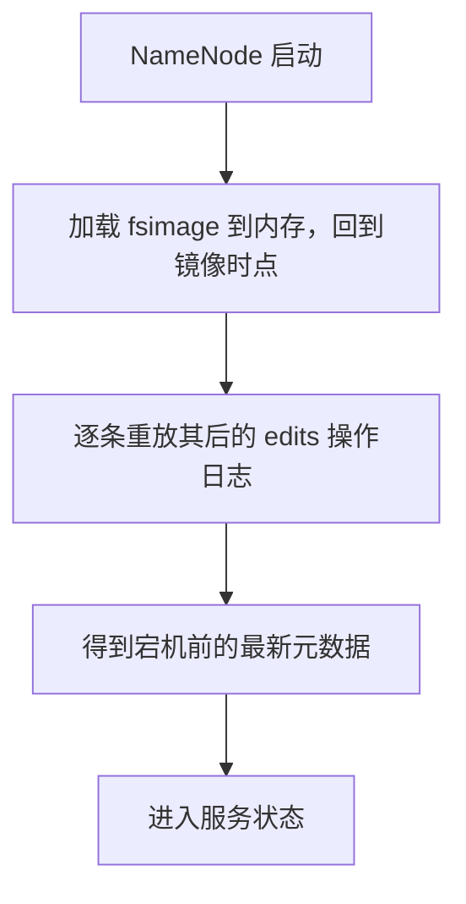
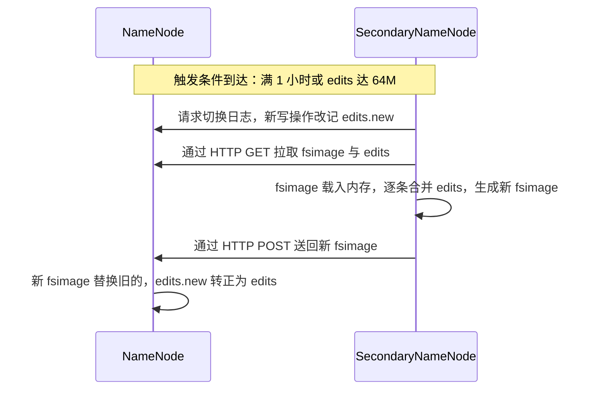

# Fsimage 加 Edits，定期合并成检查点：SecondaryNameNode 的工作机制

NameNode 的元数据全在内存里，机器一重启内存清零，集群岂不是要靠人肉重建？就算元数据能落盘，操作日志一年滚到几个 G，重启时逐条重放到猴年马月？SecondaryNameNode 就是为这两个麻烦而生的辅助角色，它名字里带着 Secondary，却经常被当成热备，这正是最需要掰清的地方。

## 先给结论

- NameNode 元数据靠两份文件持久化：fsimage 存完整镜像，edits 存最近的操作日志，写操作先记 edits 再更新内存。
- NameNode 重启时先加载 fsimage，再重放其后的 edits，即可恢复到宕机前的最新状态。
- SecondaryNameNode 在条件触发时把 fsimage 与 edits 拉到本机合并出新 fsimage 送回，edits 因此归零重来，体量始终可控。
- 触发条件两个：距上次 checkpoint 满 1 小时，或 edits 达到 64M，谁先到谁触发。
- 它只做合并辅助，不接客户端请求，NameNode 宕机它顶不上，不是热备；合并耗内存与 NameNode 相当，应部署在不同机器上。

## 一、两份文件撑起元数据持久化

元数据是一种描述性的数据结构：根目录下有个 a.txt、5KB，切了哪些块、每块在哪些 DataNode 上；再来个 b.txt、2KB，同样记一份块信息。这些内容 NameNode 全放内存，查询快，但内存掉电即失，所以必须持久化到磁盘，落盘的载体就是 fsimage 与 edits 两个文件。

**fsimage 是元数据镜像。** NameNode 内存里的全部元数据都映射在这份文件里，内容是二进制格式，可以理解为某个时间点的完整快照，讲义里也把它称作检查点。**edits 是操作日志。** 客户端对 HDFS 做写操作时，先在 edits 里追加一条日志，内存元数据随之更新，客户端才能看到最新状态。fsimage 不会跟着每次写操作实时改写，因为加载整份镜像重建内存树非常耗内存和 CPU，高频的小改动全走 edits 这条轻量通道。

两份文件放在哪由 hdfs-site.xml 指定，本课集群的实际配置如下（取自集群配置文件）：

```xml
<property>
  <name>dfs.namenode.name.dir</name>
  <value>file:///export/servers/hadoop-3.1.1/datas/namenode/namenodedatas</value>
</property>
<property>
  <name>dfs.namenode.edits.dir</name>
  <value>file:///export/servers/hadoop-3.1.1/datas/dfs/nn/edits</value>
</property>
```

进到对应目录的 current 子目录里会发现，fsimage 和 edits 都不是单个文件，而是各带事务序号的一组文件，比如 fsimage_0000000000000000864、edits_0000000000000000865-0000000000000000866，序号标明各自的覆盖范围。它们是二进制文件，直接打开是乱码，HDFS 提供了专门的查看工具：

```bash
# 查看元数据镜像，导出为 XML
cd /export/servers/hadoop-3.1.1/datas/namenode/namenodedatas
hdfs oiv -i fsimage_0000000000000000864 -p XML -o hello.xml

# 查看操作日志，导出为 XML
cd /export/servers/hadoop-3.1.1/datas/dfs/nn/edits
hdfs oev -i edits_0000000000000000865-0000000000000000866 -o myedit.xml -p XML
```

## 二、重启恢复：先加载镜像，再重放日志

恢复逻辑本身不复杂，是一条固定流水线。



用一个新增文件的操作串一遍：客户端往 HDFS 写入 c.txt，3KB，NameNode 在内存里新增一条元数据记录，同时往 edits 追加一条日志，fsimage 里此刻没有 c.txt。NameNode 重启后，fsimage 先把老元数据灌回内存，再重放 edits 里包括「新增 c.txt」在内的每条记录，内存恢复到宕机前的样子。

这里有个容易纠结的点：重放日志不是重新写一遍文件。c.txt 的真实数据一直在 DataNode 磁盘上，重放只是把日志里记录的元数据变更在内存里重新生成一次，不涉及任何数据块的搬运。

## 三、SecondaryNameNode 的 checkpoint 合并流程

镜像加重放的组合解决了丢失问题，却埋下新隐患：只要 NameNode 不重启，fsimage 就永远停在老时点，edits 单方面越长越大，滚上一年，重启时要把一年的操作全部重放，内存和 CPU 双双遭殃。SecondaryNameNode 的使命就是定期把这笔账清一清。



触发条件在 core-site.xml 里配置（出自讲义，保持默认值也可以不配）：

```xml
<!-- 多久做一次 checkpoint，默认 1 小时，单位秒 -->
<property>
  <name>fs.checkpoint.period</name>
  <value>3600</value>
</property>
<!-- edits 满多大触发 checkpoint，默认 64M，单位字节 -->
<property>
  <name>fs.checkpoint.size</name>
  <value>67108864</value>
</property>
```

两个条件同时配置时，哪一个先满足就执行哪一次合并。流程展开是五步：SecondaryNameNode 先通知 NameNode 停用当前 edits，把新写操作暂时放进 edits.new，保证合并期间集群照常可写；然后通过 HTTP GET 把 fsimage 和 edits 拉过去；在本机把 fsimage 载入内存、逐条执行 edits 里的操作，合并出一份新 fsimage；再通过 HTTP POST 送回；NameNode 用新 fsimage 替换旧文件，edits.new 转正为新的 edits，从零开始记账。

效果等价于把「重启时才做的合并」提前挪到了平时：fsimage 每小时左右刷新一次，edits 永远只装最近一小时的增量，NameNode 任何时候重启，恢复成本都被压在很小的范围内。集群进入安全模式等特殊状态时，管理员也可以用 `hdfs dfsadmin -saveNamespace` 手工创建一个检查点。

## 四、它不是热备，也不该和 NameNode 挤一台机器

「Secondary」这个名字极具迷惑性，把话说透有三层。**第一，它不对外服务。** 客户端的读写请求只认 NameNode，SecondaryNameNode 没有接管请求的能力，NameNode 宕机时它救不了场，真正的热备要靠高可用架构里的 standby NameNode 配合仲裁机制。**第二，它的元数据可能是滞后的。** 它手里的 fsimage 只精确到最近一次 checkpoint，之后的新增操作还在 NameNode 的 edits 里没同步过来，拿它恢复会丢最近一段时间的元数据变更。**第三，它很吃内存。** 合并时要把完整元数据载入内存逐条重放，消耗与 NameNode 在同一量级，跟 NameNode 挤在同一台机器上等于两个内存大户互相挤压，生产环境通常把两者部署在不同节点。

## 常见误区

- **把 SecondaryNameNode 当 NameNode 的备份或热备。** 它只做 fsimage 与 edits 的定期合并，不接收客户端请求、不实时同步元数据，NameNode 宕机它无法接替，热备是 HA 架构的 standby 节点。
- **以为 edits 里存的是文件数据。** edits 是操作日志，记录「新增了 c.txt、3KB」这类元数据变更，真实数据块从头到尾都在 DataNode 磁盘上。
- **以为合并期间的新操作会丢。** 合并启动前 NameNode 已把新写入切换进 edits.new，合并的是旧 edits，两边互不干扰，操作一条不丢。
- **以为 fsimage 和 edits 是两个孤零零的文件。** 在存储目录的 current 下它们各是一组带事务序号的文件，配合滚动与替换机制工作，用 oiv、oev 才能读出内容。

## 面试可能被问到的问题

1. 面试官追问：「fsimage 和 edits 分别存什么，为什么要拆成两份？」
   答：fsimage 是元数据的完整镜像，代表某个时间点的全量状态；edits 是之后发生的操作日志，记录增量变更。拆开是因为全量镜像加载代价高，不适合跟着每次写操作刷新，高频小改动记日志最轻量，两者配合兼顾持久化与性能。
2. 面试官追问：「描述一下 SecondaryNameNode 的工作流程。」
   答：触发 checkpoint 后，它先让 NameNode 把新写操作切换到 edits.new，再通过 HTTP GET 取走 fsimage 和 edits，在本机把镜像载入内存并逐条合并日志，生成新 fsimage 后通过 HTTP POST 送回，NameNode 替换旧镜像、edits.new 转正为新的 edits。
3. 面试官追问：「checkpoint 的触发条件有哪些？」
   答：两个条件，距上次合并满 `fs.checkpoint.period` 指定的 1 小时，或 edits 增长到 `fs.checkpoint.size` 指定的 64M，同时配置时先到先触发。
4. 面试官追问：「NameNode 宕机重启，元数据是怎么恢复的？」
   答：先加载 fsimage 把内存恢复到镜像时点，再重放其后的 edits 日志，把增量变更在内存里重建出来。重放只是恢复元数据记录，DataNode 上的数据块不受影响。
5. 面试官追问：「SecondaryNameNode 为什么不是热备？」
   答：它没有对外提供服务的能力，客户端请求始终只到 NameNode；它的元数据只更新到最近一次 checkpoint，存在滞后；而且它宕机不影响集群服务，这些都与热备的要求相反。
6. 面试官追问：「想看看 fsimage 或 edits 里到底记了什么，怎么办？」
   答：两者都是二进制文件，用 HDFS 自带工具导出，`hdfs oiv -i fsimage 文件 -p XML -o 输出.xml` 查看镜像，`hdfs oev -i edits 文件 -p XML -o 输出.xml` 查看日志，XML 输出里能直接看到文件路径、块信息等记录。

## 配套资料

- 讲义：`materials/code/04/day02-HDFS/day02/讲义/Note02.md`，1.5 节 SecondaryNameNode 元数据辅助管理，1.5.1 节 FsImage 与 Edits 详解，1.5.2、1.5.3 节 oiv、oev 查看命令，1.5.4 节五步合并流程与 checkpoint 触发条件配置，均与本课内容逐段对应。
- 本课无配套源码包，`dfs.namenode.name.dir` 与 `dfs.namenode.edits.dir` 片段取自本课集群 hdfs-site.xml 实际配置，checkpoint 配置片段出自讲义。
