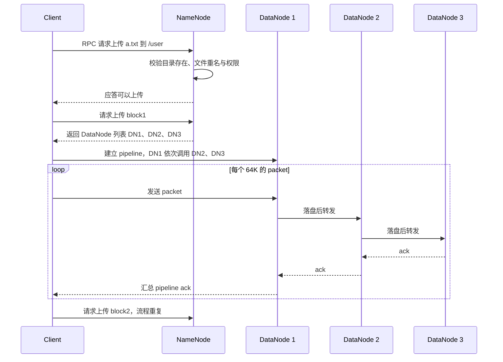
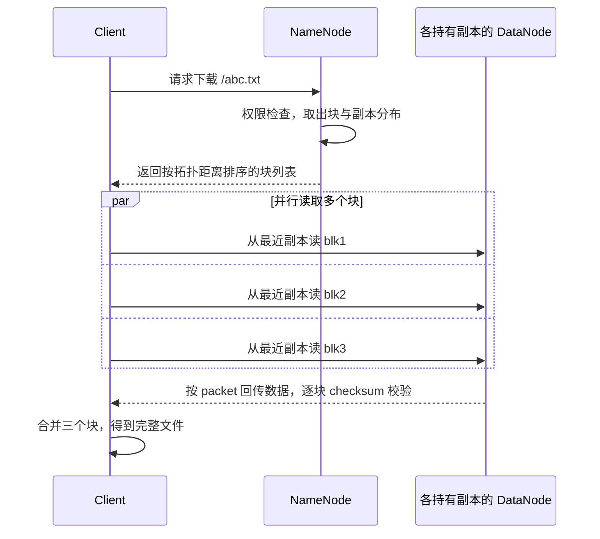

# 一份 300M 文件的旅程：HDFS 写入与读取全过程拆解

在 50070 页面把一个 300M 的 a.txt 拖进 /user 目录，进度条几秒走完，副本数稳稳显示 3；反过来下载根目录的 abc.txt，也是一键的事。看起来轻巧，背后是一套设计得相当精细的分布式协作：NameNode 负责拍板，DataNode 负责搬运，客户端负责调度。这套流程是 HDFS 面试出现频率最高的话题之一，值得把每一步掰开看。

## 先给结论

- 客户端先把文件按 128M 切成块，再通过 RPC 向 NameNode 发起上传申请；NameNode 只做权限与存在性校验、挑选 DataNode，从头到尾不碰文件内容。
- 三个副本串成一条 pipeline，数据按 64K 的 packet 逐级流式转发，ack 沿反方向逐级回传，客户端靠应答队列保证每个 packet 真正落满副本。
- 读文件时 NameNode 返回按网络拓扑距离排序的副本地址列表，客户端就近读取，每个块读完做 checksum 校验，损坏了自动换下一个副本。
- 无论写还是读，真实的数据流都直接发生在客户端与 DataNode 之间，NameNode 全程只出地址、不出数据。

## 一、写流程前半段：申请、校验、应答

**第一，客户端切块并发出申请。** 300M 的文件按 128M 的块大小切成 blk1、blk2、blk3 三块，切片由客户端自己完成。切完之后，客户端通过 RPC 向 NameNode 发出请求：要上传 a.txt，目标是根目录下的 /user 目录。

**第二，NameNode 做上传前校验。** 它在元数据里查两件事：/user 目录存不存在，目录里是不是已经有同名文件。目录不存在、权限不满足或同名冲突，这次上传直接被挡回去；两关都过，才继续往下走。

**第三，应答可以上传。** NameNode 给客户端回一条明确应答，表示上传被批准。到这里，一个字节都还没离开客户端。

## 二、NameNode 怎么挑接收数据的节点

客户端接着请求上传第一个 block。NameNode 手里维护着一个 DataNode 信息池，记录各节点的磁盘是否存满、是否宕机、余量还有多少。它从池里挑出三台状态健康的节点组成接收名单，比如 DN1、DN2、DN3，再把这份名单返回给客户端。

默认策略下，一个块的三个副本分散摆放：本地一份、同机架另一节点一份、不同机架再一份，写入速度与容灾能力两头都照顾到。块大小与副本数由配置决定，本课三节点集群用的就是默认值，对应写法如下（示例为按本课集群默认配置补全，未做改动）：

```xml
<!-- 块大小，Hadoop 默认 128M，单位字节 -->
<property>
  <name>dfs.blocksize</name>
  <value>134217728</value>
</property>
<!-- 副本数，Hadoop 默认 3 -->
<property>
  <name>dfs.replication</name>
  <value>3</value>
</property>
```

## 三、pipeline 与 packet：数据真正开始流动

**第一，建管道。** 客户端拿到名单后不再和 NameNode 打交道，而是向 DN1 发起建立 pipeline 的请求，DN1 继续调用 DN2，DN2 调用 DN3，管道逐级接通后再按原路逐级确认回来。pipeline 可以理解成一根贯通三台 DataNode 的水管。

**第二，流式发数据。** 客户端不会把 128M 的块一口气推过去，而是把块切成一个个 packet，默认 64K，沿管道逐个发送。每个 DataNode 收到 packet 先落一份到本机的 data 目录，再原样转发给下一台。

**第三，ack 沿反方向回传。** DN3 存好 packet 后向 DN2 回 ack，DN2 回 DN1，DN1 汇总成 pipeline ack 交给客户端。客户端维护着一个应答队列，packet 发出去先挂在队列里，收到完整 ack 才移除，任何环节丢应答都能立刻察觉并重发。

整条写链路用一张时序图收拢：



图里值得盯住两条线：穿过 NameNode 的只有请求与地址，没有任何文件内容；packet 在三台 DataNode 之间是接力传输，不是客户端同时发三份，客户端带宽只被占用一次。block1 存完，block2、block3 重复同样流程，300M 的文件就此落库。

## 四、读流程：就近取块，校验兜底

读是写的镜像，但规则不同。客户端要下载根目录下的 abc.txt，同样 300M、三个块，每个块有三个副本散在不同节点上。

**第一，申请与列表。** 客户端向 NameNode 发起下载请求，NameNode 先做权限检查，确认文件存在且客户端有权访问，然后从元数据里取出块分布，比如 blk1 在 DN1、DN3、DN4，blk2 在 DN1、DN2、DN4，blk3 在 DN2、DN3、DN4。

**第二，就近排序。** 每个块只需拿一个副本，取哪个有讲究。NameNode 按网络拓扑计算 DataNode 与客户端的距离，近的排前面；心跳超时被标记为 STALE 的节点排后面。客户端若恰好与某个 DataNode 同在一台机器，直接从本地取数据，也就是短路读取。排好序的列表返回给客户端。

**第三，并行读取与合并。** 客户端对每个块与对应 DataNode 建立连接，底层是 FSDataInputStream，同样按 64K 的 packet 往回搬，多个块由不同线程并行读。每读完一个块做 checksum 校验，发现数据损坏就通知 NameNode，改从下一个持有该块副本的节点继续读。所有块到齐后在客户端拼装成完整文件，落到本地 /data 目录下，下载完成。



读取同样不让 NameNode 搬数据，它只回答「这个块在谁那里」；checksum 机制保证即便某台节点上的副本悄悄损坏，客户端也能察觉并自动绕行。想验证文件块的真实分布，可以用 HDFS 自带的分析命令（示例为按本课集群执行的补充验证）：

```bash
# 列出 abc.txt 各块的长度与副本所在 DataNode
hdfs fsck /abc.txt -files -locations
```

## 常见误区

- **以为 NameNode 会转发文件数据。** 写流程里它只应答「可以传」和「传给谁」，读流程里只返回地址列表，数据流永远直连 DataNode，这是 HDFS 吞吐能力的根基。
- **以为三副本是客户端同时传三份。** 副本靠 pipeline 接力复制，客户端只发一份 packet 流，上游节点落盘后转给下游，副本数增加并不按倍数放大客户端带宽。
- **以为读哪个副本都一样。** 副本选择按拓扑距离排序、STALE 节点靠后，同机客户端还能短路读取，选错副本会白白多走网络。
- **以为 packet 发出去就万事大吉。** 已发送的 packet 在客户端应答队列里挂账，等反方向 ack 到齐才销账，丢 ack 会触发重发，这是写入可靠的最后防线。

## 面试可能被问到的问题

1. 面试官追问：「描述一下 HDFS 的文件写入流程。」
   答：客户端把文件按 128M 切块后通过 RPC 向 NameNode 申请上传，NameNode 校验目录、重名与权限后应答可以上传；客户端再申请传第一个块，NameNode 从 DataNode 信息池挑出三台健康节点返回；客户端与它们建立 pipeline，把块切成 64K 的 packet 流式发送，各节点落盘后接力转发，ack 沿反方向回传；一个块传完再传下一个，直到全部落库。
2. 面试官追问：「ack 队列是干什么用的？」
   答：客户端每发出一个 packet 先放进应答队列，等 pipeline 反方向回传的完整 ack 到达才移除。这样任何一台 DataNode 落盘失败、应答丢失，客户端都能立即发现并重新发送，保证每个 packet 真正写满副本数。
3. 面试官追问：「pipeline 中某台 DataNode 突然挂了怎么办？」
   答：客户端收不到该链路的 ack，会把坏节点移出管道，向 NameNode 重新申请节点重建 pipeline，继续发送未确认的 packet；已经确认的块由 NameNode 后续指挥健康节点补齐副本数，写入操作本身不失败。
4. 面试官追问：「读文件时 NameNode 返回的副本列表为什么有排序？」
   答：列表按客户端与 DataNode 的网络拓扑距离排序，近的排前，心跳超时的 STALE 节点排后。客户端优先读最近副本，减少跨网络流量；客户端本身就是某个副本所在节点时，还能短路读取直接走本地磁盘。
5. 面试官追问：「读到的数据怎么保证没有损坏？」
   答：每个块读取完成后做 checksum 校验。DataNode 存块时同时保存校验和，客户端读回数据后重新计算并比对，不一致说明副本损坏，客户端会通知 NameNode，并改从下一个持有该块副本的节点继续读取。

## 配套资料

- 讲义：`materials/code/04/day02-HDFS/day02/讲义/Note02.md`，1.6 节 HDFS 文件写入过程的七步描述（RPC 请求、机架感知副本摆放、pipeline 逐级建立、packet 默认 64K、应答队列等待 ack），1.7 节 HDFS 文件读取过程的八条说明（拓扑距离排序、STALE 节点靠后、短路读取、FSDataInputStream、checksum 校验、并行读取），与课程讲解逐条对应。
- 本课无配套源码包，块大小与副本数 XML 片段为按本课集群默认配置补全的示例，`hdfs fsck` 命令为补充验证示例。
