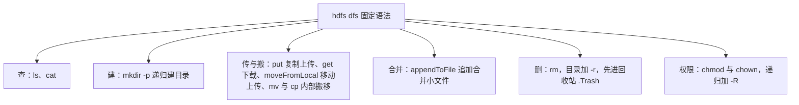

# 一套 hdfs dfs 命令管住增删改查：HDFS shell 实操与易踩的坑

集群装好之后，第一件想做的事多半是把本地数据搬进 HDFS 看看。操作 HDFS 有三条路：命令行、50070 页面、Java API，其中命令行是日常用得最多的一条。它的固定语法是 `hdfs dfs` 后面跟参数，形如 `hdfs dfs -ls /`。命令长得和 Linux shell 很像，但细节差异不少，删除进回收站、删目录必须递归、put 与 moveFromLocal 语义不同，都是新手容易栽的地方。

## 先给结论

- 固定语法 `hdfs dfs -命令 路径`，ls、mkdir、put、get、cat、rm、cp、mv、appendToFile 覆盖日常绝大多数操作。
- put 与 moveFromLocal 都能把本地文件送进 HDFS，区别是 put 复制上传、源文件保留，moveFromLocal 剪切上传、源文件消失。
- rm 删除不是物理删除，文件先进回收站 .Trash，默认 7 天后自动清空；删目录必须带 -r。
- 小文件尽量合并：每个文件都占一条 NameNode 元数据，小文件过多会把主节点压垮，appendToFile 是最轻量的合并手段。
- 权限管理两件套 chmod 与 chown，递归修改目录要加 -R。

## 一、查与建：ls、mkdir、cat

`-ls` 查看某个目录下的内容，列出的信息与 50070 页面上看到的完全一致；`-mkdir` 创建目录，加 `-p` 才能一次建出多级路径。

```bash
# 查看根目录下的文件与文件夹
hdfs dfs -ls /
# 创建目录
hdfs dfs -mkdir /test
# 递归创建多级目录：test 下的 aaa 下再建 bbb
hdfs dfs -mkdir -p /test/aaa/bbb
```

不加 -p 时，父目录不存在会直接报错，这一点和 Linux 的 mkdir 行为一致。

`-ls` 输出的每一列也值得看懂：第一列是权限位，第二列是副本数，HDFS 文件没有执行位的语义；后面依次是属主、属组、文件大小、修改时间与路径。目录的大小显示为 0 属于正常现象，目录本身不占数据块，这个字段描述的只是文件。另外，递归查看整棵目录树用 `hdfs dfs -ls -R /`，比逐层点开 Web 页面快得多。

## 二、传与搬：put、get、moveFromLocal、mv、cp

本地与 HDFS 之间的搬运是最高频的动作，四个命令的语义必须分清：put 是复制上传，moveFromLocal 是移动上传，mv 在 HDFS 内部移动，cp 在 HDFS 内部拷贝。put 既能传单个文件，也能传整个文件夹。

```bash
# 本地文件移动进 HDFS，本地源文件消失
hdfs dfs -moveFromLocal a.txt /test
# HDFS 内部移动：把 test 下的 a.txt 挪到 tmp
hdfs dfs -mv /test/a.txt /tmp
# 复制上传，本地源文件保留，文件夹同样适用
hdfs dfs -put timer.txt /
hdfs dfs -put shell4 /test
# HDFS 内部拷贝
hdfs dfs -cp /test/hello.txt /tmp
# 下载 HDFS 文件到本地（出自讲义命令清单）
hdfs dfs -get /test/hello.txt ./
```

注意 moveFromLocal 的写法里 From 与 Local 首字母都大写，敲成小写会报未知命令。这几个命令组合起来就是一套完整的上传、归档、整理流程。

## 三、appendToFile：小文件合并的轻量解法

HDFS 里要尽量避免小文件过多。每个文件在 HDFS 中都占一条元数据，元数据常驻 NameNode 内存，小文件一多，主节点的内存与响应压力直线上升。appendToFile 提供了最省事的合并手段：把若干本地小文件的内容追加进 HDFS 上的一个目标文件。

```bash
# 准备两个本地小文件
echo hello >> a.txt
echo world >> b.txt
# 把两个文件的内容合并写进 HDFS 的 hello.txt
hdfs dfs -appendToFile a.txt b.txt /test/hello.txt
# 查看合并结果
hdfs dfs -cat /test/hello.txt
```

参数顺序有讲究：前面的都是本地源文件，最后一个必须是 HDFS 目标路径。cat 执行后能看到 hello 与 world 连在一起，合并生效。

## 四、删除与回收站：rm 的真实去向

rm 删除文件时，控制台会输出一条 Moved 提示，文件并没有凭空消失，而是被挪进了回收站目录 /user/<用户名>/.Trash，默认 7 天后自动清空。误删的文件在这个窗口期内都能从回收站捞回来。

```bash
# 删除文件，实际移入回收站
hdfs dfs -rm /timer.txt
# 删除目录必须递归，否则报错
hdfs dfs -rm -r /test
```

删目录时如果不加 -r，HDFS 会明确提醒这是目录，拒绝执行。这一点和部分 Linux 习惯不同，容易在脚本里翻车。

## 五、权限：chmod 与 chown

HDFS 文件同样有权限模型，页面和 `ls` 输出里的 rw-r--r-- 就是它。改权限用 chmod，改属主与用户组用 chown，对目录做递归修改都加 -R。

```bash
# 打开文件的全部权限
hdfs dfs -chmod 777 /abc.txt
# 递归修改目录及其下所有子目录
hdfs dfs -chmod -R 777 /test
# 修改所属用户与用户组
hdfs dfs -chown -R hadoop:hadoop /test
```

根目录下新建的文件默认属主是 root，属组是 supergroup；chown 可以把整个目录树移交给 hadoop 用户。常用命令的全貌可以画成一张地图：



## 常见误区

- **把 put 当成移动。** put 执行后本地文件还在，占双份磁盘；想让文件离开本地要用 moveFromLocal，两者语义不同，脚本里选错会造成重复数据或误以为源文件被删。
- **以为 rm 是立即物理删除。** 删除的文件先进回收站 .Trash，7 天后才真正清掉；反过来说，回收站里的文件仍占着 HDFS 空间，空间紧张时只删文件不解渴。
- **删目录忘了 -r。** 目录必须递归删除，不加 -r 直接报错，批量脚本里要提前确认目标是文件还是目录。
- **小文件一股脑往里 put。** 每个小文件一条元数据，NameNode 内存吃不消；大批小文件入库前先用 appendToFile 或打包方式合并。

## 面试可能被问到的问题

1. 面试官追问：「put 和 moveFromLocal 有什么区别？」
   答：两者都能把本地文件送进 HDFS。put 是复制上传，上传完成后本地源文件保留；moveFromLocal 是移动上传，成功后本地源文件被删除。日常导入数据多用 put，确定不再保留本地副本时用 moveFromLocal 更干净。
2. 面试官追问：「hdfs dfs -rm 删掉的文件去哪了，还能恢复吗？」
   答：文件被移动到回收站目录 /user/<用户名>/.Trash 下，默认保留 7 天后自动清空。在保留期内可以直接把文件从回收站 mv 回原路径恢复；一旦过了清空期限，数据就真正丢失了。
3. 面试官追问：「为什么 HDFS 要避免小文件过多？」
   答：每个文件、每个块在 NameNode 里都占一份常驻内存的元数据，1 个 1M 的文件和 1 个 128M 的文件元数据开销在同量级。海量小文件会把 NameNode 内存耗尽、拖慢请求响应，所以入库前要用 appendToFile、打包合并等手段减少文件数。
4. 面试官追问：「mkdir 加不加 -p 有什么区别？」
   答：加 -p 时父目录不存在会自动逐级创建，等价于 Linux 的递归建目录；不加 -p 只能在已存在的目录下建最后一级，父目录缺失直接报错。
5. 面试官追问：「chmod 与 chown 的 -R 参数用在什么场景？」
   答：对目录树整体调整时使用。chmod 777 只改单个目标，chmod -R 777 /test 会把 test 及其下所有子目录、文件一起改成 777；chown 的 -R 同理，常用于把整个目录移交给另一个用户与用户组。

## 配套资料

- 讲义：`materials/code/04/day02-HDFS/day02/讲义/Note02.md`，1.8 节 hdfs 的命令行使用，含 ls、mkdir、moveFromLocal、mv、put、appendToFile、cat、cp、rm 的命令清单与 chmod、chown 权限管理命令，与本课演示一一对应。
- 本课无配套源码包，全部命令为本课集群实操实录；`-get` 命令出自讲义清单，课上未单独演示，示例为按本课写法补全。
