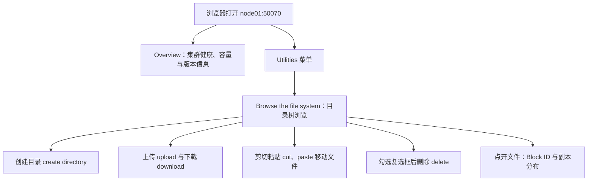

# 浏览器里的 HDFS 文件系统：50070 页面操作入门

命令行敲久了难免想换个姿势：这个文件到底存在哪几台节点上？块切成了什么样？不用登服务器，浏览器打开 NameNode 的 50070 页面就能看，还能直接创建目录、上传下载、移动删除。对排查问题和给团队演示来说，这个页面比命令行直观得多，也顺带把 HDFS 的块与副本概念可视化了。

## 先给结论

- 浏览器访问 node01:50070 打开 NameNode 主页，Utilities 菜单里的 Browse the file system 进入目录浏览页，以目录树形式展示整个文件系统。
- Hadoop 3.x 的页面支持完整的增删改查：创建目录、上传、下载、剪切粘贴移动文件、删除，还能直接修改权限、属主与副本数。
- 点开任意文件能看到块级明细：Block ID、Block Pool ID、Generation Stamp、文件大小与副本分布节点，块概念第一次变得肉眼可见。
- Hadoop 2.x 时代的页面只能浏览不能修改，3.0 之后才有完整操作能力，老版本集群仍以命令行为主，命令不能不学。

## 一、目录树与每一列的含义

进入 Browse Directory 页面，每一行代表一个文件或目录，列的顺序是：权限、拥有者、所属用户组、大小、最后修改时间、副本数、块大小、文件名。权限列的 rw-r--r-- 与 Linux 语义一致，副本数与块大小两列正好对应 hdfs-site.xml 里的 dfs.replication 与块大小配置，本课集群显示为副本 3、块 128M。

目录里有两个入口要留神：tmp 是临时目录，user 是用户目录，日常操作别去动它们，框架任务（比如作业运行）会往里写数据。页面顶部还有搜索框，输入名字点 Go! 可以直接定位文件，右上角会顺带显示当前目录下的文件个数。

## 二、页面上的增删改

**创建目录。** 点 create directory 按钮，输入名字如 app，确定后目录树里立刻多出这个目录，等价于命令行的 `hdfs dfs -mkdir`。

**上传文件。** 选中目标目录后点上传按钮，选本地文件确认 upload，几秒后文件出现，行内副本数 3、块大小 128M 一目了然，等价于 `hdfs dfs -put`。

**删除文件。** 每行前面有复选框，勾选后页面顶部出现 Delete 按钮，点删除确认即可。删除同样走回收站机制，等价于 `hdfs dfs -rm`。

**移动文件。** 勾选文件点 cut，进入目标目录再点 paste，文件就搬过去了，等价于 `hdfs dfs -mv`。

**下载与预览。** 点文件名弹出详情框，里面的 download 链接直接把文件下载到本地；Head the file (first 32K) 链接可以预览文件开头 32K 的内容，不想下载就能确认内容对不对。

页面能做的事覆盖了日常运维的大部分场景，与命令行的对应关系整理如下（等价命令为补充示例）：

```bash
# 页面创建目录 app，等价于
hdfs dfs -mkdir /app
# 页面上传文件，等价于
hdfs dfs -put Note02.md /
# 页面勾选删除，等价于
hdfs dfs -rm /Note02.md
```

## 三、点开一个文件：块与副本的可视化

这是页面最值得看的功能。点开之前合并出来的 hello.txt，详情框里列出一组块级信息：

```text
Block ID: 1073741933
Block Pool ID: BP-13329519-192.168.174.100-1555938164834
Generation Stamp: 1109
Size: 24
Availability:
  node01
  node02
  node03
```

Block ID 是这个数据块的全局编号；Block Pool ID 是集群格式化时生成的块池标识，同一个 NameNode 命名空间下的块共享它；Generation Stamp 是块版本号；Availability 列出的正是这个块三个副本所在的节点。前面课程讲的副本机制、128M 块大小，在这里都变成了看得见的行与列，文件有多块时逐块展开，每块的位置都能核对。

整个页面的功能地图如下：



## 四、为什么命令行还得学

页面操作有前提：用的 Hadoop 版本要够新。Hadoop 2.x 时代访问 50070 只能浏览目录与文件，不能增删改查；3.0 之后页面才具备完整的操作能力。生产集群里大量场景仍是脚本与程序自动化，页面更适合人工排查与临时操作，所以命令行与页面两手都要有。

## 常见误区

- **把 tmp 与 user 当普通目录随便删。** tmp 是系统临时目录，user 是用户工作目录，框架运行时会使用它们，误删可能引发任务异常。
- **以为页面删除绕过了回收站。** 页面删除与命令行 rm 走同一套机制，文件同样进 .Trash 等待清空，不是立即物理删除。
- **以为页面功能是理所当然的。** Hadoop 2.x 的 Web UI 只能看不能改，换了老版本集群发现页面没有操作按钮，不是页面坏了，是版本能力差异。
- **只看 Availability 就断定副本数。** 列表展示的是该块副本所在节点，文件被设置为低副本数时列表会更短，核对时要连同副本数列一起看。

## 面试可能被问到的问题

1. 面试官追问：「NameNode 的 Web UI 入口端口是多少，能做什么？」
   答：默认 50070，本课集群通过 node01:50070 访问。Overview 页看集群健康、容量与文件块统计，Utilities 菜单的 Browse the file system 提供目录浏览，Hadoop 3.x 还支持页面级的创建、上传下载、移动与删除。
2. 面试官追问：「在页面上点开一个文件能看到哪些块信息？」
   答：Block ID、Block Pool ID、Generation Stamp、文件大小，以及 Availability 列出的副本所在 DataNode。这些信息把元数据里的块分布可视化，能直接核对副本是否分布在预期节点上。
3. 面试官追问：「页面上传一个文件，和命令行 put 有区别吗？」
   答：底层走的是同一套 HDFS 写流程，页面只是包了图形外壳，上传后副本数、块大小都按集群配置生效。区别在适用场景，页面适合人工少量操作，命令行适合批量与脚本自动化。
4. 面试官追问：「Hadoop 2.x 和 3.x 的 Web UI 有什么能力差异？」
   答：2.x 的页面基本只读，只能浏览目录树和查看集群信息，不能修改文件系统；3.0 之后 Browse the file system 提供完整的增删改查能力，包括创建目录、上传下载、移动与删除。
5. 面试官追问：「怎么确认一个文件的副本真的分布在三个节点上？」
   答：在页面点开该文件，详情里 Availability 列出每个块的副本节点；命令行也可以用 `hdfs fsck 文件路径 -files -locations` 输出块位置，两种方式核对结果一致。

## 配套资料

- 讲义：`materials/code/04/day02-HDFS/day02/讲义/Note02.md`，1.8 节 hdfs 的命令行使用，可与页面操作逐条对照等价命令；块级信息（Block ID、Block Pool ID、Availability 等）取自本课 50070 页面实操实录。
- 本课无配套源码包，等价命令对照为按本课写法补全的示例。
