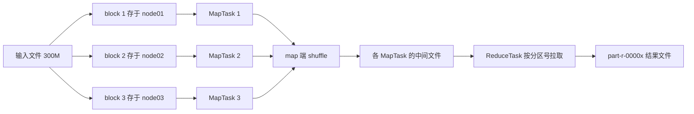
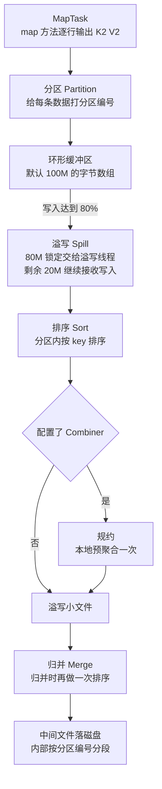

# MapReduce 运行机制：Map 阶段从读文件到中间文件落盘的全过程

词频统计、流量求和都跑通了，作业能提交、结果能出来，但很多人对 MapReduce 的理解仍停留在「写好 map 和 reduce 两个方法，框架帮我算」这一层。map 方法输出的数据去了哪里、为什么 Reduce 拿到的数据已经按 key 聚好组、溢写这个词到底指什么，这些疑问在面试问起 shuffle 时会集中爆发。把 Map 阶段的运行机制拆开看一遍，黑盒就透明了。

## 先给结论

- 文件按块存进 HDFS，每个 block 由一个 MapTask 处理；MapTask 的产出不是最终结果，而是落在本地磁盘的中间文件。
- Map 阶段分两段：map 方法逐行处理数据叫 map 处理阶段，之后的分区、缓冲、溢写、归并叫 map 端的 shuffle 阶段。
- 分区发生在数据进缓冲区之前，Partitioner 给每条 map 输出打上分区编号，这个编号决定它将来被哪个 ReduceTask 拉走。
- 环形缓冲区本质是一个字节数组，默认 100M；写入量达到 80% 就触发溢写 spill，剩下 20% 让 map 继续往里写，写入与溢出并行。
- 每次溢写产出一个内部有序的小文件，多个小文件归并成一个中间文件，归并时再排一次序；规约 Combiner 是可选项，分组则不属于 map 端 shuffle，它发生在 Reduce 端。

## 全景框架：从文件到 part 文件

以一个 300M 的输入文件为例，HDFS 按 128M 一块把它切成 3 个 block，分别存放在 node01、node02、node03 三个 DataNode 上。每个 block 启动一个 MapTask，MapTask 可以理解成一次 map 方法的运行。MapTask 处理完的数据经过 shuffle 阶段交给 ReduceTask，ReduceTask 对应我们写的 reduce 方法，每个 ReduceTask 最终写出一个 part 开头的结果文件，3 个 ReduceTask 就会产出 part-r-00000 到 part-r-00002 三个文件。

这张图画出整条链路，重点看 shuffle 处在什么位置：



图里最陌生的环节是 shuffle。它不是一个独立的进程，而是 map 输出之后、reduce 消费之前的一串动作：分区、排序、规约、分组。这串动作横跨两端，map 端负责前三个，reduce 端负责分组，Map 与 Reduce 之间靠网络传输衔接。

## Map 阶段的完整流水线

按数据流动的顺序，MapTask 内部依次发生六件事。

**第一，读数据。** 框架默认用 TextInputFormat 读文件，按行切分，切出来的是 K1 与 V1：K1 是行首偏移量，类型 LongWritable；V1 是一整行文本，类型 Text。读取组件是可替换的，自定义 InputFormat 就能改变切分方式。

**第二，map 处理。** 每读一行调用一次 map 方法，业务代码把 K1V1 加工成 K2V2，通过 context.write 交回框架。

**第三，分区。** map 输出的每条数据先经过 Partitioner 打上分区编号，编号的含义是这条数据将来归哪个 ReduceTask 管，分区因此也被叫做给数据「打标记」。

**第四，写环形缓冲区。** 分完区的数据不直接落盘，先写进内存里的一片环形缓冲区。它本质就是一个字节数组，用数组模拟出环形的首尾相接结构，默认大小 100M。

**第五，溢写。** 缓冲区写入量达到 80% 时，这 80M 被锁住交给溢写线程往小文件里倒，剩余 20M 继续接收 map 的输出，写入与溢出得以并行。往小文件写数据的时候做一次排序，所以每个溢写小文件内部都是按 key 有序的。

**第六，归并。** 数据量大时 80% 的阈值会被反复触及，溢写发生多次，产出多个小文件；框架把这些小文件归并 merge 成一个中间文件，归并过程中再做一次排序，把各小文件的局部有序合成全局有序。配置了 Combiner 的话，规约也在这个阶段顺手做掉。中间文件最终落在本地磁盘，文件内部按分区编号分段，Reduce 之后就是按这段编号来拉数据的。

把这条流水线画全，就是 map 端 shuffle 的全部：



关键路径是缓冲区到中间文件这一段：80% 触发溢写，溢写顺带排序，归并再排序一次，分区编号作为标记全程携带，最终以分段形式写进中间文件。

## 环形缓冲区为什么是 100M 加 80%

环形缓冲区大小与溢写比例都有默认值，也都可以在提交作业时调整，课程讲义里列出的几个参数如下：

| 配置项 | 默认值 | 作用 |
|---|---|---|
| `mapreduce.task.io.sort.mb` | 100 | 设置环形缓冲区的内存大小，单位 M |
| `mapreduce.map.spill.percent` | 0.8 | 设置触发溢写的比例 |
| `mapreduce.cluster.local.dir` | `$hadoop.tmp.dir/mapred/local` | 溢写数据的落盘目录 |
| `mapreduce.task.io.sort.factor` | 10 | 归并时一次合并的小文件个数 |

为什么 80% 就溢写而不是写满 100M 再溢？溢出发生时这 80M 要锁给溢写线程，如果等到整块缓冲区全满才动手，map 线程只能停下来等磁盘写完，吞吐直接掉下去。留出 20% 的空间，map 的写入与溢写线程的落盘就能同时进行，这是一个用空间换并行的设计。归并参数默认 10 的含义是一次最多把 10 个小文件合并成一个大文件，小文件数量超过 10 时会做多轮归并。

分区这一步的默认实现是框架自带的 HashPartitioner，核心逻辑只有一行：

```java
//org.apache.hadoop.mapreduce.lib.partition.HashPartitioner 的核心逻辑，Hadoop 3.1.1 框架源码
public int getPartition(K key, V value, int numReduceTasks) {
    //key 的哈希值取正后对 Reduce 个数取模，把数据均匀打散
    return (key.hashCode() & Integer.MAX_VALUE) % numReduceTasks;
}
```

哈希打散的目标是均匀，与业务归类无关。想让 135、136 号段各归其位，就按上一课的方式自定义分区器并用 `job.setPartitionerClass` 挂上去，默认实现随即被替换。

## 规约挂在哪里，分组为什么不在这里

规约 Combiner 是可选项，没配就跳过。它发生在归并阶段，作用是在 map 端提前把数据汇总一次，减少后面网络传输的量。用规约有两条硬约束：不能改变最终的计算结果，以及 Reduce 的输入 KV 类型与输出 KV 类型完全一致。累加、求最大值这类满足结合律的运算可以用，课程工程里的用法是在装配时加一行：

```java
package com.study.mapreduce;

//规约类与 Reducer 同构，输入输出 KV 类型一致才允许挂载
public class MyCombiner extends Reducer<Text, LongWritable, Text, LongWritable> {
    @Override
    protected void reduce(Text key, Iterable<LongWritable> values, Context context)
            throws IOException, InterruptedException {
        long count = 0;
        //提前在 map 端把同一 key 的值累加，减少传给 Reduce 的数据量
        for (LongWritable value : values) {
            count += value.get();
        }
        context.write(key, new LongWritable(count));
    }
}

//JobMain 装配时挂载规约
job.setCombinerClass(MyCombiner.class);
```

分区、排序、规约都发生在 map 端，那分组呢？分组是把相同 key 的数据放进同一个集合，让一次 reduce 调用处理一组，这个动作发生在 reduce 拉取数据并归并之后，属于 Reduce 端 shuffle 的职责。也就是说 shuffle 的四件事分居两端，map 端做分区、排序、规约，reduce 端做排序和分组，下一课拆 Reduce 阶段时会看到分组的落点。

## 常见误区

- **把 shuffle 理解成 map 和 reduce 之间的一个组件。** shuffle 是一串动作的统称，横跨两端；说「shuffle 阶段」时必须分清在讲 map 端还是 reduce 端，两端的动作并不相同。
- **以为缓冲区写满才溢出。** 80% 就触发溢写，这 20% 是给并行留的余量；调大 `mapreduce.map.spill.percent` 换来的小文件变少，代价是 map 写入被落盘拖慢的风险变大。
- **认为 reduce 收到的数据还要自己排一次序。** 溢写时排序一次，归并时再排一次，ReduceTask 拿到的每组数据已经按 key 有序，业务里再排属于重复劳动。
- **Combiner 随手就配。** 求平均值的场景先局部平均再全局平均，结果与总体平均不等，配了 Combiner 算出来就是错的；输出类型与 reduce 不一致时作业直接提交失败。

## 面试可能被问到的问题

1. 面试官追问：「MapTask 的个数由什么决定？」
   答：由输入分片数决定。默认 TextInputFormat 按块切分，一个 block 对应一个分片、启动一个 MapTask，300M 文件按 128M 切块就是 3 个 MapTask。
2. 面试官追问：「环形缓冲区是什么，为什么达到 80% 就溢写？」
   答：本质是一个默认 100M 的字节数组，map 输出先写进这里。80% 触发溢写是为了留出 20% 空间让 map 继续写入，溢写线程落盘与 map 写入并行进行，避免整块缓冲区被锁死导致 map 停等磁盘。
3. 面试官追问：「溢写产生的小文件怎么变成 Reduce 的输入？」
   答：框架把多个溢写小文件归并成一个中间文件，归并时再做一次排序形成全局有序，文件内部按分区编号分段落盘；ReduceTask 之后按自己的分区编号从中拉取对应分段。
4. 面试官追问：「Combiner 什么条件下能用？」
   答：一是不能改变最终计算结果，二是 Reduce 的输入 KV 类型与输出 KV 类型完全一致。累加、最大值可用，求平均值不可用，先局部平均再全局平均不等于总体平均。
5. 面试官追问：「分区、排序、规约、分组分别发生在哪一端？」
   答：分区在 map 输出后、进缓冲区前完成；排序在溢写和归并时各做一次；规约在归并阶段且是可选项，这三件在 map 端。分组在 reduce 端，拉取归并之后把相同 key 放进同一集合，属于 reduce 端 shuffle。

## 配套资料

- 代码：`materials/code/04/day04-MapReduce高级/day04/代码/day04_mapreduce_combiner/src/main/java/`，课程真实工程；其中 `mapreduce` 子包的 MyCombiner.java 与 JobMain.java 即规约类与 `setCombinerClass` 的挂载代码，包名改写为 `com.study.mapreduce`；`mapreduce_flowcount_partition` 子包可对照分区器的自定义写法。
- 运行机制图与配置项表按本课课件整理；HashPartitioner 代码摘自 Hadoop 3.1.1 框架源码。
