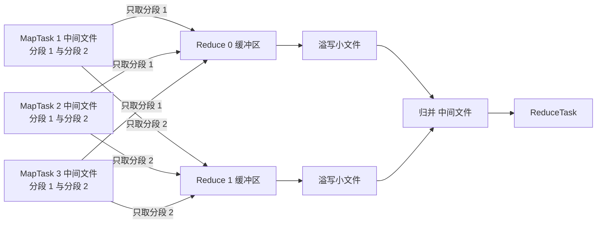

# MapReduce 运行机制：Reduce 阶段拉取、归并、分组与逐 key 计算

作业跑起来，map 进度冲到 100% 之后，reduce 的进度条才开始爬。这段时间框架在干什么？我们写的 reduce 方法收到的那组一组的数据，又是谁整理好的？答案在 Reduce 阶段内部：它同样分成 shuffle 与处理两段，拉取、缓冲、溢写、归并、排序、分组一环扣一环，最后才轮到 reduce 方法逐 key 计算。

## 先给结论

- Reduce 阶段分两段：reduce 端 shuffle 负责拉取、缓冲、溢写、归并、排序、分组，reduce 处理阶段负责从 reduce 方法到写出 part 文件。
- 每个 ReduceTask 只拉取各 MapTask 中间文件里与自己分区编号相同的那一段，分区机制保证数据各归其位，一个 ReduceTask 不会碰别的分区的数据。
- 拉到的数据先进 reduce 端缓冲区，数据量大时缓冲放不下，会像 map 端一样溢写成多个小文件，再把小文件归并成一个中间文件。
- 归并时框架做一次排序，排序之后做分组：相同 key 的数据放进同一个集合，一次 reduce 调用处理一组，K2V2 在这里变成 K3V3。
- 每个 ReduceTask 写出一个 part 文件，命名从 part-r-00000 起按序号递增；Map 与 Reduce 之间走网络传输，规约与压缩都是为这段传输减负的。

## Reduce 端 shuffle：按分区号拉取，放不下就溢写

延续上一课的场景：300M 文件切成 3 个 block，3 个 MapTask 各自产出一个内部按分区编号分段的中间文件。假设这次作业设了 2 个 ReduceTask，Reduce 端就有 2 片缓冲区，各自开工拉数据。

拉取的规则非常明确：0 号 ReduceTask 只拉每个中间文件里分区编号为 0 的那段，1 号只拉编号为 1 的那段。也就是说每个 ReduceTask 都要遍历所有 MapTask 的中间文件，但每次只取属于自己的分区段，3 个 MapTask 就是拉 3 份同编号分段。这张图画出两个 ReduceTask 的拉取路径：



拉到缓冲区的数据如果总量不大，一次就能装下；数据量大时缓冲区容纳不了全部，Reduce 端也有自己的溢写：缓冲区装满就落成一个小文件，装满几次就溢写几个小文件。这些小文件随后被归并成一个中间文件，归并的过程中框架再做一次排序，这一步与 map 端归并的逻辑同源，目的是把拉来的多份数据排成全局有序。

## 排序之后是分组：reduce 方法为什么一次拿到一组

全局有序只是手段，真正的目的在分组。相同 key 的数据排完序后天然相邻，框架把它们收进同一个集合，每凑齐一个 key 的完整集合就调用一次我们写的 reduce 方法。所以 reduce 的入参形态是「一个 key 加一个 values 集合」，而不是一条一条的零散数据。流量求和案例里的 reduce 方法就是按这个契约写的：

```java
package com.study.mapreduce.flowcount;

public class FlowCountReducer extends Reducer<Text, FlowBean, Text, FlowBean> {
    @Override
    protected void reduce(Text key, Iterable<FlowBean> values, Context context)
            throws IOException, InterruptedException {
        //values 是分组后的集合，同一手机号的全部流量记录都在里面
        Integer upFlow = 0;
        Integer downFlow = 0;
        Integer upCountFlow = 0;
        Integer downCountFlow = 0;
        for (FlowBean value : values) {
            upFlow += value.getUpFlow();
            downFlow += value.getDownFlow();
            upCountFlow += value.getUpCountFlow();
            downCountFlow += value.getDownCountFlow();
        }
        FlowBean flowBean = new FlowBean();
        flowBean.setUpFlow(upFlow);
        flowBean.setDownFlow(downFlow);
        flowBean.setUpCountFlow(upCountFlow);
        flowBean.setDownCountFlow(downCountFlow);
        //K2V2 在这里变成 K3V3
        context.write(key, flowBean);
    }
}
```

reduce 方法里不需要关心数据从哪几个 MapTask 来、经过了几次溢写归并，框架已经把同一 key 的记录收拢完毕。方法内部遍历 values 汇总，用 context.write 把 K3V3 写出去，框架再把输出落到 HDFS。

输出文件的命名规则也在此收口：第 1 个 ReduceTask 写 part-r-00000，第 2 个写 part-r-00001，以此类推，文件个数等于 ReduceTask 个数，也就是 `setNumReduceTasks` 设的值。上一课自定义分区时看到 reduce 进度按 25% 跳步，正是因为 4 个 ReduceTask 各写各的 part 文件。

## Map 与 Reduce 之间的那段网络

MapTask 与 ReduceTask 通常不在同一台主机上，中间文件里的数据要跨网络才能到 Reduce 手里，这段传输量直接决定作业快慢。框架层面的两个优化都作用在这条路上：规约在 map 端提前聚合，把同一 key 的多条记录压成一条再出门；压缩把溢写后的中间数据压小了再传。数据量越大，这两个手段的收益越明显。

把 shuffle 的四件事收拢起来看：分区、排序、规约在 map 端完成，分组在 reduce 端完成，两端合起来才是完整的 shuffle。流量、词频这类简单作业感知不到这条链路的存在，是因为框架把拉取与分组全包了，业务代码只面对分组后的结果。

## 常见误区

- **以为 ReduceTask 拉的是整个中间文件。** 它只拉各中间文件里与自己分区编号相同的那一段，分区器打标记的工作在 map 端就完成了，reduce 端按编号取件。
- **把分组当成 map 端 shuffle 的事。** 相同 key 聚成集合发生在 reduce 归并之后，map 端只负责把同 key 数据排到相邻，为分组铺路。
- **在 reduce 方法里再写一层排序。** 归并时框架已做过全局排序，values 集合内部有稳定的顺序，业务层重复排序徒增开销。
- **ReduceTask 个数随意设。** 每增加一个 ReduceTask，所有 MapTask 都要多维护一个分区段供它拉取，分区器返回值范围也必须与之对齐；设 1 个则分区逻辑整个被跳过，设过多则多出空 part 文件。

## 面试可能被问到的问题

1. 面试官追问：「ReduceTask 怎么知道自己该拉哪些数据？」
   答：每个 map 输出记录在溢写时就带上了分区编号，中间文件内部按编号分段；ReduceTask 按自己的编号，到每个 MapTask 的中间文件里只拉对应分段，3 个 MapTask 就拉 3 份。
2. 面试官追问：「reduce 方法的 values 参数是什么，怎么来的？」
   答：是同一 key 的全部记录组成的集合。Reduce 端归并排序后，相同 key 相邻，框架按 key 分组，每组调用一次 reduce 方法，这就是分组的结果。
3. 面试官追问：「Reduce 端还有排序吗，和分组什么关系？」
   答：有。归并小文件时做一次排序形成全局有序，分组依赖这个有序，相同 key 排到相邻才能被收进同一个集合，没有排序分组就无从谈起。
4. 面试官追问：「part-r-00001 这个文件名各部分什么含义？」
   答：r 表示这是 Reduce 的输出，与 map 端临时文件的 part-m 前缀区分；00001 是 ReduceTask 的编号，文件个数与 ReduceTask 个数一一对应。
5. 面试官追问：「为什么说规约和压缩都能加速 Reduce？」
   答：Map 与 Reduce 之间走网络传输，规约在 map 端提前聚合减少传输条数，压缩把中间数据体积压小，两者都直接削减跨节点传输的数据量，reduce 的等待时间随之缩短。

## 配套资料

- 代码：`materials/code/04/day04-MapReduce高级/day04/代码/day04_mapreduce_combiner/src/main/java/`，课程真实工程；`mapreduce_flowcount` 子包的 FlowCountReducer.java 即逐 key 汇总的 reduce 写法，`mapreduce_flowcount_partition` 子包的 JobMain.java 含 `setNumReduceTasks` 与分区编号对齐的装配，包名改写为 `com.study.mapreduce`。
- Reduce 端机制图按本课课件整理；reduce 缓冲区溢写行为与 map 端同源，框架未开放独立配置项。
