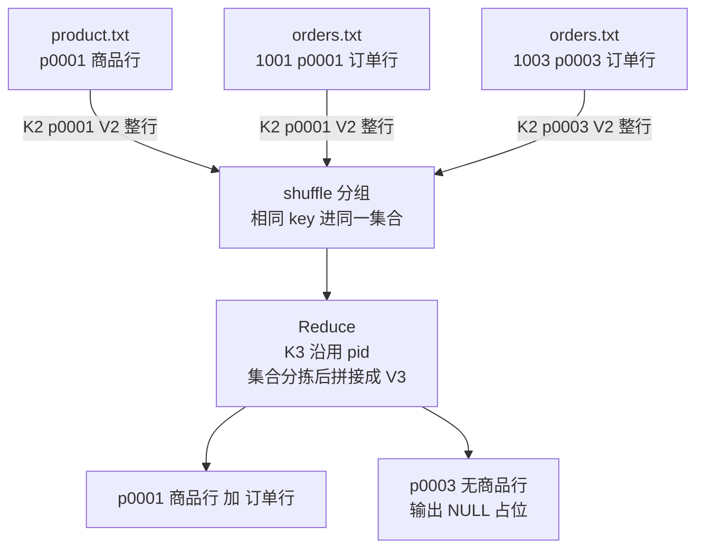
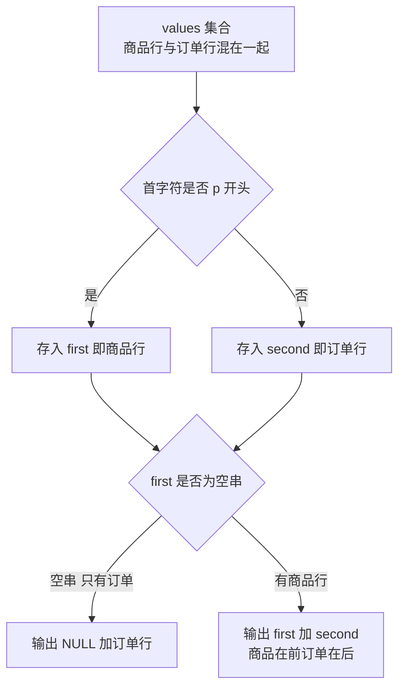
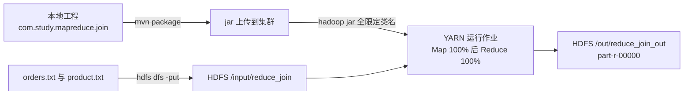

# MapReduce 实现 Reduce 端 join 操作：步骤分析、Reducer 分拣拼接与集群测试

## 先给结论

- 三篇内容把 SQL 的左外连接搬到 MapReduce 上跑：步骤分析与 Map 端代码、Reducer 阶段代码、集群测试与结果核对。
- join 的「对上」由 shuffle 分组机制完成：两张表每一行都以 pid 为 K2、整行文本为 V2，同一 pid 的商品行与订单行自动收进同一个 Reducer。
- Map 里必须区分数据来源：context.getInputSplit 强转 FileSplit 再取文件名，orders.txt 的 pid 在第 3 列取 split[2]，product.txt 的 pid 在第 1 列取 split[0]。
- Reducer 泛型四个全是 Text；分拣靠首字母判断，p 开头是商品行赋给 first，其余是订单行赋给 second，输出 first + 制表符 + second。
- 商品缺失时订单行以 NULL 占位输出，这是左外连接的正常语义不是事故；课程版对一商品多订单只留最后一条，通用版需要两个集合双循环输出完整组合。
- Reduce 端 join 的软肋是数据倾斜：热点商品 id 把海量订单吸进同一个 ReduceTask，这是后续引入 Map 端 join 的直接动机。
- JobMain 从流量统计模板改造必改四处：Job 名称、输入路径、Reducer 类、输出路径；残留的 FlowBean 编译期拦不住，要到集群写第一条记录才爆。
- 集群测试四步：HDFS 建输入目录上传两份数据、Maven 打包上传 jar、hadoop jar 提交、到输出目录核对结果。

## 第1部分：MapReduce 实现 Reduce 端 join：把 SQL 的左外连接搬到集群上跑

订单表关联商品表，数据库里一条 join 语句的事。可当两张表的数据量涨到内存装不下的规模，一次性加载进数据库或程序里就可能内存溢出，数据转而以文件形式躺在 HDFS 上。这时联表查询得靠 MapReduce 来模拟，本课要做的就是把这条 SQL 翻译成 map 与 reduce 两个阶段的过程。

### 需求与 SQL 对照

两张表的字段如下：订单数据表有订单 id、日期、商品 id pid、数量 amount 四列；商品信息表有商品 id、名称 pname、分类 id category_id、价格 price 四列。数据库里的写法是：

```sql
select a.id, a.date, b.name, b.category_id, b.price
from t_order a left join t_product b on a.pid = b.id
```

on 后面的条件 `a.pid = b.id` 点明了关联字段：订单行靠 pid 找到自己的商品行。数据在 HDFS 上是两个文本文件，orders.txt 与 product.txt，每行一条记录，字段用逗号分隔。课程演示数据长这样：

```text
# product.txt
p0001,小米5,1000,2000
p0002,锤子T1,1000,3000

# orders.txt
1001,20150710,p0001,2
1002,20150710,p0001,3
1003,20150710,p0003,1
```

1003 这条订单的 pid 是 p0003，商品表里没有它，查询结果里商品字段要以 NULL 补位，这正是 left join 的语义。两个文件都很大，谁也不该整个读进内存，那就让它们各自流过 map，靠 key 相同这一点在 shuffle 里自动相遇。

### 思路：用 key 把两张表的行拉到一起

join 的本质是「同一关联键的数据放到同一行」。MapReduce 里恰好有一个机制天然干这件事：分组。相同的 key 一定会被收进同一个 values 集合、交给同一次 reduce 调用，那么只要两张表的行都以 pid 作为 K2 输出，框架就会把 p0001 的商品行和 p0001 的所有订单行聚到一起。这张图把整条思路走一遍：



reduce 收到的新 V2 是一个集合，里面既有商品行也有订单行，来源不同但 key 相同。Reduce 端把这个集合遍历分拣：商品行拼在前面，订单行拼在后面，没有商品行的订单用 NULL 顶上。键 K3 沿用 pid 不变，V3 就是拼好的结果串。

这条思路里 Map 端只做两件事：认出这行数据来自哪个文件，以及把 pid 抠出来当 K2。V2 不拆不加工，直接放整行，因为订单行和商品行要到 reduce 里才能配对，行里的每个字段后面都用得上。

### Map 代码：判断来源文件，取 pid 作 K2

判断来源文件靠的是 context 提供的切片信息。每一条 V1 都产生自某个输入切片 InputSplit，文件型切片在框架里的实现类是 FileSplit，从它能拿到这条数据所在文件的路径与名字。课程工程新建 `mapreduce_reduce_join` 包，ReduceJoinMapper 的完整实现如下：

```java
package com.study.mapreduce.join;

import org.apache.hadoop.io.LongWritable;
import org.apache.hadoop.io.Text;
import org.apache.hadoop.mapreduce.InputSplit;
import org.apache.hadoop.mapreduce.Mapper;
import org.apache.hadoop.mapreduce.lib.input.FileSplit;

import java.io.IOException;

public class ReduceJoinMapper extends Mapper<LongWritable, Text, Text, Text> {
    @Override
    protected void map(LongWritable key, Text value, Context context)
            throws IOException, InterruptedException {
        //判断数据来自哪个文件
        FileSplit fileSplit = (FileSplit) context.getInputSplit();
        String fileName = fileSplit.getPath().getName();

        if (fileName.equals("orders.txt")) {
            //订单行 pid 在第 3 列
            String[] split = value.toString().split(",");
            context.write(new Text(split[2]), value);
        } else {
            //商品行 pid 在第 1 列
            String[] split = value.toString().split(",");
            context.write(new Text(split[0]), value);
        }
    }
}
```

三个关键点值得展开。**第一，getInputSplit 拿到的是抽象类型 InputSplit**，直接用没有 getPath 方法，要强转成它的文件型子类 FileSplit 再调用，`getPath().getName()` 层层取到文件名，只拿文件名不拿全路径，与 orders.txt 的比较才成立。**第二，两个分支的差别只在列索引**，订单行按逗号切开后 pid 落在下标 2，商品行落在下标 0，V2 始终是 value 原封不动的整行。**第三，课程写法没有把来源标记显式写进 V2**，它利用了内容特征：商品行的首字段以 p 开头，订单行首字段是纯数字，Reduce 端靠这个特征分拣来源。更通用的做法是给 V2 拼一个来源前缀或封装成带 flag 字段的 Bean，可靠性不依赖数据内容，下一篇拆 Reducer 时会再对这个问题。

### 装配：两个文件放进同一个输入目录

JobMain 没有新花样，分区排序规约分组四步全部走默认：

```java
package com.study.mapreduce.join;

//Job 装配的关键片段
public class JobMain extends Configured implements Tool {
    @Override
    public int run(String[] args) throws Exception {
        Job job = Job.getInstance(super.getConf(), "mapreduce_reduce_join");
        job.setJarByClass(JobMain.class);

        job.setInputFormatClass(TextInputFormat.class);
        //orders.txt 与 product.txt 都上传到这个目录
        TextInputFormat.addInputPath(job, new Path("hdfs://node01:8020/input/reduce_join"));

        job.setMapperClass(ReduceJoinMapper.class);
        job.setMapOutputKeyClass(Text.class);
        job.setMapOutputValueClass(Text.class);

        //分区、排序、规约、分组采用默认方式
        job.setReducerClass(ReduceJoinReducer.class);
        job.setOutputKeyClass(Text.class);
        job.setOutputValueClass(Text.class);

        job.setOutputFormatClass(TextOutputFormat.class);
        TextOutputFormat.setOutputPath(job, new Path("hdfs://node01:8020/out/reduce_join_out"));
        return job.waitForCompletion(true) ? 0 : 1;
    }
}
```

两个文件都放在 `/input/reduce_join` 目录下，TextInputFormat 把目录下所有文件都作为输入，切出的每个切片在 map 里都能查到自己属于哪个文件。Map 输出类型统一是 Text 对 Text，与 Reducer 的四个 Text 泛型呼应。

## 第2部分：Reduce 端 join 的 Reducer：按来源分拣、拼接输出与数据倾斜的伏笔

上一课把两张表的行都用商品 id 作为 K2 送进了 shuffle，分组之后，reduce 方法每次收到的 values 集合里同时装着商品行与订单行。剩下的问题只有两个：怎么在集合里分清谁是商品谁是订单，以及拼好的结果长什么样。答案落在 Reducer 的十几行代码里，而它也顺手埋下了 Reduce 端 join 最大的隐患：数据倾斜。

### Reducer 代码：先分拣，再拼接

reduce 方法收到的每组数据形态固定：key 是商品 id，values 是该 id 下商品行与订单行的混合集合。课程工程在 `mapreduce_reduce_join` 包里的 ReduceJoinReducer 如下：

```java
package com.study.mapreduce.join;

import org.apache.hadoop.io.Text;
import org.apache.hadoop.mapreduce.Reducer;

import java.io.IOException;

public class ReduceJoinReducer extends Reducer<Text, Text, Text, Text> {
    @Override
    protected void reduce(Text key, Iterable<Text> values, Context context)
            throws IOException, InterruptedException {
        String first = "";
        String second = "";
        //按内容特征分拣来源：商品行以 p 开头，订单行是数字开头
        for (Text value : values) {
            if (value.toString().startsWith("p")) {
                first = value.toString();
            } else {
                second = value.toString();
            }
        }

        if (first.equals("")) {
            //没有商品行的订单，用 NULL 占位输出
            context.write(key, new Text("NULL" + "\t" + second));
        } else {
            context.write(key, new Text(first + "\t" + second));
        }
    }
}
```

IDE 生成重写方法时会自动带出一行 `super.reduce(key, values, context)`，这行必须删干净，父类的默认实现不是为业务准备的，留着它数据会被原样透传，join 等于没做。

分拣的逻辑值得咀嚼一下。商品行 `p0001,小米5,1000,2000` 以小写 p 开头，订单行 `1001,20150710,p0001,2` 以数字开头，`startsWith("p")` 一刀切开两类数据，商品归 first、订单归 second。这是上一课说的「隐式来源标记」：Map 端没有往 V2 里写任何标记字符，来源信息完全寄托在数据自己的内容特征上。每次 reduce 调用的分拣与输出决策如下：



一条 reduce 调用遍历完整个集合，first 与 second 各就各位，两个出口分别对应「配上了商品」与「商品缺失」两种结果。

输出侧，K3 直接沿用 key，V3 用制表符把 first 与 second 接起来，商品信息在前、订单信息在后。对 p0003 这种商品表里不存在的 pid，集合里只有订单行，first 保持空串，走到 if 分支输出 `NULL` 加订单行，与 SQL 左外连接的结果语义对齐。

### 一个商品多个订单：课程版与通用版的差距

first 与 second 都是普通字符串变量，循环里后来者覆盖前者。演示数据里 1001 和 1002 两笔订单都是 p0001，这个写法最终只会输出一笔。要拿到「一个商品对应它的全部订单」的完整笛卡尔组合，需要把两侧各自收集成集合再做双循环。按本课思路补全的通用版本如下：

```java
//通用版：收集两侧再做笛卡尔拼接（按本课思路补全，非课程原码）
List<String> products = new ArrayList<>();
List<String> orders = new ArrayList<>();
for (Text value : values) {
    if (value.toString().startsWith("p")) {
        products.add(value.toString());
    } else {
        orders.add(value.toString());
    }
}
if (products.isEmpty()) {
    for (String order : orders) {
        context.write(key, new Text("NULL" + "\t" + order));
    }
} else {
    for (String product : products) {
        for (String order : orders) {
            context.write(key, new Text(product + "\t" + order));
        }
    }
}
```

m 个商品行配 n 个订单行就输出 m 乘 n 行，商品的每一行与它的每一笔订单都会成对出现。课程演示以一对一为主，简单变量足够；真实业务里订单表对商品表几乎必然是一对多，通用版才是能上生产的样子。

装配代码沿用上一课的 JobMain，TextInputFormat 读入 `/input/reduce_join` 下的两个文件，Reducer 类换成 ReduceJoinReducer 即可，输出目录换成 `/out/reduce_join_out`。跑完打开 part 文件，每行就是商品信息加订单信息的拼接结果，p0003 的订单以 NULL 开头。

### 数据倾斜：这段代码埋下的伏笔

回看 reduce 收到的数据流：同一个 key 的全部记录，不管来自几个 MapTask、几笔订单，都要汇进同一个 ReduceTask 才能分组。商品 id 的分布是极度不均匀的，爆款商品可能挂着百万笔订单，冷门商品只有几笔。前者的 key 会让某个 ReduceTask 收到的数据量是别人的成千上万倍，别的任务跑完了它还在慢慢算，整个作业的完成时间被这一个任务拖住，这就是数据倾斜。

问题的根源在 Reduce 端 join 的机制本身：join 必须在「同 key 聚合」的那一刻发生，而聚合点只有一个。订单表是大表，商品表是小表，这笔账其实可以换一种算法：把商品表整个加载进每个 map 节点的内存，大表的每一行在 map 端就直接配上商品信息，shuffle 里根本没有 join 的事，热点 key 也就无从汇聚。这正是 Map 端 join 的思路，也是后续课程要展开的优化方向，它成立的代价是那张被缓存的小表必须小到装得进每个节点的内存。

两相对照，选型的天平就清楚了：两张大表都不小，用 Reduce 端 join，忍受倾斜风险并想办法治它；一大一小且小的能进内存，优先 Map 端 join，把倾斜连根拔掉。

## 第3部分：Reduce 端 join 作业上集群：数据上传、提交运行与结果核对

本地开发机里跑通 Reduce 端 join，只说明代码逻辑没问题，这份作业的真正归宿是 Linux 集群上的 Hadoop 环境。第一次提交时最容易卡住的地方就三处：HDFS 上没有作业要读的输入目录、从别的工程拷来的 JobMain 没改干净、看到结果文件里出现 NULL 就慌忙回滚代码。把整条链路完整走一遍，这三处就都成了流程里的普通步骤。

### JobMain 改造：把流量统计模板换成 join 装配

装配代码不值得从零敲，从写过的流量统计工程把 JobMain 复制过来，逐处替换成 join 作业需要的配置即可。课程工程在 `mapreduce_reduce_join` 包里最终的 JobMain 如下：

```java
package com.study.mapreduce.join;

import org.apache.hadoop.conf.Configuration;
import org.apache.hadoop.conf.Configured;
import org.apache.hadoop.fs.Path;
import org.apache.hadoop.io.Text;
import org.apache.hadoop.mapreduce.Job;
import org.apache.hadoop.mapreduce.lib.input.TextInputFormat;
import org.apache.hadoop.mapreduce.lib.output.TextOutputFormat;
import org.apache.hadoop.util.Tool;
import org.apache.hadoop.util.ToolRunner;

public class JobMain extends Configured implements Tool {
    @Override
    public int run(String[] args) throws Exception {
        Job job = Job.getInstance(super.getConf(), "mapreduce_reduce_join");
        //打包放到集群运行时必需的配置
        job.setJarByClass(JobMain.class);

        job.setInputFormatClass(TextInputFormat.class);
        TextInputFormat.addInputPath(job, new Path("hdfs://node01:8020/input/reduce_join"));

        job.setMapperClass(ReduceJoinMapper.class);
        job.setMapOutputKeyClass(Text.class);
        job.setMapOutputValueClass(Text.class);

        //分区、排序、规约、分组采用默认方式，不设分区器与 ReduceTask 个数

        job.setReducerClass(ReduceJoinReducer.class);
        job.setOutputKeyClass(Text.class);
        job.setOutputValueClass(Text.class);

        job.setOutputFormatClass(TextOutputFormat.class);
        TextOutputFormat.setOutputPath(job, new Path("hdfs://node01:8020/out/reduce_join_out"));

        boolean b = job.waitForCompletion(true);
        return b ? 0 : 1;
    }

    public static void main(String[] args) throws Exception {
        Configuration configuration = new Configuration();
        int run = ToolRunner.run(configuration, new JobMain(), args);
        System.exit(run);
    }
}
```

模板里埋着一个隐蔽的坑：拷过来的代码里 Map 阶段输出值与 Reduce 阶段输出值都还写着 `FlowBean`。泛型只约束 Mapper 自己的输出，编译器不会报错，等作业提交到集群、写第一条记录时框架做类型核对，直接抛类型不匹配异常。凡是类型声明，四处都换成 `Text`。

两处「不做」也是决定：分区器与 `setNumReduceTasks` 不设置，作业默认只用 1 个 ReduceTask。join 的演示数据量不大，一个 Reduce 把分组结果集中输出，核对起来最直观；数据量上来之后并行度再单独调。

### 集群测试四步走

作业读的是 HDFS，数据得先到位。两份演示数据先传到 Linux 的 `/export/software` 目录，再上传进 HDFS：

```bash
#建输入目录，路径必须与 JobMain 里写的 /input/reduce_join 完全一致
hdfs dfs -mkdir /input/reduce_join
#两份数据一次上传，文件名保持 orders.txt 与 product.txt 不变
hdfs dfs -put orders.txt product.txt /input/reduce_join
#确认文件都已到位
hdfs dfs -ls /input/reduce_join
```

文件名是隐式契约：ReduceJoinMapper 里用 `FileSplit` 拿到当前处理文件的名称，`orders.txt` 走订单分支按下标 2 取 pid，其余按下标 0 取。上传前重命名文件，pid 提取的列下标就整体错位，join 静默失效。

数据就位后打包提交：

```bash
#工程目录下打包，产物在 target 目录，名字以实际打包结果为准
mvn package -DskipTests
#把 jar 上传到集群任意目录后提交，主类用全限定类名
hadoop jar day04-xxx.jar com.study.mapreduce.join.JobMain
```

主类名建议从 IDE 里右键 Copy Reference 直接粘贴，手敲 `com.study.mapreduce.join.JobMain` 拼错一个字符就会在提交时报 `ClassNotFoundException`。命令执行后控制台滚动输出进度：Map 任务到 100% 之后 Reduce 任务再到 100%，末尾打印一组作业计数器，说明整条链跑完。

完整链路如下图，任何一步失败都不必往下走，先把当前步骤修绿。



### 核对输出：NULL 是语义，不是事故

跑完先看输出目录。`hdfs dfs -cat /out/reduce_join_out/part-r-00000` 直接拉出结果，或者在浏览器打开 node01 的 9870 端口进入 HDFS Web UI，从 Utilities 里的文件浏览器逐级点开 `out/reduce_join_out` 下载 part 文件。按课程演示数据，结果大致长这样（数值为示意，以实际上传的数据为准）：

```text
p0001	p0001,小米5,1000,2000	1001,20150710,p0001,2
p0002	p0002,华为手机,2000,1000	1003,20150711,p0002,1
p0003	NULL	1004,20150711,p0003,5
```

每行的结构是 K3（商品 id）加制表符加商品行加订单行。p0003 在商品表里不存在，Reducer 分拣后 first 是空串，输出以 NULL 占位，与左外连接的结果语义对齐，这行恰恰说明代码工作正常。

真正要警惕的是另外几种形态。**第一，整篇全是 NULL。** 说明商品行从来没有被认出来，常见根因是文件名契约被破坏，Mapper 的文件名判断分支整体翻转，或者商品 id 前缀大小写与 `startsWith("p")` 不符。**第二，key 变成了订单号或价格。** 说明 pid 取错了列下标，多半是数据文件的列序与代码里的 `split` 下标对不上。**第三，作业压根没起来。** 输入路径不存在时作业初始化直接抛 `Input path does not exist`；输出目录已存在时抛 `FileAlreadyExistsException`，`TextOutputFormat` 要求输出目录预先不存在，重跑前先 `hdfs dfs -rm -r /out/reduce_join_out`。**第四，任务一写数据就挂。** 八成是模板残留的类型没换干净，翻日志找 `Type mismatch` 关键字。

## 常见误区

- **文件名判断写错比较对象。** getPath 返回的是带目录的全路径，拿它直接 equals 字符串 orders.txt 永远不等，必须先 getName 取出纯文件名。
- **列下标张冠李戴。** 订单表四列里 pid 排第三，split[2] 才是它；照着商品表的 split[0] 抄，K2 就变成订单号，join 悄悄失配，输出全是 NULL 行。
- **以为 Map 端要手动配对。** map 只负责给数据「报名字」，配对由 shuffle 分组完成；在 map 里维护任何跨行状态都是画蛇添足。
- **数据文件上传后改了名。** 判断依据是文件名字符串，上传到 HDFS 后如果重命名成 orders_bak.txt 之类，这一部分数据会全部落进 else 分支被当成商品行处理。
- **忽视前缀判断的大小写敏感。** `startsWith("p")` 只认小写，数据里商品 id 若是大写 P 开头，商品行会全部落进订单分支，first 永远是空串，输出整篇变成 NULL 加单行，join 静默失效。稳妥做法是显式打来源标记，不依赖内容猜。
- **一个商品多笔订单时以为都输出了。** second 是单个字符串，循环覆盖后只剩最后一笔，结果文件行数看起来正常、订单数却对不上账；多个订单要用集合收集再双循环。
- **重写方法里的 super.reduce 忘删。** 模板生成的这行会调用父类默认行为，把输入数据原样写出，与业务输出混在一起，排查时结果文件里一半是原始行一半是拼接行。
- **把倾斜当成数据量的均匀问题。** 倾斜是 key 分布不均导致的聚合点热点，增加 ReduceTask 个数治标不治本，热点 key 依旧独占一个任务；换 join 方案或对 key 加盐打散才是对症的药。
- **重跑作业不删输出目录。** 错例是改完代码直接再次 `hadoop jar`，作业在初始化阶段就失败。正解：重跑前 `hdfs dfs -rm -r` 删掉旧输出目录，或在 JobMain 里换一个带时间戳的输出路径。
- **上传前顺手改了数据文件名。** Mapper 靠文件名决定从哪一列取 pid，`orders.txt` 改成 `order.txt` 会让两份数据都走商品分支，key 全变成商品 id 以外的字段，join 结果整体错乱。
- **见到 NULL 行就回滚 Reducer。** 单独的 NULL 行是商品缺失时的占位输出，属于预期行为；只有当 NULL 泛滥到整篇都是，才说明分拣逻辑或数据本身有问题。
- **本地跑通就不再核对集群结果。** 本地模式与集群作业读的是两套文件系统，改了本地数据忘传 HDFS，集群上跑的还是旧数据；行数、NULL 行数、字段位置都要在集群结果上重新过一遍。

## 面试可能被问到的问题

1. 面试官追问：「Reduce 端 join 的核心思路是什么？」
   答：把 join 键作为 map 输出的 K2，两张表的数据行整行作为 V2；shuffle 分组天然把相同 key 的行聚到同一个集合，Reduce 端遍历集合按来源分拣再拼接，等价于 SQL 里按 on 条件配对。

2. 面试官追问：「map 怎么知道当前这条数据来自哪个文件？」
   答：通过 context.getInputSplit 拿到这条数据所在的输入切片，强转成 FileSplit 后调 getPath().getName() 得到文件名，再按文件名分支处理。

3. 面试官追问：「为什么 K2 选 pid，V2 却放整行？」
   答：K2 决定数据在 shuffle 里跟谁聚合，必须选关联键；V2 放整行是因为商品与订单要到 reduce 才配对，两侧行里的所有字段都可能出现在最终结果里，提前拆列反而丢信息。

4. 面试官追问：「left join 的语义在程序里怎么体现？」
   答：Reduce 端分拣后如果集合里没有商品行，订单行照样输出，商品字段以 NULL 占位；join 键在商品表缺失的订单不被丢弃，这正是左外连接与内连接的区别。

5. 面试官追问：「Reduce 端 join 和 Map 端 join 的适用场景有何不同？」
   答：Reduce 端 join 不挑数据规模，两张大表都能处理，代价是全部数据要过一次网络和 shuffle；Map 端 join 把小表缓存到每个 map 节点在大表读取时直接关联，省掉 shuffle，但要求一张表小到能装进内存。

6. 面试官追问：「Reduce 端 join 的 Reducer 泛型为什么四个都是 Text？」
   答：K2 是商品 id 字符串，V2 是整行文本，K3 沿用 K2，V3 是拼接后的结果串，全程没有数值计算与序列化 Bean 的需求，Text 一用到底最直接。

7. 面试官追问：「values 集合里商品行和订单行怎么区分？」
   答：课程实现靠内容特征，商品行以小写 p 开头，startsWith 判断后分别放进 first 与 second；更稳的方案是 Map 端在 V2 里显式带上来源标记或封装带 flag 的 Bean，避免被数据内容绑架。

8. 面试官追问：「一个商品对应很多订单，代码要注意什么？」
   答：不能只用单个字符串变量接订单行，后来者会覆盖前者。要用两个集合分别收集商品行与订单行，再做双循环输出 m 乘 n 的笛卡尔组合，缺失商品一侧按 NULL 逐订单输出。

9. 面试官追问：「为什么 Reduce 端 join 容易数据倾斜？」
   答：join 发生在 shuffle 分组之后，相同 key 的数据必须全部汇聚到同一个 ReduceTask；商品 id 分布不均，热点商品挂着海量订单时，对应任务的数据量与耗时远超其他任务，整个作业被它拖死。

10. 面试官追问：「怎么缓解或避免这种倾斜？」
   答：根源方案是改用 Map 端 join，把小表广播到 map 端直接关联，省掉同 key 汇聚；若必须走 Reduce 端 join，可对热点 key 加盐打散再二次聚合，或提高并行度，但都只是缓解，不如换方案彻底。

11. 面试官追问：「作业提交到集群，JobMain 里哪一行配置是专门为集群准备的？」
   答：`job.setJarByClass(JobMain.class)`。作业打成 jar 后由 YARN 分发到各节点，框架靠这一行确定从哪个 jar 里加载 Mapper、Reducer 等业务类，少了它本地能跑、集群上直接找不到类。

12. 面试官追问：「`hadoop jar` 命令后面跟的参数分别是什么？」
   答：第一个是 jar 包路径，第二个是入口类的全限定名，也就是包含 main 方法并用 ToolRunner 驱动 run 方法的那个类。类名写错或包名不全会报 ClassNotFoundException。

13. 面试官追问：「为什么输出目录必须事先不存在？」
   答：MapReduce 的输出组件防止把历史结果覆盖掉，作业初始化时检查目标目录，已存在就抛 FileAlreadyExistsException 让作业失败。要重跑就先删除旧目录或换新目录。

14. 面试官追问：「结果里出现 NULL 开头的行，怎么判断是不是程序 bug？」
   答：看分布。个别 key 的 NULL 行对应商品表里缺失的商品，是左外连接的正常占位输出；如果整篇结果全是 NULL，说明商品行从未被分拣进 first，要去查文件名契约与 `startsWith` 的前缀匹配。

15. 面试官追问：「集群测试与本地测试相比，哪些坑只在集群上暴露？」
   答：数据在 HDFS 上，路径必须是 `hdfs://node01:8020` 形式且与代码一致；jar 由 YARN 分发，`setJarByClass` 与主类全限定名必须正确；输出目录已存在、模板类型残留这类问题在写第一条记录或初始化时才会炸，本地模式往往绕过了这些检查。

## 配套资料

- 代码：`materials/code/04/day04-MapReduce高级/day04/代码/day04_mapreduce_combiner/src/main/java/`，课程真实工程，其下 `mapreduce_reduce_join` 子包的 ReduceJoinMapper.java 与 JobMain.java 即本课的 Mapper 与装配代码，包名改写为 `com.study.mapreduce.join`。
- orders.txt 与 product.txt 为课程演示数据，按画面内容整理；materials 中未随附这对数据文件。
- 代码：`materials/code/04/day04-MapReduce高级/day04/代码/day04_mapreduce_combiner/src/main/java/`，课程真实工程，其下 `mapreduce_reduce_join` 子包的 ReduceJoinReducer.java 与 JobMain.java 即本课的 Reducer 与装配代码，包名改写为 `com.study.mapreduce.join`。
- 笛卡尔拼接的通用版 Reducer 为按本课思路补全的示例，课程源码以一对一演示数据为准。
- 代码：`materials/code/04/day04-MapReduce高级/day04/代码/day04_mapreduce_combiner/src/main/java/`，其下 `mapreduce_reduce_join` 子包中的 JobMain.java、ReduceJoinMapper.java、ReduceJoinReducer.java 即本课的装配与业务代码，博客中包名改写为 `com.study.mapreduce.join`。
- 输出样例为课程演示数据的示意，资料包内未附 orders.txt 与 product.txt 原始数据文件，行内容以实际上传数据为准。
