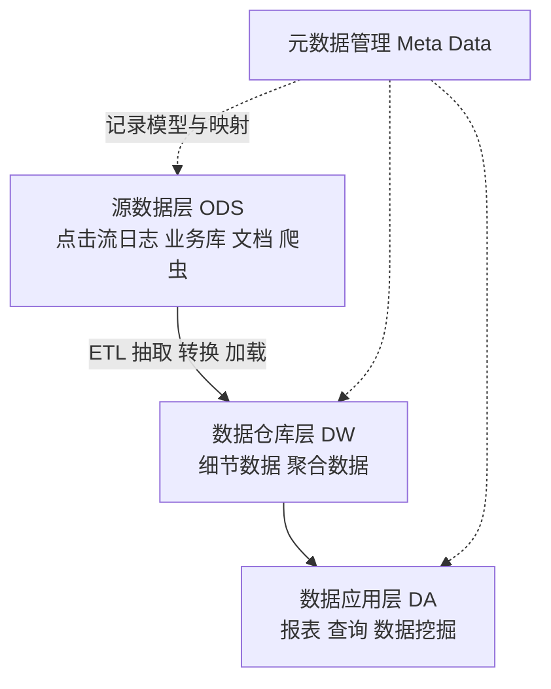

# 数仓分层与元数据管理：ODS、DW、DA 三层架构怎么搭

数仓的原始数据来自四面八方，格式五花八门，如果让分析人员直接在原始数据上出报表，清洗逻辑、口径换算会散落在每一条查询里，改一处口径就要全链路重查。解法是给数据修一条流水线：先分层，再用元数据把整条流水线管起来。这两件事合在一起，就是数仓实施层面的骨架。

## 先给结论

- 数仓从数据流入到流出分三层：源数据层 ODS、数据仓库层 DW、数据应用层 DA，层与层之间靠 ETL 串联。
- ODS 只做临时存放，DW 存清洗后一致、干净、准确的细节数据，DA 面向报表、查询与挖掘。
- 分层的价值在于把复杂问题拆小：每层只干自己擅长的事，哪一层出错就修哪一层，不全链路返工。
- 元数据是贯穿三层的「关于数据的数据」，记录模型定义、层间映射、转换规则与装载周期，与 NameNode 管理的文件系统元数据不是一回事。
- 元数据由元数据资料库统一存储，工程上通常落在 MySQL 这类关系库中。

## 三层架构：数据从流入到流出

从下往上看这条流水线。最下面是源数据层，习惯叫 ODS 层（Operational Data Store）。数仓本身不生产数据，原料全在这里汇集：点击流日志、网络日志、业务数据库的数据、文档数据，还有爬虫采集的外部数据。这一层的数据格式不统一，往往也不符合分析要求，所以它的角色是临时存放，为下一环节的清洗做准备。

中间是数据仓库层，叫 DW 层（Data Warehouse）。源数据经过统一规范、清洗、格式化之后进入这一层，数据更规范、更整齐、没有任何杂质，因此 DW 也被称作细节层，它保存着数仓最完整的明细与细节。

最上面是数据应用层，叫 DA 层（Data Application）。报表、查询、数据挖掘这些应用从这里取数，对 DW 的数据做进一步的分析加工，最终生成报表展示给使用者。三层的流转与元数据的贯穿关系如下：



数据自下而上单向流动，ETL 负责层间的每一次搬运与加工，元数据在右侧贯穿三层，记录每一层里数据的定义与来龙去脉。

课程口径是 ODS、DW、DA 三层。业内常见的叫法会把中间的 DW 再细分：DWD 存明细、DWM 存中间加工结果、DWS 存面向业务聚合的宽表，DA 层也常被叫作 ADS 或 APP 层。叫法有差异，骨架是同一套，看到这些缩写能对上号即可。

## 为什么要分层

分层把一个大的数据处理问题做了划分，每层只处理单一步骤、只干自己最擅长的事。带来的好处非常具体：清洗环节出了问题，只需要修改清洗那一层的代码，重跑该层即可；报表展示出了问题，只需要修改展示那一层，不动底层。哪层出错修哪层，复杂问题就变成了一个个简单问题。

反过来看不分层的代价：清洗逻辑嵌在报表查询里，口径改动要在几十条查询里逐个排查，任何一处漏改都让数字对不上。分层之后，层与层之间有明确的接口，数据结构清晰，定位问题、维护数据准确性都容易得多，ETL 的过程也随之被简化。

## ETL：贯穿层间的新陈代谢

从 ODS 到 DW 的这段操作，统称 ETL。E 是 Extract，抽取；T 是 Transform，转换；L 是 Load，加载。从源数据抽取出来，转换成统一格式，再装载进数据仓库，数据仓库从源数据流入开始、到在仓内转换流动的整个过程，都可以看作 ETL 的组成部分。

ETL 在数仓里扮演的角色是维持数据的新陈代谢：源系统每天产生新数据，靠 ETL 周期性把数据搬进仓、加工好。数仓日常的管理和维护，大部分精力就花在保持 ETL 的稳定上。落地时，每一层就是一批 Hive 表，层间加工就是一条条 SQL。下面是配套讲义里一个真实的 DWD 层事实表建表语句：

```sql
CREATE EXTERNAL TABLE IF NOT EXISTS data_course.course_visit_fact
(course_visit_fact_id String,
course_dim_id String,
time_dim_id String,
area_dim_id String,
company_dim_id String,
client_ip String,
client_sessionid String,
client_type String,
visit_time bigint)
PARTITIONED BY (years String, months String, days String)
ROW FORMAT DELIMITED FIELDS TERMINATED BY '\t'
STORED AS PARQUET
location '/user/hive/external/data_course/course_visit_fact';
```

表按年月日三级分区，存储格式选了列式存储的 PARQUET，这就是 DW 层明细表的典型形态。ODS 到 DWD 的日常加工示意如下：

```sql
-- ODS 到 DWD 的每日加工示意（按本课写法补全的示例）
INSERT OVERWRITE TABLE data_course.course_visit_fact
PARTITION (years = '2026', months = '11', days = '04')
SELECT visit_id, course_id, user_id, client_ip, visit_time
FROM ods_click_stream
WHERE dt = '2026-11-04' AND user_id IS NOT NULL;
```

## 元数据管理：贯穿三层的账本

分层架构图右侧那根贯穿三层的虚线，就是元数据管理（Meta Data）。元数据是记录数据的数据，一个直接对比可以帮助区分：讲 HDFS 时 NameNode 管理元数据，那是文件系统层面的东西，记的是文件名、权限、块位置；数仓的元数据是逻辑层面的，它记录数仓中各种模型的定义、各层之间的映射关系，监控数仓中数据的状态与 ETL 的运行状态，本质上是协调整个数仓的账本。

账本上记的内容包括：源数据到数仓的映射，数据转换的规则（什么样的数据转成什么样的数据），数据的逻辑结构，数据的更新规则（多长时间更新一次、什么时候导入了数据、装载周期是多少）。有了这本账，任何一层的表都能回答「我从哪来、经过了什么加工、多久刷新一次」。

元数据具体分两类。**技术元数据**给开发和管理数仓的专业人员看，描述数仓开发、管理、维护相关的信息：抽取方法、转换规则、汇总规则、清洗规则都在其列。**业务元数据**给业务人员看，比如项目经理关注的数据质量、数据组织方式。分开存放的原因很朴素：让不同角色都能以自己的视角理解数仓的组织与管理。

元数据本身也是数据，它通过一个元数据资料库统一存储和管理，目的是让数仓从设计、部署、操作到管理协调一致。工程上，这本账几乎总是落在关系型数据库里，原因是它体量小、读写频繁、需要事务保证与并发访问，这正是 MySQL 最擅长的场景。后面安装 Hive 时会实际配到这一点，Hive 的表结构等元数据就由 metastore 服务存进 MySQL：

```xml
<!-- Hive metastore 的元数据落库配置（按主流写法补全的示例） -->
<property>
  <name>javax.jdo.option.ConnectionURL</name>
  <value>jdbc:mysql://node01:3306/hive?createDatabaseIfNotExist=true</value>
</property>
<property>
  <name>javax.jdo.option.ConnectionDriverName</name>
  <value>com.mysql.jdbc.Driver</value>
</property>
```

## 常见误区

- **把 ODS 层当正式数仓给分析用。** ODS 数据格式未统一、未清洗，直接出报表口径必然打架；它只做临时存放，分析必须走清洗后的 DW 层。
- **把数仓元数据与 HDFS 元数据混为一谈。** NameNode 记的是文件名、权限、块位置；数仓元数据记的是模型定义、层间映射、转换规则与装载周期，两者一个在文件系统层，一个在逻辑层。
- **认为层数越多越专业。** 每加一层就多一份加工链路与维护成本，层数超出团队驾驭能力后，ETL 链条过长反而难排查，按业务复杂度取合适分层即可。
- **元数据建完就不管。** 层间映射与转换规则不更新，血缘就断了，出问题时无法回溯到源头，元数据账本的价值恰恰在持续维护。

## 面试可能被问到的问题

1. 面试官追问：「数仓一般分几层？每层放什么？」
   答：常见三层口径是 ODS、DW、DA。ODS 源数据层临时存放日志与业务库等原始数据；DW 数据仓库层存清洗后一致干净的细节数据，业内常再细分出明细、中间、汇总层；DA 数据应用层面向报表、查询与挖掘输出结果。
2. 面试官追问：「为什么要对数仓分层？」
   答：分层把复杂问题拆成多个单一步骤，每层只干擅长的事，便于维护、提高效率、简化清洗。哪一层出问题就修哪一层，例如清洗出错只改清洗层，报表出错只改展示层，不用全链路返工。
3. 面试官追问：「ODS 层的数据能直接给报表用吗？」
   答：不建议。ODS 只做原始数据的临时存放，来源格式不统一也不符合分析要求，直接使用口径混乱；正确路径是经 ETL 清洗进 DW 层后，再由应用层取数出报表。
4. 面试官追问：「什么是数仓的元数据？包含哪些内容？」
   答：元数据是记录数据的数据，指数仓的逻辑层信息。包括模型定义、源数据到数仓的映射、层间映射关系、数据转换规则、逻辑结构、更新与装载周期，以及对数据状态和 ETL 运行状态的监控，由元数据资料库统一存储管理。
5. 面试官追问：「数仓元数据为什么通常存在 MySQL 这类关系库里？」
   答：元数据体量小但读写频繁，且需要事务保证与并发访问，关系库正好擅长；Hive 的 metastore 就把表结构等元数据落在 MySQL，让设计、部署、操作到管理协调一致。
6. 面试官追问：「技术元数据和业务元数据有什么区别？」
   答：技术元数据面向开发与仓库管理人员，描述抽取方法、转换规则、汇总规则、清洗规则等实现细节；业务元数据面向业务人员，描述数据质量、数据组织等内容，让不同角色按各自视角理解数仓。

## 配套资料

- 讲义：`materials/docs/04/智慧学成-第2章-数据仓库.md`，其「数据分层方法」一节给出 ODS、DW（DWD、DWM）、APP、维度层的划分口径，「Hive 创建数据仓库」部分含 course_visit_fact 等真实建表 SQL，文中引用的建表语句出自此讲义。
- 讲义：`materials/docs/04/智慧学成-第2章-ETL.md`，ETL 概念的完整表述。
- ODS 到 DWD 的加工 SQL 与 Hive metastore 配置为按本课写法补全的示例，本课视频为概念讲解，无配套源码。
