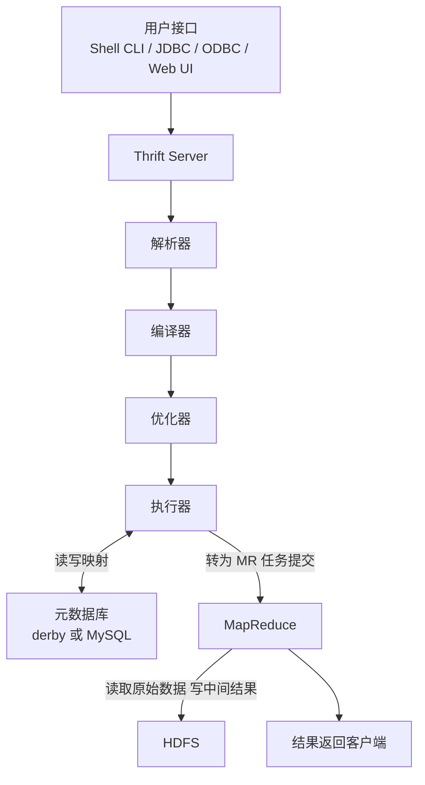

# Hive 架构解析：一条 HQL 从提交到返回的全链路

> 🔒 安全提示：文中示例的口令/密钥均为课程教学环境演示口径，生产环境的安全要求见《安全与合规须知》。

在命令行敲一行 select，回车，几秒后集群上真的跑起一个 MapReduce 任务，结果回到终端。全程没写一行 Java，把 HQL 变成 MR、把表名换成 HDFS 路径的工作是谁做的？把 Hive 的内部结构拆成三大模块，这条链路就清楚了。

## 先给结论

- Hive 架构分三大模块：用户接口、解析器、元数据存储。
- 用户接口是写 HQL 的入口，有 Shell/CLI、JDBC 客户端、ODBC 客户端、Web UI 四种；走 JDBC 与 ODBC 需要经过 Thrift Server。
- 解析器内部再分编译器、优化器、执行器：编译 HQL、做等价调优、把 HQL 转成 MapReduce 任务。
- 元数据记录表与数据文件的映射、字段映射和文件存放位置，默认存 derby，生产一般换成 MySQL。
- 底层计算走 MapReduce，原始数据与中间临时数据都落在 HDFS 上。

## 用户接口：HQL 的四种入口

写 SQL 总得有个地方写，这个位置就是用户接口。Hive 提供四种：Shell/CLI 命令行、JDBC 客户端、ODBC 客户端、Web 界面。课程里用的是 shell 命令行，本地进入 hive 命令直接交互；JDBC 与 ODBC 是网络入口，需要 Hive 先把服务能力暴露出来，这个角色由 Thrift Server 承担，对应 hiveserver2 进程，远程客户端通过它建立连接再提交语句。四种入口最终通向同一个解析器，选哪个只影响提交方式：CLI 适合上手调试，JDBC 与 ODBC 适合程序和可视化工具接入，Web 界面适合查看与验证：

```bash
# 启动 hiveserver2 后，远程客户端才能以 JDBC、ODBC 方式接入（按本课写法补全）
hiveserver2 &
beeline -u jdbc:hive2://node01:10000 -n root
```

## 解析器：编译、优化、执行三步接力

HQL 在底层走 MapReduce，从一句 SQL 变成一个 MR 任务，中间由解析器完成，它内部又分成三个部分。

**编译器**对 HQL 做编译，把文本形式的语句变成内部可执行的计划。**优化器**对语句做调整：写法效率不高时，它做一些等价微调让效率更高，例如把过滤条件尽量前移，让参与计算的数据量在早期就被削下来。**执行器**负责把 HQL 转成一个 MapReduce 任务并提交运行，到这一步，SQL 的世界交接给了 Hadoop 的世界。整个翻译过程中每一步都要查元数据：表名对应 HDFS 上哪个文件、字段按什么分隔符切分，答案全在元数据里，没有这本账，编译与执行都无从下手。

## 元数据存储：映射关系住在哪

解析器要正确翻译，必须知道 t_access 对应 HDFS 上哪个文件、每个字段怎么切分，这些全在元数据里。元数据记录表与数据文件之间的对应关系、表字段与文件字段的映射关系，以及表数据文件的存放位置。默认的元数据库是 derby，有缺陷，一般换成 MySQL，把连接信息写进配置即可：

```xml
<!-- metastore 指向 MySQL 的连接配置（按本课写法补全的示例） -->
<property>
  <name>javax.jdo.option.ConnectionURL</name>
  <value>jdbc:mysql://node01:3306/hive?createDatabaseIfNotExist=true</value>
</property>
<property>
  <name>javax.jdo.option.ConnectionDriverName</name>
  <value>com.mysql.jdbc.Driver</value>
</property>
<property>
  <name>javax.jdo.option.ConnectionUserName</name>
  <value>root</value>
</property>
<property>
  <name>javax.jdo.option.ConnectionPassword</name>
  <value>123456</value>
</property>
```

架构图上，元数据库与解析器一侧画成双向箭头：解析阶段要查映射，执行阶段同样依赖它，谁来都要读这份账。

## 底层执行：MapReduce 与 HDFS

执行器产出的 MapReduce 任务提交到集群，运行时从 HDFS 读取原始数据文件，中间产生的临时数据也再存放在 HDFS 上，而不是留在本地磁盘，这样后续任务可以直接接着使用；处理完毕把查询结果返回给客户端。整条链路如下图：



关键路径：四种入口分流后，网络入口汇到 Thrift Server，再交给解析器三步接力，元数据在旁路随时被读写，最终所有数据操作都落在 HDFS，结果沿原路回到客户端。

## 常见误区

- **把架构图底部的元数据库当成业务库。** 它只存映射关系这类元数据，业务数据文件全在 HDFS 上，别去 MySQL 里找表数据。
- **JDBC 想直连 Hive。** 必须经 Thrift Server（hiveserver2，默认端口 10000）转发，CLI 才是本地直达入口；远程连接报连不上，先查 hiveserver2 起没起。
- **指望优化器拯救烂 SQL。** 优化器只做等价调整，数据倾斜、笛卡尔积这类结构性问题仍要自己改写语句，它的微调改变不了烂结构。
- **derby 与 MySQL 来回切。** 元数据库切换后，旧的映射不会自动迁移，表现为表消失；选定 MySQL 后就不要再用默认 derby 启动。

## 面试可能被问到的问题

1. 面试官追问：「说说 Hive 的架构组成？」
   答：三大模块：用户接口（Shell/CLI、JDBC 客户端、ODBC 客户端、Web UI，JDBC 与 ODBC 需经 Thrift Server）、解析器（内部分编译器、优化器、执行器）、元数据存储（默认 derby，生产常用 MySQL）；底层计算引擎是 MapReduce，数据存放在 HDFS。
2. 面试官追问：「描述一条 HQL 的执行流程？」
   答：客户端提交 HQL，解析器先编译、再优化，执行器把它转成 MapReduce 任务提交到集群；任务从 HDFS 读取原始文件，中间临时数据写回 HDFS，结果返回客户端，全程依赖元数据里的表与文件映射。
3. 面试官追问：「Hive 元数据里都存什么？」
   答：表与数据文件之间的映射、表字段与文件字段的映射、表数据文件在 HDFS 上的存放位置，由元数据资料库统一存储管理。
4. 面试官追问：「为什么 JDBC 客户端要经过 Thrift Server？」
   答：Thrift Server 把 Hive 的服务能力以标准协议暴露出去，hiveserver2 就是这个角色，JDBC、ODBC 客户端通过它建立连接并提交查询；CLI 在本地直接交互，不走这条网络链路。
5. 面试官追问：「编译器、优化器、执行器分别做什么？」
   答：编译器把 HQL 编译成执行计划；优化器做等价调整提升效率，比如把过滤条件前移减少参与计算的数据量；执行器把 HQL 转成 MapReduce 任务并提交运行。

## 配套资料

- 讲义：`materials/docs/04/智慧学成-第2章-数据仓库.md`，「4 Hive 创建数据仓库」一节的 time_dim、course_dim 等真实建表 SQL，是映射关系落库后 HQL 的实际使用形态。
- 讲义：`materials/docs/04/智慧学成-第2章-ETL.md`，采集链路里「启用 Hive 连接」的配置段落，可对照理解 Hive 作为服务被外部系统接入的方式。
- 本课视频为架构图讲解，无配套源码包；hiveserver2、beeline 命令与 hive-site.xml 元数据库连接配置为按本课写法补全的示例。
