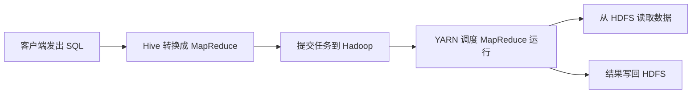

# Hive 与 Hadoop 及传统数据库的关系：相似的外表，不同的赛道

从 MySQL 转过来的人，第一眼会觉得 Hive 没什么特别：select、group by 都是老朋友。直到想更新一条记录发现没有 UPDATE 可用，或者等一个简单查询跑出结果花了二十多秒，才意识到这是两个物种。它们像，是因为 Hive 有 SQL 数据库的外表；它们不同，是因为应用场景完全不同。

## 先给结论

- 与 Hadoop 的关系一句话：Hive 利用 HDFS 存储数据、利用 MapReduce 做数据分析计算，运行由 YARN 调度，自身只负责把 SQL 翻译成任务并维护元数据，元数据本身存 MySQL 这类关系库。
- 与传统数据库的差别集中在六个维度：查询语言、数据存储、执行、执行延迟、处理数据规模、索引。
- Hive 只支持 SQL 的一个子集，HQL 与标准 SQL 相似度高但细节有别；Hive 2.0 之前不支持记录级增删改。
- 定位结论：Hive 具有 SQL 数据库的外表，但应用场景完全不同，只适合做批量数据的统计分析，也就是海量数据的离线分析。

## Hive 与 Hadoop：存储与计算各归其位

Hive 自己既不带存储也不带计算。客户端发出一条 SQL，Hive 把它处理转换成 MapReduce 任务，提交到 Hadoop 上运行，运行时需要 YARN 集群来调度，任务从 HDFS 读取相应的数据，结果也可以存储回 HDFS：



分工非常清楚：HDFS 出存储，靠它的横向扩容能力托住海量数据；MapReduce 出算力，分布式并行完成计算；YARN 出调度；Hive 出翻译，顺便把表与文件的映射等元数据管起来，元数据本身落在 MySQL 这类关系库中。Hive 建立在这套体系之上，这就是它与 Hadoop 的全部关系。

## 六个维度的正面对比

很多人写 Hive 时觉得操作和平时数据库没区别，实际上两者有本质差别：传统关系型数据库面向事务处理，Hive 是数据仓库工具，数据仓库主要用于数据分析。细粒度的差别用一张表说清：

| 对比维度 | Hive | RDBMS |
|---|---|---|
| 查询语言 | HQL | SQL |
| 数据存储 | HDFS | Raw Device or Local FS |
| 执行 | MapReduce | Executor |
| 执行延迟 | 高 | 低 |
| 处理数据规模 | 大 | 小 |
| 索引 | 0.8 版本后加入位图索引 | 有复杂的索引 |

**查询语言。** Hive 用类 SQL 查询，叫 HQL 或 Hive SQL；关系库用标准 SQL。两种语言相似度很高，大部分一样，只有细节上有所差别。

**数据存储。** Hive 的数据存放在 HDFS，是分布式存储，可以随意扩容；关系库占的是本地磁盘，装一个 Oracle 或 MySQL，用的都是本机磁盘空间，扩容性不强。

**执行。** Hive 底层是 MapReduce，分布式计算；关系库用自己的执行器 Executor 完成，这是完全不一样的执行模型。

**执行延迟。** Hive 底层走 MapReduce，整个过程要把文件读进内存、内存与硬盘来回搬运、再经过网络传输，链路长，延迟非常高。课程环境里 16G 内存的虚拟机跑一个简单案例，二十多秒才出结果；关系库实时性很强，延迟一两秒用户都嫌慢。这不是 Hive 写得差，是执行模型决定的。

**处理数据规模。** Hive 作为数据仓库的分析处理，适合大数据量；关系库处理的是小数据量的事务。处理规模不同，应用场景自然分开了。

**索引。** Hive 直到 0.8 版本之后才引入位图索引，能力有限；关系库有复杂完整的索引体系。

## 记录级增删改与 SQL 子集

两个超出对比表的硬差别，实际动手前必须知道。

**Hive 2.0 之前不支持记录级增删改。** 数据基本只写不改，没有可用的 UPDATE、DELETE，修正一条数据只能整表或整分区重写；2.0 之后引入了 ACID 支持，但限定在特定表类型与配置下，不能按业务库的习惯依赖它。用本章的 SQL 练习库举例，同一件事在两边的写法差距一目了然：

```sql
-- 关系库里的行级修改：直接更新一条成绩（练习库 score 表）
UPDATE score SET s_score = 95 WHERE s_id = '01' AND c_id = '03';
```

```sql
-- Hive 里的替代做法：先备份，再整表重写（示例按本课写法补全）
CREATE TABLE score_bak AS SELECT * FROM score;
INSERT OVERWRITE TABLE score
SELECT s_id,
       c_id,
       CASE WHEN s_id = '01' AND c_id = '03' THEN 95 ELSE s_score END
FROM score_bak;
DROP TABLE score_bak;
```

改一条记录，一边是带 WHERE 的单行更新，一边是三步的整表替换，成本差了几个数量级。

**HQL 只是 SQL 的子集。** 相似度高不等于等价：事务、存储过程、复杂的约束与行级触发这类数据库能力，HQL 没有对应物；部分函数与子查询的行为也有差异，写复杂 SQL 前先确认 Hive 的支持范围。

```sql
-- 查询语法两边几乎一致：每个学生的平均分（练习库 score 表）
SELECT s_id, AVG(s_score) FROM score GROUP BY s_id;
```

查询长得一样，写动作时立刻分道扬镳，这就是「外表相似、内核不同」的具体样子。

## 应用场景的分水岭

把定位收拢成一句话：Hive 用于海量数据的离线数据分析。它具有 SQL 数据库的外表，但应用场景完全不同，只适合用来做批量数据的统计分析，这正是数据仓库要干的事情。对应到 OLTP 与 OLAP 的分工：关系库继续服务在线事务，保证每一笔操作又快又准；Hive 服务离线分析，对沉淀下来的海量历史数据出报表、算指标。给业务系统做增删改查，用 MySQL；对 T 级日志做批量统计，用 Hive。选型时先问数据规模和时效要求，再问自己要不要行级更新，答案就出来了。

## 常见误区

- **拿 Hive 当业务库用。** 行级增删改做不了（2.0 之前），秒级到分钟级的延迟也撑不起在线业务；业务库继续用 MySQL，分析场景再搬上 Hive。
- **认为 HQL 完全兼容 SQL。** 它只是相似度高的子集，事务、存储过程没有，部分函数行为不同，复杂语句要逐条验证再上线。
- **用响应速度否定 Hive。** 单机小数据量下 Hive 必然不如 MySQL，但它的主场是关系库装不下也算不动的海量数据，比错赛道没有意义。
- **以为元数据也存在 HDFS。** 数据文件在 HDFS，元数据在 MySQL 或 derby 这类关系库里；元数据库出问题，HDFS 上的文件还在，表却查不到了。

## 面试可能被问到的问题

1. 面试官追问：「Hive 和 Hadoop 是什么关系？」
   答：Hive 建立在 Hadoop 之上，利用 HDFS 存储数据、利用 MapReduce 做数据分析计算，运行时由 YARN 调度；Hive 自身负责把 SQL 翻译成 MapReduce 任务，并把表与文件的映射等元数据存在关系库里。
2. 面试官追问：「Hive 和传统关系型数据库有哪些区别？」
   答：查询语言 HQL 对 SQL；数据存储 HDFS 对本地磁盘；执行 MapReduce 对数据库执行器；执行延迟高对低；处理数据规模大对小；索引仅 0.8 版本后有位图索引对复杂索引体系。本质是 OLAP 批量分析与 OLTP 事务处理的区别。
3. 面试官追问：「为什么 Hive 的延迟很高？」
   答：它底层走 MapReduce，计算要经历读文件、内存与磁盘间的多次交换以及网络传输，链路长、启动开销大，简单查询也要秒级到分钟级；关系库自带执行器，一两秒就能返回。
4. 面试官追问：「Hive 支持 update 和 delete 吗？」
   答：Hive 2.0 之前不支持记录级增删改，数据基本只写不改，修正数据靠整表或整分区重写；之后的 ACID 支持也限制在特定表类型与配置下，不能按业务库习惯依赖。
5. 面试官追问：「Hive 适合什么场景？」
   答：海量数据的离线批量统计分析，例如日志分析、报表加工；它有 SQL 数据库的外表但应用场景完全不同，不适合在线事务与实时查询。

## 配套资料

- 讲义：`materials/docs/04/智慧学成-第2章-数据仓库.md`，「4.1 Hive 介绍」给出 Hive 建立在 Hadoop 上的定位，「4 Hive 创建数据仓库」一节含真实建库建表 SQL。
- 代码：`materials/code/04/day05-Hive/day05/资料/测试数据/sql_prac.sql`，本章 SQL 练习库，标准 MySQL 建表脚本（student、score、course、techer 四张表），文中用它演示两边语法的差异。
- UPDATE 对比与整表重写、平均分查询示例为按本课写法补全，本课视频为概念讲解，无配套源码。
