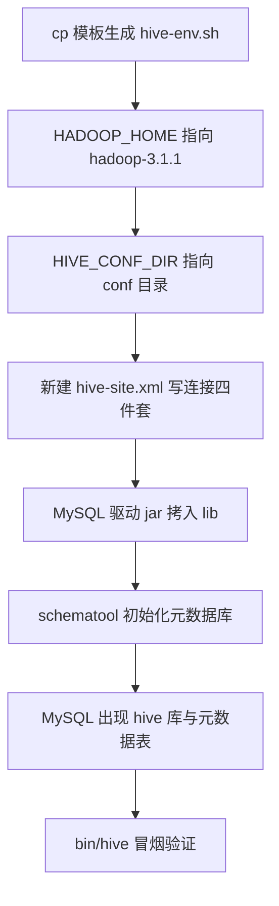

# 把 Hive 接上 Hadoop 与 MySQL：hive-env.sh 与 hive-site.xml 配置全过程

> 🔒 安全提示：文中示例的口令/密钥均为课程教学环境演示口径，生产环境的安全要求见《安全与合规须知》。

MySQL 元数据库就位、Hive 本体解压完毕，按理说敲一下 `hive` 就能用了，实际往往起不来：要么报 Hadoop 相关的类找不到，要么建库建表时元数据库连不上。原因很简单，Hive 和 Hadoop、MySQL 之间还没「接线」。接线动作集中在 Hive 主目录 `conf` 下的两个文件里，外加一个 JDBC 驱动包和一次元数据库初始化，拢共四件事。集群规划沿用：Hadoop 3.1.1 装在三个节点，Hive 3.1.1 主目录为 `/export/servers/apache-hive-3.1.1-bin`，MySQL 在 node01，root 密码 123456。

## 先给结论

- `conf` 目录下全是模板，`hive-env.sh.template` 要先复制成 `hive-env.sh` 再改，直接改模板等于没配。
- `hive-env.sh` 配两项就够：`HADOOP_HOME` 指向 Hadoop 安装目录，`HIVE_CONF_DIR` 指向 Hive 自己的 conf 目录。
- `hive-site.xml` 默认不存在，需要新建，核心是连接四件套：URL、驱动名、用户名、密码，外加 warehouse 目录。
- MySQL 的 JDBC 驱动 jar 必须拷进 Hive 的 `lib` 目录，否则启动时报找不到驱动类。
- Hive 3.x 首次使用前要用 `schematool` 初始化元数据库，缺这一步建表会报元数据缺表。

## 第一步：复制模板并配置 hive-env.sh

进入 Hive 主目录，`conf` 下能看到 `hive-default.xml.template`、`hive-env.sh.template`、`hive-log4j2.properties.template` 一排模板文件。环境脚本按惯例从模板复制出来：

```bash
cd /export/servers/apache-hive-3.1.1-bin
cp conf/hive-env.sh.template conf/hive-env.sh
```

`conf` 目录下值得先扫一眼：`hive-default.xml.template` 里收着 Hive 几百个参数的默认值，全部保持默认、一个都不用动；`hive-log4j2.properties.template` 管日志格式，也不着急碰。真正要动手的就两个文件，模板统一带 `.template` 后缀，正是在提醒「先复制再生效」。

打开 `hive-env.sh` 向下翻，有三处带注释的配置项，打开其中两处：

```bash
# Set HADOOP_HOME to point to a specific hadoop install directory
HADOOP_HOME=/export/servers/hadoop-3.1.1/
# Hive Configuration Directory can be controlled by:
export HIVE_CONF_DIR=/export/servers/apache-hive-3.1.1-bin/conf
# Folder containing extra libraries required for hive compilation/execution can be controlled by:
# export HIVE_AUX_JARS_PATH=
```

`HADOOP_HOME` 是 Hive 跑起来的前提。Hive 自己没有存储也没有计算引擎，查询最终翻译成 MapReduce 作业提交，表数据落在 HDFS，它必须知道 Hadoop 装在哪。为了避免手敲出错，可以把 profile 里已有的 `HADOOP_HOME` 值直接拷过来。`HIVE_CONF_DIR` 显式声明配置目录，让 Hive 不必依赖启动位置去猜。文件注释里还有一项 `HADOOP_HEAPSIZE`，默认堆内存 256 MB，查询涉及大量文件与分区时可以调大。

## 第二步：新建 hive-site.xml

`conf` 下没有 `hive-site.xml`，新建一个，把准备好的配置整段拷进去，一个属性都不要多也不要少：

```xml
<configuration>
  <property>
    <name>javax.jdo.option.ConnectionURL</name>
    <value>jdbc:mysql://node01:3306/hive?createDatabaseIfNotExist=true</value>
  </property>
  <property>
    <name>javax.jdo.option.ConnectionDriverName</name>
    <value>com.mysql.jdbc.Driver</value>
  </property>
  <property>
    <name>javax.jdo.option.ConnectionUserName</name>
    <value>root</value>
  </property>
  <property>
    <name>javax.jdo.option.ConnectionPassword</name>
    <value>123456</value>
  </property>
  <property>
    <name>hive.metastore.warehouse.dir</name>
    <value>/user/hive/warehouse</value>
  </property>
</configuration>
```

逐项过一遍。`ConnectionURL` 是元数据库的位置：`node01` 是装 MySQL 的主机，`3306` 是端口，库名 `hive` 由 `createDatabaseIfNotExist=true` 保证自动创建，Hive 第一次连上就会在 MySQL 里冒出这个库。`ConnectionDriverName` 固定写 `com.mysql.jdbc.Driver`。用户名 `root`、密码 `123456` 对应安全脚本里设置的凭据，远程授权此前也已开启。`hive.metastore.warehouse.dir` 是整个数据仓库的家，所有库表的数据默认落在这个 HDFS 目录下。主机名按环境写：集群配了 hosts 解析就写 `node01`，没配就写 IP，两种写法效果一样。

这份文件为什么如此关键，要看元数据到底存了什么：哪张表属于哪个库、每个字段叫什么是什么类型、表数据在 HDFS 的哪个路径，这些映射条目全部记在 `hive` 库里。四件套里任何一个写错，第一次进客户端就会连不上元数据库，后面所有建库建表全部无从谈起。

## 第三步：驱动包进 lib，初始化元数据库

配置写完还不算完，Hive 手里没有能连 MySQL 的驱动。把 `mysql-connector-java` 系列的 jar 拷进 Hive 的 `lib` 目录：

```bash
cp mysql-connector-java-5.1.32.jar /export/servers/apache-hive-3.1.1-bin/lib/
```

驱动包提前放到机器上即可，版本选 5.1.x 系列与课程这版 MySQL 匹配。接着做 Hive 3.x 绕不开的一步，初始化元数据库表结构：

```bash
bin/schematool -dbType mysql -initSchema
```

命令跑完再去 MySQL 里看，`hive` 库里多出几十张元数据表，账本的表格画好了：`DBS` 记库级信息，`TBLS` 记表级信息，`COLUMNS_V2` 记每个字段的类型，后面建一张表就往这些表里添一行。这一步视频没有单独演示，但 Hive 3.x 不初始化就无法正常建表，属于必须补上的动作。

## 配置链路总览



验证方式很直接：执行 `bin/hive` 能进交互界面，`show databases` 列出 default 库，图形客户端连 MySQL 能看到自动创建的 `hive` 库，三件事都发生，说明接线成功。首次启动偏慢，屏幕上还会刷一串 SLF4J 绑定提示，属于正常噪音，不必处理。交互方式的细节交给下一篇展开。

## 常见误区

- **改了模板文件而不是复制后的脚本。** Hive 启动脚本只读 `hive-env.sh`，对着 `hive-env.sh.template` 改半天，配置等于没生效。
- **URL 参数连接符写裸的 `&`。** 需要给连接串追加 `useUnicode`、`characterEncoding` 等参数时用 `&` 连接，而 `&` 在 XML 里必须转义成 `&amp;`，直接写裸符号会让配置解析直接失败。
- **驱动没拷或驱动类对不上。** 报 `ClassNotFoundException: com.mysql.jdbc.Driver`，先看 `lib` 下有没有驱动 jar；用了过新的驱动则注意驱动类名已变为 `com.mysql.cj.jdbc.Driver`。
- **跳过 schematool 直接建表。** 表现是操作报元数据缺表或版本校验失败，先执行 `bin/schematool -dbType mysql -initSchema` 再进客户端。

## 面试可能被问到的问题

1. 面试官追问：「hive-env.sh 里最关键的配置是什么，为什么必须配？」
   答：`HADOOP_HOME`。Hive 本身只负责把 HQL 翻译成执行计划，存储靠 HDFS、计算靠 MapReduce，都依赖 Hadoop 环境，不知道 Hadoop 安装位置就无法提交作业；`HIVE_CONF_DIR` 则显式固定配置目录，避免受启动位置影响。
2. 面试官追问：「hive-site.xml 里建库前要配哪些核心属性？」
   答：连接四件套加 warehouse 路径，即 `javax.jdo.option.ConnectionURL`、`ConnectionDriverName`、`ConnectionUserName`、`ConnectionPassword`，以及 `hive.metastore.warehouse.dir`；URL 上带 `createDatabaseIfNotExist=true` 可以让元数据库自动建出来。
3. 面试官追问：「JDBC 驱动包为什么要拷到 Hive 的 lib 下？」
   答：Hive 进程要作为 MySQL 的客户端建立 JDBC 连接，驱动类由 Hive 的类加载器加载，`lib` 是它的默认 classpath 之一；驱动不在里面就抛 `ClassNotFoundException`，元数据库根本连不上。
4. 面试官追问：「Hive 3.x 为什么必须执行 schematool 初始化？」
   答：Hive 3.x 引入了新的元数据表结构，新装的 MySQL 里只有空库，没有表结构；`schematool -dbType mysql -initSchema` 负责把元数据表建齐，跳过这一步，建库建表时会报缺表或元数据版本校验失败。
5. 面试官追问：「连接 URL 里的 createDatabaseIfNotExist 有什么作用？」
   答：首次连接时自动创建 `hive` 元数据库，省去手工建库；元数据的表结构由 schematool 负责，二者配合完成元数据库从无到有的搭建。

## 配套资料

- 讲义：`materials/docs/04/智慧学成-第2章-数据仓库.md`，「4 Hive 创建数据仓库」起的建库建表，都建立在这套配置之上。
- 代码：`materials/code/04/day05-Hive/day05/代码/day05_hive_udf_test/pom.xml`，章内 UDF 工程依赖 `hive-exec` 与 `hadoop-common`，版本均为 3.1.1，与本次安装对齐。
- 安装与配置命令来自课程操作实录；驱动包版本、`schematool` 初始化命令为按本课环境（MySQL 5.1.73、root 密码 123456、Hive 3.1.1）补全的示例。
