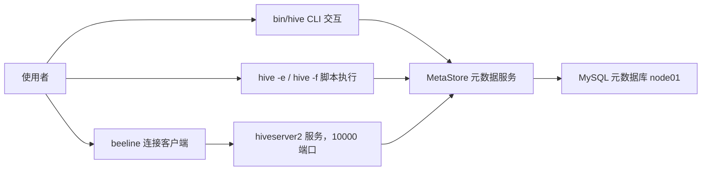

# 进 Hive 的三种姿势：CLI 交互、hive -e/-f 脚本执行与 hiveserver2 + beeline

> 🔒 安全提示：文中示例的口令/密钥均为课程教学环境演示口径，生产环境的安全要求见《安全与合规须知》。

Hive 配置接线完成，第一件事就是验证它能不能用、好不好用。同一个 Hive，却有三种进入方式：敲 `bin/hive` 进交互命令行，用 `hive -e` 或 `hive -f` 在客户端外直接跑 HQL，或者起 hiveserver2 服务再用 beeline 连。区别不只是「进不进客户端」，三种方式对应的是三种真实工作场景：人调、机器跑、多人共用。这一轮把三种方式都走一遍，顺便确认元数据确实落进了 MySQL。

## 先给结论

- `bin/hive` 进交互式命令行，提示符 `hive>` 可以当成 MySQL 客户端来用，适合人工学习与调试。
- `hive -e "语句"` 跑单条 HQL，`hive -f 脚本` 跑整份脚本，不进客户端，是定时任务的写法。
- hiveserver2 对外提供 10000 端口的 JDBC 服务，beeline 连上去操作，生产上多用户共用 Hive 走这条路。
- 三种方式殊途同归：都读写同一个元数据库，交互方式换来换去，库和表不会乱。
- 脚本执行时注意写全路径 `bin/hive`，只敲 `hive` 而没配 PATH 会直接报 command not found。

## 第一种：bin/hive 交互式命令行

进入 Hive 主目录，执行 `bin/hive`：

```bash
cd /export/servers/apache-hive-3.1.1-bin
bin/hive
```

首次启动会慢，日志里先出现 `Logging initialized using configuration in ... hive-log4j2.properties` 的初始化信息，又有 `Hive-on-MR is deprecated in Hive 2...` 的弃用提醒，都可以无视。进入类似 shell 的交互界面后，`hive>` 提示符下写的就是 HQL，和 SQL 几乎没有区别：

```sql
show databases;
create database if not exists myhive;
show databases;
use myhive;
create table t_test(id int, name string);
show tables;
exit;
```

`show databases` 第一次只列出默认库 default；create 之后再看，多出了 myhive；`use` 切库，`create table` 建表，`exit` 退出，整套手感与 MySQL 客户端一致。这里发生了什么值得多看一眼：表和真实数据文件之间的映射关系叫元数据，元数据保存在配置好的 MySQL 里。用图形客户端连上 node01（root，密码 123456），数据库列表里多出一个 `hive` 库，它就是 Hive 自动建出来存元数据的，剩下的 information_schema、mysql、test 是 MySQL 自带的系统库与测试库。元数据查得到，说明 Hive 与 MySQL 的关联已经生效。

## 第二种：不进客户端，直接执行 HQL

单条语句用 `-e`，适合一次性验证：

```bash
cd /export/servers/apache-hive-3.1.1-bin
bin/hive -e "create database if not exists mytest;"
```

命令跑完屏幕会刷一串 SLF4J 日志，结果可以直接再进 CLI `show databases` 验证，`mytest` 已经在里面。这种「跑完即走」的方式没有交互界面，执行结果就是日志，做自动化检查时反而省事。一批语句用 `-f`，先写脚本：

```sql
create database if not exists mytest2;
use mytest2;
create table stu(id int, name string);
```

保存为 `/export/servers/hive.sql`，然后用 `-f` 一次执行整个文件：

```bash
bin/hive -f /export/servers/hive.sql
```

视频里第一次执行报了命令未找到，因为只敲了 `hive` 没带 `bin` 前缀，补全为 `bin/hive -f` 后顺利跑完，再进 CLI 就能看到 `mytest2` 与里面的表。要避免这个小坑，把 Hive 的 `bin` 目录加进 PATH 即可。`-e` 与 `-f` 的真正价值在调度：HQL 写成脚本交给 crontab 定时执行，数据仓库的日常跑批就是这么做起来的。

## 第三种：hiveserver2 与 beeline

前两种都是本机玩法，多个人、多台机器要共用同一个 Hive 时，用服务化的第三种。课程视频重点演示了前两种，这里按主流写法补全最小可用流程：

```bash
cd /export/servers/apache-hive-3.1.1-bin
nohup bin/hiveserver2 1>/dev/null 2>&1 &
bin/beeline
!connect jdbc:hive2://node01:10000
```

beeline 提示输入用户名密码，填 `root`、回车跳过密码即可。连接成功后，`show databases`、建库建表与 CLI 中完全一致，因为背后连的是同一份元数据。验证服务是否活着用 `jps`，能看到一个 `RunJar` 进程；beeline 里用 `!quit` 退出，服务端进程不受影响。



三种方式最终都汇到元数据服务与同一个 MySQL 元数据库上，这条链路正是安装配置阶段接好的线。

## 三种方式怎么选

**学概念、调语句，用 CLI。** 起得来就敲，`exit` 就走，反馈直接。

**定时与批量，用 `-e` 或 `-f`。** 语句进脚本，脚本能重复执行，crontab 一挂就是一条数仓流水线。

**多人生产环境，用 hiveserver2 加 beeline。** 服务常驻，JDBC 接入，并发会话由服务端统一管理，也是后续做权限控制的基础。

## 常见误区

- **`-f` 脚本里语句漏分号。** 脚本按语句逐条解析，漏一条分号整份脚本解析失败，写完先在 CLI 里逐条验证再入脚本。
- **`-e` 的命令里嵌套双引号。** 外层已经用双引号包住 HQL，语句内的字符串要改用单引号，例如 `hive -e "select * from stu where name='jack'"`。
- **hiveserver2 前台启动，窗口一关服务就挂。** 用 `nohup ... &` 放到后台，再拿 `jps` 看有没有 `RunJar` 进程确认活着。
- **把首启慢当成卡死。** 第一次执行要初始化会话并连元数据库，日志停在初始化属正常，等而不是反复杀进程。

## 面试可能被问到的问题

1. 面试官追问：「Hive 有哪几种交互方式，分别适合什么场景？」
   答：三种。`bin/hive` 交互式命令行，适合人工学习调试；`hive -e`、`hive -f` 直接执行语句或脚本，适合定时任务与批量作业；hiveserver2 加 beeline 提供常驻 JDBC 服务，适合生产环境多用户并发访问。
2. 面试官追问：「hive -e 和 hive -f 的区别？」
   答：`-e` 后面直接跟一条 HQL 字符串，适合单语句验证；`-f` 后面跟一份脚本，文件里可写多批语句，适合把成体系的 HQL 沉淀成脚本重复执行，两者都不进入交互客户端。
3. 面试官追问：「为什么生产环境推荐 beeline 而不是老的 hive CLI？」
   答：CLI 直接连元数据库，而 beeline 通过 JDBC 连 hiveserver2，会话由服务端统一管理，支持多用户并发、连接池与权限控制，Hive 2.x 起 CLI 也被官方标记为废弃，新特性都落在 hiveserver2 这条路上。
4. 面试官追问：「怎么证明 Hive 的元数据确实存放在 MySQL？」
   答：配置项 `javax.jdo.option.ConnectionURL` 指向 MySQL 的 hive 库，用客户端连上该库能看到 `DBS`、`TBLS`、`COLUMNS_V2` 等元数据表，建一张新表后 `TBLS` 里同步多出一行，映射关系一目了然。
5. 面试官追问：「三种交互方式混着用，会不会出现数据不一致？」
   答：不会。三种方式最终连同一个元数据库、同一个 HDFS warehouse，库表状态只有一份，只是进入 Hive 的入口不同。

## 配套资料

- 讲义：`materials/docs/04/智慧学成-第2章-数据仓库.md`，「4 Hive 创建数据仓库」的建库建表语句可在任意一种交互方式里执行。
- 代码：`materials/code/04/day05-Hive/`，本章资料包，后续的 UDF 工程与 SQL 练习库都基于本次验证通过的交互环境。
- CLI 与 `hive -e`、`hive -f` 的命令来自课程操作实录；hiveserver2 与 beeline 的连接流程为按本课写法补全的示例。
