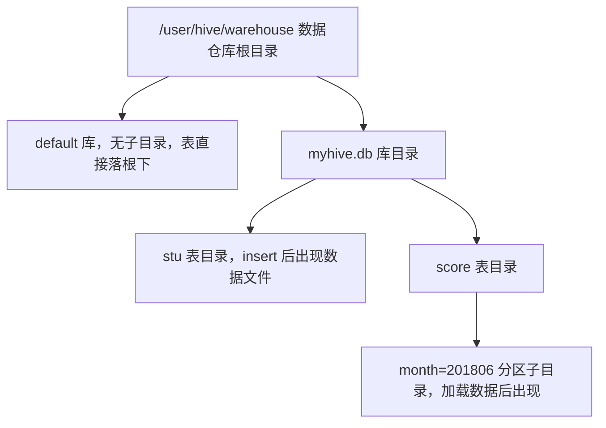
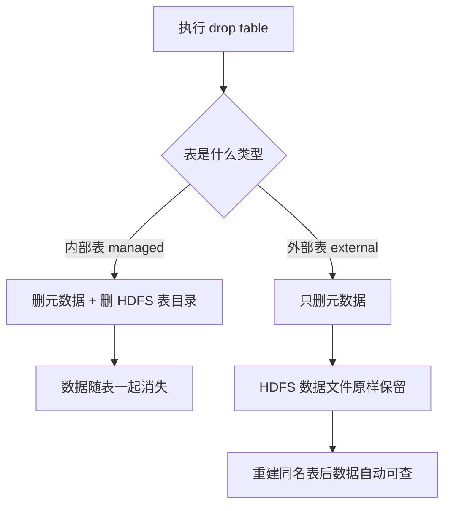
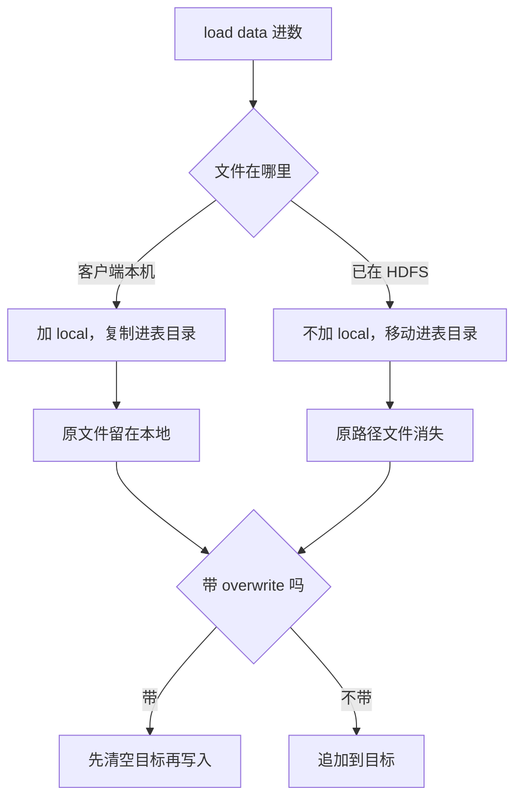
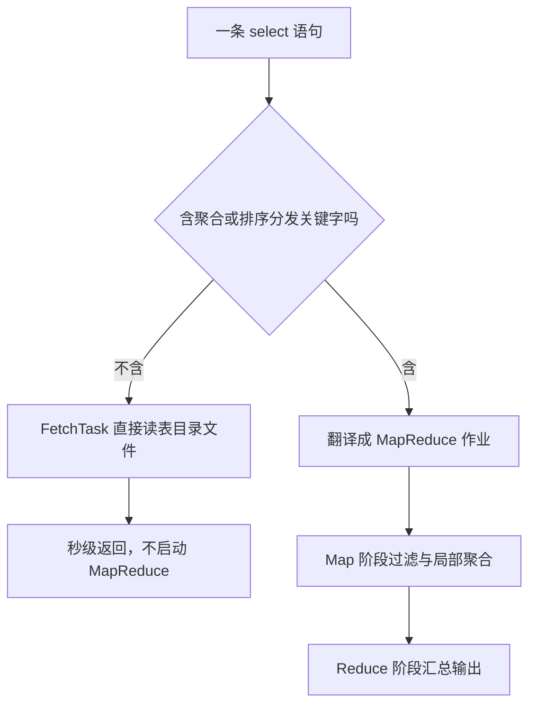
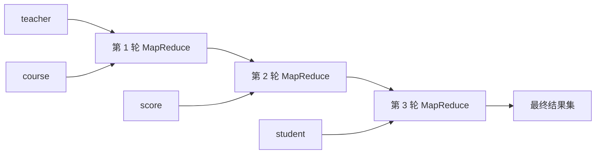
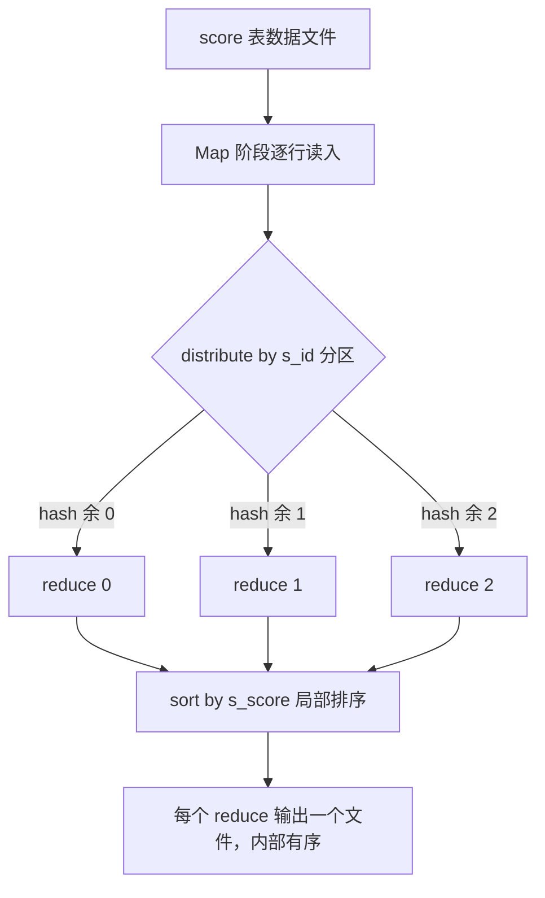

# Hive的基本操作七讲：库表生命周期、建表五形态、查询与连接、四种排序与内置函数

## 先给结论

Hive 的操作课有一条贯穿全系列的对照线：MySQL 里看不见摸不着的库和表，落到 Hive 里就是 HDFS 上一层套一层的目录。数据库是目录、表是下一层目录，理解了这层映射，建库、指定 location、删库、分区分桶的种种行为就都顺理成章。全系列七讲把库与表的完整生命周期、查询语法、函数体系一次走完。
库与表层是地基：建库删库与 default 库的特殊之处；建表语法的九个子句拆开，内部表、外部表、分区表、分桶表各建一遍，删表后数据在不在、按文件夹分还是按文件分，全部落到 HDFS 上眼见为实；alter table 四件套只改元数据不动文件，load data 带不带 local 差在复制还是移动，三条进数通道各有分工。
分析层步步收紧：查询骨架多出的几个关键字与 FetchTask 的快；group by 的铁律、having 二次筛选与四种 join 的取舍；order by、sort by、distribute by、cluster by 放进 reduce 个数的坐标系里一次看清；函数篇三条命令查遍 289 个内置函数，再亲手写一个 UDF 走完注册调用流程。
七讲依次是：
- 数据库的创建和删除：库即目录、location 自定义路径与 cascade 强删。
- 创建表的格式：九个子句逐个认与内部表、外部表、分区表、分桶表。
- 表结构修改和数据加载：alter 四件套与 load、insert 三条进数通道。
- 基本查询语法：多出的骨架关键字、FetchTask 快的原理与 like、rlike。
- 分组和多表连接：group by 铁律、having 二次筛选与四种 join。
- 排序：四种排序关键字与 reduce 个数的关系、语法顺序。
- 内置函数：三条命令查函数、UDF 一进一出与 add jar 注册调用。

## 第1部分：Hive 建库与删库：数据库就是 HDFS 上的一层目录

在 MySQL 里建一个库，肉眼看不见它落在哪个文件；Hive 完全不同，`create database` 执行完，到 HDFS 上刷新一下，就多出一个实打实的文件夹。数据库是目录、表是下一层目录，理解了这层映射，建库、指定路径、删库的种种行为就都顺理成章了。这一轮把库的完整生命周期走一遍：建、用、看、改、删，以及 default 库的特殊之处。

### 建库：if not exists 是防线

```sql
create database if not exists myhive;
use myhive;
```

不加条件直接再建一个同名库，客户端当场报 `Database mytest2 already exists`，语句中断；带上 `if not exists` 则变成「有就跳过，没有才建」。手工交互时加不加都能忍，写进脚本就必须加，否则第二次执行整个流程就断在第一步。`use` 负责切换当前库，之后的建表都落在当前库里。

### 库在 HDFS 上的真实形态

warehouse 根路径由 `hive-site.xml` 里的 `hive.metastore.warehouse.dir` 指定，默认 `/user/hive/warehouse`。打开 HDFS 的 Web UI 进到这个目录：刚建的每个库是一个文件夹，点进去每张表又是一个文件夹，表目录里暂时还没有数据文件。数据库、表到 HDFS 上就是一层套一层的目录，路径形如 `/user/hive/warehouse/myhive.db/stu2`，库目录自带 `.db` 后缀。



default 库的身份有点不一样：它是建表时不写库名就会进的默认库，HDFS 上并没有一个 default 文件夹，建在它下面的表直接摆在 warehouse 根目录。这也是为什么看 warehouse 根目录时，有些表目录和库目录混在一起。

### location：给库自定义落盘路径

默认路径不合适时，建库语句可以直接指定 HDFS 位置：

```sql
create database myhive2 location '/myhive2';
```

语句执行完刷新 HDFS 根目录，`/myhive2` 已经出现。什么场景需要这么做：数仓按 ODS、DW、APP 分层建设时，不同层的数据要按规划放到不同路径，配额与权限也按路径划分。课程讲义里的分层建库就是这种规划的落地：

```sql
create database data_agency;
create database data_course;
create database data_dimen;
create database data_platform;
create database data_subject;
```

机构、课程、维度、平台、主题各占一库，后续建表全部挂到对应库下，这是工程上「先规划库、再建表」的顺序。

### 查详情与改属性

```sql
desc database myhive2;
desc database extended myhive2;
alter database myhive set dbproperties('createtime'='20180611');
```

`desc database` 列出库名、所在位置与所属用户、用户类型；`extended` 在此基础上追加自定义属性。注意视频里把 extended 拼错过一次，正确拼写就是 `EXTENDED`。`alter database ... set dbproperties` 只能增改属性键值对，比如打个创建时间标签；库名、库路径这类元数据核心信息不提供修改入口，建库前要把名字想好。

### 删库：一条不用慌的报错和一条真要慌的命令

```sql
drop database myhive2;
```

执行时控制台可能抛出一串异常栈，内容大致是某个元数据库不存在，但刷新 HDFS 会发现目录已经删掉，这条报错不影响删除结果，再执行一遍反而报库不存在。库里有表时删除会被拒绝，提示先清空或级联；确认要连表带数据一起删，加 `cascade`：

```sql
drop database myhive cascade;
```

`cascade` 会把元数据、表结构、HDFS 上的数据目录一并清除，删错库数据就真没了，只允许用在确认废弃的库上。

## 第2部分：Hive 建表全景：完整语法逐子句，内部表、外部表、分区表与分桶表

Hive 的 `create table` 是一整串可选子句的组合：外部表关键字、分区、分桶、行分隔符、存储格式、路径，一次全摆出来，第一次看很容易懵。真正决定表行为的就是几个关键子句的组合方式，五张表建下来，差别就显出来了：有的表删了数据还在，有的表删了连文件一起消失；有的表按文件夹分数据，有的表按文件拆数据。这一轮把建表语法逐子句拆开，再依次建内部表、外部表、分区表、分桶表，每一种都建完、装上数据、看到 HDFS 上的结果才收尾。

### 完整建表语法：九个子句逐个认

先把完整语法摆出来，中括号里的都是可选项：

```sql
CREATE [EXTERNAL] TABLE [IF NOT EXISTS] table_name
[(col_name data_type [COMMENT col_comment], ...)]
[COMMENT table_comment]
[PARTITIONED BY (col_name data_type [COMMENT col_comment], ...)]
[CLUSTERED BY (col_name, col_name, ...) INTO num_buckets BUCKETS]
[SORTED BY (col_name [ASC|DESC], ...)]
ROW FORMAT row_format
STORED AS file_format
[LOCATION hdfs_path]
```

**第一，EXTERNAL 决定表的「户籍」。** 不写就是内部表（managed table），写上就是外部表（external table）。两者的建表动作也不同：创建内部表时，Hive 会把数据移动到数据仓库指向的路径；创建外部表时仅记录数据所在的路径，不对数据的位置做任何改变。删表行为由此分叉：内部表元数据与数据一起删，外部表只删元数据，细节在外部表一节展开。

**第二，IF NOT EXISTS 与 COMMENT 是工程习惯。** 同名表已存在时直接建表会抛异常，加 `if not exists` 忽略之，脚本场景必带；列注释与表注释分别用列级、表级 `comment` 写，注意注释里默认不能用中文。

**第三，PARTITIONED BY 与 CLUSTERED BY 是两种「分」法。** 前者分区，本质是分文件夹；后者分桶，本质是分文件，`into num_buckets buckets` 指定桶数；`SORTED BY` 在分桶基础上再指定桶内排序。两者都放在独立小节里细讲。

**第四，ROW FORMAT 指定行内字段怎么切。** 写成 `row format delimited fields terminated by '\t'` 就是按制表符切列，也可以用竖线、逗号等任意字符；列里如果有 `MAP` 类型，键值对的切分再用 `map keys terminated by` 指定；不指定或写 `row format delimited` 时使用自带的 SerDe。SerDe 是序列化与反序列化的规则，Hive 靠它决定文件里的每一段文字对应表里的哪一列，建表时自定义分隔符，本质是在告诉 SerDe 怎么解析。

**第五，STORED AS 指定文件格式。** 纯文本用 `stored as textfile`；需要压缩的场景可指定 `stored as sequencefile`（语法列表里还有 RCFILE 等格式，本课用到 TEXTFILE 即可）。

**第六，LOCATION 指定数据落点。** 不写就落在 warehouse 的库目录下；外部表用它指向已有数据，内部表一般不写。另有一个 `like` 关键字：`create table 新表 like 旧表` 只复制表结构、不复制数据，与 `as select` 的区别后面对比。

### 常用数据类型：与 MySQL 对齐，外加复杂类型

原始类型和 MySQL 高度对齐：整数系列 `TINYINT`、`SMALLINT`、`INT`、`BIGINT`（按 1、2、4、8 字节递增），浮点 `FLOAT`、`DOUBLE`，字符串 `STRING`、`VARCHAR`、`CHAR`，外加 `BOOLEAN`、`BINARY`、`DATE`、`TIMESTAMP`、`INTERVAL`。复杂类型有四个：`ARRAY` 数组、`MAP` 键值对、`STRUCT` 结构体、`UNION` 多类型之一，用在一条记录里嵌一串标签、一组键值这类场景，比如给用户表加一列 `array<string>` 存兴趣标签。业务字段照搬即可，拿不准长度的字符串直接 `string`，本课建表用的全是 int 与 string。

### 内部表：三种建法与一条纪律

最朴素的一种，两列直接建：

```sql
use myhive;
create table stu(id int, name string);
insert into stu values (1,'zhangsan');
select * from stu;
```

insert 刚敲下去会明显卡顿，因为它真的提交了一轮 MapReduce：Map 启动、Reduce 启动，一条数据才进去。视频里这次 insert 还被集群时间不同步卡了一道，三台机器对齐系统时间后才跑通，遇到作业莫名异常，先查各节点时间是否一致。跑完后 HDFS 的 `/user/hive/warehouse/myhive.db/stu` 表目录里出现 `000000_0` 这样的数据文件，insert 的结果就以文件形式躺在表目录里。这条纪律从这里就立起来：数仓是用来查询分析的，增删改极少做，批量进数要靠 load 与外部表映射。

带分隔符、存储格式与路径的建法才是日常主力：

```sql
create table if not exists stu2(id int, name string)
row format delimited fields terminated by '|'
stored as textfile
location '/user/stu2';
```

分隔符在这里定死，意义在于「建表时对齐，加载时就直接可用」：将来加载的文件只要也按竖线切列，文件内容立刻映射成表数据。到 HDFS 上看，`/user/stu2` 目录随建表出现。

另外两种建表方式最容易被混着记：

```sql
create table stu3 as select * from stu2;
create table stu4 like stu2;
```

`as select` 是把查询结果物化成新表：stu3 既复制了 stu2 的结构，也把 stu2 的数据整体拷贝过来，执行时跑一轮 MapReduce；`like` 只把 stu2 的表结构抄给 stu4，一条数据都没有。查 `select * from stu3` 出来两行 jack 和 tom，查 stu4 则空空如也，`desc stu4` 能看到与 stu2 一致的 id int、name string。记忆口诀：as 连结构带内容全要，like 只要一张空壳。

看表的详细信息用：

```sql
desc formatted stu2;
```

输出里值得盯三行：`Table Type: MANAGED_TABLE` 表明这是内部表；`Location: hdfs://node01:8020/user/stu2` 是数据在 HDFS 上的绝对位置；再往下有 `Owner`、`CreateTime`、`numFiles` 等参数。普通 `desc 表名` 只给列名与类型，formatted 版本连表的户籍资料一起给。

### 外部表：删表删不掉的数据

外部表的存在理由先摆清楚：网站日志每天定时写到 HDFS，很多人要在日志基础上做统计分析，数据天然是共享的，谁都不能独占，更不能让某个人删表把原始日志一并带走。外部表只登记路径、不独占数据，删表只删元数据，正对这种场景。要加载的文件是 csv 格式，可以把它当成 Excel 表格来看，从业务库导出数据时经常导成这种形式。

建老师表与学生表，字段设计与资料包 sql_prac.sql 里的 student、techer 两张表一致（编号、姓名、生日、性别），分隔符 `\t` 与后面的数据文件对应：

```sql
create external table teacher(t_id string, t_name string)
row format delimited fields terminated by '\t';
create external table student(s_id string, s_name string, s_birth string, s_sex string)
row format delimited fields terminated by '\t';
```

从 Linux 本机加载文件，`local` 表示读的是客户端所在机器的路径，动作是复制：

```sql
load data local inpath '/export/servers/hivedatas/student.csv' into table student;
load data local inpath '/export/servers/hivedatas/student.csv' overwrite into table student;
```

`into` 是追加，文件内容拼到表目录；`overwrite` 是覆盖，原有数据先清空再装。这批数据来自资料包里 sql_prac.sql 同源的 8 名学生记录（赵雷、钱电等人，与课程演示的 student.csv 一致），加载完 `select * from student` 八行全出。

不加 `local` 则从 HDFS 加载，动作变成剪切：

```bash
cd /export/servers/hivedatas
hdfs dfs -mkdir -p /hivedatas
hdfs dfs -put techer.csv /hivedatas/
```

```sql
load data inpath '/hivedatas/techer.csv' into table teacher;
```

执行完有一个明显现象：`/hivedatas` 下的 techer.csv 没了，文件被移进了 warehouse 里 teacher 的表目录。local 加载是复制，inpath 加载是剪切，两者别记反。

外部表的核心行为，删表验证一遍：`drop table student` 后再到 HDFS 上看，表目录与 student.csv 原样都在，只是元数据没了，此时查询会报表不存在；把建表语句原样重跑一遍，`select * from student` 八行数据立刻回来。表只是外壳，数据躺在文件里，外壳拆了随时能再装一个。



同一句 drop，两种结局，差别全在 external 那一个关键字上。选型口诀：数据要共享、被多个表或多个工具使用的，用外部表；中间结果、生命周期完全跟随表的，用内部表。外部表还有一种更直接的用法：建表语句里带上 `location` 指向 HDFS 上已经存在的数据目录，建表即生效，文件连位置都不用挪，日志目录直接变成可查的表。

### 分区表：文件夹级的分而治之

数据量一大，单个文件夹里堆所有文件，查询时明明只关心某个月却要全扫。分区的思路是分而治之：把大文件按维度拆成小份，各放各的文件夹，查哪个月份就只进哪个文件夹。

```sql
create table score(s_id string, c_id string, s_score int)
partitioned by (month string)
row format delimited fields terminated by '\t';
```

分区字段 `month` 只是个文件夹单位，名字与类型自己定，它不是表的真实数据列，真实数据列只有 s_id、c_id、s_score 三列。加载时用 `partition` 指定落点：

```sql
load data local inpath '/export/servers/hivedatas/score.csv' into table score partition (month='201806');
load data local inpath '/export/servers/hivedatas/score.csv' into table score partition (month='201807');
```

两次加载后，HDFS 上 score 表目录下出现 `month=201806` 与 `month=201807` 两个文件夹，score.csv 的 18 条成绩记录（与 sql_prac.sql 的 score 表同源）分别落进对应月份。每月产生一个文件，按月份归档，正是分区要干的事。文件夹名即分区值，元数据里也记着这条映射，查询时 Hive 先在元数据里定位分区，再只读对应文件夹下的文件。

一个分区键不够就上多个，层层嵌套：

```sql
create table score2(s_id string, c_id string, s_score int)
partitioned by (year string, month string, day string)
row format delimited fields terminated by '\t';
load data local inpath '/export/servers/hivedatas/score.csv' into table score2 partition (year='2018', month='06', day='01');
```

HDFS 上变成三级目录：`year=2018` 里套 `month=06`，再套 `day=01`，文件夹相互包含。分区粒度随业务定，天级、小时级都行。

查询要享受分区的红利，必须带分区条件：

```sql
select * from score where month='201806';
```

where 里带上 `month`，Hive 只扫对应文件夹，数据量小很多；不带条件则是全分区扫描，一个文件都躲不掉。这种加载时把分区值写死在命令里的方式叫静态分区，按天、按月归档的数仓流水线用的就是它，分区值由调度脚本按批次给定；让 Hive 按数据自动归档的动态分区属于进阶用法。要同时取两个分区的数据，用 union all 把两个带分区条件的查询拼起来。分区自身的管理有三条常用命令：

```sql
show partitions score;
alter table score add partition(month='201805');
alter table score drop partition(month='201806');
```

分别查看现有分区、手动补一个空分区、删除某个分区。

### 分桶表：文件级的哈希拆分

分区把文件夹拆细了，但单个文件夹里的文件仍然可能过大。分桶往更细一层走：把一个表（或一个分区）的数据按某列的哈希值拆成固定数量的文件。两者的分工一句话说清：分区是文件夹维度，分桶是文件维度。

先开分桶并约定 reduce 个数：

```sql
set hive.enforce.bucketing=true;
set mapreduce.job.reduces=3;
create table course(c_id string, c_name string, t_id string)
clustered by(c_id) into 3 buckets
row format delimited fields terminated by '\t';
```

`clustered by(c_id)` 指定按 c_id 分桶，这个字段必须是表中已有列；`into 3 buckets` 指定桶数为 3。分桶原理与 MapReduce 的分区一脉相承：对分桶列取哈希，再对桶数取模，余 0 进第一个文件、余 1 进第二个、余 2 进第三个，同一个 c_id 永远落进同一个桶，桶与桶之间天然不重不漏，所以 reduce 个数要与桶数对齐，这里都是 3。

为什么分桶，官方给过两个理由。**一是查询提效，尤其 join。** 两张表都按连接列分桶后，相同列值的桶与桶之间可以直接做 map-side join，参与 join 的数据量大幅缩小，大表 join 大表的成本被压下来。**二是取样高效。** 对大规模数据集做开发调试时，在桶的子集上跑查询就等于抽了样，不必全表执行。

建桶表有个硬规矩：不能用 `load data` 直接灌。load 只是把文件原样搬进表目录，不会按哈希重新分桶，搬进去的文件结构与桶声明不符。标准做法是中间表中转：

```sql
create table course_common(c_id string, c_name string, t_id string)
row format delimited fields terminated by '\t';
load data local inpath '/export/servers/hivedatas/course.csv' into table course_common;
insert overwrite table course select * from course_common cluster by(c_id);
```

普通表 course_common 先用 load 装好数据（语文、数学、英语三门课，与 sql_prac.sql 的 course 表同源），再用 `insert overwrite ... select ... cluster by(c_id)` 从中间表挑数据写入分桶表。这条 insert 走 MapReduce，三个 reduce 各写一个文件，执行完打开 HDFS 的 course 表目录，正好三个文件，course.csv 的内容被按 c_id 哈希拆散进了三个桶。

取样正是建立在桶结构上：想在部分桶上验证查询效果，用 `tablesample` 从桶里抽，例如 `select * from course tablesample(bucket 1 out of 3 on c_id)` 表示三个桶里抽第一个，只扫三分之一的数据（取样语句为按主流写法补全的示例，课程视频只演示了分桶与拆文件的效果）。前提是桶是靠 insert 分出来的真桶，load 灌进去的假桶经不起这么用。

### 五种表形态速查

| 形态 | 关键子句 | HDFS 形态 | 删表行为 |
|---|---|---|---|
| 内部表 | 缺省 external | warehouse 库目录下 | 元数据与数据一起删 |
| 外部表 | `external`（常配 `location`） | 指定的任意路径 | 只删元数据，文件保留 |
| 分区表 | `partitioned by` | 分区值对应子文件夹 | 同所属表类型 |
| 分桶表 | `clustered by ... into n buckets` | 固定数量的桶文件 | 同所属表类型 |
| 派生表 | `like` 或 `as select` | 同内部表 | like 空壳，as 带数据 |

分桶与分区并不互斥，一张表可以声明 `partitioned by` 的同时再 `clustered by`，HDFS 上先按分区切文件夹、文件夹里再按哈希切桶文件，数据量大到两级都吃紧的表才值得这么叠。落地顺序上也有章法：建表先想分区键，按查询里过滤最频繁的字段定；数据量再上台阶，才在分区内引入分桶。

## 第3部分：Hive 表结构修改与数据加载：alter table 四件套与三条进数通道

表建完只是起点。需求一变，列要补、表名要改、废弃的表要清掉；数据要进来，逐条 insert 慢得让人怀疑集群出了故障，文件又可能躺在客户端本机，也可能已经传到 HDFS。这一轮把 alter table 的常用子命令与 load、insert 的组合语义一次理清，重点钉住两个问题：改表结构到底改动了什么，load data 带不带 local 到底差在哪。

### alter table：改的是元数据，不是文件

**第一，重命名。** 语法一句话：

```sql
alter table old_table_name rename to new_table_name;
```

标准示例是 `alter table score4 rename to score5;`，演示库里当时没有 score4，现场把此前练习留下的 stu4 改成 stu5，效果一致：

```sql
alter table stu4 rename to stu5;
show tables;
```

改完 show tables 里 stu4 消失、stu5 出现。对内部表来说，HDFS 上表目录的名字也会跟着换，数据文件原地不动，真正变化的只是元数据里那张表的登记信息。

**第二，添加列。** 先 desc 看一眼现有结构，再用 add columns 追加：

```sql
desc score5;
alter table score5 add columns (mycol string, myscu string);
```

执行后再 desc，两列已经排在原有列后面。这条命令的成本值得记住：Hive 只在元数据库里追加了两个列定义，表目录下的数据文件一个字节都没变。于是查旧数据行时，mycol 与 myscu 解析不到值，一律补 null，新写入的行才会真正携带这两列。

**第三，更新列。** change column 把改名与改类型合成一步：

```sql
alter table score5 change column myscu mysconew int;
```

myscu 这一列从此叫 mysconew，类型换成 int。这类操作用得少：列设计尽量在建表阶段一次定准，事后改类型还可能遇到与文件里已有内容不匹配的麻烦。

**第四，删除表。** `drop table 表名;` 内部表元数据与 HDFS 数据一起消失，外部表只删元数据、文件保留，两种结局的差异由建表时是否声明 external 决定。

### insert values：能跑，但别当主力

先把 score 的表结构抄给一张新表，再往指定分区里塞一条数据：

```sql
create table score3 like score;
insert into table score3 partition(month='201807') values ('001', '002', 100);
```

values 写法的执行现场很直观：点下回车，Map 启动、Reduce 启动，一轮完整的 MapReduce 跑完才进去一条数据。真实的数据分析场景里，数据都是从外部批量进来的，这种逐条插入的效率低到没有生产价值，留作临时验证即可。

### load data：文件级的进数通道

load 的完整写法把可变项都摆出来：

```sql
load data [local] inpath '路径' [overwrite] into table 表名 [partition(分区名='分区值')];
```

local 与 overwrite 的四种组合，语义用一张表说清：

| 组合 | 动作 | 原文件 | 表内已有数据 |
|---|---|---|---|
| local + into | 从本机复制 | 留在本地 | 追加 |
| local + overwrite | 从本机复制 | 留在本地 | 先清空再写入 |
| 无 local + into | HDFS 内移动 | 原路径消失 | 追加 |
| 无 local + overwrite | HDFS 内移动 | 原路径消失 | 先清空再写入 |

分区表加载时 partition 子句指明落点，文件会进到对应分区文件夹里；overwrite 加在分区上时，只清空该分区的数据，其他分区不受影响。



这张图在讲 load data 的两步判定：文件位置决定复制还是移动，overwrite 决定追加还是清空重写。关键路径一句话：local 关系到原文件的死活，overwrite 关系到旧数据的死活，两组开关互不干扰。

### insert select：查询结果的物化

用得最多的进数方式。建一张同结构空表，把 score 里 201806 分区的成绩批量搬进去：

```sql
create table score4 like score;
insert overwrite table score4 partition(month='201806')
select s_id, c_id, s_score from score where month='201806';
```

执行过程又是一轮 MapReduce，跑完查 score4，与源表分区里一模一样的数据已经躺在里面。两条语义要分清：insert into 是往表里追加，insert overwrite 是把目标（整表或指定分区）清空后写入；静态分区的值写死在 partition 子句里，select 的列清单里只有真实数据列，不含分区列。

顺带把派生建表放进同一条线：`create table 新表 as select ...`（CTAS）等于建表加 insert select 一步到位，结构带数据全抄走，同样走一轮 MapReduce；`create table 新表 like 旧表` 只抄结构、不带数据，正是上面 score3、score4 的建法。

## 第4部分：Hive 基本查询语法：会 SQL 就会大半，差异都藏在骨架的关键字里

从 MySQL 转过来的第一反应是把 select 照搬过来，大半确实成立：where、between、in、limit、聚合函数全都认。真正的差异集中在 select 的骨架上，Hive 多出 group by、cluster by、distribute by、sort by 这几个关键字；另一个体感差异是执行成本，聚合一跑就起 MapReduce，不带函数的查询却快得出奇。把下面的例子在同一张 score 分区表上跑一遍，两类差异就都能摸到。

### 查询骨架：多出来的那几个关键字

完整骨架先摆出来：

```sql
SELECT [ALL | DISTINCT] select_expr, select_expr, ...
FROM table_reference
[WHERE where_condition]
[GROUP BY col_list [HAVING condition]]
[CLUSTER BY col_list]
[ DISTRIBUTE BY col_list ] [SORT BY col_list]
[ LIMIT number ]
```

中括号全是可选子句。where 筛行、group by 分组配 having 筛组、limit 截行数，这三个与 SQL 同款。多出来的关键字都在跟 reduce 打交道：sort by 分区内排序，distribute by 控制数据去哪个 reduce，cluster by 是两者作用在同一字段时的简写，全局排序的 order by 骨架里没画出来但同样常用。四个排序关键字的分工与演示在排序专讲展开，这里记住一点就够：语句里只要出现聚合或这些关键字，作业就会提交 MapReduce。cluster by 还与分桶表相连：两张表按同一列分桶后做 join，可以桶对桶直接对接，省去大范围 shuffle。

### 选列、别名与聚合

全表、指定列与别名：

```sql
select * from score;
select s_id, c_id from score;
select s_id as myid, c_id from score;
```

as 给列起别名，与 SQL 一致，后面按别名排序时会再用到。聚合函数照搬 SQL 的那一套：

```sql
select count(1) from score;
select max(s_score), min(s_score) from score;
select sum(s_score) from score;
```

sum 这条在演示数据上跑出 2468：score 表有 201806 与 201807 两个分区，各装了 sql_prac.sql 同源的 18 条成绩，单分区合计 1234，两份正好 2468。聚合必然提交 MapReduce，Map 阶段做局部汇总，Reduce 阶段出最终值，等待时间花在作业启动与 shuffle 上。顺带看 distinct：写在 select 后面做整行去重，`select distinct s_id from score` 返回去重后的学号列表，它和 group by 一样要把数据按列重排才能比对。

### limit 为什么快

```sql
select * from score limit 3;
```

不出函数、只截几行的查询，Hive 走 FetchTask 直接读表目录里的文件返回结果，根本不提交 MapReduce，速度是读文件的级别。摸底数据时先 limit 几行看看长什么样，再决定要不要写聚合与排序，是省时间的好习惯。

### where：比较、区间、空值与集合

常用运算符与 SQL 高度重合：

| 运算符 | 含义 |
|---|---|
| A=B、A<>B、A<=B、A<B、A>B、A>=B | 等值与大小比较 |
| A [NOT] BETWEEN B AND C | 区间判断，含边界 |
| A IS [NOT] NULL | 空值判断 |
| A [NOT] IN (B, C) | 集合枚举 |

演示集中在区间、空值与集合上：

```sql
select * from score where s_score between 80 and 100;
select * from score where s_score is not null;
select * from score where s_score in (80, 90);
```

between 80 and 100 把 80 分与 100 分都算在内，边界含两端；is null 与 is not null 是空值的唯一正确写法，= null 在 SQL 的三值逻辑里永远不成立；in 后面跟精确枚举，学号、课程号这类离散值常用它。

### like 与 rlike：两种模糊匹配

like 只有两个通配符：% 匹配任意个字符，_ 只匹配一个字符：

```sql
select * from score where s_score like '8%';
select * from score where s_score like '_9%';
```

`like '8%'` 取出 8 开头的成绩，后面是什么字符一概不管；`like '_9%'` 限定第一个字符任意、第二个字符必须是 9。rlike 接的是正则表达式：

```sql
select * from score where s_id rlike '[9]';
select * from score where s_id like '%9%';
```

中括号字符集表示「包含其中任意一个字符」，所以 `rlike '[9]'` 的语义就是包含 9，与 `like '%9%'` 结果一致；正则的写法能力更强，`^8` 表达以 8 开头，`8$` 表达以 8 结尾。rlike 有一条硬限制：操作数必须是 string 或 varchar 一类的字符串类型，对 int 类型的成绩列直接报类型不匹配，换成字符串类型的学号列就能跑；like 则会隐式把数值转成字符串再匹配，宽容得多。

### 逻辑运算符收尾

```sql
select * from score where s_score > 80 and s_id = '01';
select * from score where s_score > 80 or s_id = '01';
select * from score where s_id not in ('01', '02');
```

and 要求两个条件同时成立，or 满足其一即可，not in 把枚举之外的行全放出来。到这里基本查询盘点完毕：运算符、函数、逻辑符几乎照搬 SQL，差异集中在骨架关键字与执行成本两处。



这张图在讲一条查询的两条执行路径：语句的构成决定走 FetchTask 还是走 MapReduce。关键路径一句话：查询里出现聚合、排序分发关键字或自定义函数，就逃不开一轮作业，探数阶段能用纯 select 解决就别轻易上聚合。

## 第5部分：Hive 分组聚合与多表连接：group by 铁律、having 二次筛选与四种 join

把成绩表里的学号翻译成姓名、算出每个学生的平均分，这两件最日常的分析分别对应 join 与 group by。语法看起来与 MySQL 无异，真正容易翻车的是两条隐形规则：select 里混进一个非分组列就整条报错；join 只认等值连接，连的表一多，MapReduce 一轮接一轮地跑。

### group by：按谁分组，select 里就只能写谁

统计每个学生的平均分，以学号分组：

```sql
select s_id, avg(s_score) from score group by s_id;
```

avg 作用在每个分组内部，一组（一个学生）算出一个平均分，跑完左边是学号、右边是平均分。换成 max 就得到每个学生的最高成绩：

```sql
select s_id, max(s_score) from score group by s_id;
```

真正的红线是把非分组列也写进 select：

```sql
select s_id, s_score, max(s_score) from score group by s_id;
```

直接报错：

```text
FAILED: SemanticException [Error 10025]: Line 1:12 Expression not in GROUP BY key 's_score'
```

原因一句话说清：一个分组里有多行，s_score 每行都不一样，引擎不知道该显示哪一行的值。正解只有两条路：把它写进 group by，或者用聚合函数把它收敛成一个值。这是 Hive 与 MySQL 的一个鲜明差异：MySQL 在宽松模式下允许这种写法并随机取值，Hive 从语法层就拒绝。

### having：对分组结果再筛一遍

想只保留平均分高于 85 的学生，where 帮不上忙，因为平均分是分组之后才算出来的：

```sql
select s_id, avg(s_score) avg_score
from score
group by s_id
having avg(s_score) > 85;
```

where 与 having 的分工由此清楚：where 在分组前筛原始行，having 在分组后筛聚合结果，两个阶段各管一段。演示数据里学号 01 的平均分约 89.67、学号 07 约 93.5，两人过线。

### 四种连接：交集与补 null 的四种取舍

join 在 Hive 里只支持等值连接，on 条件必须写列与列相等。成绩表只存学号，把姓名、生日关联过来：

```sql
select s.s_id, s.s_score, stu.s_name, stu.s_birth
from score s
left join student stu on s.s_id = stu.s_id;
```

score 表两个分区共 36 行，每行的学号都能在 student 表里找到姓名与生日，连出来就是学号、成绩、姓名、出生年月并排的宽表。teacher 与 course 用 t_id 关联，正好把其余几种连接一次看清：

```sql
select * from teacher t inner join course c on t.t_id = c.t_id;
select * from teacher t left join course c on t.t_id = c.t_id;
select * from teacher t right join course c on t.t_id = c.t_id;
```

inner join 取两表都能匹配上的交集；left join 左表全输出，右表没有匹配的列补 null；right join 以右表为主，左表缺的补 null。为了看清补 null 的行为，给 teacher 表补一条没有课程的老师再连一遍：

```sql
insert into teacher values ('04', 'zhaoliu');
```

这条 values 同样要提交一轮 MapReduce。连完之后，04 号老师那一行在 left join 里完整输出，课程相关列全部补 null；换成 inner join，这一行直接消失。full outer join 课程未演示，语义是把左右两表的行都保留、缺的一侧互相补 null，等于 left join 与 right join 的并集，示例按标准语义补记：

```sql
select * from teacher t full outer join course c on t.t_id = c.t_id;
```

### 多表连接与 MapReduce 链

把老师、课程、成绩、学生四张表串成一张宽表：

```sql
select t.t_name, c.c_name, s.s_score, stu.s_name
from teacher t
left join course c on t.t_id = c.t_id
left join score s on c.c_id = s.c_id
left join student stu on s.s_id = stu.s_id;
```

四个表名都起了别名，select 里用别名加点号引用，写法短也不容易撞列名。代价在执行层：



这张图在讲四表连接被 Hive 拆成三轮串联作业的过程：teacher 与 course 先按 t_id 连出中间结果，中间结果再依次与 score、student 连接，前一轮输出即后一轮输入。n 张表 n-1 个条件、n-1 轮作业，连接的表越多，等待时间线性上涨，先过滤、只取需要的列再连接，能把每一轮的量压下来。

### map 端 join：小表广播省 shuffle

上面几种连接都是 reduce 端 join，两表数据都要经过 shuffle 到 reduce 阶段才能按连接键对上。如果一张表小到能整个放进内存，可以开启 `hive.auto.convert.join=true`，Hive 自动把小表广播到每个 map 任务的内存里，map 阶段直接完成拼接，大表数据完全不用 shuffle，这是大表 join 小表时的默认优化方向。分桶表还有一条进阶路线：两表按同一连接列分桶后桶对桶对接，参与连接的数据量进一步压缩。课程对这两条只提概念，配置项按 Hive 3.1.1 主流写法补全。

## 第6部分：Hive 四种排序：order by、sort by、distribute by、cluster by 与 reduce 个数的关系

在 Hive 里给成绩排序，用 order by 等了十几秒；听说 sort by 快，换过去一跑，结果文件里又是乱的。四个排序关键字不是四个平级选项，它们围绕同一个变量打转：数据被分成几份、每份内部有没有序、全局有没有序。把这四个关键字放进 reduce 个数的坐标系里，谁全局、谁局部、谁只管分发，一次看清。

### order by：全局有序，一个 reduce 买单

课程讲义里的第一个例子，把学生姓名与成绩连起来按分数降序排：

```sql
select * from student s
left join score sco on s.s_id = sco.s_id
order by sco.s_score desc;
```

order by 后面跟排序字段与方向，asc 升序、desc 降序，与 SQL 一致；不写方向默认 asc，把 desc 改成 asc 重跑，同样的结果反了过来。全局有序的前提只有一个 reduce：所有数据要汇聚到同一个节点排完再输出，所以数据量一大，这个单点先成为瓶颈。

order by 还能直接引用 select 里定义的别名，也能带多个排序列构成主次条件：

```sql
select s_id, avg(s_score) avg from score group by s_id order by s_id, avg;
```

这条语句叠加了三个知识点：order by 引用别名 avg 排序；order by 后面跟 s_id、avg 两列，先按学号排，学号相同再按平均分排；分组与排序同框时，select 里依旧只能出现分组列与聚合函数。

### sort by：每个 reduce 内部有序

要并行，就得让多个 reduce 各排各的。先改 reduce 个数，再把排序结果导出到本地目录逐个文件检查：

```sql
set mapreduce.job.reduces=3;
insert overwrite local directory '/export/servers/hivedatas/sort'
select * from score sort by s_score;
```

`insert overwrite local directory` 的意思是把后面的查询结果写到本地目录，目录不用预先建好，写完自动生成。三个 reduce 就有 `000000_0`、`000001_0`、`000002_0` 三个文件，逐个 cat 会看到每个文件内部成绩有序，比如 20 一路升到 98；把三个文件连起来看却是乱的，第二个文件可能又从 20 重新开始。sort by 的语义就是局部有序，全局顺序它不管。

### distribute by：决定数据去哪个 reduce

sort by 之前还有个问题没人管：一行数据该进哪个 reduce。distribute by 专门干这个，分区算法与 MapReduce 的 HashPartitioner 一模一样：对字段取 hashCode，再对 reduce 个数取模，余数决定去向。

```sql
set mapreduce.job.reduces=7;
insert overwrite local directory '/export/servers/hivedatas/sort'
select * from score distribute by s_id sort by s_score;
```

score 表里的学号恰好 7 个不同值，取模后一行都不会空跑，目录里正好生成 7 个文件：学号 01 的所有行聚在同一个文件里，文件内部再按 s_score 有序。两条使用规则随之而来：distribute by 要写在 sort by 之前；单独的 distribute by 只管分发不排序，单独的 sort by 分发随机、只保局部序，两者配对才有可控的并行排序。



这张图在讲 distribute by 与 sort by 的接力：map 读入后按学号哈希分发到各 reduce，每个 reduce 内部按成绩排好序再写文件。关键路径一句话：分发决定哪几行聚在一起，排序决定文件内部的次序，两者叠加才是可控的并行排序。

### cluster by：同字段时的简写

distribute by 与 sort by 作用在同一个字段时，可以合并成一个 cluster by：

```sql
set mapreduce.job.reduces=5;
insert overwrite local directory '/export/servers/hivedatas/sort'
select * from score cluster by s_id;
```

它等价于 `select * from score distribute by s_id sort by s_id`。两个字段不同就不能换：`distribute by s_id sort by s_score` 里分区列与排序列不是同一个，换成 cluster by 会丢掉按成绩排序的语义。cluster by 还有一处限制：排序只能升序，不能像 sort by 那样追加 desc，需要降序就得拆回 distribute by 加 sort by 的完整写法。

## 第7部分：Hive 内置函数怎么查怎么用，再动手写第一个自定义 UDF

用 Hive 做分析，迟早撞上两类问题：一是函数太多，不知道有哪些、用法在哪查；二是内置函数覆盖不到的业务逻辑，比如把某个字段的首字母转大写，标准 SQL 里没有现成的函数可调。这两件事分别对应 Hive 函数体系的两大块：内置函数与自定义函数。Hive 3.1.1 这套环境里内置函数有 289 个，查、试、用的入口一共三条命令；自定义函数从写 Java 类到注册调用，走通一遍流程就不再神秘。

### 查函数：三条命令覆盖全部内置函数

Hive 自带函数清单命令。在 hive 客户端敲 `show functions`，输出从运算符一路排到函数名：abs 求绝对值、avg 求平均、ceil 向上取整、floor 向下取整，运算符本身也被归进内置函数的范畴。清单末尾一行 `Fetched: 289 row(s)` 给出了总数，这套 Hive 3.1.1 环境里内置函数就是 289 个。

光看名字猜不出用法，desc function 补上这一步：

```sql
desc function upper;
-- upper(str) - Returns str with all characters changed to uppercase

desc function extended upper;
-- Synonyms: ucase
-- Example:
-- > SELECT upper('Facebook') FROM src LIMIT 1;
-- 'FACEBOOK'
-- Function class: org.apache.hadoop.hive.ql.udf.generic.GenericUDFUpper
-- Function type: BUILTIN
```

extended 版比普通版多出 Example 与 Function class 两段：前者给出可直接照抄的示例，后者给出实现类的全限定名与 BUILTIN 标记，说明它属于内置实现。实际调用用 select 验证，`select upper('hello');` 返回 HELLO，一个函数的查与试就闭环了。

### 一批高频内置函数

字符串与类型相关的函数演示集中在五条语句上：

```sql
select concat('hello','world','hive');            -- helloworldhive
select concat_ws(',', 'hello', 'world', 'hive');  -- hello,world,hive
select abs(-5);                                   -- 5
select cast(1.5 as int);                          -- 1
```

concat 把多个字符串首尾相接，拼 SQL 片段、拼路径时常用；concat_ws 多了一个分隔符能力，第一个参数固定是分隔符，其余参数按它拼接。cast 做类型转换，`cast(1.5 as int)` 直接截掉小数部分得到 1，语义上相当于一次强制类型转换，字段类型不匹配的清洗场景里很常用。

JSON 串解析交给 get_json_object，第一个参数是 JSON 串，第二个参数是路径表达式：

```sql
select get_json_object('{"name":"jack","age":20}', '$.name');  -- jack
select get_json_object('{"name":"jack","age":20}', '$.age');   -- 20
```

`$.键名` 取对应键的值，换一个键名就取另一个值，嵌套 JSON 也能用路径一路点下去。

URL 解析函数 parse_url 在埋点日志分析里出场率更高，一个 URL 想取哪一段都有对应的关键字：

```sql
select parse_url('http://facebook.com/path/p1.php?k1=v1&k2=v2', 'HOST');        -- facebook.com
select parse_url('http://facebook.com/path/p1.php?k1=v1&k2=v2', 'PATH');        -- /path/p1.php
select parse_url('http://facebook.com/path/p1.php?k1=v1&k2=v2', 'QUERY');       -- k1=v1&k2=v2
select parse_url('http://facebook.com/path/p1.php?k1=v1&k2=v2', 'QUERY', 'k1'); -- v1
```

HOST 取域名，PATH 取请求路径，QUERY 取整个查询串；QUERY 后面再跟一个键名，就只取那一对键值里的值。网络日志分析经常要从一条 URL 里拆出页面路径与参数，这一个函数就够了。

### 自定义函数三类：一进几出定类型

内置函数再多也有覆盖不到的逻辑，Hive 留了扩展口子，自己写的函数统称 UDF（User Defined Function）。按输入输出的行数关系分三种类别：

**第一类 UDF，一进一出。** 输入一行数据，输出也是一行，上面演示的 upper 就是典型：进去一行字符串，出来还是一行，只是内容变了。

**第二类 UDAF，多进一出。** 输入多行，聚合输出一个值，count、max、min 都属于这类：给你多行，统计出一个总数或一个最大值。

**第三类 UDTF，一进多出。** 输入一行，输出多行，官方文档举的例子是 lateral view explode()，一行炸开成多行，后面用到时再展开。

本课动手实现的是第一类 UDF。

### 写一个首字母大写的 UDF

新建 Maven 工程，打包方式 jar，引入两个与集群版本一致的依赖，Hive 与 Hadoop 都是 3.1.1，版本对齐能省掉绝大多数序列化冲突：

```xml
<dependencies>
    <dependency>
        <groupId>org.apache.hive</groupId>
        <artifactId>hive-exec</artifactId>
        <version>3.1.1</version>
    </dependency>
    <dependency>
        <groupId>org.apache.hadoop</groupId>
        <artifactId>hadoop-common</artifactId>
        <version>3.1.1</version>
    </dependency>
</dependencies>
```

自定义类继承 `org.apache.hadoop.hive.ql.exec.UDF`，重写 evaluate 方法，把业务逻辑写进去。资料包里的完整工程只做一件事：把字符串首字母转大写，用来和内置的 upper 区分：

```java
package com.study.hive.udf;

import org.apache.hadoop.hive.ql.exec.UDF;
import org.apache.hadoop.io.Text;

public class MyUDF extends UDF {
    public Text evaluate(final Text str) {
        String tmp_str = str.toString();
        if (str != null && !tmp_str.equals("")) {
            String str_ret = tmp_str.substring(0, 1).toUpperCase() + tmp_str.substring(1);
            return new Text(str_ret);
        }
        return new Text("");
    }
}
```

写的时候有两条硬约束。**其一，evaluate 必须有返回值。** 返回 null 都可以，唯独不能把方法声明成 void，Hive 靠返回值把函数结果带回。**其二，参数与返回值用 Hadoop 的数据类型。** Text 是 Hadoop 对字符串的 Writable 实现，Hive 运行时按 Hadoop 序列化类型传值，用 String 这类 Java 类型会在中间多一层转换。

从写代码到调用，整条链路一共六步：


关键路径在后三步：jar 不挂载、函数不绑定，select 里写函数名只会得到 Invalid function 报错，前两步写得再对也到不了调用那一步。

### 注册与调用：add jar 加 create temporary function

`maven package` 打出 `day05_hive_udf_test-1.0-SNAPSHOT.jar`，上传到服务器，挪进 Hive 安装目录的 lib 下，然后在 hive 客户端做两步注册：

```sql
add jar /export/servers/apache-hive-3.1.1-bin/lib/day05_hive_udf_test-1.0-SNAPSHOT.jar;
create temporary function myupper as 'com.study.hive.udf.MyUDF';
```

add jar 把 jar 包挂进当前会话的类路径；create temporary function 的 as 后面是自定义类的全限定名，myupper 是给函数起的名字。之后调用与内置函数没有任何区别：

```sql
select myupper('hello');  -- Hello
```

首字母变成大写 H，链路全部走通。temporary 这个词意味着函数只在当前会话有效，退出客户端再进，函数名就消失了，需要重新 add jar 加 create temporary function，这也是它和注册进元数据库的永久函数最根本的区别。

## 常见误区

- **把 cascade 当成日常删库方式。** 正常流程是先逐张 `drop table`，确认无表再删库；`cascade` 是绕过保护的一刀切，误用等于误删全部数据。
- **看到 drop 抛异常栈就以为没删掉。** 视频里那条元数据库不存在的报错不影响结果，判断删没删，以 `show databases` 与 HDFS 目录为准，而不是以控制台是否报错为准。
- **以为 alter database 能改库名。** 它只能改 `dbproperties` 属性，改名没有 SQL 入口，重命名库只能新建库再迁移表。
- **建库时不规划路径，后来再挪。** 库路径在元数据里固定，事后换路径要重建表迁移数据，分层规划应在建库阶段用 `location` 定好。
- **分隔符与文件不一致，整列查出 null。** 建表写 `terminated by '\t'`，文件实际用竖线分隔，解析错位后字段全部为 null；先看文件真实分隔符再定子句。
- **把分区字段当成普通数据列插入。** insert 与 load 都不包含分区列的值，分区值只在 `partition(...)` 里指定；把它写进列定义的列清单里会直接报错。
- **用 load data 灌分桶表。** 文件不会被哈希分桶，桶声明形同虚设，后续 map-side join 与取样全部失效；必须中间表加 `insert overwrite ... cluster by`。
- **as 建表与 like 建表混着用。** `as select` 复制结构加数据且走一轮 MapReduce，`like` 只复制结构；想建一张空壳表却用 as，等于白跑一轮作业还把数据一并搬了过来。
- **把 add columns 当成改文件。** 它只改元数据，旧数据行的新列查询时全部补 null；给存量表补列后，需要重刷历史数据才能让旧行带上新值。
- **把 load 当成 values 式插入。** load 不校验、不解析文件内容，文件原样搬进表目录，分隔符对不上要等查询时才爆出整列 null；load 前先核对文件分隔符与建表的 `row format` 是否一致。
- **overwrite 位置或范围弄错。** 语法顺序是 inpath 之后、into table 之前写 overwrite，写反直接报错；分区表想清空某个分区必须把 partition 子句带上，不带 partition 的 overwrite 作用于整张表。
- **拿 insert values 灌批量数据。** 一条 values 语句至少启动一轮 MapReduce，千行数据也要完整跑一遍作业；批量进数一律走 load 或 insert select。
- **拿 = null 判空。** SQL 三值逻辑里任何值与 null 的等值比较都返回 null 而不是 true，判空只能写 is null 或 is not null。
- **以为 between 不含边界。** between 80 and 100 是闭区间，80 与 100 都会出现在结果里；要开区间就用大于小于组合。
- **给数值列硬上 rlike。** rlike 要求操作数是 string 类型，int 列直接报类型不匹配；数值列想模糊匹配，要么换字符串列，要么显式 cast，要么像课程演示那样改用会隐式转换的 like。
- **把 limit 当成全局前 N。** 不带 order by 的 limit 只是从读取顺序里截 N 行，与「成绩最高的前 3 名」不是一回事；要真前 N 必须先 order by 再 limit。
- **select 里混进非分组列。** 报 Expression not in GROUP BY key 错误；正解是把该列写进 group by，或用聚合函数收敛成一个值。
- **以为 join 支持 !=、like 这类条件。** Hive 的 join 只支持等值连接，非等值条件要么改写成等值加 where 过滤，要么先在子查询里处理完再连。
- **join 关联不上不报错。** on 条件写错列、表名敲错（现场就把 teacher 敲成过另一张形近表），语句照样执行，缺的一侧悄悄补 null；结果行数或 null 比例与预期不符时，先核对表名与 on 条件。
- **以为多表连接只跑一轮作业。** n 张表 n-1 个连接条件对应 n-1 轮串联 MapReduce，连接越多越慢，能先裁剪数据再连接就先裁剪。
- **把 sort by 当成全局排序。** 它只保证每个文件内部有序，合并起来是乱的；要全局序只能 order by，代价是单 reduce。
- **distribute by 与 sort by 顺序写反。** 语法要求 distribute by 写在 sort by 之前，写反直接报错；order by 也不要与这两个关键字混用。
- **给 cluster by 加 desc。** cluster by 是简写，只支持升序；需要降序时拆开写 distribute by 加 sort by，sort by 后面可以跟 asc 或 desc。
- **set 完 reduce 个数不做验证。** `set mapreduce.job.reduces` 只影响当前会话，换窗口就失效；跑排序前先 set 再不带值查一次，确认 reduce 数与预期一致，否则 sort by 退化成单 reduce，局部有序与全局有序无异。
- **evaluate 写成 void。** Hive 依赖 evaluate 的返回值输出结果，方法必须声明返回类型，没有值可返回时返回 null，而不是去掉返回值。
- **判空顺序写反。** `str.toString()` 写在 `str != null` 判断之前，参数真为 null 时先抛空指针；正确顺序是先判 null 再调 toString。资料包工程里恰好是反的写法，直接照抄会把坑一起带回去。
- **把临时函数当永久函数用。** create temporary function 注册的函数只活在当前会话，换窗口、退出重连都会失效，报函数不存在的错时先看是不是换了会话，再重新注册即可。
- **concat 与 concat_ws 的分隔符混淆。** concat 没有分隔符概念，纯首尾相接；concat_ws 的第一个参数固定是分隔符，把要拼接的内容误放到第一个参数，整串就会粘连。

## 面试可能被问到的问题

1. 面试官追问：「Hive 的数据库在 HDFS 上是什么形态？」
   答：一层目录。默认根是 `hive.metastore.warehouse.dir` 指定的 `/user/hive/warehouse`，每个库对应其下一层带 `.db` 后缀的目录，库下每张表再对应一层目录，表数据文件就放在表目录里。

2. 面试官追问：「default 库有什么特殊之处？」
   答：它是建表时不指定库名时的默认库，HDFS 上没有 default 子目录，其表目录直接位于 warehouse 根下；工程上通常约定不用 default 放业务表，建表一律带库名，便于按库做路径与权限管理。

3. 面试官追问：「create database 的 location 子句什么场景会用到？」
   答：数仓分层或按主题规划存储时，把不同层的库指到不同 HDFS 路径，配合配额、权限与清理策略；默认路径外的目录还可以与外部数据共用一块盘。

4. 面试官追问：「drop database 报库非空删不掉怎么办，有什么风险？」
   答：库里还有表时默认拒绝删除，确认要删可加 cascade 级联删除元数据与 HDFS 数据；风险在于数据无法恢复，规范做法是先逐张删表、核对目录，最后才删库。

5. 面试官追问：「alter database 能改什么，不能改什么？」
   答：能通过 `set dbproperties` 增改库的属性键值对，例如记录创建时间；库名、路径等核心元数据不能改，改名只能新建库后迁移。

6. 面试官追问：「内部表和外部表的区别是什么，各自什么场景用？」
   答：内部表由 Hive 托管数据，建表时数据移入 warehouse，删表时元数据与数据一起删；外部表用 external 声明、常配 location 登记已有数据路径，删表只删元数据，文件保留，重建同名表数据可查。原始日志等需要共享与保护的数据用外部表，中间结果与生命周期跟随计算过程的表用内部表。

7. 面试官追问：「load data local inpath 和 load data inpath 有什么区别？」
   答：带 local 从客户端本机文件系统加载，动作是复制，原文件还在；不带 local 从 HDFS 加载，动作是剪切，文件被移进表目录后原路径下不再存在。另外 into 是追加，加 overwrite 是先清空再写入。

8. 面试官追问：「分区和分桶的区别？」
   答：分区按分区键把数据分到不同文件夹，分区字段不是真实数据列，目录名形如 month=201806，查询带分区条件可裁剪扫描范围；分桶按已有列的哈希值对桶数取模，把数据拆成固定数量的文件，物理上更细一层。分区解决文件夹过大，分桶解决单文件过大。

9. 面试官追问：「分桶表为什么不能直接 load data，正确做法是什么？」
   答：load 只搬运文件不重新分桶，文件结构与桶声明不符，桶的收益全部落空。正确做法是先建普通中间表 load 进去，再执行 `insert overwrite table 分桶表 select * from 中间表 cluster by 分桶列`，走 MapReduce 按哈希写入各桶。

10. 面试官追问：「把表或分区组织成桶有哪些收益？」
   答：一是 join 提效，两张表按同一连接列分桶后可做 map-side join，同值桶直接对接，减少参与 join 的数据量；二是取样高效，开发调试阶段在部分桶上执行查询即可小规模验证，不必全表扫描。

11. 面试官追问：「外部表的数据目录还在，为什么查询报表不存在？」
   答：drop 外部表只删元数据，HDFS 文件保留，但 Hive 的元数据里已没有这张表的登记，查询自然报表不存在；按原结构重新执行建表语句，元数据重建后与已有文件重新映射，数据立即可查。

12. 面试官追问：「alter table add columns 底层发生了什么，查询旧数据会怎样？」
   答：只在元数据库追加列定义，HDFS 数据文件不变。查询旧行时新列解析不到值，返回 null；新写入的行才携带新列。要给存量数据补值，需要重刷或用 insert overwrite 重写数据文件。

13. 面试官追问：「insert into 和 insert overwrite 的区别？」
   答：into 是追加，已有数据保留；overwrite 是先清空目标再写入，目标可以是整张表，也可以是指定的分区。数仓例行重算一般用 insert overwrite，保证幂等，重跑不会让数据翻倍。

14. 面试官追问：「分区表用 load 装数据时要注意什么？」
   答：命令末尾要带 partition 子句指定分区值，文件才会落到对应分区文件夹；静态分区漏写 partition 会直接报错。overwrite 只清空所写的分区，不带 partition 的 overwrite 作用于整表。

15. 面试官追问：「create table as select 与 create table like 的区别？」
   答：as select 把查询结果物化成新表，结构与数据一起复制，执行时走一轮 MapReduce；like 只复制表结构，得到一张空壳。留存分析结果用 as，为后续装载预留同结构空表用 like。

16. 面试官追问：「Hive 的 select 和标准 SQL 有什么差异？」
   答：语法骨架多了 cluster by、distribute by、sort by 这类与 MapReduce 分区分发相关的关键字；join 只支持等值连接；判空用 is null。运算符与常用函数与 SQL 基本一致，迁移成本低。

17. 面试官追问：「为什么有的查询秒回，有的要等几十秒？」
   答：纯 select 走 FetchTask 直接读表目录文件返回，不提交 MapReduce；一旦带聚合、排序分发关键字或自定义函数，就翻译成 MapReduce 作业执行，等待时间主要花在作业启动与 shuffle 上。

18. 面试官追问：「like 和 rlike 的区别？」
   答：like 用 % 与 _ 两个通配符，% 匹配任意个字符、_ 只匹配一个；rlike 接正则表达式，表达力更强，但要求操作数为字符串类型，对 int 列会报类型不匹配。s_id rlike '[9]' 与 s_id like '%9%' 效果等价。

19. 面试官追问：「distinct 和 group by 去重有什么区别？」
   答：distinct 对 select 的全部列做整行去重，写法简单；group by 按指定列分组，还能同时带聚合函数。两者底层都要按列重排数据，大数据量下成本相近，纯去重用 distinct 更直观，要聚合只能用 group by。

20. 面试官追问：「limit 3 能拿到成绩最高的三个人吗？」
   答：不能。limit 只截取读取顺序里的前几行，没有 order by 就没有语义上的顺序；要拿最高分，必须 order by s_score desc 之后再 limit。

21. 面试官追问：「group by 与 having 的区别？」
   答：where 在分组前对原始行过滤，having 在分组后对聚合结果过滤，having 是二次筛选。聚合条件如 avg(s_score) > 85 只能写在 having 里，因为分组前这个值还不存在。

22. 面试官追问：「Hive 的 join 为什么只支持等值连接？」
   答：Hive 把 join 翻译成 MapReduce，关联依赖按连接键哈希分发、同键数据在 reduce 端对齐，非等值条件在这个模型里无法高效完成，所以语法层只接受列相等的 on 条件。

23. 面试官追问：「inner join、left join、right join、full outer join 分别保留什么？」
   答：inner 只保留两表都匹配的交集；left 保留左表全部行，右表缺的补 null；right 相反；full outer 左右两侧都保留并互相补 null，相当于 left 与 right 的并集。

24. 面试官追问：「四张表连接会启动几轮 MapReduce？」
   答：默认每个连接条件对应一轮作业，四张表三个条件就是三轮串联 MapReduce，前一轮输出作为后一轮输入；连接的表越多等待越久，这是 Hive 多表查询的主要成本。

25. 面试官追问：「什么是 map 端 join，什么时候用？」
   答：把小表整表广播进 map 任务的内存，map 阶段直接与大表每个分片拼接，省去大表 shuffle 与 reduce 阶段。小表能装进内存时收益最大，hive.auto.convert.join 打开后 Hive 自动选择。

26. 面试官追问：「order by 和 sort by 的区别？」
   答：order by 全局有序，强制单个 reduce 完成全部排序，数据量大时是瓶颈；sort by 只保证每个 reduce 内部有序，全局乱序，可多 reduce 并行。数据量大又要全局序时，常见做法是先 sort by 预排，再在下游做全局排序，避免单点。

27. 面试官追问：「distribute by 的分区算法是什么？」
   答：与 MapReduce 的默认分区器 HashPartitioner 一致，对分区分列取 hashCode 后对 reduce 个数取模，余数决定该行进入哪个 reduce。它只管分发不排序，通常与 sort by 连用，且写在 sort by 之前。

28. 面试官追问：「cluster by 等价于什么，有什么限制？」
   答：等价于 distribute by 与 sort by 作用在同一个字段的组合写法。限制有两个：分区列与排序列必须是同一个字段，且排序只能升序、不能指定 desc，需要降序时必须拆开写。

29. 面试官追问：「为什么 order by 只能有一个 reduce？」
   答：全局有序要求所有数据在一个节点上排完，多个 reduce 各排各的只能在各自内部有序，无法保证全局次序，所以 Hive 对 order by 强制单 reduce；数据量大时改用 sort by 或两段式排序。

30. 面试官追问：「怎么验证 sort by 的结果确实是局部有序？」
   答：把结果 insert overwrite local directory 导出到本地，目录下文件数等于 reduce 个数，逐个查看文件内部有序、文件之间乱序；课程演示正是用三个 reduce、三个文件逐一验证的。

31. 面试官追问：「Hive 自定义函数分哪几类？」
   答：按输入输出行数分三类。UDF 一进一出，处理一行出一行；UDAF 多进一出，把多行聚合成一个值，如 count、max、min；UDTF 一进多出，一行展开成多行，如 explode 配 lateral view 使用。

32. 面试官追问：「开发一个自定义 UDF 的完整步骤？」
   答：写 Java 类继承 org.apache.hadoop.hive.ql.exec.UDF，重写 evaluate 方法实现业务逻辑，Maven 打成 jar；进 hive 客户端后 add jar 挂载 jar 包，再 create temporary function 把类的全限定名绑成函数名，之后就能在 select 里当普通函数调用。

33. 面试官追问：「为什么 evaluate 的参数和返回值用 Text 而不用 String？」
   答：Hive 底层跑在 Hadoop 上，数据以 Hadoop 的序列化类型在节点间传输，Text 是 Hadoop 对 UTF-8 字符串的 Writable 实现。evaluate 直接用 Hadoop 类型，可以避免 Java 类型与序列化类型之间的反复转换，这也是课程明确要求的写法。

34. 面试官追问：「temporary function 和永久函数有什么区别？」
   答：temporary function 只在当前 hive 会话有效，注册信息不写入元数据库，退出即失效，适合临时验证逻辑；永久函数注册到 metastore，跨会话、跨客户端都可用，创建时通常需要更高的权限。

35. 面试官追问：「从 JSON 串里取字段用什么函数？」
   答：get_json_object，第一个参数是 JSON 串或含 JSON 的列，第二个参数是路径表达式如 $.name；一次取一个键，取多个键需要多次调用，深层结构用路径表达式逐级下钻。

36. 面试官追问：「parse_url 能取 URL 的哪些部分？」
   答：HOST 取域名，PATH 取请求路径，QUERY 取整个查询串，QUERY 后再跟键名可以取单个参数的值；日志分析里常用它从埋点 URL 中拆出页面路径与业务参数。

## 配套资料

- 讲义：`materials/docs/04/智慧学成-第2章-数据仓库.md`，「4.2 创建数据库」给出 data_agency、data_course、data_dimen、data_platform、data_subject 五个分层建库语句。
- 代码：`materials/code/04/day05-Hive/day05/资料/测试数据/sql_prac.sql`，配套的 MySQL 侧练习库脚本，下一节建表要用到的 student、techer、course、score 数据都在里面。
- 建库、查详情与删库命令来自课程操作实录；default 库在 HDFS 上无子目录的行为为按主流写法补全的说明。
- 代码：`materials/code/04/day05-Hive/day05/资料/测试数据/sql_prac.sql`，student、techer、course、score 四张表的建表与数据脚本，课程演示用的 student.csv、techer.csv、score.csv、course.csv 与它同源（8 名学生、3 名教师、3 门课程、18 条成绩）。
- 讲义：`materials/docs/04/智慧学成-第2章-数据仓库.md`，「4.3.2 创建维度表」给出 CREATE EXTERNAL TABLE 配 `ROW FORMAT DELIMITED FIELDS TERMINATED BY '\t'`、`STORED AS TEXTFILE`、`location /user/hive/external/...` 的工程实例。
- 课程视频中的 csv 数据文件未随资料包提供，文中示例按 sql_prac.sql 同源数据与画面线命令还原；SORTED BY 仅给出语法说明，本课未展开演示。
- 代码：`materials/code/04/day05-Hive/day05/资料/测试数据/sql_prac.sql`，score、student、techer、course 四张表的建表与数据脚本，本课演示的 score 分区数据与它同源。
- 讲义：`materials/docs/04/智慧学成-第2章-数据仓库.md`，第 4 章的维度表脚本大量使用 `PARTITIONED BY` 建分区表，与这里 partition 子句的装载用法同一条链路。
- 课程演示用的 csv 文件未随资料包提供，insert values 与 insert select 的演示语句按画面线与声音线还原；load data 的完整语法按 Hive 3.1.1 官方语法补全。
- 代码：`materials/code/04/day05-Hive/day05/资料/测试数据/sql_prac.sql`，student、techer、course、score 的建表与数据脚本，查询演示用的 score 分区数据与它同源（每个分区 18 条成绩）。
- 课程未随资料包提供查询语法讲义文档，全部查询示例按画面线命令与声音线讲解还原；运算符清单取自课程画面中的语法表格。
- 代码：`materials/code/04/day05-Hive/day05/资料/测试数据/sql_prac.sql`，student、techer、course、score 四张表的建表与数据脚本，本课 join 演示的全部表结构与数据同源于此（8 名学生、3 名教师、3 门课程、每分区 18 条成绩）。
- 讲义：`materials/docs/04/智慧学成-第2章-数据仓库.md`，第 4 章的维度表与事实表 DDL 展示了分区表建法，是这里多表连接的业务背景。
- full outer join 课程未演示，示例按标准 SQL 语义补全；map 端 join 的配置项为按 Hive 3.1.1 主流写法补全；补录 04 号老师的 insert 语句按画面线还原。
- 代码：`materials/code/04/day05-Hive/day05/资料/测试数据/sql_prac.sql`，score 表的 18 条成绩与演示数据同源，distribute by 演示里 7 个不同学号即来自这张表。
- 代码：`materials/code/04/day04-MapReduce高级/day04/代码/day04_mapreduce_combiner`，MapReduce 排序案例工程，FlowBean 实现 WritableComparable 接口完成分组内排序，与 sort by 的底层机制同源。
- 课程查询排序讲义未随资料包提供，排序示例按画面线命令与声音线讲解还原；insert overwrite local directory 语法按 Hive 3.1.1 官方语法补全。
- 代码：`materials/code/04/day05-Hive/day05/代码/day05_hive_udf_test/src/main/java`，UDF 完整工程源码，正文中的包名按规范重写为 `com.study.hive.udf`。
- 讲义：`materials/docs/04/智慧学成-第2章-数据仓库.md`，day05 所属章的讲义，覆盖 Hive 建仓与数据分层的章节背景。
- 内置函数部分资料包未附独立讲义与示例工程，函数输出按画面线实操结果与 Hive 3.1.1 官方语法还原。
