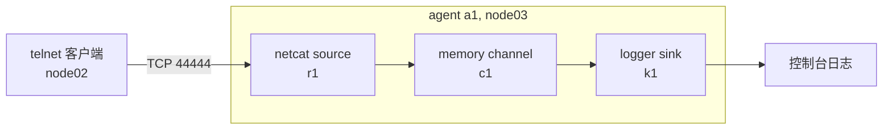

# Flume 网络采集案例全流程：从安装、配置三件套到 telnet 发数据验证

概念清楚了，该让 agent 真正跑起来。这个案例的场景很直白：node02 上用 telnet 往网络里发一行文字，node03 上部署一个 Flume agent 盯住 44444 端口，把收到的数据打印到控制台。链路虽短，安装、配置、启动、验证四步一个都不能少，而最容易卡住新手的正是配置文件里那一堆键值对：a1、r1、c1、k1 各是什么，谁连谁。把第一个案例搭通，后面换 source、换 sink 都只是改配置的事。

## 先给结论

- Flume 安装即解压：上传 `apache-flume-1.8.0-bin.tar.gz` 到 `/export/software`，解压到 `/export/servers`，前提是节点已有 hadoop 环境。
- `flume-env.sh` 由模板复制而来，只需要配一行 `JAVA_HOME`。
- 采集方案是一个 properties 风格的配置文件：先给 agent 的 source、channel、sink 起名字，再逐个描述类型与参数，最后两行把三件套连起来。
- 启动命令 `bin/flume-ng agent -c conf -f conf/netcat-logger.conf -n a1 -Dflume.root.logger=INFO,console`，`-n` 指定的 agent 名必须与配置文件里的前缀一致。
- 在 node02 上 `telnet node03 44444` 发一行文字，控制台打印出 event：header 加 body，body 里就是发来的内容。

## 安装：上传解压，配一行 JAVA_HOME

案例里 node01 一侧是业务程序，往 node02 发网络消息；node03 作为数据接收端部署 agent，内部是 socket source 与 console sink，从端口收数据、往屏幕打日志。Flume 的安装非常简单，只要解压即可，前提是已有 hadoop 环境。

把提前下载好的 `apache-flume-1.8.0-bin.tar.gz` 上传到装 agent 的那台机器，这里用第三台机器 node03：

```bash
cd /export/software/
rz -E        # 上传 apache-flume-1.8.0-bin.tar.gz
tar -zxvf apache-flume-1.8.0-bin.tar.gz -C /export/servers/
```

解压完 `/export/servers` 下多出 `apache-flume-1.8.0-bin` 目录，里面有 bin、conf、lib、docs 几个部分：bin 放启动脚本，conf 放配置，lib 放依赖 jar，docs 是自带文档。安装最后一步是生成 Flume 自己的环境变量文件，conf 目录里只有模板，复制一份再改：

```bash
cd /export/servers/apache-flume-1.8.0-bin/conf
cp flume-env.sh.template flume-env.sh
```

编辑 `flume-env.sh`，只需要保证 JDK 路径正确：

```bash
export JAVA_HOME=/export/servers/jdk1.8.0_141
```

到这里安装就结束了，没有编译、没有初始化。hadoop 环境的作用在启动那一刻才体现：flume-ng 会自动找到 `/export/servers/hadoop-3.1.1`，把 Hadoop 的各个 lib 目录加进 classpath，agent 因此能直接对接 HDFS 这类存储。

## 采集方案：先命名，再描述，最后连线

使用 Flume 的方式就是在 conf 目录下写一个配置文件，对三个组件分别配置。文件名随意，这里叫 `netcat-logger.conf`，内容分四段：

```properties
# 定义这个agent中各组件的名字
a1.sources = r1
a1.sinks = k1
a1.channels = c1

# 描述和配置source组件: r1
a1.sources.r1.type = netcat
a1.sources.r1.bind = 192.168.174.120
a1.sources.r1.port = 44444

# 描述和配置sink组件: k1
a1.sinks.k1.type = logger

# 描述和配置channel组件, 此处使用是内存存储的方式
a1.channels.c1.type = memory
a1.channels.c1.capacity = 1000
a1.channels.c1.transactionCapacity = 100

# 描述和配置source channel sink之间的连接关系
a1.sources.r1.channels = c1
a1.sinks.k1.channel = c1
```

第一段只是起名：a1 是 agent 实例的名字，这个名字会在启动命令里再次出现，叫什么都行；r1、k1、c1 分别是这个 agent 里 source、sink、channel 组件的名字。一个 agent 的 sources、sinks、channels 都可以有多个，所以这三行等号右边是列表。

第二段描述 source。type 写 netcat，它是官方 Source 清单里的一员，专门监听一个 TCP 端口，把收到的每一行文本当作一个事件；bind 绑定本机 IP，port 指定 44444，合起来就是「在这台机器的这个端口监听数据」。

第三段分别描述 sink 与 channel。sink 的 type 是 logger，把从 channel 收到的数据交给日志系统打印到控制台，方便亲眼看到采集结果；channel 的 type 是 memory，数据存内存，capacity 1000 表示管道里最多暂存 1000 个 event，transactionCapacity 100 表示一次事务最多处理 100 个，这两个值后面讲 event 时再展开。

第四段连线：`a1.sources.r1.channels = c1` 是复数，说明一个 source 可以把数据写进多个 channel；`a1.sinks.k1.channel = c1` 是单数，一个 sink 只从一个 channel 取数据。source 与 sink 各自认了同一个 channel c1，三件套就连成了流水线。



这张图在讲配置文件落成后的实际链路：telnet 发出的每一行文本进 netcat source，经 memory channel 缓冲，logger sink 取出打到控制台。关键路径一句话：配置文件里命名、描述、连线三段，与图上三个箭头一一对应，看懂配置先看懂这张图。

## 启动 agent：flume-ng 参数逐个拆

启动命令在官方文档 Getting Started 里就有示例，落到本案例：

```bash
bin/flume-ng agent -c conf -f conf/netcat-logger.conf -n a1 -Dflume.root.logger=INFO,console
```

四个参数各司其职。`-c conf` 指定 Flume 自身配置文件所在目录；`-f conf/netcat-logger.conf` 指定采集方案，就是刚才写的那份三件套配置；`-n a1` 指定 agent 名字，必须与配置文件里的 a1 前缀一致，配置文件里写 a1、这里传 -n a2，组件一个都找不到；`-Dflume.root.logger=INFO,console` 设日志级别为 INFO 并输出到控制台。

命令执行后终端「卡住」是正常状态：agent 是一个常驻进程，此刻正在监听 192.168.174.120 的 44444 端口等数据进来。启动日志里能看到一行 `Info: Including hadoop libraries found via /export/servers/hadoop-3.1.1/bin/hadoop`，说明它确实自动挂上了集群里 Hadoop 3.1.1 的库。

## telnet 发数据，认识 event

数据发送端在另一台机器 node02 上准备，安装 telnet 客户端并连到 44444 端口：

```bash
yum -y install telnet
telnet node03 44444
```

连上后光标停在输入处，敲一个 hello 回车，node03 的控制台立刻有反应：收到一个 event，body 里是 hello；再发一行「你好」，又是一个 event，body 以十六进制字节形式显示「你好」的内容。Flume 确实把网络数据采集到了。

event 是 Flume 里最基础的数据单位，值得停下来看清结构。channel 内部流动的数据就是一条条 event，采到一条数据就是一个 event。每个 event 像一颗胶囊，分成两段：前面是 header，头部信息，装一些标志与属性，本案例里是空的；后面是 body，正文，装真实数据，本质是一个字节数组。控制台打印的十六进制就是 body 的原始字节，不是乱码。

## 常见误区

- **`-n` 的名字与配置文件前缀对不上。** 配置文件里所有键都以 a1 开头，启动时却传 `-n a2`，Flume 找不到任何组件，直接报错退出；两边必须严格一致。
- **bind 填成别人的 IP。** netcat source 绑定的是运行 agent 这台机器的地址，写成 node02 的 IP 启动时就绑定失败；bind 必须是本机 IP，要允许任意来源访问就监听本机全部地址。
- **把前台卡住当成程序假死。** agent 启动后不退出是在监听端口，属正常现象；Ctrl+C 会终止 agent，生产上要常驻就用 nohup 放后台，别误以为命令没执行完。
- **把十六进制 body 当乱码。** logger sink 打印的 body 是字节数组的十六进制表示，中文与英文都能还原；想直接看明文，换 sink 类型或对照编码转换即可。

## 面试可能被问到的问题

1. 面试官追问：「flume-ng agent 启动命令里各参数是什么含义？」
   答：`-c conf` 指定 Flume 自身配置目录；`-f` 指定采集方案文件，即描述 source、channel、sink 的那份配置；`-n` 指定 agent 名字，必须与配置文件里的前缀一致；`-Dflume.root.logger=INFO,console` 设定日志级别 INFO 并输出到控制台。
2. 面试官追问：「netcat source 是怎么工作的？」
   答：它监听一个 TCP 端口，把收到的每一行文本封装成一个 event 写入 channel。案例里 bind 配本机 IP、port 配 44444，另一台机器 telnet 上来发一行 hello，agent 就采到一条数据。
3. 面试官追问：「memory channel 的 capacity 和 transactionCapacity 有什么区别？」
   答：capacity 是 channel 里最多暂存的 event 总数，案例里 1000；transactionCapacity 是一次事务里 source 写入或 sink 读出的最大 event 数，案例里 100。后者必须不大于前者，否则事务里的事件数超过管道容量会出问题。
4. 面试官追问：「Flume 的 event 是什么结构？」
   答：event 是数据传输的基本单位，由 header 和 body 两部分组成。header 存标志与属性信息，可以为空；body 存真实数据，是字节数组。channel 里流动的就是一条条 event。
5. 面试官追问：「logger sink 适合生产环境吗？」
   答：它把 event 按 INFO 级别打到日志，主要用来调试验证链路。生产上数据要落地，一般把 sink 换成 hdfs sink 写 HDFS，或换成对接下游 agent 的类型，配置只动 sink 那几行。
6. 面试官追问：「安装 Flume 为什么要求节点先有 hadoop 环境？」
   答：flume-ng 启动时会通过 hadoop 命令找到 Hadoop 的安装目录，把它的各个 lib 加进 classpath，sink 要写 HDFS 时才能加载对应的实现类；没有 hadoop 环境，HDFS 相关的 sink 跑不起来。

## 配套资料

- 本课资料包未包含 Flume 安装包与采集方案文件，安装步骤、`flume-env.sh` 与 `netcat-logger.conf` 均按画面线实操逐行还原，source、sink、channel 类型清单参照 Flume 1.8.0 官方文档 Getting Started 部分；示例为按本课写法补全。
- 讲义：`materials/docs/04/采集系统部署使用说明.md`，课程项目采集系统的部署文档，可对照理解网络日志采集的业务背景。
