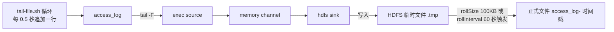

# tail 文件采集实测：脚本灌数据、HDFS 落盘，再复现一次重启丢数据

方案在纸面上成立不等于链路能跑。exec 案例要验证两件事：tail -F 能否把追加进日志文件的行实时送进 HDFS；agent 重启之后数据会变成什么样。第二件事属于 exec 方案的关键局限，用一套同样的环境补一个可复现的实验，把结论做实。

## 先给结论

- 先建好被监控文件 `/export/servers/taillogs/access_log` 再启动 agent，配置文件叫 `tail-file.conf`，agent 名是 `agent1`。
- 启动命令结构与目录案例一致，只换 `-f` 与 `-n` 的取值。
- 用一个循环脚本每 0.5 秒往 access_log 追加一行当前时间，模拟业务日志持续写入；单条数据也可以用 `echo` 追加快速验证。
- 控制台出现 creating hdfs 字样时，sink 正在 HDFS 上创建临时文件；临时文件满足滚动条件后变成正式文件。
- 重启丢数据可以复现：停机期间追加 20 行，重启后只有末尾 10 行被读走，前 10 行永远丢失，exec 无断点续传坐实。

## 准备配置与被监控文件

tail-file.conf 按画面线逐行还原如下：

```properties
agent1.sources = source1
agent1.sinks = sink1
agent1.channels = channel1

# 描述和配置 tail -F source1
agent1.sources.source1.type = exec
agent1.sources.source1.command = tail -F /export/servers/taillogs/access_log
agent1.sources.source1.channels = channel1

# 描述和配置 sink1
agent1.sinks.sink1.type = hdfs
agent1.sinks.sink1.channel = channel1
agent1.sinks.sink1.hdfs.path = hdfs://node01:8020/weblog/flume-collection/%y-%m-%d/%H-%M
agent1.sinks.sink1.hdfs.filePrefix = access_log
agent1.sinks.sink1.hdfs.maxOpenFiles = 5000
agent1.sinks.sink1.hdfs.batchSize = 100
agent1.sinks.sink1.hdfs.fileType = DataStream
agent1.sinks.sink1.hdfs.writeFormat = Text
agent1.sinks.sink1.hdfs.rollSize = 102400
agent1.sinks.sink1.hdfs.rollInterval = 60
agent1.sinks.sink1.hdfs.round = true
agent1.sinks.sink1.hdfs.roundValue = 10
agent1.sinks.sink1.hdfs.roundUnit = minute
agent1.sinks.sink1.hdfs.useLocalTimeStamp = true

# memory channel
agent1.channels.channel1.type = memory
agent1.channels.channel1.keepAlive = 120
agent1.channels.channel1.capacity = 500000
agent1.channels.channel1.transactionCapacity = 600

# 连线
agent1.sources.source1.channels = channel1
agent1.sinks.sink1.channel = channel1
```

有一处讲义笔误要修正：讲义原稿在 sink 段里写了 `agent1.sinks.sink1.channel = c1`，而配置里实际存在的 channel 叫 `channel1`，照抄会在启动时找不到组件，必须改成 `channel1`。与 spooldir 案例相比，sink 多了两个参数：`writeFormat = Text` 表示按行式文本写出，writeFormat 只有 Text 与 Writable 两种取值，显式写出来避免歧义；`maxOpenFiles = 5000` 限制同一时刻 sink 在 HDFS 上打开的文件句柄数，防止句柄耗尽。滚动阈值回归了正常量级：`rollSize = 102400` 即 100 KB，`rollInterval = 60` 即 60 秒。

被监控文件先手工建好：

```bash
mkdir -p /export/servers/taillogs
touch /export/servers/taillogs/access_log
```

tail -F 容忍文件暂时不存在，会持续重试，但先把文件建好，可以避免启动阶段命令输出无谓的告警。

## 启动 agent 并灌入数据

启动命令与前两个案例同构：

```bash
cd /export/servers/apache-flume-1.8.0-bin
bin/flume-ng agent -c conf -f conf/tail-file.conf -n agent1 -Dflume.root.logger=INFO,console
```

讲义印刷版里安装目录写的是 1.6.0 CDH 版本路径，课程实际部署的是 Flume 1.8.0，按本机目录替换即可。进程起来后阻塞等待，它执行的是 tail -F，正守着 access_log 等新增内容。

先验证单条链路，手工追加一行：

```bash
echo "hello tail" >> /export/servers/taillogs/access_log
```

控制台立刻滚出这条 event，说明命令输出确实被 source 读走了。持续灌数据用循环脚本，建在 `/export/servers/shells` 下，命名 `tail-file.sh`：

```bash
#!/bin/bash
while true
do
  date >> /export/servers/taillogs/access_log
  sleep 0.5
done
```

`date` 取当前时间追加进日志文件，`sleep 0.5` 控制节奏，循环不退出，业务进程持续写日志的场景就是这个模型。执行 `sh tail-file.sh`，脚本开始每半秒写一行。

## HDFS 落盘观察

脚本运行后，agent 控制台出现 creating hdfs 字样的日志，表示 sink 正在 `/weblog/flume-collection` 下创建临时文件。打开 HDFS 的 Web 管理页面，按 `hdfs.path` 的层级进入：`weblog`、`flume-collection`、日期目录、时分目录。目录里先看到 `.tmp` 结尾的临时文件，隔一段时间变成正式文件，文件名以 `access_log-` 开头。



这张图在讲数据从脚本到正式文件的全程：临时文件是 hdfs sink 的过渡形态，滚动条件满足才转正。关键路径一句话：`round` 三件套把目录按 10 分钟分桶，`roll` 两个阈值控制文件大小与生命周期，两者配合下 HDFS 上的文件既分桶又可控。

## 补做一次重启丢数据实验

exec 的局限值得亲手验证一遍，步骤如下：

```bash
# 1. Ctrl+C 停掉 agent
# 2. 停机期间向文件追加 20 行
for i in $(seq 1 20); do echo "offline-line-$i" >> /export/servers/taillogs/access_log; done
# 3. 重新启动 agent
bin/flume-ng agent -c conf -f conf/tail-file.conf -n agent1 -Dflume.root.logger=INFO,console
```

结果：HDFS 新落盘的文件里只找得到 `offline-line-11` 到 `offline-line-20` 这 10 行，前 10 行永远没有出现。原因在 exec 的工作方式：重启后命令重新执行，tail 默认先输出文件末尾 10 行再进入跟随模式，停机窗口里更早写入的行被跳过，位置信息不会从磁盘恢复。

停机期间追加的行数如果少于 10 行，现象还会反过来：这些新行连同更早的旧行一起被当作「末尾 10 行」重发，HDFS 里出现重复数据。丢还是重取决于窗口大小，根因相同，exec 只保证运行期间的实时性，不保证跨重启的完整性。要断点续传，换 taildir source：Flume 1.7 起内置，每个文件的读取位置写入磁盘 position 文件，重启接着读，课程环境的 Flume 1.8.0 可直接使用。

这一节不在原视频演示范围内，是按同一套环境补做的验证实验，结论与 exec source 的实现机制一致。

## 常见误区

- **照抄讲义里的 `channel = c1`。**组件名对不上，agent 启动即失败；连线段的 channel 名必须与命名段声明的一致。
- **以为 agent 重启会自动补采。**exec 无断点续传，停机窗口的数据补不回来；需要完整性的场景用 taildir 或 file channel 加可靠的 source 组合。
- **把测试脚本写进被监控的日志目录。**脚本与数据混放会让文件变脏；脚本放 `/export/servers/shells`，日志目录里只留被采集的文件。
- **滚动阈值照搬教学值。**100 KB、60 秒是演示用的量级，生产按数据流量与下游容忍度计算，避免小文件泛滥。

## 面试可能被问到的问题

1. 面试官追问：「exec source 重启后为什么丢数据？如何复现验证？」
   答：exec 只在启动时执行一次命令且不记录读取位置，重启后 tail -F 从文件末尾继续，停机期间追加的数据不补采。复现：停掉 agent 后向文件追加 20 行，重启后 HDFS 里只有末尾 10 行，前 10 行丢失。
2. 面试官追问：「重启后数据是纯粹丢失吗？有没有别的表现？」
   答：取决于停机窗口。追加超过 10 行时中间数据丢失；追加少于 10 行时，tail 启动默认输出末尾 10 行，新行会连同旧行一起重发，变成重复数据。丢与重的根因都是位置不落盘。
3. 面试官追问：「hdfs sink 为什么要配 maxOpenFiles？」
   答：hdfs.path 里带时间转义时，不同时间桶对应不同文件，sink 可能同时打开大量句柄；maxOpenFiles 限制同时打开的文件数，防止文件句柄耗尽导致写入失败。
4. 面试官追问：「writeFormat 与 fileType 的区别？」
   答：fileType 决定 HDFS 文件的容器格式，DataStream 是普通文本，SequenceFile 是二进制；writeFormat 决定 event 在文件里的写出格式，取值 Text 或 Writable。两者搭配 DataStream 加 Text 才是人可读的行式文本。
5. 面试官追问：「断点续传在 Flume 里怎么实现？」
   答：用 taildir source，它把每个被监控文件的读取位置写入磁盘 position 文件，agent 重启后按位置继续读，兼顾文件追加采集与不丢数据；exec 与 spooldir 都做不到跨重启续传。
6. 面试官追问：「怎么快速验证一条 exec 采集链路是通的？」
   答：先手工 echo 一行追加进被监控文件，观察 agent 控制台是否出现对应 event，再到 HDFS 的目标时间目录核对落盘文件内容；通了之后再用循环脚本压持续流量。

## 配套资料

- 代码：`materials/code/04/day06-Flume/`，本课资料包未附带 tail 案例的配置与脚本，`tail-file.conf` 按视频画面逐行还原（滚动与时间参数均为画面原值），`tail-file.sh` 按讲解的循环结构还原，示例为按本课写法补全。
- 讲义：`materials/docs/04/采集系统部署使用说明.md`，课程采集系统的部署与业务背景，脚本持续写日志模拟的正是业务进程产出行为日志的生产场景。
- 代码：`materials/code/04/buried/`，课程用户行为日志采集工程源码，业务侧日志的产生方式可对照查阅。
