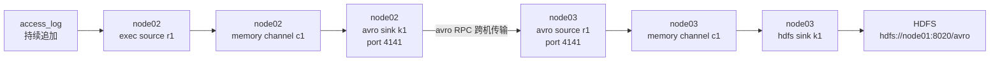

# 两个 agent 接力：Flume 级联跨机采集与落盘全流程

前面几个案例都是一台机器、一个 agent 包办到底：source 读数据，sink 直接落 HDFS。真实采集系统里这条路经常走不通，业务服务器分散在不同节点上，日志得先在业务机子就近采一层，再统一送到负责存储的节点。把多个 agent 串成一条链路接力传输，这就是 Flume 的级联。这一课把两个 agent 分别部署到 node02 与 node03，中间用 avro 协议对接，跑通一条「tail 文件、网络转发、落 HDFS」的完整链路，并把级联里 source 与 sink 的选型问题一并讲透。

## 先给结论

- 级联的关键只在两个组件的类型：上一级的 sink 配成 avro，下一级的 source 也配成 avro，两边靠 hostname 与 port 完全对齐来握手，其余组件与单机案例写法相同。
- node02 上写 `tail-avro-logger.conf`：exec source 盯文件、memory channel 缓冲、avro sink 往下游发；node03 上写 `avro-hdfs.conf`：avro source 收数据、memory channel、hdfs sink 落盘。
- Flume 解压即用，node02 没装就先 `scp -r` 把 node03 的安装目录拷过去，复制目录必须带 `-r`。
- 启动顺序永远是下游先起、上游后起：sink 对着一个没监听的端口只会反复重试，白耗时间。
- exec 的重启丢数局限在级联里原样存在，要断点续传就把上游 source 换成 taildir，下游配置一个字都不用动。

## 级联模型：数据在两台机器之间怎么接力

需求用两句话就能说清：第一个 agent 负责收集文件中的数据，通过网络发送给第二个 agent；第二个 agent 负责接收发来的数据，保存到 HDFS 上。两个 agent 分别部署在不同主机，node02 靠近业务文件，node03 靠近 HDFS。级联的最简形态就是两个 agent 首尾相接，前者的 sink 直接连后者的 source。

难点不在架构而在配置：不管多少个 agent，每一个都要老老实实配齐三个组件。课程讲义把单个 agent 的实施总结成六步：写配置文件、配置 source、配置 channel、配置 sink、把组件组合起来、启动 agent 并测试。级联没有引入第七步，只是这六步要做两遍，一遍给 node02，一遍给 node03，唯一的新知识是 source 与 sink 各多出一个 avro 类型。换句话说，会配单机 agent 就会配级联，把两个 agent 的组件分工列出来，每个格子该填什么就一目了然了。

| 位置 | source | channel | sink |
|---|---|---|---|
| node02（第一跳） | exec，监控 `tail -F` 命令输出 | memory | avro，发往下一跳 |
| node03（第二跳） | avro，接收上一跳发来的数据 | memory | hdfs，落 HDFS |

这张表里唯一的新面孔是 avro。avro sink 与 avro source 都是 Flume 官方用户指南里列出的内置组件：avro sink 可以实现多级 Flume 之间的关联，配置时除了 type 写 avro，还要绑定 hostname 与 port，表示把数据发送到哪个主机的哪个端口；avro source 则反过来，接收上一级 agent 的输出，配置时要绑定自己的 IP 与端口。对方发数据时指定的目标地址，就是自己绑定的地址，这三个参数是配对成立的全部条件。

两个 agent 的组件都配 memory channel 也是有意为之：级联的每一跳各自持有独立的缓冲，上一跳的 sink 与下一跳的 source 之间是网络边界，channel 只为本跳的「进与出」兜底。node02 只负责把文件数据搬出去，node03 只负责收下并落盘，谁都不需要在内存里攒太多东西，容量给到一千，教学链路足够，生产上把容量与下游吞吐匹配起来再调。



这张图在讲两跳 agent 的接力关系：跨机的边界出现在 avro sink 与 avro source 之间，端口 4141 是这一对接头的约定点。关键路径一句话：左半段与 tail 案例完全一致，右半段与 tail 案例的 sink 换了个方向，从「写 HDFS」变成「先收数据再写 HDFS」，级联并没有引入第三种新组件。

## 第一跳：node02 上的 tail-avro-logger.conf

node02 上还没有 Flume，先把现成的安装目录整份拷过去。在 node03 上执行：

```bash
cd /export/servers
scp -r apache-flume-1.8.0-bin node02:$PWD
```

复制的是目录，`-r` 不能省；`$PWD` 表示拷到 node02 的当前同名路径下，省得再拼一遍目标路径。Flume 本身解压即用，拷完就等于装好了。

接着在 node02 的 conf 目录下新建配置文件 `tail-avro-logger.conf`，文件名在启动命令里还要用到。三个组件逐项写：

```properties
a1.sources = r1
a1.sinks = k1
a1.channels = c1

# Describe/configure the source
a1.sources.r1.type = exec
a1.sources.r1.command = tail -F /export/servers/taillogs/access_log
a1.sources.r1.channels = c1

# sink 的 avro 是一个数据发送者
a1.sinks.k1.type = avro
a1.sinks.k1.channel = c1
a1.sinks.k1.hostname = 192.168.174.120
a1.sinks.k1.port = 4141
a1.sinks.k1.batch-size = 10

# Use a channel which buffers events in memory
a1.channels.c1.type = memory
a1.channels.c1.capacity = 1000
a1.channels.c1.transactionCapacity = 100

# Bind the source and sink to the channel
a1.sources.r1.channels = c1
a1.sinks.k1.channel = c1
```

source 段与 tail 案例一模一样，exec 类型执行 `tail -F` 盯住被监控文件。sink 段是新内容：type 从 hdfs 换成 avro，`hostname` 与 `port` 指明下一跳的地址与端口，`batch-size = 10` 表示攒满 10 个 event 打一次网络请求，小批次可以降低单次传输失败的重放成本。

`hostname` 的取值只有一个原则：填「运行 avro source 那台机子」的地址。画面线里的取值是 192.168.174.120，即录制环境中真正监听 4141 的接收端；它没有标准答案，写成 IP 或主机名都可以，failover 案例里就用主机名 node02、node03。课程集群规划表的口径是 node01 为 192.168.174.100、node02 为 192.168.174.120、node03 为 192.168.174.130，若按这套规划部署，下一跳是 node03，这里应写成 192.168.174.130 或主机名 node03；照搬别处地址会让 sink 连向一台没有 avro source 监听的机器，连接被拒，事件全部积压在 channel 里。画面线里还出现过把 hostname 拼成 hostame 的笔误，少了字母 n，key 对不上等同于没配，agent 启动后 sink 一直连不出去。

被监控的文件与目录要提前建好，这一步在 node02 上执行：

```bash
mkdir /export/servers/taillogs/
touch /export/servers/taillogs/access_log
```

tail -F 容忍文件暂时不存在，但先把目录和文件备齐，启动阶段就不会有无谓的告警。命令敲在哪台机子上也要留神，`tail-avro-logger.conf` 必须出现在 node02 的 conf 目录里，`avro-hdfs.conf` 必须出现在 node03 的 conf 目录里，两份文件写串了机器，两边的 agent 都起不来。待会儿灌数据用的脚本也可以直接从 node03 拷过来，下一节测试时一起做。

## 第二跳：node03 上的 avro-hdfs.conf

node03 的配置文件命名为 `avro-hdfs.conf`，命名带上两端的组件类型，启动时好认。三个组件镜像 node03 在前面案例里的角色，只是把入口从文件换成了网络：

```properties
a1.sources = r1
a1.sinks = k1
a1.channels = c1

# avro source 绑定本机地址与端口，与上一跳的 hostname/port 对齐
a1.sources.r1.type = avro
a1.sources.r1.bind = 192.168.174.120
a1.sources.r1.port = 4141
a1.sources.r1.channels = c1

# Describe the sink
a1.sinks.k1.type = hdfs
a1.sinks.k1.hdfs.path = hdfs://node01:8020/avro
a1.sinks.k1.hdfs.filePrefix = avro-
a1.sinks.k1.hdfs.fileType = DataStream
a1.sinks.k1.hdfs.writeFormat = Text
a1.sinks.k1.hdfs.rollSize = 102400
a1.sinks.k1.hdfs.rollInterval = 10
a1.sinks.k1.hdfs.useLocalTimeStamp = true

# Use a channel which buffers events in memory
a1.channels.c1.type = memory
a1.channels.c1.capacity = 1000
a1.channels.c1.transactionCapacity = 100

# Bind the source and sink to the channel
a1.sources.r1.channels = c1
a1.sinks.k1.channel = c1
```

这份配置画面里只拍到了讲解要点，逐行按 Flume 1.8.0 主流写法补全：source 的 bind 与 port 必须与上一跳 avro sink 的 hostname 和 port 取同一组值，级联通不通的分水岭就在这两行；sink 段沿用课程 tail 案例的 hdfs 写法，`hdfs.path` 落在 `/avro` 目录，滚动参数里的 `rollInterval = 10` 偏短，正是待会儿 HDFS 上出现大量小文件的原因。bind 的取值同样遵循「与对端一致」原则，按集群规划表口径部署时，与上一跳的 hostname 一起换成 node03 的实际地址。

## 启动与测试：先下游后上游

配置就绪后进入实测，验证的口径很明确：文件里追加的每一行，都要能穿过两台机器落到 HDFS 的 `/avro` 目录里。两个 agent 分属两台机器，启动顺序有讲究。node03 是接收端，必须先起：

```bash
cd /export/servers/apache-flume-1.8.0-bin/
bin/flume-ng agent -c conf -f conf/avro-hdfs.conf -n a1 -Dflume.root.logger=INFO,console
```

node03 的终端卡住不动，说明 avro source 已经在 4141 端口上等待数据。这时再启动 node02：

```bash
cd /export/servers/apache-flume-1.8.0-bin/
bin/flume-ng agent -c conf -f conf/tail-avro-logger.conf -n a1 -Dflume.root.logger=INFO,console
```

node02 的启动日志里能直接看到级联是否成立，找这几行：

```text
Rpc sink k1: Building RpcClient with hostname: 192.168.174.120, port: 4141
Component type: SINK, name: k1 started
Component type: SOURCE, name: r1 started
WARN NettyAvroRpcClient: Using default maxWorkers
```

`Building RpcClient` 一行打出 sink 真正去连的地址与端口，与 node03 的 bind 一致就说明配对成功；`Using default maxWorkers` 是一个无害告警，提示 avro 客户端没配线程数参数、走了默认值，不用处理。

三个终端窗口同时开着的操作里最容易出的问题是切错窗口：node02 与 node03 的 agent 名字都是 a1，控制台输出长得也像，灌数据前先确认当前窗口连的是哪台机子，看主机名或看配置文件名都行。这条提醒听着琐碎，实测环节一半的低级故障都出在窗口错位上，把命令敲到别的机器上，再好的配置也不会有结果。

数据从文件进来。脚本和上一课一样放在 `/export/servers/shells` 下，从 node03 一并拷到 node02：

```bash
cd /export/servers
scp -r shells/ taillogs/ node02:$PWD
```

先验证单条链路，手工追加一行：

```bash
echo "hello cascade" >> /export/servers/taillogs/access_log
```

node02 的控制台立刻滚出这条 event，说明文件变化被 exec source 读到；node03 的控制台同步显示正在收集 events，说明 avro 对接把数据送过了网络。持续灌数据再跑循环脚本：

```bash
cd /export/servers/shells
sh tail-file.sh
```

脚本每 0.5 秒往文件追加一行当前时间，两台机器的日志持续滚动。打开 HDFS 的 Web 管理页面，进入根目录下的 `avro` 目录，能看到大量小文件正在不断生成，文件先以 `.tmp` 临时形态存在，满足滚动条件后转正。


这张图在讲数据从脚本到 HDFS 的全程，中间多了一跳网络传输，其余环节与单机案例无差。关键路径一句话：每一跳内部依然走「source 到 channel 到 sink」的事务模型，级联只是把上一跳的 sink 与下一跳的 source 用 avro 协议缝了起来。

小文件值得单独算一笔账：脚本每 0.5 秒写一行，一分钟 120 行，`rollInterval = 10` 意味着 sink 每 10 秒关闭当前文件另起一个，一分钟就要产出 12 个文件，看几分钟页面上就是一片密密麻麻的文件列表。课程里给的判断正是「滚动频率太大」，治理手段也常规：把 `rollInterval` 调大到分钟级、配合 `rollSize` 或 `rollCount` 兜底、用 `round` 三件套把目录按时间分桶，这几项参数 tail 案例里详细拆过，落盘形态的要求不同，取值组合就不同。

## 原理：avro sink 与 avro source 的握手

**第一，avro 是 Hadoop 生态的序列化 RPC 协议。** Flume 选它做 agent 间传输，除了协议本身与 Hadoop 同源，还因为这对组件是官方推荐的跨 agent 数据通道，配置项少、语义清晰，hostname 加 port 就能完成一次对接。

**第二，配对靠三个要素对齐。** 上一跳 sink 的 `hostname` 与 `port`，描述的是「发给谁」；下一跳 source 的 `bind` 与 `port`，描述的是「在本机哪个地址上监听」。两组值必须指向同一个地址、同一个端口，任何一边写错，握手都不成立。`batch-size` 只影响发送节奏，不参与寻址。端口取 4141 是 Flume 文档与社区案例里 avro 组件的惯例值，与 netcat 案例惯用 44444 是同一类约定，换成其他未占用端口也完全可以，只要两端一致。

**第三，传输失败有 channel 兜底。** avro sink 从 channel 里取出一批 event，通过网络发出去，收到下一跳的成功应答后才提交事务；对端不可达时事务不提交，event 留在 channel 里等重试。这也解释了为什么下游晚启动不会直接丢数据，只是上游日志里反复出现连接失败，等下游起来数据自动续传过去。不过 memory channel 本身放在内存里，进程掉电它也保不住，对完整性要求高的链路要换 file channel。

**第四，这对组件还有一批可选参数。** avro sink 支持 `connect-timeout` 与 `request-timeout` 控制建连和请求的超时，`compression-type` 可以打开压缩传输，`reset-connection-interval` 支持定期重建连接；avro source 侧有 `threads` 控制处理线程数，也支持同样的压缩参数与 keystore 证书配置。本课只用了最核心的四项，生产上跨机房传输时压缩与超时这两组参数值得打开，其余保持默认即可。

## 组件选型：上游 source 用 exec 还是 taildir

级联模型本身与 source 类型无关，本课沿用 exec 是为了衔接 tail 案例，选型上它并不是最优解。两个候选的差别集中在这几处：

| 对比项 | exec + tail -F | taildir source |
|---|---|---|
| 工作方式 | 启动时执行一次命令，跟随输出 | 独立监控多个文件，按行读取 |
| 断点续传 | 无，位置不落盘 | 有，读取位置写入 position 文件 |
| 重启行为 | 丢停机窗口数据，或尾部重发 | 从上次位置继续，不丢不重 |
| 版本要求 | 任意版本可用 | Flume 1.7 起内置，1.8.0 直接可用 |
| 配置改动 | `type = exec` 加 command | `type = TAILDIR` 加文件组与路径 |

结论也直白：临时验证、允许丢数的调试场景用 exec 无妨；业务采集链路一律推荐 taildir，级联的下游只需保证 avro 对接不动，上游换 source 对它零影响。tail 案例里复现过的重启丢数实验，在级联里做会得到完全相同的结果，这个局限跟着 source 走，跟下游没有关系。

还有一种常见的上游形态是 spooldir source：业务程序把日志按文件落进一个目录，source 发现新文件就整文件读取，读完把文件名加上 COMPLETED 后缀标记已处理。它适合「文件写完才出现」的批式场景，正在写入中的文件不会去碰，也不支持递归子目录扫描。三种 source 各守一段边界：exec 抓命令输出，taildir 盯追加中的文件，spooldir 收成批落地的文件，级联的上游选哪个，取决于业务产日志的方式，下游的 avro 对接在三种情况下都原样不动。

## 常见误区

- **把 sink 的 hostname 填成本机地址。** sink 要找的是下一跳的 avro source，填自己的 IP 会连向一台没人监听的机器，事件全部积压在 channel；画面里的地址值要按自己集群里「谁跑 avro source」来定。
- **两端端口只改了一边。** sink 的 port 与 source 的 port 是同一个约定的两半，改了 4141 却只改一端，握手照样失败；两处必须同值。
- **先起上游后起下游还以为配错了。** 看到上游日志反复 Connection refused，多数只是下游还没启动；先起下游再起上游，报错自然消失。
- **以为级联链路绝对不丢数。** avro 对接有事务与 channel 兜底，但 memory channel 掉电即丢，级联只是保证「运行期间」的可靠，跨进程崩溃的完整性要靠 file channel 与 taildir 这类落盘组件。

## 面试可能被问到的问题

1. 面试官追问：「两个 Flume agent 之间怎么传数据？为什么不用 hdfs sink 直接落？」
   答：用 avro sink 加 avro source 对接，上一级把数据通过网络发给下一级。业务机子与存储节点常常不在一台机器上，hdfs sink 要求每个采集点都能直连 HDFS，网络与客户端压力大；级联可以让边缘节点只做就近采集，汇聚与落盘交给专门的收集层。
2. 面试官追问：「avro sink 的 hostname、port 与 avro source 的 bind、port 是什么关系？」
   答：前者描述发送目标，后者描述本机监听地址，两组值必须指向同一个地址与端口，对齐是级联成立的前提。bind 填的是运行 source 这台机器自己的地址，不能填别人的 IP，否则启动即绑定失败。
3. 面试官追问：「级联案例为什么要先启动下游 agent？」
   答：avro sink 启动时就要向 hostname 加 port 建立连接，下游没起时端口没人监听，上游只能反复重试并刷连接失败日志。先下游后上游能让链路一次就绪；即便顺序错了数据也不会丢，会暂存在 channel 里等重试。
4. 面试官追问：「avro sink 的 batch-size 调大调小各有什么影响？」
   答：batch-size 决定一次 RPC 携带的 event 数量。调大批次吞吐更高、网络开销更小，但单批失败重放的数据量也更大；调小则相反。它只在 channel 与网络之间控制节奏，不改变事务的可靠性语义。
5. 面试官追问：「级联链路的数据可靠性由什么保证？哪里还可能丢？」
   答：每一跳内部由事务保证，source 写 channel、sink 取走并成功送达后提交，失败则回滚重试。可能丢数的点是 memory channel：它缓冲在内存里，agent 进程崩溃或机器断电时未落盘的数据会丢失，换成 file channel 可以把这层风险去掉。
6. 面试官追问：「上游 source 选 exec 还是 taildir，判断依据是什么？」
   答：看是否需要跨重启的完整性。exec 不记录读取位置，重启会丢数或重发尾部数据；taildir 把每个文件的位置写入 position 文件，重启接着读，Flume 1.7 起内置。生产采集链路默认选 taildir，exec 只适合临时验证。

## 配套资料

- 代码：`materials/code/04/day06-Flume/`，本课资料包为空（0 个文件），`tail-avro-logger.conf` 按视频画面逐行还原（组件别名、地址、端口、batch-size 均为画面原值），`avro-hdfs.conf` 画面未完整拍到，按讲解要点与课程 tail 案例的 hdfs sink 写法补全并已注明。
- 讲义：`materials/docs/04/采集系统部署使用说明.md`，采集系统的部署说明与业务背景，级联模拟的正是多节点日志先汇聚再落盘的生产形态。
- 代码：`materials/code/04/buried/`，课程用户行为日志采集工程源码，业务侧日志的产生方式可对照查阅。
