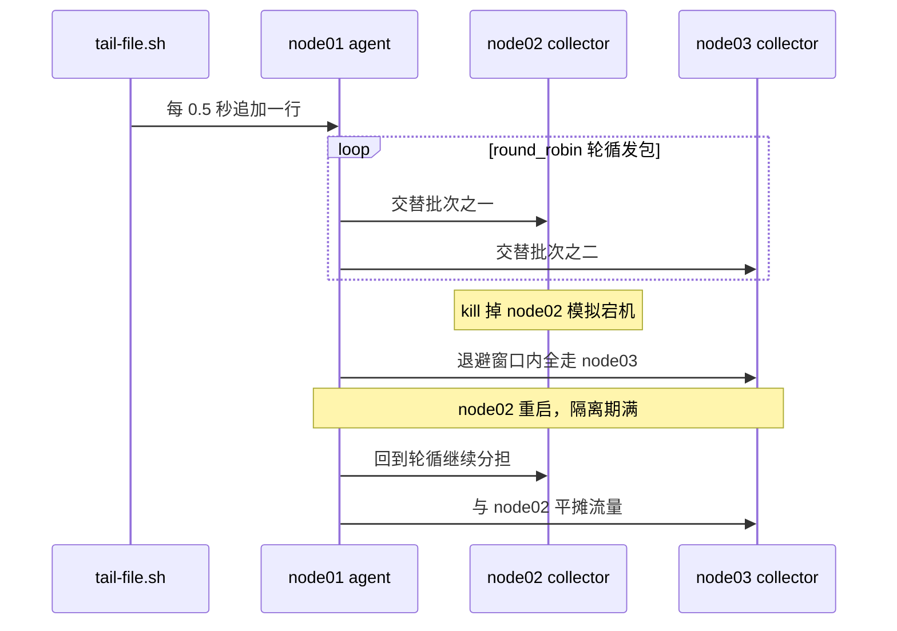

# 跑一次负载均衡：两台收集器轮流收包，杀一台看退避兜底

配置文件摆在那里只是纸面能力，load_balance 的处理器是不是真在轮流发包，得让三台机器跑起来看。这一课按先收集后采集的顺序拉起 agent，灌数据后盯住 node02 与 node03 的控制台，验证轮循现象；视频止步于此，故障切换与恢复分担的半程按同一套环境补做了一段演练，正好把 backoff 与 maxTimeOut 的行为也验证了。

## 先给结论

- 启动顺序 node03、node02、node01，先收集后采集，与 failover 案例的次序一致。
- 启动命令从安装根目录执行，cd 进 conf 目录再跑 `bin/flume-ng` 会报 `No such file or directory`。
- 正常态 node02 与 node03 都在收数据，轮流交替、你一包我一包，轮循就此坐实。
- kill 掉一台后 backoff 生效，流量在退避窗口内全部流向另一台，恢复的节点回到轮循继续分担。
- 与 failover 的恢复行为不同：负载均衡恢复后平摊流量，failover 恢复后高优先级重新独占。

## 启动顺序：先收集后采集

三台机器依次拉起 agent。node03 先起：

```bash
cd /export/servers/apache-flume-1.8.0-bin
bin/flume-ng agent -n a1 -c conf -f conf/load_balancer_server.conf -Dflume.root.logger=DEBUG,console
```

node02 用同一条命令启动，配置文件同名同位置。两台收集器起来后，最后在 node01 上启动采集端：

```bash
cd /export/servers/apache-flume-1.8.0-bin
bin/flume-ng agent -n a1 -c conf -f conf/load_balancer_client.conf -Dflume.root.logger=DEBUG,console
```

有个画面里真实踩过的坑值得记下来：操作时习惯性 cd 进了 `conf` 目录再执行命令，终端立刻回了一句 `bin/flume-ng: No such file or directory`，因为 `bin` 目录不在 `conf` 下面。教师当场纠正，要进的是安装根目录 `/export/servers/apache-flume-1.8.0-bin`，让 `bin/flume-ng` 与 `-c conf`、`-f conf/...` 这些相对路径都能各归各位。

收集器启动成功的日志证据在三处：组件 c1、k1、r1 逐个 started，`Starting Source r1: [bindAddress: node02, port: 52020]` 说明 avro source 已经在监听 52020 端口，最后一行 `Avro source r1 started.` 收尾。node01 后启动，它的两个 avro sink 建连时下游早已就绪，不会刷连接失败。

## 正常态：两台轮流收

收集器就位后，启动灌数据脚本：

```bash
cd /export/servers/taillogs
sh tail-file.sh
```

脚本持续向被监控的 `access_log` 追加时间行，node01 的 exec source 盯着文件新增内容，把它包装成 event 交给处理器分流。此时 node02 与 node03 的控制台都在滚动：DEBUG 级别下能看到 avro source 报告收到 event 批次，打印出每条数据的 header 与 body 字节描述。两个终端窗口的高亮色变蓝表示正在持续输出，颜色会交替闪烁。

关键观察是节奏：node02 与 node03 不是同时收，而是轮着收，node02 落下一包，node03 跟上收一包，交替推进。这正是 round_robin 的分发包序，两台收集器的压力在肉眼可见的尺度上均等。



这张图把一次完整验证里 node01 的发包节奏画成了四段：正常轮循、故障隔离、恢复试探、平摊回归。关键路径一句话：无论哪一段，决策都发生在 node01 的 sinkgroups 处理器里，下游两台收集器始终只是被动接包的执行者。

## 补做演练：kill 一台后的退避与恢复

原视频在轮循现象处收尾，故障半程按同一套环境补做，结论与上一课 failover 的演练互相印证：

```bash
# 在 node02 上模拟宕机（按画面演示的「把进程干掉」补全）
ps -ef | grep flume | grep -v grep
kill -9 进程号
```

node02 静默后，node01 的日志出现发送失败并进入重试，k2 被标记失败进入退避隔离，在 `maxTimeOut = 10000` 毫秒内不再被轮循选中，流量全部压到 node03 上。等待隔离期满，处理器会向 k2 发一次试探，node02 的 agent 重新拉起后试探成功，k2 回到轮循队列，node01 的发包恢复交替节奏，两台收集器重新平摊。补做的这段与 failover 演练的差别在恢复后的姿态：failover 里高优先级节点回归即独占，负载均衡里回归节点只是回到队伍继续分活，没有「接管」一说。

## 常见误区

- **把两台同时滚动当成配置错了。** failover 案例里正常态只有一台在收，习惯了那个现象的人看到两台都滚会以为 priority 漏配了；负载均衡的正常态就是两台都在收，区别只在节奏是轮流而不是同时。
- **把终端高亮变色当成异常信号。** 窗口颜色变蓝只是控制台表示「正在输出」的视觉提示，不是告警；判断健康看日志内容里 event 批次的滚动，不要被终端配色带偏。
- **cd 进 conf 目录执行启动命令。** 相对路径全是以安装根目录为基准的，根目录错了命令直接报 `No such file or directory`，报错后不要急着改配置，先检查自己在哪个目录。
- **杀进程后盯着 node01 反复重启它。** 切换有退避节奏，maxTimeOut 的窗口内 node01 只会把流量派给 node03；反复重启收集器只会搅乱退避与试探的判断，不如等隔离期满看流量回不回来。

## 面试可能被问到的问题

1. 面试官追问：「怎么从日志证明负载均衡生效了？」
   答：三处证据叠加。node02 与 node03 的 DEBUG 控制台都滚动着 avro source 收到的 event 批次；node01 的日志显示两个 sink 都在轮换发送；节奏上两台交替收包而非并行同收。三者合起来排除「只有一台在跑」的可能。
2. 面试官追问：「kill 掉一台收集器后，链路的行为是怎样的？」
   答：发送失败后失败 sink 被 backoff 隔离，隔离窗口由 selector.maxTimeOut 决定，窗口内全部流量走另一台。切换期间数据不丢，压在上游 channel 里等出口恢复。窗口结束后处理器向故障节点试探，恢复成功则回到轮循队列继续分担。
3. 面试官追问：「负载均衡和 failover 在恢复阶段的行为有什么差别？」
   答：failover 恢复后高优先级节点重新独占流量，低优先级回到待命；负载均衡恢复后只是回到候选队列，与另一台平摊流量。前者是主备语义，恢复即接管；后者是分担语义，恢复即归队。
4. 面试官追问：「如果两台收集器同时挂了呢？」
   答：两个 sink 都失败被隔离，channel 里的 event 发不出去，上游链路暂停推进。数据是否丢失取决于 channel 类型，memory channel 进程被强杀时在途数据会丢，生产环境换 file channel 才能把丢失窗口关死。
5. 面试官追问：「启动顺序为什么还是先收集后采集？」
   答：上游的 avro sink 在 agent 启动时就要向外建连，下游没监听时它只能反复报连接失败。先起 node03、node02 再起 node01，能让采集端一启动就建立完整链路，也避免启动日志里混入大量失败噪音干扰观测。

## 配套资料

- 代码：`materials/code/04/day06-Flume/`，本课资料包为空（0 个文件），启动命令与观测现象按视频画面还原，kill 演练与恢复观察画面未入帧，按同一套环境补做并已注明。
- 讲义：`materials/docs/04/采集系统部署使用说明.md`，采集系统部署说明与业务背景，负载均衡验证的正是这套行为日志采集链路的分摊能力。
