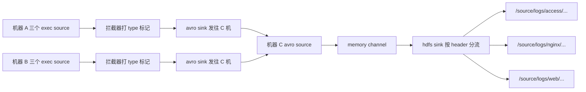

# 拦截器模型：给 event 的 header 打标记，让 HDFS 按日志类型分目录

两台主机各自跑着多个日志服务，磁盘上同时更新着 `access.log`、`nginx.log`、`web.log` 三份日志，现在要把 A、B 两台机器的日志汇总到第三台机器，再按类型分别写进 HDFS 的不同目录：access 的进 access 目录，nginx 的进 nginx 目录，web 的进 web 目录。链路用 Flume 搭并不难，exec source 加 avro sink 发给汇总端，汇总端用 hdfs sink 落盘。真正的问题是：汇总端收到的一批 event 里，access 的数据与 web 的数据混在一起，长得一模一样，HDFS sink 拿什么区分它们的归属？这一课的答案就是拦截器。

## 先给结论

- 需求本质是分流：A、B 两台各起一个 agent，三个 exec source 各盯一份日志，汇到 C 机后按类型写 HDFS。
- 区分归属靠 header：拦截器在 source 内部给每条 event 的 header 塞进一个键值对，教学口径用 `type = access` 这类标记。
- event 的结构是 header 加 body：header 是 `Map<String, String>` 元数据，body 是日志原文的 byte 数组。
- 拦截器实现 `org.apache.flume.interceptor.Interceptor` 接口，initialize 初始化、intercept 加工、close 释放。
- 多个拦截器按声明顺序链式执行，前一个的输出 event 是后一个的输入。

## 案例模型：两台采集端加一台汇总端

把需求翻译成 Flume 组件图。A 机与 B 机结构完全相同：三个 exec source 分别执行 `tail -F` 盯三份日志的变化，三个 source 全部写进同一个 memory channel，channel 后面挂一个 avro sink 把数据发往 C 机。C 机是一个标准汇总 agent：avro source 接收上游、memory channel 中转、hdfs sink 落盘。HDFS 上的目标目录按类型与日期分桶，形如 `/source/logs/access/20180101/`、`/source/logs/nginx/20180101/`、`/source/logs/web/20180101/`。

模型里每个日志文件的 event 都要经过 source 侧的 static interceptor 加工，标上类型后再进 channel：



这张图在讲标记的旅行路线：拦截器在 A、B 两台的 source 里给 event 盖章，header 里带着 type 这个标记一路经过 channel、avro 传输、C 机的 source 与 channel，最后 hdfs sink 落盘时读 header 决定进哪个目录。关键路径一句话：标记在源头打上，在终点消费，中间任何组件都不需要理解它的含义，只负责搬运。

## 为什么必须有拦截器

设想 A 机的 `access.log` 与 `nginx.log` 里恰好都写入了一行 `hello`。两条 event 到达 C 机时，body 都是 `hello`，header 都是空的，HDFS sink 看到的只是两条无法区分的数据。按行数对账会发现数据没错，按目录归类时却没有任何依据可用。问题的根源是：Flume 的 event 默认不带业务语义，body 只有原文，组件之间传递时不附「我来自哪个文件」的信息。

拦截器补的就是这块语义。它在 source 内部拦下每条即将写入 channel 的 event，往 header 里塞一个键值对。教学口径选的键是 `type`，值随文件而定：access 文件来的标 `access`，nginx 文件来的标 `nginx`，web 文件来的标 `web`。这样两条 `hello` 到达 C 机时，header 里分别带着 `type=access` 与 `type=nginx`，HDFS sink 的路径配置里写 `%{type}`，落盘时取 header 的值拼出目标目录，同名内容就此分道扬镳。标记是个字符串键值对，很轻，但它让下游第一次拥有了路由依据。

## event 与 Interceptor 接口

标记挂在 header 上，先看 event 的真实结构。一个 Flume event 就是两部分：header 与 body。用一段可运行的示例把结构摸清楚：

```java
package com.study.flume.interceptor;

import org.apache.flume.Event;
import org.apache.flume.event.EventBuilder;

import java.util.HashMap;
import java.util.Map;

public class EventStructureDemo {

    public static void main(String[] args) {
        // body 是日志原文，按字节存放；header 是字符串键值对的元数据
        Map<String, String> headers = new HashMap<String, String>();
        headers.put("type", "access");

        Event event = EventBuilder.withBody("hello".getBytes(), headers);

        // 下游组件读标记时，从 header 里按键取值
        System.out.println(event.getHeaders().get("type"));   // access
        System.out.println(new String(event.getBody()));      // hello
    }
}
```

header 与 body 的分工要分清：body 承载日志原文，一字节不动地传输；header 承载元数据，值必须是字符串，取值按键。往 header 加标记不碰 body，日志原文保持原样落盘。

拦截器的行为由 `org.apache.flume.interceptor.Interceptor` 接口约定，四个方法加一个 Builder，骨架如下：

```java
package com.study.flume.interceptor;

import org.apache.flume.Event;
import org.apache.flume.interceptor.Interceptor;

import java.util.ArrayList;
import java.util.List;
import java.util.Map;

public class HeaderMarkInterceptor implements Interceptor {

    private String typeValue;

    public HeaderMarkInterceptor(String typeValue) {
        this.typeValue = typeValue;
    }

    @Override
    public void initialize() {
        // 组件启动时调用一次，做一次性准备
    }

    @Override
    public Event intercept(Event event) {
        // 每个 event 进来一次：改 header、清洗 body，返回 null 表示丢弃
        Map<String, String> headers = event.getHeaders();
        headers.put("type", typeValue);
        event.setHeaders(headers);
        return event;
    }

    @Override
    public List<Event> intercept(List<Event> events) {
        // source 以批次为粒度调用，逐条走单条逻辑
        List<Event> out = new ArrayList<Event>();
        for (Event e : events) {
            Event r = intercept(e);
            if (r != null) {
                out.add(r);
            }
        }
        return out;
    }

    @Override
    public void close() {
        // 组件关闭时调用一次，释放资源
    }
}
```

这份骨架就是模型落进代码的样子：单条 `intercept` 是加工现场，批量 `intercept` 负责整批遍历，返回 null 的 event 不会写进 channel，等于在源头完成了一次丢弃。拦截器跑在 source 的线程里，逻辑必须轻快，重活压进拦截器会直接拖慢采集速度。

## 链式执行与典型用途

一个 source 可以挂多个拦截器，配置里 `a1.sources.r1.interceptors = i1 i2 i3` 声明顺序，执行就按这个顺序链式传递，前一个输出交给后一个。链式组合让复杂加工拆成独立的小步骤，每步只做一件事。

常见用法有三类。时间戳拦截器是官方内置的一种，自动往 header 写入 `timestamp`，供 HDFS 路径里的 `%Y%m%d` 这类日期变量取值，案例需求里按日期分目录靠的就是它，路径不含时间变量时它也可以省去。静态拦截器往每条 event 固定追加一个键值对，本案例的 `type` 标记就是它来打。自定义拦截器承接前两类覆盖不了的场景，比如对 body 做正则脱敏、把手机号掩掉再入库，或者按 body 内容决定丢弃与否，相当于把清洗逻辑前移到了采集端。

## 常见误区

- **把标记拼进 body 而不是写进 header。** 在 body 前面接一个前缀字符串再传输，下游取不到结构化信息，落盘的日志原文也被污染；标记必须走 header，键值对结构才能被 `%{type}` 这样的变量读取。
- **以为 header 会限制日志内容长度。** header 只放元数据，几十个字节量级，真正的大内容在 body；两者作用不同，不存在 header 挤占 body 容量的问题。
- **拦截器里做耗时操作。** 拦截器跑在 source 线程，一条卡住整批卡住，channel 断粮、下游跟着空转；脱敏清洗要控制在轻量正则级别，重加工交给流式框架。
- **认为链式拦截器的顺序无所谓。** 后挂的拦截器可能依赖前一个写入的 header，时间戳拦截器若放在读取 timestamp 的自定义拦截器之后，取到的就是空值；声明顺序即执行顺序，按依赖排布。

## 面试可能被问到的问题

1. 面试官追问：「Flume 的 event 由哪几部分组成？」
   答：header 与 body 两部分。body 是日志原文的 byte 数组，header 是 `Map<String, String>` 形式的元数据。路由、时间、标记这类控制信息放 header，原始内容放 body，两者随 event 一起传输。
2. 面试官追问：「拦截器在链路中的位置在哪里？」
   答：在 source 内部，event 由 source 产生之后、写入 channel 之前被加工。所以它能修改或丢弃尚未入库的数据，但碰不到已经离开 source 的数据；channel 与 sink 侧没有拦截器机制。
3. 面试官追问：「多个拦截器怎么协作？」
   答：配置里按声明顺序排列，执行时链式传递，前一个返回的 event 列表是后一个的输入。组合时把依赖关系排好，比如先打时间戳再消费时间戳。单个拦截器职责单一，复杂逻辑拆成链条。
4. 面试官追问：「拦截器能丢弃数据吗，怎么实现？」
   答：能。批量方法里把不要的 event 不放进返回列表即可，单条方法里返回 null 表示丢弃。被丢弃的 event 不会进 channel，下游永远见不到它，适合在源头过滤无效日志。
5. 面试官追问：「A、B 两台机器发来的数据内容相同，C 机怎么区分归属？」
   答：靠 source 侧拦截器在 header 打的类型标记，比如 type=access 与 type=nginx。标记随 event 经 avro 传输到 C 机，hdfs sink 的路径里写 `%{type}` 变量，落盘时按 header 值建目录，相同内容按标记分进不同目录。
6. 面试官追问：「时间戳拦截器什么时候必须配？」
   答：HDFS 路径里出现 `%Y%m%d` 这类时间变量、而 event 的 header 里没有 timestamp 时必须配。exec source 不会自动带时间戳，不配拦截器又用本地时间兜底时，要给 hdfs sink 配 useLocalTimeStamp；路径不用时间变量时它可省。

## 配套资料

- 代码：`materials/code/04/buried/`，用户行为埋点工程，日志的生产方，`OuLogType` 枚举里预留了「通过 Flume 缓存到 HDFS」的存储类型，`log4j2.xml` 中保留着输出到 Flume 的注释配置，本课拦截器标记的正是这类日志的归属路由。
- 讲义：`materials/docs/04/采集系统部署使用说明.md`，采集系统的部署说明与业务背景。
- 源码包说明：`materials/code/04/day06-Flume/` 资料包为空（0 个文件），event 与 Interceptor 的示例代码为按 Flume 1.8.0 官方接口补全的可编译骨架。
