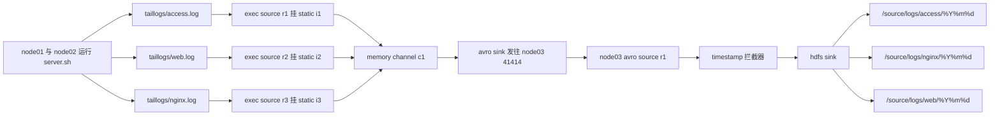

# Flume 拦截器链路联调：造数脚本、启动顺序与 HDFS 分目录验收

配置文件写完只是纸面工程，三台机器的 agent 能不能按设计把三类日志送进三个目录，要等真实数据流过整条链路才能下结论。联调阶段要自己补齐三件事：给 `tail -F` 喂一个持续产出的日志源，按数据流向排好启动顺序，最后到 HDFS 的 web 界面上做验收。

## 先给结论

- 造数脚本 `server.sh` 放在 `/export/servers/shells`，一个 while 循环每 0.5 秒向 `access.log`、`web.log`、`nginx.log` 各追加一行 `date` 输出，node01 与 node02 各需一份，scp 分发最省事。
- 启动顺序跟着数据流走：先起 node03 的汇总 agent，让 avro source 先占住 41414 端口等数据，再起 node01 与 node02 的采集 agent，最后跑脚本。
- 真机测试时 node03 的落盘路径是 `/source/logs/%{type}/%Y%m%d` 两级目录，路径里出现日期变量后，时间戳拦截器从可选项变成必配项。
- 验收看两处：agent 日志里滚动的 event 输出，以及 node01:50070 页面上 `/source/logs` 下分出的三个目录。
- 只要拦截器打的 header 键相同，多少台主机发来的数据都汇进同一个目录，多机采集与分类落库由此解耦。

## 造数脚本：给 tail -F 喂持续的日志

三个 exec source 盯的是 `/export/servers/taillogs/` 下的三份日志，测试环境没有业务系统在写它们，得自己造一个写入方。脚本内容如下：

```bash
#!/bin/bash
while true
do
date >> /export/servers/taillogs/access.log
date >> /export/servers/taillogs/web.log
date >> /export/servers/taillogs/nginx.log
sleep 0.5;
done
```

脚本非常直白：死循环里三条重定向，每次循环向三个目标文件各追加一行当前时间，然后休眠 0.5 秒。数据的节奏由 `sleep 0.5` 控制，一秒两个批次，三个 source 每个都能持续读到新行。文件名必须与采集端配置里 `tail -F` 命令写的路径一字不差，否则 source 会盯着一个永远不会出现的文件空等。

脚本建在 `/export/servers/shells/server.sh`，node02 也要有一份，直接从 node01 拷贝：

```bash
scp server.sh node02:$PWD
```

`$PWD` 让文件落在 node02 的同名目录下，与分发 Flume 配置文件时用的手法一致。两个目录 `shells` 与 `taillogs` 两台机器都要建好，脚本写文件时路径不存在会直接报错。

## 启动顺序：下游先就位

启动顺序教师特意停下来问了一句：node01、node02、node03 先起谁。答案是 node03。这张拓扑里 avro source 是监听方，avro sink 是连接方，node03 先起，41414 端口才有进程在收；反过来先起采集端，sink 找不到对端，日志里会刷出一串 Connection refused，虽然 Flume 会自动重试最终连上，但满屏报错会干扰后面观察数据流。三条启动命令按序执行（命令画面未完整入帧，按课程环境主流写法补全）：

```bash
# node03：汇总端，先起
cd /export/servers/apache-flume-1.8.0-bin
bin/flume-ng agent -n a1 -c conf -f conf/avro_source_hdfs_sink.conf -Dflume.root.logger=DEBUG,console

# node02：采集端
cd /export/servers/apache-flume-1.8.0-bin
bin/flume-ng agent -n a1 -c conf -f conf/exec_source_avro_sink.conf -Dflume.root.logger=DEBUG,console

# node01：采集端，启动方式与 node02 相同
bin/flume-ng agent -n a1 -c conf -f conf/exec_source_avro_sink.conf -Dflume.root.logger=DEBUG,console
```

启动日志里能看到 Flume 把 Hadoop 与 Hive 的类路径也挂了进来，并提示 SLF4J 存在多个绑定，这些都是环境探测信息，不是故障。三个 agent 起稳后，在 node01 与 node02 各开一个会话运行 `sh server.sh`，控制台立刻开始滚动收数日志，说明 exec source 已读到新行、event 正流过 channel。



这张图把联调全程连成一条线：脚本产数据，三个 source 打标汇流，node03 接力落盘。关键路径一句话：数据的源头是脚本而不是业务系统，验收时看到的所有 event 都能沿这条链追溯到某一次 `date` 重定向。

## node03 测试版配置的完整面貌

真机测试用的配置文件是 `avro_source_hdfs_sink.conf`，保存时 vim 状态栏显示 38 行。核心内容如下：

```yaml
a1.channels = c1
# avro source 接收两台采集机的数据
a1.sources.r1.type = avro
a1.sources.r1.bind = node03
a1.sources.r1.port = 41414
# 添加时间戳拦截器：路径里有 %Y%m%d，header 必须带 timestamp
a1.sources.r1.interceptors = i1
a1.sources.r1.interceptors.i1.type = org.apache.flume.interceptor.TimestampInterceptor$Builder
# channel
a1.channels.c1.type = memory
a1.channels.c1.capacity = 20000
a1.channels.c1.transactionCapacity = 10000
# hdfs sink：%{type} 取 header 分类，%Y%m%d 取时间分目录
a1.sinks.k1.type = hdfs
a1.sinks.k1.hdfs.path = hdfs://node01:8020/source/logs/%{type}/%Y%m%d
a1.sinks.k1.hdfs.filePrefix = log-
a1.sinks.k1.hdfs.fileType = DataStream
a1.sinks.k1.hdfs.writeFormat = TEXT
a1.sinks.k1.hdfs.rollInterval = 10
```

与只保留 `%{type}` 的简化写法相比，测试版多了一层 `%Y%m%d` 日期目录，这一层变量消费的是 header 里的 timestamp 键，而 timestamp 键正是拦截器写入的：event 进入 source 时，`TimestampInterceptor$Builder` 创建的拦截器把当时的毫秒时间戳塞进 header。两个变量、两行配置是一对，加了日期变量就要配拦截器；若路径只有 `%{type}`，拦截器两行可以省，改配 `useLocalTimeStamp = true` 兜底也可以。画面里 hdfs 路径写的是 IP 形式 `192.168.174.100:8020`，它与主机名 node01 是同一台机器（hosts 已做映射），口径统一按 `node01:8020` 写。`rollInterval = 10` 让 sink 每 10 秒滚动一个新文件，联调时文件小而多，正好方便快速看到结果。

## 到 HDFS 上验收

浏览器打开 node01 的 50070 端口进入 HDFS 页面，按路径找到 `/source/logs`，下面分出了三个目录：access、nginx、web。点进 access 目录能看到文件，node01 与 node02 两台采集机的 access 日志都落在这里；nginx 与 web 目录同理。文件名带 `log-` 前缀，内容就是脚本里一行行的 `date` 输出。

这个结果给出一条通用规律：HDFS 目录的划分依据是 header 的键值，而不是主机的 IP 或主机名。两台机器的拦截器都打 `type=access`，数据就汇进同一个 access 目录；将来扩展到十台采集机，只要打标的键值约定一致，汇总端配置一行都不用改。至此整条拦截器链路验收通过，Flume 采集这条线可以收尾。

## 常见误区

- **先起采集端再起汇总端。** avro sink 是主动连接方，下游 source 未就位时上游日志会持续报 Connection refused，虽然能自动重连，但排错时容易被误导。口诀是数据流向的末端先启动。
- **只在 node01 建了脚本和目录。** node02 的 exec source 同样在 `tail -F`，目标文件不存在时它不会报错退出，只会空等，表现是 node02 的数据迟迟不来。两台机器的目录、脚本、配置要同步准备。
- **路径加了 `%Y%m%d` 却没配时间戳拦截器。** event 的 header 里没有 timestamp，sink 解析日期变量时直接报错，落盘失败。日期变量、拦截器、或 `useLocalTimeStamp = true`，三者必须凑齐一项兜底。
- **忘了写 `sleep 0.5` 或把间隔调得过小。** 死循环全速写盘，几小时内就能制造海量小文件，HDFS 的 NameNode 内存与 sink 的滚动策略都吃不消。联调造数宁可慢，便于观察每一批 event 的走向。
- **用 `tail -f` 代替 `tail -F`。** 日志文件被清空重建后 `-f` 会停在旧文件句柄上继续等，新数据再也读不到；`-F` 会重新跟踪新文件，生产上日志轮转是常态，exec source 的命令必须写大写 F。

## 面试可能被问到的问题

1. 面试官追问：「级联 Flume 集群，启动顺序有什么讲究？」
   答：按数据流向从末端往上起。汇总端（avro source 监听方）先起，采集端（avro sink 连接方）后起，最后造数或放行业务日志。顺序反了不致命，sink 会重试，但会引入大量连接报错，影响问题定位。
2. 面试官追问：「exec source 里 tail -F 和 tail -f 的区别？」
   答：`-f` 跟踪文件描述符，文件被清空或轮转重建后仍停在旧句柄上，读不到新内容；`-F` 等价于 follow 加 retry，文件不存在时等待，重建后自动重新跟踪。生产日志会轮转，必须用 `-F`。
3. 面试官追问：「两台主机的数据怎么落到同一个 HDFS 目录？」
   答：目录由 header 决定，与主机无关。两台机器的拦截器给 event 打相同的键值（如 `type=access`），汇总端 hdfs sink 的路径模板里用 `%{type}` 取值建目录，值相同自然汇进同一目录，扩展新机器只需沿用打标约定。
4. 面试官追问：「路径里同时有 %{type} 和 %Y%m%d，header 需要哪些键？」
   答：`%{type}` 需要 header 里有 type 键，由 static 或自定义拦截器写入；`%Y%m%d` 需要 timestamp 键，由时间戳拦截器写入，或在 sink 上配 `useLocalTimeStamp = true` 用本地时间兜底。缺对应键时该变量解析失败，event 落不了盘。
5. 面试官追问：「联调时怎么快速判断链路哪一段断了？」
   答：分段看。先看造数脚本的文件是否在增长，再看采集端 agent 日志有没有读到 event，接着看汇总端日志有没有接收记录，最后查 HDFS 目录与文件内容。日志里 event 数停在中间某段，断点就在那段与下一段之间。
6. 面试官追问：「为什么造数脚本要 sleep 0.5 而不是全速写入？」
   答：一是让数据流可观察，event 一批批出现便于跟踪；二是控制文件增长速度，配合 sink 的滚动间隔避免短时间产生大量小文件，HDFS 对小文件非常不友好，NameNode 元数据内存会被吃光。

## 配套资料

- 代码：`materials/code/04/day06-Flume/`，本课资料包为空（目录下无源码文件），造数脚本、node03 配置与 scp 命令按视频画面逐行还原；三条 agent 启动命令画面未完整入帧，按课程环境主流写法补全并已在文中注明。
- 讲义：`materials/docs/04/采集系统部署使用说明.md`，采集系统的部署说明与业务背景，本课验收的三目录结构对应的是这套行为日志按类型入库的落盘方案。
