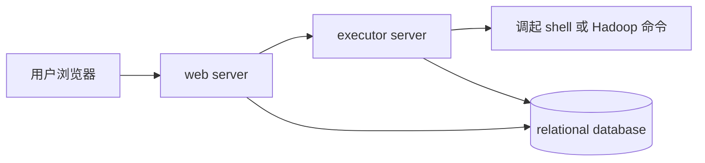

# 工作流调度器 Azkaban：定位、组件与依赖编排

一个完整的大数据分析系统由大量任务单元组成：shell 脚本、Java 程序、MapReduce 作业、Hive 脚本，彼此之间还有先后依赖。每天凌晨这一串任务怎么自动跑起来、上一步失败了下一步要不要继续，就是工作流调度器要回答的问题。Azkaban 是这一课的主角，先把它的定位、组件与依赖表达方式讲清楚。

## 先给结论

- Azkaban 是 LinkedIn 开源的批量工作流任务调度器，解决的是「一批任务按指定顺序、在指定时间自动执行」的问题。
- crontab 只管定时，表达不了依赖；任务之间的先后关系才是调度器的核心价值。
- 依赖用 key/value 的 properties 文件描述：一个 `.job` 文件是一个 job，`dependencies` 字段指向上游 job，若干 job 连成一张有向无环图，整体叫 flow。
- Azkaban 由三部分组成：web server 提供页面与调度入口，executor server 真正执行 job，relational database 存储元数据与执行状态。
- 选型时重点比对工作流描述语言、是否需要 web 容器、重试支持这三项。

## 定时容易，依赖难

设想某个业务系统每天产生 20G 原始数据，要走的分析流程分五步：


这条链是严格串行的：数据没进 HDFS，清洗无从谈起；明细大表没算出来，报表就是空表；结果没同步回去，业务端拿不到。用大白话说，工作流调度器就是给这条链装上一个「按顺序自动按下按钮」的装置，任何一个环节卡住，后面全部暂停，而不是拿一堆半成品数据继续算。

手动执行的问题显而易见：每天凌晨三点由人敲五条命令，谁也撑不了多久。于是第一反应往往是 crontab，它确实能定时，但往下走一步就会发现不够。

## crontab 的边界在哪里

crontab 的用法极其简单，两条定时任务一个文件就写完了：

```bash
# crontab -e 写入两条定时任务
0 1 * * * sh /export/servers/etl/step1_collect.sh >> /export/servers/logs/step1.log 2>&1
0 2 * * * sh /export/servers/etl/step2_clean.sh >> /export/servers/logs/step2.log 2>&1
```

凌晨一点跑采集，两点跑清洗，看起来安排得明明白白，隐患全藏在「靠时间对齐依赖」这六个字里。**第一，依赖是硬编码的。** step1 一点整跑，两点整一定结束吗？某天数据量翻倍，step1 跑到两点半还没完，step2 已经用半份数据开算，整条链的结果全部失真。**第二，失败无人知晓。** step1 半夜抛异常退出，crontab 不会重试也不会通知，下游到点照跑，直到第二天看报表才发现前一天的数据是空的。**第三，没有全局视图。** 十几个任务散落在几台机器的 crontab 里，谁依赖谁只能靠人脑记，改动一次上下游的时间点就要逐台重新对表。

依赖关系需要被显式声明，而不是被时间表隐式暗示，这正是 Azkaban 这类工作流调度器出场的位置。

## Azkaban 的定位与特点

Azkaban 由 LinkedIn 开源，定位是批量工作流任务调度器：在一个工作流内，按特定顺序运行一组任务与流程。它的任务描述语言是带着 key/value 键值对的 properties 文件，依赖关系就写在文件里：

```properties
# step2.job：清洗任务，声明依赖 step1
type=command
command=sh /export/servers/etl/step2_clean.sh
dependencies=step1
```

一个 `.job` 文件对应一个 job，`type=command` 表示执行一条 shell 命令，`dependencies` 指向上游 job 的文件名。多个 job 文件各自声明依赖，打包成一个 zip 上传，Azkaban 会把这些 job 连成一张有向无环图（DAG），这张图就叫 flow，调度与执行都以 flow 为单位。相比 XML 风格的描述文件，这种写法几乎没有学习成本，两行就能表达「B 在 A 之后」。

Azkaban 官方给出的功能特点有五条：web 用户界面，所有操作都在页面上完成；支持基于时间的定时执行；工作流打包成 zip 即可上传；任务之间的依赖关系方便设置；工作流与任务的日志有记录、可审计。定时、依赖、可视化、留痕四件事一次配齐，crontab 的三个短板正好被补上。

## 三组件与选型参照

Azkaban 本身由三部分组成，跑起来像一个「页面 + 执行器 + 台账」的组合：



web server 负责页面展示与调度管理，用户在页面上建工程、上传 zip、触发执行、查看进度；executor server 负责任务的真正执行，本质是把 job 里写的命令调起一个子进程来跑；relational database 存放 Azkaban 自己产生的数据，工程、flow、执行历史都记在这里，web 与 executor 通过读写同一套库协同。executor 执行的是 job 里声明的命令，MapReduce 与 Hive 该怎么跑还是怎么跑，Azkaban 不替代计算框架，只负责发令与监督。

常见调度器横向放在一起看更直观：

| 特性 | Hamake | Oozie | Azkaban | Cascading |
| --- | --- | --- | --- | --- |
| 工作流描述语言 | XML | XML（xPDL 风格） | key/value 文本文件 | Java API |
| 依赖机制 | data-driven | explicit | explicit | explicit |
| 是否需要 web 容器 | No | Yes | Yes | No |
| 进度跟踪 | 控制台与日志 | web page | web page | Java API |
| 重试支持 | No | workflownode | Yes | Yes |

从表里能读出 Azkaban 的取舍：描述文件最轻，web 页面开箱即用，重试开箱即有，代价是要装一套带数据库的服务。Oozie 功能更全面但 XML 配置沉重，Hamake 与 Cascading 则偏向特定使用方式。团队按复杂度与维护成本权衡即可，中小规模数仓里 Azkaban 的易用性优势非常明显。

## 常见误区

- **把 Azkaban 当成 crontab 的网页版。** 它的核心能力是依赖编排、失败重试与执行审计，定时只是其中一项；只拿来定时跑单条命令，等于浪费了整套 DAG 引擎。
- **用时间硬编码串联任务。** 在 job 里写「先 sleep 两小时再跑下一步」是反模式，上游跑多久是不可预测的，正确做法是声明 `dependencies`，由调度器保证顺序。
- **以为 Azkaban 替代 MapReduce、Hive 执行计算。** executor 调起的是 job 文件里写的命令，计算框架各司其职，Azkaban 只负责何时启动、失败后怎么办。
- **混淆 job 与 flow。** job 是单个 `.job` 文件定义的任务，flow 是多个 job 经 dependencies 连成的 DAG，上传 zip、调度执行、页面展示的对象都是 flow。
- **以为必须先有 Hadoop 集群才能用。** Azkaban 的 job 可以是任意 shell 命令，单机部署 solo 模式就能跑通一个 echo 任务，Hadoop 只是它最常见的调度对象。

## 面试可能被问到的问题

1. 面试官追问：「crontab 和 Azkaban 的本质区别是什么？」
   答：crontab 只有定时能力，依赖靠执行时间硬编码，失败无重试、无通知、无全局视图；Azkaban 用 properties 文件显式声明任务依赖，按 DAG 顺序调度，失败可重试、可告警，且有 web 页面与执行日志审计。
2. 面试官追问：「Azkaban 由哪三个组件组成，各自负责什么？」
   答：web server 负责页面展示与调度管理，executor server 负责真正执行 job（调起命令子进程），relational database 存放工程、flow 定义与执行历史等元数据，web 与 executor 通过数据库协同。
3. 面试官追问：「Azkaban 怎么表达任务依赖？」
   答：每个 job 一个 `.job` 文件，properties 格式的键值对；`dependencies=jobA` 声明当前 job 的上游。多个 job 文件打包 zip 上传后，Azkaban 解析依赖连成 DAG，形成 flow，按拓扑顺序执行。
4. 面试官追问：「flow 是什么，和 job 什么关系？」
   答：job 是最小调度单元，flow 是 job 之间依赖关系构成的有向无环图。一个 zip 包里的一组 job 默认构成一个 flow，调度、重跑、日志查看都以 flow 为入口，flow 内部按依赖拓扑决定各 job 的启动时机。
5. 面试官追问：「Azkaban 和 Oozie 怎么选？」
   答：Azkaban 用 KV 文本文件描述依赖，配置轻、页面友好、部署简单，适合中小规模与快速上手；Oozie 用 XML 定义，功能更全、与 Hadoop 生态集成更深，但学习与维护成本高。团队规模与任务复杂度是主要权衡点。
6. 面试官追问：「一个 job 失败了，Azkaban 会怎么处理？」
   答：flow 中断在失败节点，下游依赖它的 job 不会启动；job 可配置重试次数与间隔，失败支持告警通知，页面上能定位失败日志并手动重跑该节点，重跑不会影响已完成的其他分支。

## 配套资料

- 本课（day07-Azkaban）无配套源码包，job 文件示例为按本课写法补全的 properties 写法，可在后续安装课程的环境里直接验证。
- 讲义：`materials/docs/04/智慧学成-第2章-数据仓库.md`，分层数仓与 ETL 链路的完整背景，工作流调度器编排的正是这一类逐层加工的依赖链。
- 讲义：`materials/docs/04/智慧学成-第2章-ETL.md`，同一套 ETL 链路用 NiFi 做调度的实现，可与 Azkaban 的调度思路对照阅读。
