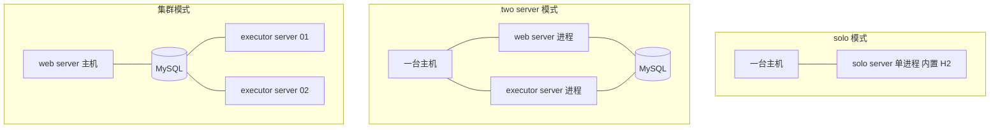

# 编译 Azkaban 3.51.0：从源码到四种产物，三种安装模式怎么选

Azkaban 官方不发现成的安装包，只发源码，所以装它的第一步永远是编译。编译本身不难，难的是动手前要想清楚部署模式：模式决定了后面要哪几个产物、用什么数据库、启动几个进程。这一课把编译流程、三组件落点与三种安装模式一次讲透。

## 先给结论

- 编译四要素：源码包 3.51.0、JDK 必须 1.8、系统装 git 与 gcc-c++、在源码根目录执行 `./gradlew build installDist -x test`。
- Azkaban 三组件：executor server 执行任务，web server 提供页面与调度，relational database 存元数据，编译产物与安装模式都围绕这三者展开。
- 三种安装模式：solo 单服务（两组件同进程、内置 H2）、two server 双服务（两进程分开、用 MySQL）、multiple executor 集群（多台执行器加一台 web），本课程环境采用 two server。
- 编译产出四件套：exec server 包、web server 包、solo server 包、create-all-sql 建库脚本，外加一个 `execute-as-user.c` 源文件。
- 产物版本号显示 0.1.0-SNAPSHOT，与源码版本 3.51.0 不是一回事，解压后重命名理顺即可。

## 编译：一条命令跑通工具链

源码包已经提前下载好，传到 node03 的 `/export/softwares` 目录。完整流程如下：

```bash
cd /export/softwares/
wget https://github.com/azkaban/azkaban/archive/3.51.0.tar.gz
tar -zxvf 3.51.0.tar.gz -C ../servers/
cd /export/servers/azkaban-3.51.0/
yum -y install git
yum -y install gcc-c++
./gradlew build installDist -x test
```

逐段拆开看。解压 `-C ../servers/` 把源码放进 `/export/servers/azkaban-3.51.0/`，与课程环境其他组件的目录约定一致。`yum -y install git` 与 `yum -y install gcc-c++` 各有用途：git 是构建过程拉取部分依赖需要的，gcc-c++ 则用来编译源码里自带的 C 程序 `execute-as-user.c`。编译命令交给 Gradle，它与 Maven 同属 JVM 系构建工具，源码里的 `gradlew` 是自带的自启动脚本，首次执行会下载 Gradle 发行版与一长串插件，网络慢是常态，耐心等。`build` 负责编译打包，`installDist` 生成可分发的目录与压缩包，`-x test` 跳过测试用例，省掉一大段与环境耦合的测试时间。终端出现 Build Success 即编译完成，源码根目录下会多出一批带 build 目录的子模块。

JDK 版本是硬门槛：编译必须用 1.8。课程环境里如果还挂着 1.7，先切换再编译，否则构建在半路报错，报错信息还不直接指向 JDK 版本，排查起来很绕。

## 三种安装模式：进程与数据库的差异

编译完成后要做的第一个决策是选安装模式。三种模式画在一起对比最直观：



**solo 单服务模式**：一台主机上，把 executor server 与 web server 放进同一个进程，用 `azkaban-solo-server` 这一个目录就能跑，数据库用内置的 H2，不需要外部 MySQL。定位是学习与演示，装得最快，数据也随目录生灭，不适合留生产数据。**two server 双服务模式**：executor 与 web 拆成两个独立进程，各自有启动脚本，数据库换成 MySQL。两种职责互不拖累，web 重启不影响正在执行的 job，这是课程环境采用的方案。**multiple executor 集群模式**：executor server 部署到多台机器，web server 放在其中一台，executor 负责执行、web 负责提交与调度，数据库仍是 MySQL，靠多执行器分摊任务量。这是生产规模化的形态，前面两种模式练熟了再上。

三种模式没有谁淘汰谁，迁移成本也低：所有产物都来自同一次编译，从 solo 升级到 two server，多装一个 MySQL、多解压一个包而已。

## 编译产物清单：四件套加一个 C 文件

模式选定后，到源码目录里取对应产物。各产物的位置与用途如下表：

| 产物 | 位置 | 用途 |
| --- | --- | --- |
| azkaban-exec-server-0.1.0-SNAPSHOT.tar.gz | azkaban-exec-server/build/distributions/ | two server 与集群模式的执行器 |
| azkaban-web-server-0.1.0-SNAPSHOT.tar.gz | azkaban-web-server/build/distributions/ | 调度页面服务，另有 zip 版供 Windows |
| azkaban-solo-server-0.1.0-SNAPSHOT.tar.gz | azkaban-solo-server/build/distributions/ | solo 模式整装包 |
| create-all-sql-0.1.0-SNAPSHOT.sql | azkaban-db 模块目录下 | MySQL 建库建表脚本，two server 与集群模式必用 |
| execute-as-user.c | az-exec-util 模块源码目录下 | C 源文件，编译成可执行文件后供 job 以指定系统用户身份运行（用途为按主流写法补全的说明） |

产物版本号里的 0.1.0-SNAPSHOT 是构建脚本没绑定版本号导致的默认值，与下载的源码版本 3.51.0 无关，看到它不要怀疑自己拿错了包。实际操作时习惯把解压出来的目录重命名成 `azkaban-exec-server-3.51.0`、`azkaban-web-server-3.51.0`，长 SNAPSHOT 名字在配置文件与脚本里太容易写错。

sql 脚本单独说一句：它不是 tar 包，就是一个 sql 文件，cp 到 `/export/software/` 备用，装 two server 模式时在 MySQL 里 source 它，几十张表一次建齐。`execute-as-user.c` 则要靠 gcc 现场编译，这正是前面装 gcc-c++ 的原因。

## 常见误区

- **JDK 版本不达标。** 编译必须 JDK 1.8，1.7 编译会报出与版本无关的奇怪错误，动手前先 `java -version` 确认。
- **不加 `-x test` 直接 build。** 完整测试套件耗时长且依赖环境，单机环境跑不过去会中断整个构建，编译安装场景一律带 `-x test`。
- **把 0.1.0-SNAPSHOT 当成下错了包。** 它是构建默认版本号，产物对不对看模块名与目录结构，不看这个版本串。
- **漏装 git 或 gcc-c++。** 前者让构建拉依赖失败，后者让 `execute-as-user.c` 没法编译，两个都是 yum 一条命令的事，漏了会在编译或使用阶段分别爆雷。
- **给 solo 模式配 MySQL。** solo 用的是内置 H2 数据库，不需要也不读 MySQL 配置；要接 MySQL 就该用 two server 模式的包，模式与数据库类型是一一对应的。

## 面试可能被问到的问题

1. 面试官追问：「Azkaban 为什么不能直接解压安装？」
   答：官方只发布源码不发布二进制安装包，需要用 Gradle 自己构建。编译要求 JDK 1.8，系统装 git 与 gcc-c++，在源码根目录执行 `./gradlew build installDist -x test`，产出 exec、web、solo 三个 server 包与数据库脚本。
2. 面试官追问：「Azkaban 有哪三种安装模式，各适用什么场景？」
   答：solo 模式把 web 与 executor 放同一进程、内置 H2，适合学习演示；two server 模式两组件拆成两个进程、数据库换 MySQL，适合单机小规模生产；multiple executor 集群模式在多台机器部署执行器加一台 web，适合任务量大的生产环境。
3. 面试官追问：「solo 模式和 two server 模式的数据库有什么不同？」
   答：solo 内置 H2 文件数据库，数据随安装目录走，零配置；two server 用外部 MySQL，先建 azkaban 库再执行 create-all-sql 脚本建表，web 与 executor 两个进程共享这套库协同工作。
4. 面试官追问：「编译命令里的 -x test 起什么作用？」
   答：Gradle 的排除语法，跳过 test 任务。Azkaban 的测试用例多且依赖外部环境，全量执行既慢又容易因环境缺失中断，编译安装阶段跳过测试可以显著缩短构建时间。
5. 面试官追问：「编译产物里的 execute-as-user.c 是做什么的？」
   答：一个 C 源文件，用 gcc 编译成可执行程序后，executor 在以指定系统用户身份执行 job 时借助它完成用户切换（代理用户执行）。这也是编译前要装 gcc-c++ 的原因。
6. 面试官追问：「产物版本号为什么是 0.1.0-SNAPSHOT？」
   答：源码版本 3.51.0 是 GitHub 上的发布标签，构建脚本没有把版本号绑定过去，Gradle 输出默认落在 0.1.0-SNAPSHOT。两者互不冲突，实践中解压后直接把目录重命名成带 3.51.0 的短名，避免配置文件里写长名出错。

## 配套资料

- 本课（day07-Azkaban）无配套源码包，编译与安装命令按视频画面逐行还原；产物表中 execute-as-user.c 的用途说明为按主流写法补全，sql 文件位置按画面目录还原。
- 讲义：`materials/docs/04/采集系统部署使用说明.md`，同一课程环境的部署口径（node01 至 node03 主机与 `/export/servers` 目录约定），编译产物解压落位遵循同一套约定。
