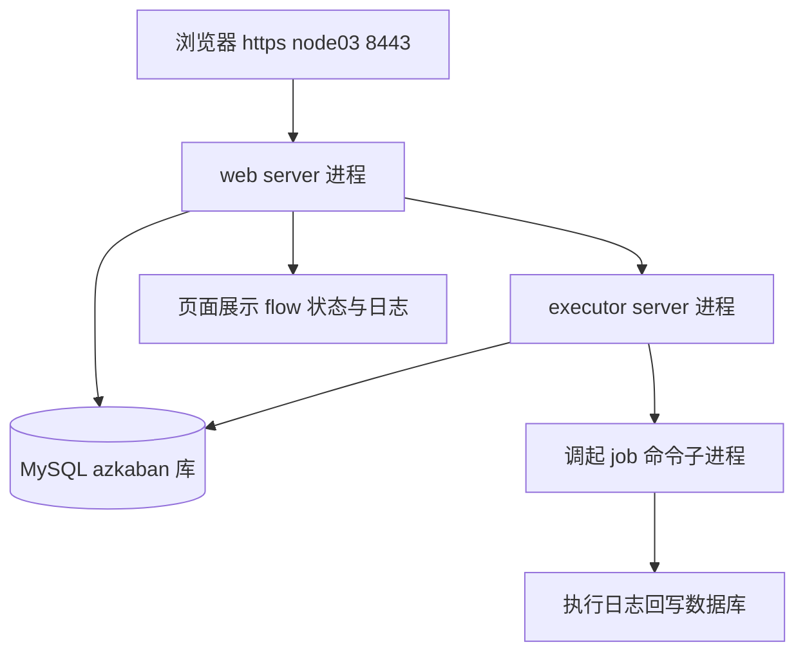

# Azkaban 部署实录：solo 模式跑通第一个 job，two server 模式装到能启动

> 🔒 安全提示：文中示例的口令/密钥均为课程教学环境演示口径，生产环境的安全要求见《安全与合规须知》。

Azkaban 的三种安装模式里，solo 上手最快，two server 最贴近生产。这一课把两种模式的完整部署过程走一遍：solo 从解压到页面登录再到跑通一个 echo 任务；two server 从 MySQL 建库、解压重命名、SSL 证书到 web 与 executor 两份配置文件逐一改完。全部操作都在 node03 上进行，目录沿用课程环境 `/export/softwares` 收包、`/export/servers` 安装的约定。

## 先给结论

- solo 模式三步走：解压 `azkaban-solo-server-0.1.0-SNAPSHOT.tar.gz` 到 `/export/servers`，改时区、关内存检查两处配置，`bin/start-solo.sh` 启动；`jps` 里出现 `AzkabanSingleServer`，浏览器访问 node03:8081，默认账号密码都是 azkaban。
- 跑通一个 job 四步：写 `foo.job`（Notepad++ 转成 UTF-8 编码）、压成 zip 包、页面上 create project 再 upload、点 Execute Flow；成功的标志是绿色 success，Detail 页里能看到 `echo hello world` 的真实输出。
- two server 模式先备两样：MySQL 建 azkaban 库并执行 `create-all-sql-0.1.0-SNAPSHOT.sql` 建表；在 web server 安装目录用 keytool 生成 keystore 证书，口令设为 azkaban。
- web 与 executor 各有一份 `azkaban.properties` 要改：时区改 Asia/Shanghai，SSL 两端同时打开，executor 的 keystore 路径直接指向 web server 目录，`azkaban.webserver.url` 写 `https://node03:8443`。
- 细节决定成败：source 脚本时路径多打一个字符都会失败，课程现场就踩过一次；工程名里带空格直接创建报错。

## solo 模式安装：解压、两处配置、一条命令

solo 模式只需要一个安装包。编译产物在源码目录 `azkaban-solo-server/build/distributions/` 下，先拷到软件目录再解压：

```bash
cd /export/servers/azkaban-3.51.0/azkaban-solo-server/build/distributions/
cp azkaban-solo-server-0.1.0-SNAPSHOT.tar.gz /export/software/
cd /export/software/
tar -zxvf azkaban-solo-server-0.1.0-SNAPSHOT.tar.gz -C ../servers/
```

解压完有个小细节：tar 包自带一层同名目录，`/export/servers` 下会出现 `azkaban-solo-server-0.1.0-SNAPSHOT/azkaban-solo-server-0.1.0-SNAPSHOT/` 的两层嵌套，conf 与 bin 都在里层，后续所有命令都进里层执行，找配置文件时别在外层空转。

配置只有两处。第一处是时区，打开里层 `conf/azkaban.properties`：

```properties
# conf/azkaban.properties：默认时区改为东八区
default.timezone.id=Asia/Shanghai
```

这行的默认值是美国时区。不改的后果不只是页面右上角时间不对：所有 Schedule 定时触发都按这个时区计算，设个凌晨一点执行实际会在白天某个时刻跑，任务与数据对不上日期。文件里其余配置如 `user.manager.class=azkaban.user.XmlUserManager`、`database.type=h2`、`azkaban.project.dir=projects` 都保持默认，solo 的数据就存在内置 H2 里，不依赖外部数据库。

H2 是一个文件级数据库，数据落在安装目录里，目录一删历史记录就清空，学习与演示正合适；也正因如此，solo 模式不必提前装 MySQL、建库导 sql，整包开箱即用。页面登录用的账号密码同样由配置决定：`user.manager.xml.file` 指向 `conf/azkaban-users.xml`，默认的 azkaban 用户就定义在这个 xml 里，要加新用户改这份文件再重启即可，不必进数据库。

第二处是内存检查，打开 `plugins/jobtypes/commonprivate.properties`：

```properties
# 追加一行，关闭内存检查；文件原有的 execute.as.user=false 保持不动
memCheck.enabled=false
execute.as.user=false
```

Azkaban 启动后会检查机器空闲内存是否满足它的要求，不达标时任务提交了也不会被执行，页面上的 flow 一直停在等待状态。内存检查项的名字画面未完整入帧，按 Azkaban 3.51.0 的主流写法补全为 `memCheck.enabled=false`。原文件里已有的 `execute.as.user=false` 不必动，它表示 job 以启动 Azkaban 的用户身份执行，单机学习环境正好合适。

启动只有一条命令：

```bash
cd /export/servers/azkaban-solo-server-0.1.0-SNAPSHOT/azkaban-solo-server-0.1.0-SNAPSHOT/
bin/start-solo.sh
jps
```

`jps` 输出里能看到 `AzkabanSingleServer` 进程，这就是 web 与 executor 合体后的那一个进程。浏览器访问 `node03:8081`，登录框里输入默认用户名密码 azkaban 与 azkaban（两个词一样，别顺手改错），进入主页能看到 project 工程列表、正在执行的任务与历史任务三块内容。到这里 solo 模式安装完毕。

## solo 模式使用：从 foo.job 到绿色 success

需求很朴素：让 Azkaban 调度一条 Linux 命令。整个旅程分四步，先看任务文件长什么样：

```properties
# foo.job：一个最小任务
type=command
command=echo "hello world"
```

`.job` 文件是 properties 格式，`type=command` 表示执行一条 shell 命令，`command` 后面跟命令内容。在 Windows 桌面新建文本文档改名 `foo.job`，用 Notepad++ 打开编辑，编码菜单里转成 UTF-8 再保存。编码这一步不能省，job 里一旦出现中文注释或路径，GBK 编码传上去就是乱码，任务解析直接出问题。

第二步打包。右键 `foo.job` 添加到压缩文件，压缩格式必须选 zip：Azkaban 只认 zip，rar 与 tar.gz 都不行，且 job 文件要待在压缩包根目录，多套一层文件夹上传后解析不出 flow。

第三步建工程并上传。页面点 Create Project，Name 填 `azkabanfirst`，Description 填 `azkaban first demo`。这里有个当场踩到的坑：第一次起名带了空格，创建直接报错，工程名不允许空格，连写或用下划线即可，描述栏反而随便写。建好的工程点进去，右上角有 delete、upload、download 三个入口，选 upload，选择桌面的 `foo.zip` 上传。上传成功后页面右侧出现 flow 操作列表。

第四步执行。列表里的 Execute Flow 是立即执行，左下角的 Schedule 是定时执行，两者入口不同：立即执行点一下、确认框提交，页面跳到 Executing 列表，Execution Id、Executor Id、Flow、User、Status 等列一目了然；想每天凌晨自动跑，就走 Schedule 配置周期表达式，页面里可以设置首次执行时间、重复间隔或 cron 表达式，保存后 flow 按点进入调度队列自动触发。这个任务极小，几秒内状态变绿：


这张图是一条 job 从本地文件到结果的完整路径。关键点在两端：入口处 zip 格式与编码决定上传能否成功，出口处 Flow Log 与 Detail 决定能不能看懂执行过程。Flow Log 里记录 flow 开始、提交 job、运行的流水；Job List 以时间轴展示各 job 状态；点开 Detail 能看到 `command=echo "hello world"` 这行命令与它的标准输出，hello world 就在那里。页面顶部的 History 保留每次执行的历史记录，回溯排查全靠它。

把 echo 换成真实的业务脚本，这套流程原样成立：`command=sh /export/servers/etl/daily_report.sh` 就能调度一个清洗脚本，多个 job 文件写上 dependencies 再一起打包，就是一个按依赖顺序执行的完整工作流。solo 模式麻雀虽小，上传、执行、日志、重跑这条主线与生产模式没有差别，先用它把操作练熟，再换 two server 模式部署，动作可以完全平移。

## two server 模式：先把数据库和证书备好

two server 模式的安装分七步，前四步在第一讲里完成：数据库准备、解压软件包、SSL 安全认证，然后才是配置。数据库是 web 与 executor 两个进程共享的台账，先把它建好。登录 MySQL（root 密码 123456），依次执行：

```sql
CREATE DATABASE azkaban;
CREATE USER 'azkaban'@'%' IDENTIFIED BY 'azkaban';
GRANT all privileges ON azkaban.* to 'azkaban'@'%' identified by 'azkaban' WITH GRANT OPTION;
flush privileges;
use azkaban;
source /export/software/create-all-sql-0.1.0-SNAPSHOT.sql;
```

六条命令各司其职：建 azkaban 库；建数据库账号 azkaban 密码 azkaban（root 的 123456 只用于登录，业务账号单独一个，权限收敛到 azkaban 库）；授权并刷新；切库；最后 source 执行编译产物里的建表脚本，脚本提前从源码 `azkaban-db` 目录 cp 到 `/export/software`。课程现场这里翻过车：source 的路径多打了一个字符，写成 software4 之类，MySQL 回一句打不开路径，检查发现 `/export/software` 与敲入的目录对不上，改回正确路径重执行才通过。执行完 `show tables;` 验证，表分两组：一组带 `QRTZ_` 前缀，是 Quartz 定时框架的触发器表；另一组是 Azkaban 的业务表，`execution_flows` 存执行记录，`active_executing_flows` 存正在执行的 flow，`execution_dependencies` 存依赖关系。

账号设计上有个值得留意的点：`'azkaban'@'%'` 表示该账号允许从任意主机连库，web 与 executor 无论部署在哪台机器都能访问；授权语句末尾的 `WITH GRANT OPTION` 是讲义写法，学习环境无妨，生产上应收敛授权范围，密码也不宜与库名同名。几十张表一次建齐，后续两个进程的读写都落在这套表上，库与账号不就绪，后面每一步都会卡住。

第二步解压两个包。回到源码目录，把 exec 与 web 的 distributions 产物各 cp 一份到 `/export/software`，再分别解压到 `/export/servers`：

```bash
cd /export/software/
tar -zxvf azkaban-exec-server-0.1.0-SNAPSHOT.tar.gz -C ../servers/
tar -zxvf azkaban-web-server-0.1.0-SNAPSHOT.tar.gz -C ../servers/
cd ../servers/
mv azkaban-exec-server-0.1.0-SNAPSHOT/ azkaban-exec-server-3.51.0
mv azkaban-web-server-0.1.0-SNAPSHOT/ azkaban-web-server-3.51.0
```

重命名不是强迫症，是工程习惯：0.1.0-SNAPSHOT 这种长名后面要在配置文件里反复出现，改成短名把出错概率降下来。解压后 web server 与 executor server 都在 `/export/servers` 下，两个进程各管各的目录。

第三步 SSL 安全认证。教师口播里说的是 SSH，按上下文与实际命令判断，这里做的是 SSL，目的让浏览器能用 https 访问 Azkaban 页面。命令在 web server 目录下执行：

```bash
cd /export/servers/azkaban-web-server-3.51.0/
keytool -keystore keystore -alias jetty -genkey -keyalg RSA
```

keytool 是 JDK 自带的证书工具，生成 Java 密钥库文件 keystore，里面存着证书与私钥，Jetty（Azkaban 内置的 web 容器）靠它开启 https。交互过程要过三关：先输入密钥库口令，两遍都输 azkaban，输密码时屏幕不回显，一个字母一个字母敲；接着填组织信息，What is your first and last name、organization、city、state、country code 一路回车保持 Unknown；最后确认信息输 yes，再给 jetty 别名的私钥口令，还是 azkaban。输错任何一步都可以重新运行命令再来一遍。结束后 `ls` 一下，目录里多了 keystore 文件，web server 目录变成 bin、conf、keystore、lib、web 五项。

keystore 与 truststore 两个词辨析一下：keystore 存自己的证书与私钥，用来向对方证明身份；truststore 决定信任谁的证书。这份实验证书没有 CA 签名，属于自签名证书，浏览器首次访问时会提示连接不受信任，选择继续访问即可，学习环境不必申请正式证书。生成的这一份文件马上会出现在两份配置里，web 用它开 8443 的 https，executor 用它建立对 web 的信任，一对证书服务两端。

## two server 模式：web 与 executor 的配置文件

两个进程各有一份 `conf/azkaban.properties`，改的项目高度相似又各有分工。先改 web server 这份：

```properties
# Azkaban Personalization Settings
azkaban.name=Azkaban
azkaban.label=My Local Azkaban
azkaban.color=#FF3601
azkaban.default.servlet.path=/index
web.resource.dir=web
default.timezone.id=Asia/Shanghai
# Azkaban UserManager class
user.manager.class=azkaban.user.XmlUserManager
user.manager.xml.file=conf/azkaban-users.xml
# Loader for projects
executor.global.properties=conf/global.properties
azkaban.project.dir=projects
velocity.dev.mode=false
# Azkaban Jetty server properties
jetty.use.ssl=true
jetty.maxThreads=25
jetty.port=8081
jetty.ssl.port=8443
jetty.keystore=/export/servers/azkaban-web-server-3.51.0/keystore
jetty.password=azkaban
jetty.keypassword=azkaban
jetty.truststore=/export/servers/azkaban-web-server-3.51.0/keystore
jetty.trustpassword=azkaban
# mail settings
mail.sender=
mail.host=
# Azkaban mysql settings
database.type=mysql
mysql.port=3306
mysql.host=node03
mysql.database=azkaban
mysql.user=azkaban
mysql.password=azkaban
mysql.numconnections=100
# Multiple Executor
azkaban.use.multiple.executors=true
# azkaban.executorselector.filters=StaticRemainingFlowSize,MinimumFreeMemory,CpuStatus
azkaban.executorselector.comparator.NumberOfAssignedFlowComparator=1
azkaban.executorselector.comparator.Memory=1
azkaban.executorselector.comparator.LastDispatched=1
azkaban.executorselector.comparator.CpuUsage=1
executor.flow.threads=30
```

要点分四块看。第一块是门面：`azkaban.name` 与 `azkaban.label` 显示在页面标题上，随便起但别带空格。第二块是 https：`jetty.use.ssl=true` 打开 SSL，页面从 8081 换到 8443 端口，keystore 与 truststore 都指向刚生成的证书文件，四个密码与生成证书时输入的口令一致。第三块是数据库：type 从 h2 换成 mysql，host 填 node03，账号密码用刚建的 azkaban。第四块是多执行器调度：`azkaban.use.multiple.executors=true` 打开执行器选择机制，下面一行 filters 本来做静态任务量、空闲内存、CPU 状态三个过滤，课程环境单执行器用不上，注释掉；comparator 四行是选择执行器时的比较因子，保留默认。尾部补的 `executor.flow.threads=30` 控制 flow 执行线程数（画面可见该项数值为 30）。另外两处默认值读一遍有好处：页面账号体系由 `user.manager.xml.file=conf/azkaban-users.xml` 提供，加账号改这份 xml；`mail.sender` 与 `mail.host` 留空表示失败邮件通知未开启，生产环境填上 SMTP 信息后，job 失败能第一时间收到告警。

executor server 的配置改得更少，核心内容如下：

```properties
# Azkaban Personalization Settings
azkaban.name=MyAzkaban
azkaban.label=My Local Azkaban
default.timezone.id=Asia/Shanghai
# Azkaban Jetty server properties
jetty.use.ssl=true
jetty.port=8081
jetty.keystore=/export/servers/azkaban-web-server-3.51.0/keystore
jetty.password=azkaban
jetty.keypassword=azkaban
jetty.truststore=/export/servers/azkaban-web-server-3.51.0/keystore
jetty.trustpassword=azkaban
# Azkaban webserver url
azkaban.webserver.url=https://node03:8443
# Azkaban mysql settings
database.type=mysql
mysql.port=3306
mysql.host=node03
mysql.database=azkaban
mysql.user=azkaban
mysql.password=azkaban
mysql.numconnections=100
```

改动的三个位置值得逐一说透。时区照旧改 Asia/Shanghai，两个进程必须一致。SSL 四行 keystore 配置的路径直接指向 web server 目录，两个进程共用同一对证书文件，信任关系由此建立。`azkaban.webserver.url` 是 executor 回访 web 的地址，协议写 https 而不是 http，主机写 node03 而不是 localhost，端口写 8443 而不是 8081，这三个值必须与 web 端 SSL 后的真实地址完全吻合，任何一处不匹配，executor 与 web 握手失败，flow 提交上去却没有执行器接管。数据库 host 同样改成 node03，其余默认。executor 配置里还有一行默认值值得知道：`executor.port=12321`，这是 executor 对外服务的端口，web 通过数据库得知各执行器的地址与端口再派发 flow；哪天动了这个端口，curl 激活命令与页面显示的 executor 地址要跟着改，否则激活请求会打到不存在的服务上。两个文件改完各自 wq 保存。

整套配置有三条一致性红线：两端 `jetty.use.ssl` 同时为 true；keystore 指向同一个文件；`azkaban.webserver.url` 与 web 端的 SSL 端口互相印证。三条缺一，two server 模式就在「配置都写完了却跑不起来」的状态里打转。

## 启动收尾与验证

画面到配置保存为止，两个进程的启动与验证按 Azkaban 3.51.0 two server 模式的主流写法补全如下：

```bash
cd /export/servers/azkaban-exec-server-3.51.0/
bin/start-exec.sh
curl -G "node03:12321/executor?action=activate" && echo
cd ../azkaban-web-server-3.51.0/
bin/start-web.sh
```

先起 executor，再用 curl 调一次激活接口（12321 是 executor 的默认通信端口），最后起 web。`jps` 里应出现 `AzkabanExecutorServer` 与 `AzkabanWebServer` 两个进程，浏览器访问 `https://node03:8443`，账号密码仍是 azkaban。两个进程各挂各的启动脚本，重启、停服互不影响，这正是 two server 模式相对 solo 的核心优势。

验证按 solo 一节的套路再走一遍更稳妥：页面登录后建工程、传一个 echo job、立即执行，绿色 success 加 Detail 页里的输出，整条链才算闭环。端口记一张小表：8443 是页面的 https 入口，8081 是 jetty 的常规 http 端口，12321 是 executor 的通信端口，3306 是 MySQL。排障时用 telnet 探这几个端口能快速定位断在哪一层：8443 不通查 web 进程与证书，12321 不通查 executor 是否激活，3306 不通查数据库账号与连接数。



这张图是 two server 模式运行期的骨架：页面提交的 flow 经 web 写入数据库，executor 取到任务起子进程执行，日志与状态再经数据库回到页面。关键路径一句话：两个进程不直接通信、全靠同一套 MySQL 协同，所以数据库与配置的三条一致性红线才如此重要。

## 常见误区

- **时区不改就开跑。** 默认时区在美国，页面上时间看着正常，定时任务的实际触发点全部偏移，数据按错误日期入库。solo 与 two server 的所有进程配置都要改 Asia/Shanghai。
- **内存检查不关。** 机器空闲内存达不到 Azkaban 的默认要求时，job 提交后永远等不到执行器接管，页面毫无报错。在 jobtype 插件配置里加 `memCheck.enabled=false`，学习与小规格环境直接关掉。
- **上传包不合规。** rar、tar.gz 后缀 Azkaban 不认；zip 里 job 文件套了一层目录，flow 解析不出来；文件编码不是 UTF-8，含中文的 job 上传即乱码。三件事都在打包那一步处理干净。
- **工程名带空格。** Create Project 时 Name 里有空格直接报错，连写或用下划线；Description 不限制。
- **source 路径手滑。** 执行 sql 脚本时目录多打一个字符，MySQL 提示路径打不开，表一张没建，后面两个进程起了一半才发现。执行完用 `show tables;` 确认再往下走。
- **SSL 配置不对称。** 只改 web 端不改 executor 端，或 `azkaban.webserver.url` 还写着 http 与 8081，executor 连不上 web，flow 一直卡在准备状态。按三条一致性红线逐项核对。

## 面试可能被问到的问题

1. 面试官追问：「solo 模式和 two server 模式的核心区别，生产该怎么选？」
   答：solo 把 web 与 executor 放在同一进程、内置 H2 数据库，一个包一套目录即可运行，适合学习与演示；two server 把两组件拆成两个独立进程、外接 MySQL，重启页面不影响执行中的任务，数据可靠留存。生产至少用 two server，任务量大再上 multiple executor 集群。
2. 面试官追问：「type=command 的 job，Azkaban 是怎么执行的？」
   答：executor server 把 command 字段的命令作为子进程调起，捕获其标准输出与错误输出写入日志，退出码决定 job 成败，状态与日志经数据库回到 web 页面。Azkaban 不解释命令内容，shell 能做的它都能调度。
3. 面试官追问：「Execute Flow 和 Schedule 有什么不同？」
   答：Execute Flow 是手动立即触发一次；Schedule 在页面上配置周期表达式，让 flow 按计划定时触发。两者产生的执行记录都进 History，定时任务失败同样可以在历史里定位并重跑。
4. 面试官追问：「two server 模式为什么要外接 MySQL，里面存了什么？」
   答：两个进程需要共享状态，MySQL 就是它们的协同媒介。库里存工程与 flow 定义、执行历史（execution_flows）、正在执行的 flow（active_executing_flows）、依赖关系，以及 Quartz 定时框架的 QRTZ 触发器表。这些由 create-all-sql 脚本一次建齐。
5. 面试官追问：「keystore 是什么，为什么 web 与 executor 都要配？」
   答：keystore 是 Java 密钥库文件，存放证书与私钥，Jetty 用它开启 https。two server 模式下两组件之间也走加密通信，executor 配置里 keystore 与 truststore 直接指向 web server 目录下的同一个文件，双方互信建立后 https 握手才能通过。
6. 面试官追问：「azkaban.use.multiple.executors 与 selector filters 的作用是什么？」
   答：打开后 web 在派发 flow 时会从多个 executor 中做选择，filters 定义过滤条件（静态任务量、空闲内存、CPU 状态），comparator 定义排序因子（已分配 flow 数、内存、最近派发时间、CPU 使用率）。单执行器环境可以注释掉 filters 简化行为，集群环境则靠它们把任务派给负载合适的节点。

## 配套资料

- 本课（day07-Azkaban）无配套源码包，全部命令与配置按视频画面逐行还原；solo 模式的内存检查配置项名称、two server 模式的启动与激活命令为按 Azkaban 3.51.0 主流写法补全，已在正文注明。
- 讲义：`materials/docs/04/采集系统部署使用说明.md`，同一课程环境的部署口径（node01 至 node03 主机与 `/export/servers` 目录约定），Azkaban 的落位与 Flume 等组件保持一致。
- 讲义：`materials/docs/04/智慧学成-第2章-数据仓库.md`，分层数仓链路的背景资料，装好的调度器后续编排的正是这一类逐层加工作业。
