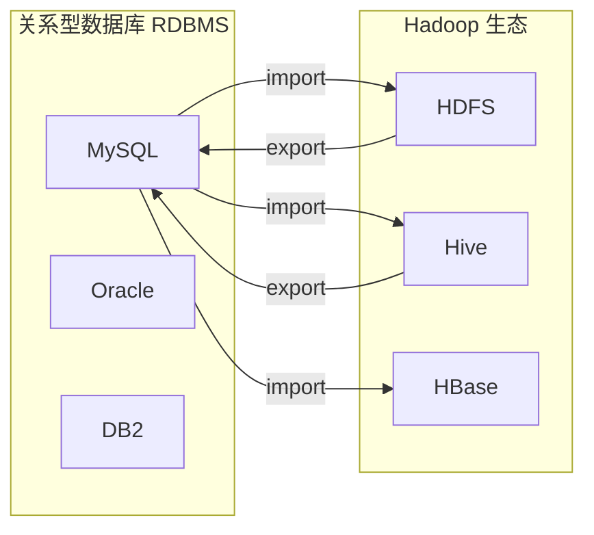
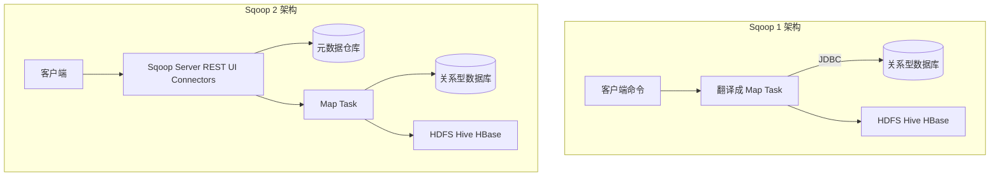

# Sqoop 入门：Hadoop 与关系型数据库之间的搬运工

数仓的日常里有一个绕不开的场景：订单、用户、课程这类业务数据安安稳稳躺在 MySQL 里，而分析这些数据的是 Hadoop 生态，HDFS、Hive 都不认识 JDBC。日志数据有 Flume 收，业务数据靠谁搬？这一课的主角 Sqoop 就是答案。先把它的定位、两条功能腿和两代架构讲清楚，后面几课再动手安装和实跑。

## 先给结论

- Sqoop 是 Apache 旗下在 Hadoop 与关系型数据库服务器之间传送数据的工具，名字即 SQL-to-Hadoop。
- 功能只有两条腿：import 把 MySQL、Oracle、DB2 等关系库的数据导入 HDFS、Hive、HBase；export 把 Hadoop 里的数据导回关系库。
- 架构分两代：Sqoop 1 是客户端直接把命令翻译成 map task，简单直接，企业主流；Sqoop 2 引入了 Sqoop Server、REST 接口与元数据库，安全更好但配置麻烦。
- 底层是 map only 的 MapReduce：只有 map 没有 reduce，并行度由 `-m` 决定，多 map 并行时靠主键切分数据段。
- 离线数仓里 Sqoop 命令通常不手敲，写进脚本交给 Azkaban 这类调度器按时间表定时执行。

## 定位：业务数据入仓的那条通道

大数据处理的流程图上，数据收集阶段画着两条通道。一条是 Flume，专门对接日志文件这类流式数据；另一条就是 Sqoop，对接存放在关系型数据库里的业务数据。用 transport 的视角类比：Flume 是接着日志源的导流槽，数据源源不断地流；Sqoop 更像油罐车，定期把一整车关系库数据拉到 Hadoop 仓库，卸完就走，下次再拉。

这个定位决定了它的使用形态。业务库的数据量按天积累，入仓动作天然是批量的、周期性的，凌晨业务低峰跑一次最合适。所以 Sqoop 的命令很少由人手敲，典型做法是把命令写进脚本，挂到调度器上：上一课刚配过 Azkaban 的 Schedule，每天凌晨两点半触发，触发的正是这样一条 Sqoop 搬运命令。课件里那组以「0 1 2 3 *」开头的定时表达式样例，想说明的也是同一件事，Sqoop 作业要挂定时器，表达式细节以所用调度器的规范为准。

## 两条腿：import 与 export

Sqoop 的全部功能浓缩在两个动词里。import 是导入，方向从关系库到 Hadoop；export 是导出，方向从 Hadoop 回关系库。两端各是什么，一张图说清：

这张图在讲 Sqoop 的能力边界：左端是它认识的关系库，右端是 Hadoop 的三种存储。最常用的组合是 MySQL 与 HDFS 之间的往返，导入下一课实跑，导出在数据出仓到报表库时用。Hive 与 HBase 作为导入目标时，本质仍是以 HDFS 文件为基础再挂元数据或写表，掌握了 HDFS 方向，另两个目标只是多几个参数。图里的每条箭头都由一条命令触发，`--connect` 指数据库、`--table` 指表、`--target-dir` 指目的地，参数细节留给安装与导入两课。

## 两代架构：为什么企业还在用 Sqoop 1

Sqoop 有两代产品，架构差别很大。**Sqoop 1 的架构非常简单。** 用户在客户端提交命令，Sqoop 把这条命令翻译成一个 MapReduce 作业，map task 通过 JDBC 直接连关系库读数据，处理后写到 HDFS；反向导出同理。没有服务端，没有常驻进程，装一个客户端包就能干活，出问题也只在一条命令的生命周期内。

**Sqoop 2 在客户端与 Hadoop 之间加了一层 Sqoop Server。** 它对外提供 REST 接口与 Web UI，内置 Connectors 连接器体系，背后挂一个元数据仓库存储任务与连接配置，还加入了安全控制措施，比如用户不必在命令行里明文携带数据库密码。功能确实更强，代价是部署与配置复杂度上一个台阶。企业现状是绝大部分仍使用 Sqoop 1，生态成熟、资料多、排障直观。课程后续的安装与使用全部基于 Sqoop 1.4.x，这个选择本身就是行业现状的反映。

对比的关键在中间那层：Sqoop 1 没有 Server，命令直达 MapReduce；Sqoop 2 的 Server 接管了连接管理与安全控制，也带来了额外的部署成本。

## 底层原理：map only 的 MapReduce

导入时 Sqoop 干的事，是把一条 `sqoop import` 命令变成一个只跑 map 的 MapReduce 作业。每个 map task 拿到自己负责的一段表数据，通过 JDBC 读取，不做聚合、不做排序，原样写成 HDFS 文件。没有 reduce 意味着没有 shuffle 阶段，省掉了这个最耗资源的环节，导入速度基本取决于关系库的读取带宽与 map 的并行度。

并行度由 `-m` 参数决定：`-m 1` 起一个 map，一条 JDBC 连接拉全表；`-m 4` 起四个 map，Sqoop 按主键把表切成四段，各读各的，这就是 split-by 参数的用武之地。实跑命令在导入 HDFS 那一课会出现，先记住因果：导入快不快，先看 `-m`。

## 常见误区

- **把 Sqoop 当实时同步工具。** 它是批量搬运车，不监听数据库变更，做不了实时复制；要 CDC 得用 Canal、Maxwell 这类工具，两者定位不同。
- **以为导入能随便覆盖旧数据。** import 的目标目录已存在时会直接报错，重复执行要配合 `--delete-target-dir` 或换目录；export 则要求目标表先建好，Sqoop 不会替你建表。
- **追新选 Sqoop 2。** 功能多不等于合适，Sqoop 2 部署复杂且社区活跃度反而不如 1.x，生产环境先确认团队既有技术栈再定。
- **导入慢只怪网络。** `-m 1` 时整张表靠一条连接串行读，再快的网络也白搭；提速先看 map 数与主键分布，主键分布不均时并行切分会严重倾斜。

## 面试可能被问到的问题

1. 面试官追问：「Sqoop 是什么，数仓里为什么离不开它？」
   答：Sqoop 是 Apache 旗下在 Hadoop 与关系型数据库之间传送数据的工具。数仓的分析能力在 Hadoop 生态，而业务数据源头几乎都在 MySQL 这类关系库里，Sqoop 负责把业务数据批量导入 HDFS 供 Hive 分析，也负责把计算结果导回关系库给报表使用，是数据入仓与出仓的搬运通道。
2. 面试官追问：「import 和 export 分别解决什么问题？」
   答：import 从 RDBMS 导入 HDFS、Hive、HBase，解决数据入仓；export 从 Hadoop 导出回关系库，解决分析结果落地。两条腿方向相反，命令结构相似，核心都是 `--connect`、`--username`、`--table` 这组参数。
3. 面试官追问：「Sqoop 1 与 Sqoop 2 的架构区别是什么，生产怎么选？」
   答：Sqoop 1 是纯客户端，命令直接翻译成 map only 的 MapReduce 作业，无服务端，简单稳定；Sqoop 2 引入 Sqoop Server、REST 接口、Connectors 与元数据库，安全控制更强但部署复杂。生产绝大多数用 Sqoop 1，本课程环境也是 1.4.x。
4. 面试官追问：「为什么 Sqoop 导入作业没有 reduce 阶段？」
   答：导入只是把表数据从关系库原样搬到 HDFS，不需要聚合、分组或全局排序，跳过 shuffle 与 reduce 可以省掉最重的计算环节。数据的切分在 map 端完成，Sqoop 按主键划段，每个 map task 通过 JDBC 读自己那段并直接写出文件。
5. 面试官追问：「`-m` 参数影响什么，设多了会怎样？」
   答：`-m` 决定 map task 并行度，也就是同时有几条 JDBC 连接读表。设大可提速，但每个 map 都要与数据库建连接，并发过高会冲击业务库性能，且切分依赖主键分布，主键倾斜时各 map 负载不均，速度快不起来。一般按数据量与库的承受能力折中取值。

## 配套资料

- 本课（Sqoop 入门）无配套源码包，两张架构图按视频画面重绘；cron 与 `-m` 相关表述为按主流写法补全，正文已注明。
- 讲义：`materials/docs/04/智慧学成-第2章-数据仓库.md`，分层数仓链路的背景资料，Sqoop 搬运的业务数据正是这条链路的源头。
- 讲义：`materials/docs/04/采集系统部署使用说明.md`，同一集群环境的采集口径与目录约定。
