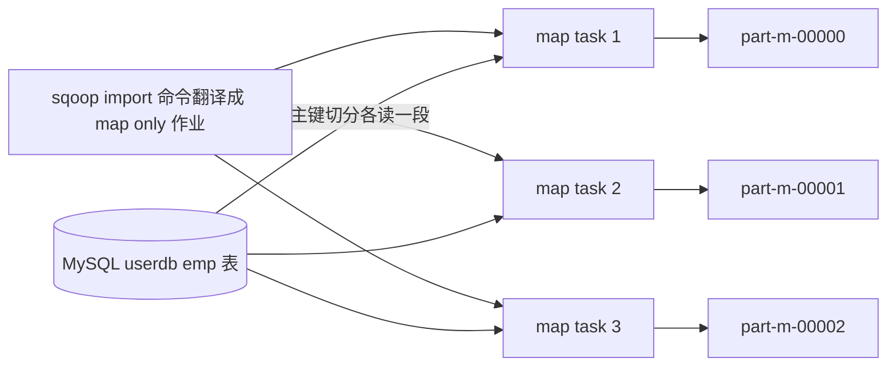

# Sqoop 导入 HDFS 实操：先探路、再导入、后调分隔符

> 🔒 安全提示：文中示例的口令/密钥均为课程教学环境演示口径，生产环境的安全要求见《安全与合规须知》。

背过 `sqoop import` 的参数，真正上手时还是会卡在两个问题上：命令一跑报连接拒绝，或者任务显示成功却不知道数据落到了 HDFS 哪里。这一课按实际操作顺序走一遍导入：先用两条 list 命令确认与关系库的连通性，再执行最小化的 import 看数据落点，最后用 `--target-dir` 与 `--fields-terminated-by` 控制目的地和文件格式。环境为上一课装好的 Sqoop 1.4.7，演示用的关系库是 Windows 主机上的 MySQL（账号密码 root），课程集群内 MySQL 的 root 密码为 123456，命令模板完全一致。

## 先给结论

- 导入前先探路：`list-databases` 列库、`list-tables` 列表，连通性确认了再 import，报错能提前暴露在最小命令上。
- import 最小命令四件套：`--connect`、`--username`、`--password`、`--table`，加 `-m 1` 指定单 map 执行。
- 不指定目录时数据落到 HDFS 当前用户家目录下与表同名的路径（`/user/root/emp`），文件默认逗号分隔，按 `part-m-00000` 命名。
- `--target-dir` 指定目的地，重复执行配 `--delete-target-dir` 先删后导。
- `--fields-terminated-by '\t'` 自定义字段分隔符，与课程数仓 Hive 建表的 `\t` 约定一致，导出的文件后续可直接挂载成 Hive 外部表。

## 导入前先探路：两条 list 命令

Sqoop 每个子命令都带帮助，先看语法再动手：

```bash
bin/sqoop list-databases --help
```

探路的第一条命令列出目标主机上的所有数据库：

```bash
bin/sqoop list-databases --connect jdbc:mysql://192.168.1.1:3306/ --username root --password root
```

`--connect` 的值是 JDBC 连接串，`jdbc:mysql://` 固定，后面接主机 IP 与端口 3306；`--username` 与 `--password` 是数据库账号。命令执行后把远端 MySQL 里的库名逐行列出，与在数据库客户端里看到的列表完全一致，说明 Sqoop 到关系库的连通没有问题。

Windows 上的 MySQL 默认可能不允许远程主机连接，连不上时在 Windows 的数据库客户端里执行两条授权命令：

```sql
grant all privileges on *.* to 'root'@'%' identified by 'root' with grant option;
flush privileges;
```

`'root'@'%'` 表示放开 root 账号的来源主机限制，授权后刷新生效，再跑 list-databases 就通了。库能列出来还不够，导入前再确认表：

```bash
bin/sqoop list-tables --connect jdbc:mysql://192.168.1.1:3306/userdb --username root --password root
```

连接串末尾带上库名 `userdb`，命令列出该库下的所有表，员工表 emp 就在其中。探路的两个动作成本极低，却能把账号、网络、驱动三类问题全部提前暴露，值得养成习惯。

## 第一条 import：先弄清数据落在哪

导入命令的最小形态：

```bash
bin/sqoop import --connect jdbc:mysql://192.168.1.1:3306/userdb --username root --password root --table emp -m 1
```

逐段读：`import` 表示导入，方向固定从关系库到 Hadoop；`--connect` 与账号三件套定位数据源；`--table emp` 指定要导的表；`-m 1` 指定启动一个 map task。执行过程要等一会儿，因为底层走的是 MapReduce：Sqoop 把命令翻译成 map only 作业，map task 通过 JDBC 读表、写 HDFS，控制台会滚出 MapReduce 的计数器输出，看到成功即导入完成。

关键问题是数据去哪了。不指定目录时，Sqoop 默认写到执行用户的 HDFS 家目录下、以表名命名的路径，也就是 `/user/root/emp`。打开 HDFS 页面进到该目录，里面的文件以 `part-m-` 开头（m 代表 map 产出），下载打开内容与 emp 表的数据一致，字段之间用逗号分隔。没指定分隔符时默认就是逗号，这一默认值后面要改。

## 指定目录与覆盖重跑

默认落点不方便管理，生产上导入都用 `--target-dir` 显式指定：

```bash
bin/sqoop import --connect jdbc:mysql://192.168.1.1:3306/userdb --username root --password root --table emp --target-dir /sqoop/emp --delete-target-dir -m 1
```

`--target-dir /sqoop/emp` 把输出目的地定为根目录下的 sqoop 目录；`--delete-target-dir` 表示若目录已存在则先删除再导入。这个参数与重复执行强相关：Sqoop 遇到已存在的目标目录会直接报错退出，不做覆盖，想要重跑就明确授权它删除旧目录。执行日志中间出现过 `Interrupted Exception` 一类的输出，那是底层框架的日志噪声，与导入结果无关，等任务跑完看最终状态即可。执行完到 HDFS 上确认 `/sqoop/emp` 出现且内容完整。

## 自定义字段分隔符

逗号分隔的文件与课程数仓的建表约定对不上，Hive 建表脚本统一使用 `\t` 分隔。导入时用 `--fields-terminated-by` 指定：

```bash
bin/sqoop import --connect jdbc:mysql://192.168.1.1:3306/userdb --username root --password root --table emp --target-dir /sqoop/emp2 --fields-terminated-by '\t' -m 1
```

导出到 `/sqoop/emp2`，打开文件确认字段之间按 `\t` 分隔。这个选择不是随意的：数仓建外部表时 `ROW FORMAT DELIMITED FIELDS TERMINATED BY '\t'` 与导入分隔符一致，文件才能被表正确解析，两边任何一边擅自改动都会出现字段错位。本课程资料里的 Hive 建库建表脚本全部采用 `\t`，导入侧保持同一约定，链路才通。

这一步现场翻过一次车：命令敲下去报错，提示找不到合适的 driver，检查发现连接串把 `jdbc:mysql://` 少写了一个斜杠。JDBC 串格式稍有偏差，报错往往不指向真正的错误点，先核对连接串格式再怀疑驱动与环境，这是排障顺序问题。

## -m 并行与 split-by：导入提速的两个旋钮

`-m` 决定并行度。`-m 1` 只起一个 map task，一条 JDBC 连接串行读全表，适合小表与验证；数据量大时提到 `-m 4` 起四个 map task，Sqoop 按主键把表切成四段，各 map 读各的段，互不重叠。切分的依据字段由 `--split-by` 指定，主键是最常见的选择。本课命令都取 `-m 1`，画面未演示多 map 写法，按主流写法补全一个并行形态：

```bash
bin/sqoop import --connect jdbc:mysql://192.168.1.1:3306/userdb --username root --password root --table emp --target-dir /sqoop/emp3 --split-by id --fields-terminated-by '\t' -m 4
```

并行不是越大越好：每个 map 都要占一条数据库连接，`-m` 过大会冲击业务库；主键分布不均时切分严重倾斜，某一段独大，其他 map 早就跑完干等，速度快不起来。HDFS 上最终会生成与 map 数相同数量的 part 文件，`-m 4` 就有四个分片。



这张图是导入的运行期视图：一条命令被翻译成多个 map task，按主键分段通过 JDBC 读取，各自写出一个 part 文件。关键点是全链路没有 reduce，也没有聚合，文件内容就是表数据的原样投影，分隔符与命名规则决定了下游怎么消费它。

## 常见误区

- **连不上先怀疑 Sqoop。** 连接拒绝十有八九是账号授权范围（`root@'%'` 是否放开）与网络端口问题，先用 list-databases 把连通性验证干净，再谈导入。
- **目标目录报错就换目录名。** 目录已存在时 Sqoop 直接报错不覆盖，重跑用 `--delete-target-dir` 明确授权删除，换目录只会让 HDFS 上堆满半成品。
- **拿默认逗号分隔的文件直接建 Hive 表。** 建表分隔符与文件分隔符必须一致，否则字段全部错位；导入时用 `--fields-terminated-by` 与数仓约定对齐。
- **连接串格式错了先重装驱动。** `jdbc:mysql://` 少一个斜杠，报错会指向 driver 而不是 URL，先核对连接串再排查环境。
- **`-m` 盲目调大。** 并行度受主键分布与业务库承受力双重约束，倾斜的主键加再多 map 也不会快，反而拖垮数据库。

## 面试可能被问到的问题

1. 面试官追问：「Sqoop import 的底层执行流程是怎样的？」
   答：import 命令被翻译成一个 map only 的 MapReduce 作业，没有 reduce 阶段。每个 map task 通过 JDBC 读取按主键切分出的数据段，原样写成 HDFS 文件，文件名形如 part-m-00000。因为没有 shuffle 与聚合，导入速度主要取决于数据库读取能力与 map 并行度。
2. 面试官追问：「`-m` 和 `--split-by` 是什么关系？」
   答：`-m` 决定 map task 数量，也就是并行度；`--split-by` 指定按哪个字段把表切分成与 map 数相同的连续区段。默认用主键切分，主键分布不均会导致各段数据量倾斜，个别 map 成为瓶颈，此时应选分布均匀的列作为切分字段。
3. 面试官追问：「不指定 target-dir 时数据落在哪，文件格式是什么？」
   答：落在执行用户的 HDFS 家目录下、与表同名的路径，如 root 用户导 emp 表是 `/user/root/emp`。文件默认文本格式，字段以逗号分隔，可用 `--fields-terminated-by` 改为 `\t` 等自定义分隔符，分隔符要与下游 Hive 建表的 ROW FORMAT 约定一致。
4. 面试官追问：「`--delete-target-dir` 有什么风险，生产上怎么用？」
   答：它会在导入前无条件删除已存在的目标目录，配错路径或表名就可能误删历史数据。生产上建议目录按日期分区命名，重跑只影响当天目录，并对删除动作做二次确认或先导到临时目录再原子性重命名切换。
5. 面试官追问：「导入前你会做哪些准备动作？」
   答：先用 list-databases 与 list-tables 验证连通性与目标表存在，确认账号权限覆盖远程主机；检查目标目录是否已存在；估算数据量决定 `-m` 与切分字段；与下游约定好分隔符。探路命令成本极低，能把网络、账号、驱动三类问题提前暴露。

## 配套资料

- 本课（Sqoop 导入 HDFS）无配套源码包，命令按视频画面逐行还原；`--split-by` 并行写法、Windows MySQL 授权语句为按主流写法补全，正文已注明。
- 代码：`materials/code/04/_散落资料/` 下的 Hive 建库建表脚本，建表统一使用 `ROW FORMAT DELIMITED FIELDS TERMINATED BY '\t'`，与本课导入分隔符的选择正是同一套约定。
- 讲义：`materials/docs/04/智慧学成-第2章-数据仓库.md`，分层数仓链路背景，导入 HDFS 的业务数据后续按这套链路逐层加工。
