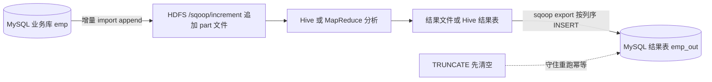

# Sqoop 增量导入与导出：三参数抓增量，export 回写 MySQL

> 🔒 安全提示：文中示例的口令/密钥均为课程教学环境演示口径，生产环境的安全要求见《安全与合规须知》。

全量导入每天跑一遍，HDFS 里堆的都是重复数据，白白消耗算力；另一头，分析结果留在 Hive 里业务系统看不见，得回到 MySQL 供报表查询。这一课解决链路两端：进来的只导新增，出去的把结果按列序回写。环境沿用本阶段的 Sqoop 1.4.7，命令连接的演示库是画面上的 MySQL（账号密码 root），课程集群内 MySQL 的 root 密码为 123456，替换连接串与密码即可。

## 先给结论

- 增量导入三参数：`--incremental append` 声明模式、`--check-column id` 指定判断列、`--last-value 1202` 指定上次边界，只导比它大的行。
- 增量模式的目标目录是积累载体，不能配 `--delete-target-dir`，配了直接报错。
- 更灵活的区间增量用 `--where` 圈时间窗，条件下发到数据库端过滤。
- `lastmodified` 模式按时间戳列抓「被更新过的行」，append 只认新增，两者按业务有没有 UPDATE 来选（此部分按主流写法补充）。
- 导出 `sqoop export` 按 HDFS 文件列序 INSERT 进 MySQL 表；export 是追加语义、不幂等，重跑前先 TRUNCATE 目标表。

## 什么是增量导入：三个参数定住「只导新增」

增量数据的定义：给一个时间点或一个值，只导在这个基准之后新增的部分。emp 表 id 已经到 1205，上次导到 1202，今天要的就是 1203、1204、1205 三行，比 1202 大的才导。

命令：

```bash
bin/sqoop import \
--connect jdbc:mysql://192.168.1.7:3306/userdb \
--username root \
--password root \
--table emp \
--incremental append \
--check-column id \
--last-value 1202 \
-m 1 \
--target-dir /sqoop/increment
```

逐参数看：`--incremental append` 声明增量模式并以追加方式产出；`--check-column id` 指定用哪一列判断增量，id 是自增主键，天然单调递增，画面对着第一列强调过这一点；`--last-value 1202` 是上次导入的边界值，本次只导 id 大于 1202 的行；`--target-dir /sqoop/increment` 指定追加目的地。执行完到 HDFS 打开 part 文件核对，里面只有 1203、1204、1205 三行，增量生效。

一个画面特别强调的细节：增量命令不能加 `--delete-target-dir`。全量导入靠它先删后导重跑，增量导入要往同一个目录追加新的 part 文件，历史就在这个目录里，删目录等于断档。Sqoop 在增量模式下遇到该参数直接报错退出，这是模式互斥，不是警告。

## 区间增量：--where 圈定任意条件

check-column 只能表达「大于某个值」，要导某个时间段的数据就换 `--where`：

```bash
bin/sqoop import \
--connect jdbc:mysql://192.168.1.7:3306/userdb \
--username root \
--password root \
--table emp \
--where "create_time > '2018-06-17 00:00:00' and create_time < '2018-06-17 23:59:59'" \
--target-dir /sqoop/increment2 \
-m 1
```

`create_time` 是 MySQL 表里的时间字段，条件圈定 6 月 17 号一整天，落到 `/sqoop/increment2` 的记录全是这一天的。本质上 where 增量就是把 SQL 的 where 条件下发到数据库端过滤，Sqoop 把过滤结果拉回 HDFS。它比 check-column 灵活，能表达任意区间与组合条件；代价是边界条件写在命令里，「上次导到哪」要自己维护。

这条命令现场翻过一次车：执行报 Access denied for user，核对发现 `--password` 把 root 写成了 admin，改回重跑即过。报错信息直接点名账号，排障先对账报错里的用户名与密码，再查网络与授权。

## append 与 lastmodified：两种增量模式的差别

课程演示的是 append。`--incremental` 支持两种取值，差别在于怎么对待「变化」：

| 模式 | 判断依据 | 抓得住 | 抓不住 |
|---|---|---|---|
| append | 检查列的值大于 last-value | 新增行 | 被更新的旧行 |
| lastmodified | 时间戳列晚于 last-value | 新增行与被更新的行 | 直接追加会撞重复，需配 `--merge-key` |

append 适合日志、流水这类只增不改的数据；lastmodified 适合字段会被 UPDATE 的业务表，且必须配 `--merge-key`（一般是主键），把新旧两版合并成一行，否则旧行还在、新行又插一条。课程画面只演示了 append，lastmodified 与 merge 的用法按主流写法补充。last-value 每次执行后由 Sqoop 记录，工程上通常把命令封装成 `sqoop job` 交给调度，执行时自动使用并更新上次记录的边界，免去手工传参，此为按主流写法补充。

## 导出：HDFS 文件回写 MySQL

方向反过来：import 从关系库进 Hadoop，export 从 Hadoop 存储回关系库。前提两个：HDFS 上先有文件（此前导入产出的 part 文件，逗号分隔），MySQL 里先建好目标表，列的个数、顺序、类型与文件字段一一对应。

```sql
CREATE TABLE emp_out (
  id INT(11) DEFAULT NULL,
  name VARCHAR(64) DEFAULT NULL,
  deg VARCHAR(64) DEFAULT NULL,
  salary INT(11) DEFAULT NULL,
  dept VARCHAR(64) DEFAULT NULL
);
```

画面只截到建表语句首行，其余列按 HDFS 文件的字段顺序补全。导出前把目标表清空：

```sql
TRUNCATE TABLE emp_out;
```

清空这一步直指幂等：export 把文件里的每一行 INSERT 进目标表，不带任何先删后插语义，跑两遍数据就翻倍。先 TRUNCATE 再导，重复执行的结果才可复现。

```bash
bin/sqoop export \
--connect jdbc:mysql://192.168.1.7:3306/userdb \
--username root \
--password root \
--table emp \
--export-dir /sqoop/increment2
```

画面 PPT 的命令模板如上，`--table` 与 `--export-dir` 按各自的目标替换：演示中目标表是新建并清空的 `emp_out`，目录用此前导入产出的 `/sqoop/emp`。执行完在 MySQL 查询，文件里的行全部落表。命令里没有分隔符参数，默认按逗号切分文件字段，正好对应全量导入未指定分隔符时的默认值；文件若按 `\t` 产出，导出时要加 `--fields-terminated-by '\t'` 对齐。

## 字段对齐与幂等：回写环节的两个关键点

- **列序对齐。** export 按文件列的先后顺序对上目标表的列定义，不认列名。文件五列、表只有四列，或者字符串列对上 INT 列，导出阶段就会抛错。导出失败比导错更幸运：错位的数据一旦入库，下游报表直接失真。
- **幂等靠外力。** import 重跑有 `--delete-target-dir`，export 没有等价物，重复执行就是重复 INSERT。工程上三种常规做法：重跑前 TRUNCATE 结果表；目标表带唯一键，用 `REPLACE INTO` 或先删后插；结果按日期落表，每天只写自己的分区。课程配套真实工程里，Hive 结果回写 MySQL 由 NiFi 流程模板承担，SelectHiveQL 查出统计结果，PutSQL 执行 `INSERT INTO business.subject_user_week_biz VALUES (...)`，同样是追加语义，靠上游按周计算、只写当期数据来规避重复。



这张图把本课两端接成一条往返链：增量 import 把新增行追加进 HDFS，分析产出结果文件，export 按列序 INSERT 回 MySQL 结果表，TRUNCATE 在前端守住重跑幂等。关键点是进出两个方向不对称：import 有模式与目录约束可依赖，export 的正确性全靠建表对齐与调用方自律。

## 常见误区

- **增量导入还带着 `--delete-target-dir`。** 增量目录是历史积累的载体，删了就断档；增量模式下该参数直接报错，属模式互斥。
- **check-column 拿非单调列判断。** 用状态位、更新时间这类会回跳的列做 append 检查列，会漏导或重导；选自增主键或严格递增的时间戳。
- **以为 export 按列名对齐。** export 按列序对齐，文件列与建表列的顺序、类型必须一一对应，错位直接报错或入库失真。
- **重复执行 export 不做清理。** export 是追加语义不幂等，重跑前 TRUNCATE 结果表，或按分区只写当期数据。

## 面试可能被问到的问题

1. 面试官追问：「Sqoop 增量导入 append 和 lastmodified 有什么区别？」
   答：append 通过 check-column 的值大于 last-value 识别新增行，适合只增不改的数据；lastmodified 通过时间戳列晚于 last-value 识别新增与被更新的行，要配 `--merge-key` 按主键合并新旧两版。数据有 UPDATE 就用 lastmodified，否则 append 更简单。
2. 面试官追问：「增量导入为什么不能用 `--delete-target-dir`？」
   答：增量导入往同一目标目录追加新的 part 文件，历史数据全在这个目录里，删除目录等于清空历史。全量导入重跑才用 `--delete-target-dir`，增量模式下两者互斥，Sqoop 直接报错。
3. 面试官追问：「last-value 怎么维护，每次手动传吗？」
   答：增量任务执行完后 Sqoop 会记录本次的最大检查值。工程上把命令封装成 `sqoop job` 由调度执行，job 自动使用并更新上次记录的 last-value；手动传值只适合一次性验证。
4. 面试官追问：「sqoop export 重复执行会发生什么，怎么保证幂等？」
   答：export 把 HDFS 文件逐行 INSERT 进目标表，没有覆盖或合并语义，重复执行数据翻倍。幂等要靠调用方：重跑前 TRUNCATE 结果表、目标表加唯一键做替换写入，或按日期分区只写当期数据。
5. 面试官追问：「export 报字段类型转换错误，一般是什么原因？」
   答：常见两类：文件字段与目标表列没有对齐（列数或顺序不一致），或文件分隔符与导出约定不一致导致整行被当成一个字段。导出用 `--fields-terminated-by` 与文件实际分隔符对齐，建表列序与文件列序逐一核对。

## 配套资料

- 本课（Sqoop 增量导入与导出）无配套源码包，命令按视频画面逐行还原；lastmodified 模式、`--merge-key`、`sqoop job` 与目标表补全列均为按主流写法补充，正文已注明。
- 代码：`materials/code/04/_散落资料/` 下的 NiFi 流程模板，Hive 统计结果经 SelectHiveQL 与 PutSQL 写回 MySQL 的 `business.subject_user_week_biz`，是结果回写环节在真实工程里的落地形态；同目录的 `course_visit_fact.sh`、`course_visit_process.sh` 按日期参数调度离线统计作业，日期参数化正是增量思想在调度层的延伸（源文件名带的推广后缀在正文一律略去）。
- 讲义：`materials/docs/04/智慧学成-第2章-ETL.md`，ODS 采集字段与分层加工口径。
