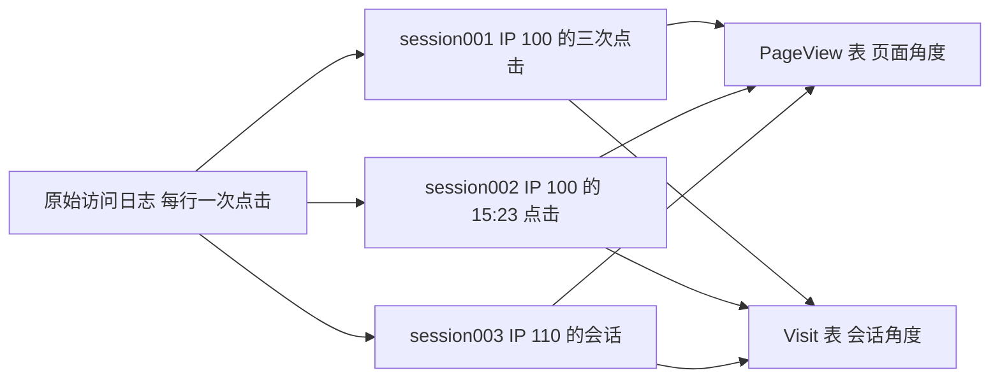
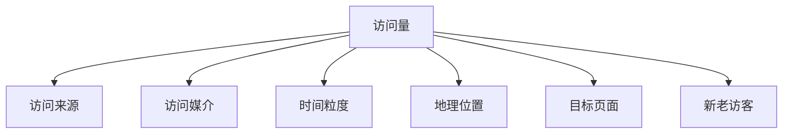
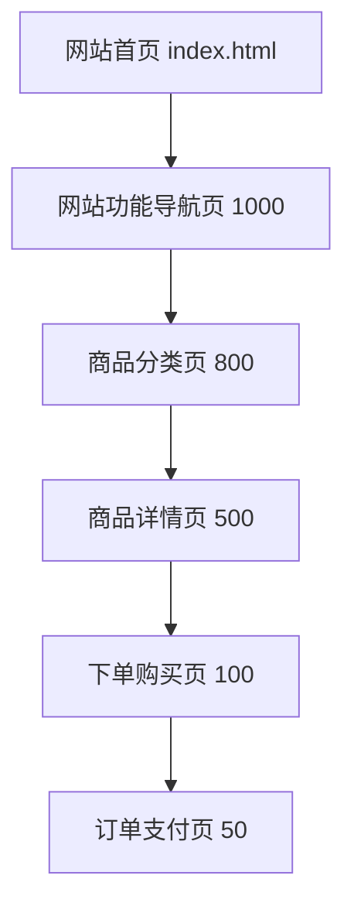

# 网站流量日志分析：点击流模型与指标体系

Hadoop 生态的分析框架到这里基本讲完，剩下的问题是把这些单点串进一个真实场景。网站流量日志分析是最经典的离线分析案例：用户在页面上的每次点击、跳转、评论都会落到访问日志里，成为网站提供方做分析的数据依据。运营方要从这堆日志里读出谁来了、看了什么、停留多久、在哪一步流失，再回头优化页面与投放渠道。这一课合并两段内容：先讲怎么把零散的日志行建模成点击流，再讲建模之后能算出哪些指标、支撑哪几类分析模型。

## 先给结论

- 一行日志只是一次点击；把同一访客、间隔不超过 30 分钟的点击串成一个 session（会话），才形成「一次访问」，这是点击流分析的基石。
- 点击流模型落到两张表：PageView 表站在页面角度记录会话内每一步访问，Visit 表站在独立访客角度记录一次会话的进出时间与进出页面。
- 指标分三档：IP、PV、UV 这类基础计数，访问次数（VV）与网站、页面停留时间这类行为指标，人均浏览页数、跳出率、退出率这类复合指标。
- 分析模型四类：流量质量分析、多维度细分、内容与导航分析、转化漏斗分析，所有分析共同指向 ROI，用最低成本换最高回报。
- 课程配套真实工程的 ODS 采集字段（session_id、client_ip、user_agent 等）正是这套模型的落地版：session_id 去重出会话，client_ip 去重出访客，user_agent 过滤机器流量。

## 从一行日志能算出什么

先看一组原始访问数据，三列：IP、访问时间、访问的页面。

```text
192.168.52.100  2018-08-22 12:23:25  a.html
192.168.52.100  2018-08-22 12:24:35  c.html
192.168.52.100  2018-08-22 12:24:45  d.html
192.168.52.100  2018-08-22 15:23:25  d.html
192.168.52.110  2018-08-22 12:24:25  b.html
192.168.52.110  2018-08-22 12:24:35  d.html
192.168.52.110  2018-08-22 15:24:45  f.html
```

基于这七行，回答一组运营最常见的问题：

- IP 100 访问了几个页面：4 次，a、c、d、d。
- IP 100 来了几次：12:23 与 12:24 的两次点击间隔不到 30 分钟，算同一次会话；15:23 的那次已经超过会话周期，算第二次，所以来了 2 次。
- 今天多少个人访问：看 IP 去重，100 与 110 共 2 个。
- 今天一共多少次页面被访问：7 次。
- 人均浏览页数：7 ÷ 2 = 3.5。
- 访问最多的页面：d.html，被两个 IP 共访问 3 次。
- 每个页面的停留时长：下一页进入时间减去本页进入时间；会话的最后一个页面拿不到「下一页」，给一个估算值，比如 10 分钟或 30 分钟。

前六问是简单聚合，第二问与第七问背后是同一件事：零散的点击必须先组织成「会话」，才谈得上访问行为。

## session：把点击串成访问

session（会话）是同一访客的一次连续访问，默认以 30 分钟为超时周期：两次点击间隔不超过 30 分钟归入同一会话，超过则开启新会话。切分的前提是识别「同一访客」，工程上以 cookie 或 session id 作为唯一标识，而不能拿 IP 当标识：一个办公区出口 IP 背后可能是几十个人，同一个手机用户在不同网络下 IP 也会漂移。真实工程里每打开一个页面产生一个会话 id、关闭浏览器即消失，就是这个用途。

点击流（click stream）就是把每个访客的每次访问记为一个点，按时间顺序串起来的访问轨迹。网站由多个页面组成，页面之间靠链接与跳转衔接，把同一个会话里的页面按时间串成线，用户行为就显形了：从哪进、怎么逛、在哪停、从哪走。后续所有模型与指标，都建立在这条线之上。



这张图讲建模的第一步：日志行先按访客与会话归组，同一份会话数据再向两个视角投影出两张模型表。切分规则只有一条，30 分钟超时，其余全是聚合。

## 两张模型表：PageView 与 Visit

PageView 表（PV 表）站在页面角度，一行记录会话里的每一步访问：session 编号、访客 IP、访问时间、访问的页面、停留时长，以及这是会话里的第几步（step）。以 IP 100 的第一个会话为例：

```text
session001  192.168.52.100  12:23:25  a.html  --    step 1
session001  192.168.52.100  12:24:35  c.html  70s   step 2
session001  192.168.52.100  12:24:45  d.html  10s   step 3
```

停留时长不是日志自带字段，而是加工出来的：下一页进入时间减去本页进入时间，12:23:25 到 12:24:35 的 70 秒就是 a.html 的停留时长；会话最后一页没有「下一页」，给估算值。step 字段看着简单，作用不小：它能还原页面在会话中的位置，第一步是入口页候选，只有一步的会话就是跳出，深度分析（浏览几步流失）也靠它聚合。

Visit 表站在独立访客角度，一行描述一次会话的来龙去脉：

```text
session001  192.168.52.100  12:23:25  12:24:45  a.html  d.html  3
```

字段依次是 session 编号、访客 IP、开始时间、结束时间、进入页面、离开页面、访问页面总数。进入页面是用户从外部落进站内的第一页，离开页面是流失前的最后一页，运营据此判断站外投放带来的流量落在哪些页面、从哪些页面流失，这是这张表最大的业务价值。

加上最底层的原始访问日志表（时间戳、IP、请求路径、请求头、响应码），点击流模型一共三张表。课程配套真实工程把这套模型落成了采集字段：ETL 讲义的 ODS 数据结构里，每条课程访问埋点记录包含课程 id、时间维度 id、session_id、client_ip、user_id、user_agent、访问时间。字段注释写得直白，session_id 是会话 id，每打开一个页面产生、关闭浏览器消失，用于去重；client_ip 用于去重；user_agent 判断用户访问方式以及是否是机器人。PV 表的去重键、Visit 表的会话键、机器流量过滤，在这张 ODS 表里各就各位。

## 指标体系：基础计数、行为指标、复合指标

模型解决「数据怎么组织」，指标解决「组织完算什么」。指标是记录和衡量访问者在网站上各种行为的标准，课程把指标按层级分成三档。

基础计数（课程称骨灰级指标）：

- IP：一天之内访问网站的不重复 IP 数，相同 IP 多次访问只计一次。早年拿它当访客身份记录，现在更多用来获取访问者的地理位置信息。
- PV（PageView）：页面被加载的总次数，刷新一次多计一次，衡量流量规模。
- UV（独立访客）：一天之内不重复的访客数，按 cookie 识别，一天内同一访客多次访问只计一次。画面 PPT 把这一项写作 Unique PageView，业界通行叫法是 UV 或独立访客。

行为指标（基础指标）：

- 访问次数（VV，Visit View）：访问从进入网站到离开的一系列活动记为一次访问，也称会话，一次访问可以包含多个 PV。
- 网站停留时间：访问者在网站上花费的时间。
- 页面停留时间：访问者在某个特定页面或某组页面上花费的时间。两者关系：把一个会话内各页面的停留时长加总，近似得到该会话的网站停留时间，最后一页的估算口径直接影响它。

复合指标：

- 人均浏览页数 = 浏览次数 ÷ 独立访客数，平均每个独立访客产生的 PV，反映流量深度：数值高说明访客愿意多逛，数值低说明落地页与导流设计有问题。
- 跳出率：一次访问只浏览一个页面就离开的访问占比，作用于入口页；入口页跳出率高，说明引流带来的访客在第一页就走，要么流量本身不精准，要么页面承接能力差。
- 退出率：退出的访问者占总访问量的百分比，通常基于某个范围（某个页面）统计，用于衡量页面在流程中的「漏人」程度。

再往上还有四类进阶视角。趋势与对比分析：提供网站流量数据与历史发展状况的参考，支持两个或多个时间段的纵向对比，当前数据看最近 15 分钟的流量、来源与变化，期间数据看最近 7 日的访问情况。来源分析：按直接输入、搜索引擎、其他外部链接、站内来源拆分流量占比，用量化数据回答什么渠道产生的流量多、效果好，进而合理化推广方案。受访分析：提供网站各域名、各页面的访问情况，对比不同内容的受欢迎程度，入口页跳出率高就要重点优化。转化路径分析：访问者完成了期望的活动记为一次转化，转化目标包括在线注册、创建订单、咨询留言、加入购物车、视频播放等，收入目标是在线订单与付款，路径分析用户在站内走到转化的轨迹。这些视角非常丰富，核心作用是给后续的分析模型备好「尺子」。

## 四类分析模型

**流量质量分析。** 流量对每个网站都很重要，但不是越多越好，应该更侧重流量的质量，换句话讲就是同样的流量能够带来多少收入。分析模型把量画在横轴、把质（收入）画在纵轴，点越小代表成本越低，目标是把流量往「量足质高、成本低」的右上角推。买量型的运营尤其要盯这个模型：渠道 A 带来 10 万 PV 只成交 5 单，渠道 B 带来 2 万 PV 成交 40 单，质量差距比规模差距重要得多。

**多维度细分。** 细分是指通过不同维度对指标进行分层，查看同一个指标在不同维度下的表现，进而找出有问题的部分。访问量可以按访问来源、访问媒介、时间粒度、地理位置、目标页面、新老访客下钻：



每条分支都是一次排障路径：访问量整体下滑时，按来源下钻发现是某个搜索引擎渠道掉了，按时间粒度发现集中在晚高峰，按地理位置锁定某个省份，问题的范围就一步步收窄。真实数仓为此建了时间维度表 `time_dim`，字段含年、月、日、小时、周与年内第几周，任何按时间粒度的下钻都靠它 JOIN 出来（见配套建库建表脚本）。

**内容与导航分析。** 一个网站无非由导航页、功能页、内容页构成，分析三类页面之间的关系：访客从导航页走到功能页、内容页的比例，在哪些页面上往返徘徊，可以指导导航结构与页面布局的优化，改善用户体验。

**转化与漏斗分析。** 所谓转化，即网站业务流程中的一个关键点，引导用户按照流程最终实现业务目标，比如商品成交。漏斗模型把进入渠道的用户在各环节的到达数依次排开，课程示例：



漏斗的读法在每一层的差值：导航到分类从 1000 到 800，丢了两成；分类到详情从 800 到 500，要查分类覆盖是否完整、推荐是否到位；下单到支付从 100 掉到 50，用户已经决定购买却在最后一步流失，优先排查支付方式是否完善。漏斗分析的价值不在总量，而在定位流失最大且业务可干预的那一层。

**用户价值模型 RFM。** 工程里常见的用户价值分层是 RFM：最近一次访问时间 Recency、访问频次 Frequency、消费或互动价值 Monetary，三项打分组合划分用户层级，指导运营资源投放。课程视频只把分析目标归到 ROI，未展开 RFM，此处按主流口径补充，面试被问到时能接得上即可。

四类模型的终点一致：ROI（投资回报率）。流量分析、内容分析、转化分析追求的都是用最低的成本来得到最高的回报，这是网站流量分析全部工作的最终目标。

## 常见误区

- **把 PV 当 UV 用。** PV 统计页面打开次数，刷新也累计；UV 按 cookie 对访客去重。衡量流量深度要用人均浏览页数（PV ÷ UV）。
- **用 IP 数冒充用户数。** 局域网出口 NAT 让一个 IP 背后站着很多人，移动网络下同一个人也会换 IP；IP 数现在主要用于地理位置推断。
- **会话切分只看跨天。** 30 分钟无操作即切新会话，不看是否过了午夜；间隔小于 30 分钟的跨天点击仍是同一会话，隔了 3 小时即使同一天也早已断开。
- **最后一页停留时长记成 0。** 最后一页拿不到「下一页进入时间」，按 0 计会压低整体停留时长，通行做法是给估算值并在口径里注明。
- **跳出率与退出率混用。** 跳出率按「一次访问只有一个页面」统计，作用于入口页；退出率按「从该页面离开的次数」统计，可作用于任何页面。

## 面试可能被问到的问题

1. 面试官追问：「PV、UV、VV、IP 四个指标的区别？」
   答：PV 是页面被打开的总次数，刷新也累计；UV 是一天内按 cookie 去重后的访客数；VV 是访问次数即会话数，一次会话可包含多个 PV；IP 是不重复 IP 数。四个数一般满足 PV 大于等于 VV，UV 与 IP 接近，但在 NAT 与移动网络场景下有偏差。
2. 面试官追问：「点击流分析里 session 怎么切分？」
   答：以访客标识（cookie 或 session id）为主键，把访问按时间排序后观察间隔，超过 30 分钟无访问即切分新会话，不区分是否跨天。切分之后才能计算一次会话的进入页面、离开页面、页面数与停留时长。
3. 面试官追问：「页面停留时长怎么计算？」
   答：等于下一页进入时间减去本页进入时间，前提是先把点击按会话与时间排序。会话最后一页没有下一页，取不到差值，通行做法是给一个估算值并在统计口径中说明，这直接影响网站停留时间的准确性。
4. 面试官追问：「PageView 表和 Visit 表分别站在什么角度？」
   答：PageView 表站在页面角度，粒度是会话内的每一步访问，带 step 与页面停留时长，用于页面热度与流转分析；Visit 表站在独立访客角度，一次会话一行，记录进出时间与进出页面，用于入口页、出口页与会话质量分析。
5. 面试官追问：「漏斗分析怎么定位流失？」
   答：把业务流程的关键节点按顺序统计到达人数，相邻两层的差值就是该环节的流失量。优先处理流失比例最大且业务可干预的环节，例如下单到支付骤降先排查支付方式，分类到详情骤降先排查分类覆盖度。
6. 面试官追问：「user_agent 字段在流量分析里有什么用？」
   答：一是识别访问方式（浏览器、移动端、App），二是过滤机器流量与爬虫，避免刷量污染指标；配合 session_id 与 client_ip 的去重，PV 与 UV 才算得干净。

## 配套资料

- 讲义：`materials/docs/04/智慧学成-第2章-ETL.md`，ODS 层数据结构表给出课程 id、时间维度 id、session_id、client_ip、user_id、user_agent、访问时间的完整字段口径，与点击流模型一一对应。
- 讲义：`materials/docs/04/智慧学成-第2章-数据仓库.md`，指标与维度、星型建模与数据分层的体系化背景。
- 代码：`materials/code/04/_散落资料/` 下的 Hive 建库建表脚本，其中 `data_dimen.time_dim` 时间维度表支撑多维度细分的时间下钻（源文件名带的推广后缀在正文一律略去）。
- 说明：漏斗数字与指标分级按视频画面还原；RFM 与趋势、来源、受访、转化路径的展开为按主流口径补充，正文已注明。
