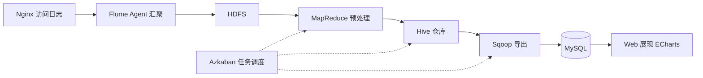
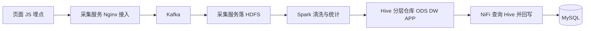

# 网站流量日志分析的数据处理流程：把阶段四的工具串成一条链

阶段四的工具单点都过了：Flume 采集、MapReduce 计算、Hive 仓库、Sqoop 搬运、Azkaban 调度。单点会了，真到「网站流量日志分析」这种完整项目上，问题就变成五类工具各站哪个环节、环节之间怎么衔接、谁负责按天把它们跑起来。这一课讲整条离线分析流水线的编排，也是阶段四工具链的收束。

## 先给结论

- 离线分析的固定链路：数据采集 → 数据预处理 → 数据入仓 → 数据分析 → 数据导出 → 数据展现，外加贯穿全程的任务调度。
- 环节与工具对位：采集用 Flume 或定制采集程序，预处理用 MapReduce 且常常不止一个作业，仓库用 Hive，导出用 Sqoop，展现用 Web 程序加 ECharts，调度用 Azkaban。
- 预处理的核心价值是统一化：原始日志格式不能满足分析需求，清洗、去脏、结构化之后才进 Hive。
- 真实工程同一条链路只是换了组件：JS 埋点加 Kafka 采集，Spark 替代 MapReduce 加工，NiFi 承担结果回写 MySQL。
- 整条链是纯离线批处理，靠调度器按天驱动，每一步做成可重跑的原子任务。

## 六个环节：每步做什么、用什么做

网站流量日志分析是一个纯粹的离线数据分析项目，全部环节按数据处理流程组织：

| 环节 | 职责 | 课程选型 |
|---|---|---|
| 数据采集 | 原始访问日志落到 HDFS | Flume agent 或定制采集程序 |
| 数据预处理 | 清洗、去脏、格式统一化 | MapReduce，多个作业串行 |
| 数据入仓 | 建 ODS 库表，数据 load 进 Hive | Hive |
| 数据分析 | 按需求开发 ETL，出各维度统计结果 | Hive SQL |
| 数据导出 | 统计结果回写关系库 | Sqoop |
| 数据展现 | 结果可视化给业务方 | Web 程序 + ECharts |

架构图把环节和数据流画在一起：



这张图是课程给出的系统架构：数据单向流动，多台 Web 服务器的 Nginx 日志经 Flume agent 汇进 HDFS，MapReduce 清洗后入 Hive，Hive 里跑 ETL 出统计结果，Sqoop 把结果导到 MySQL，Web 程序从 MySQL 读数画图。Azkaban 不在数据路径上，只负责驱动有依赖的作业按序执行。

## 为什么每个环节选这个工具

**采集：Flume 而不是手写脚本。** 网页访问日志分散在多台 Web 服务器上，Flume 的 agent 就地读日志、多级汇聚进 HDFS，channel 与事务机制保证不丢不重；埋点类业务数据也可以走定制采集程序，两条路课程都点名了。

**预处理：MapReduce，而且常常不止一个。** 原始日志脏数据多、格式不统一、字段要拆解重组，直接进仓分析会失真。清洗逻辑写成 MapReduce 作业放到 Hadoop 集群上跑，复杂场景一个作业不够，就多个作业串联，前一个的输出是后一个的输入。

**入仓与分析：Hive。** 清洗后的数据 load 进 Hive 的分层表，分析需求全部用 SQL 表达，按时间、按地域、按来源的多维度统计不必写代码，ETL 语句本身就是最终产出。

**导出与展现：Sqoop 加 Web。** 分析结果是聚合后的中间结果，量不大但业务方天天要看，回写 MySQL 让报表与可视化直接查；Web 程序接 MySQL 数据用 ECharts 出图。可视化不直连 Hive，避免报表高峰冲击数仓查询。

**调度：Azkaban。** 六步之间是严格依赖：没采集完不能预处理，预处理完才能入仓分析，分析完才能导出。每步封装成 job，用 dependencies 声明依赖，定时触发整条流。按本课写法补全一个最小示例：

```properties
# collect.job：第一步，采集日志进 HDFS
type=command
command=sh /opt/run/collect_to_hdfs.sh

# clean.job：第二步，MapReduce 预处理，依赖采集
type=command
command=hadoop jar clean-1.0.jar com.example.log.clean.CleanJob /raw/log/ /clean/log/
dependencies=collect

# export.job：导出环节，依赖分析
type=command
command=sh /opt/run/sqoop_export_result.sh
dependencies=etl
```

任一环节失败，按日期参数单独重跑该环节即可，这正是把每步做成原子任务的意义。

## 真实工程怎么落地：同一条链，换一批组件

课程配套的真实项目（智慧学成离线数仓）走的是同一条链路，对照着看更容易理解哪些环节可以替换：



采集侧：页面埋 JS 埋点脚本，采集服务接收用户行为日志，经 Kafka 缓冲解耦后落到 HDFS，对应采集系统部署使用说明里的部署链路。加工侧：ETL 脚本按日期参数调 Spark 作业，类 `VisitSourceToFact` 与 `CourseVisitProcessByDay` 分别负责访问数据源转事实与按天统计（脚本里原始包名带机构前缀，按规范改写为 `com.example.xc.analysis.visit`）：

```bash
#!/usr/bin/env bash
if [[ $1 != "" ]];then
    TD_DATE=$1
else
    echo "[===no params input,default date_info is yesterday===]"
    exit 1
fi
SPARK_SUBMIT=/opt/spark/bin/spark-submit
$SPARK_SUBMIT \
  --master spark://xc-online-spark:7077 \
  --class com.example.xc.analysis.visit.VisitSourceToFact \
  /opt/run/jars/xc-service-offline-jar-with-dependencies.jar ${TD_DATE}
```

入仓侧：数仓按分层建库，`data_dimen`、`data_subject` 等库对应 ODS、DW 到 APP 的分层，维度表与事实表统一建外部表：

```sql
CREATE EXTERNAL TABLE IF NOT EXISTS data_dimen.time_dim(
  time_dim_id String,
  year String,
  month String,
  day String,
  hour String,
  week String,
  week_name String)
ROW FORMAT DELIMITED FIELDS TERMINATED BY '\t'
STORED AS TEXTFILE
location '/user/hive/external/data_dimen/time_dim';
```

回写侧：NiFi 流程模板用 SelectHiveQL 查统计结果，PutSQL 把行 INSERT 进 MySQL 的结果表，与 Sqoop export 的回写思路一致。逐环节对照如下：

| 环节 | 课程组件 | 真实工程组件 | 差异说明 |
|---|---|---|---|
| 采集 | Flume agent | JS 埋点 + 采集服务 + Kafka | 埋点主动上报，Kafka 削峰解耦 |
| 预处理 | MapReduce | Spark | 引擎替换，清洗逻辑同构 |
| 入仓分析 | Hive | Hive 分层 ODS、DW、APP | 分层思想一致，库按业务域组织 |
| 导出 | Sqoop | NiFi SelectHiveQL + PutSQL | 回写组件替换，幂等思路一致 |
| 调度 | Azkaban job 依赖 | 日期参数化的脚本序列 | 每步一个原子脚本，可按天重跑 |

## 常见误区

- **跳过预处理直接入仓。** 原始日志的字段、编码、格式五花八门，直接 load 进 Hive，ETL 里全是防御性判断；问题后移，成本更高。
- **环节之间靠人肉衔接。** 六步依赖严格，人肉按序执行早晚漏一步；每步封装成 job 交给 Azkaban，依赖声明清楚，调度器兜底。
- **把结果表当明细表导出。** 回写 MySQL 的是聚合后的统计结果，量小、供报表读；把明细数据导进业务库既撑爆容量也没有业务价值。
- **可视化直连 Hive。** 报表访问高峰会冲击数仓查询资源；结果先落 MySQL，可视化只读 MySQL。
- **脚本不收日期参数。** 离线分析按天跑，脚本不接收日期参数就没法重算历史某一天，补数只能全量重来。

## 面试可能被问到的问题

1. 面试官追问：「离线网站流量分析项目的处理流程是什么样的？」
   答：数据采集进 HDFS，MapReduce 或 Spark 做预处理清洗，清洗数据 load 进 Hive 分层仓库，Hive ETL 按需求出各维度统计结果，Sqoop 或 NiFi 把结果导回 MySQL，Web 程序加 ECharts 做可视化，全程由 Azkaban 按依赖按天驱动。
2. 面试官追问：「预处理为什么要单独用 MapReduce 做，不直接在 Hive 里做？」
   答：原始日志脏数据多、格式不统一，在数据进仓前把结构规范下来，Hive 里的 ETL 才能专注于业务统计。预处理逻辑复杂时还能拆成多个作业串联，职责分离，出问题也好定位重跑。
3. 面试官追问：「Azkaban 在这条链路里调度什么？」
   答：把每个环节封装成 type=command 的 job，用 dependencies 声明先后依赖，定时触发后按拓扑顺序执行：采集完成后才预处理，分析完成后才导出。任何一步失败可以按日期参数单独重跑该步。
4. 面试官追问：「分析结果为什么要导回 MySQL？」
   答：结果表是聚合后的小规模数据，业务方报表与可视化要频繁查询，MySQL 的并发点查能力适合这个场景；Hive 适合批量扫描分析，不适合作为报表直查库，两者各司其职。
5. 面试官追问：「真实工程里这条链路和教学案例差在哪？」
   答：环节结构一致，组件按规模替换：采集侧用 JS 埋点加 Kafka 解耦削峰，加工侧用 Spark 替代 MapReduce 提速，回写侧用 NiFi 流程固化 Hive 查询与写库，调度侧脚本按日期参数化由调度系统驱动。链路思想不变，选型随数据量与团队技术栈调整。

## 配套资料

- 讲义：`materials/docs/04/智慧学成-第2章-数据仓库.md`，数仓分层（ODS、DW 的 DWD 与 DWM、APP）与维度建模，入仓环节的完整规范。
- 讲义：`materials/docs/04/智慧学成-第2章-ETL.md`，ODS 采集字段口径与 NiFi 加工脚本。
- 讲义：`materials/docs/04/采集系统部署使用说明.md`，JS 埋点、Nginx、Kafka 与采集服务的部署链路。
- 代码：`materials/code/04/_散落资料/` 下的 Hive 建库建表脚本、`course_visit_fact.sh` 与 `course_visit_process.sh`（Spark 离线统计的日期参数化调度脚本，包名按规范改写）、NiFi 流程模板（Hive 结果回写 MySQL）（源文件名带的推广后缀在正文一律略去）。
- 说明：Azkaban job 示例与环节职责表为按本课写法补全，正文已注明。
