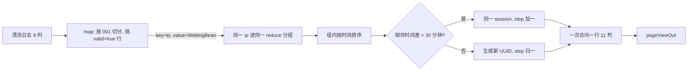

# 从清洗日志到 PageView 表模型：按 session 拆分点击流的 MapReduce 实现

预处理把原始访问日志洗成了带 valid 标记的统一格式，但每行还只是一次孤立的请求。流量分析真正关心的是会话：同一个访客在 30 分钟内连续看了哪些页面、每个页面停了多久、是本次会话的第几步。这一课的 PageView 表模型就负责把请求流组织成会话流：一行仍然对应一次页面访问，但行首多了 session 标识，行内多了步数编号与停留时长。拿到这张表，Visit 表模型和后续多维统计才有了加工对象。

## 先给结论

- PageView 表模型一行一次页面访问，在清洗日志的 9 列基础上追加 session、visit_step、page_staylong 三列，共 11 列。
- 会话划分规则：同一访客相邻两次访问的时间差小于 30 分钟归同一个 session，超过 30 分钟开启新 session，session id 用 UUID 生成。
- MapReduce 的分组键取 ip：同一 ip 的访问进同一个 reduce 分组，组内按时间排序后逐对比较相邻时间差。
- 停留时长的算法是「下一次访问时间减本次访问时间」，session 内最后一次访问没有下一次，给默认 60 秒。
- 两个实现要点：values 迭代器里的对象引用会被框架复用，必须逐条深拷贝；map 阶段只放行 valid 为 true 的行。

## PageView 模型要加什么字段

清洗日志一行 9 列：valid、ip、用户、时间、url、状态码、字节数、referer、user-agent。PageView 模型保留 true 的行，去掉 valid 列，追加三列会话信息后变成 11 列，列序与后面入 Hive 的 `ods_click_pageviews` 建表语句一一对应：

| 列 | 含义 |
|---|---|
| session | 会话标识，同一 session 的行共享同一个 UUID |
| remote_addr | 访客 ip |
| remote_user / time_local / request / http_referer / http_user_agent / body_bytes_sent / status | 原始日志字段原样保留 |
| visit_step | 本行是该 session 内第几步访问，从 1 起 |
| page_staylong | 本页停留秒数，最后一页为默认 60 |

一个 session 的多行长这样（字段以 `\001` 分隔，这里展示为表格化的示意数据）：

```text
09c1d1b7-6b52-4f9d-9f3a-2f0b1d3c5e7a\001220.181.102.177\001-\0012013-09-18 07:25:11\001/course/detail.html\0011\00137\001http://study.example.com/index.html\001Mozilla/5.0\00112451\001200
09c1d1b7-6b52-4f9d-9f3a-2f0b1d3c5e7a\001220.181.102.177\001-\0012013-09-18 07:25:48\001/course/list.html\0012\00152\001/course/detail.html\001Mozilla/5.0\0019077\001200
09c1d1b7-6b52-4f9d-9f3a-2f0b1d3c5e7a\001220.181.102.177\001-\0012013-09-18 07:26:40\001/course/video.html\0013\00160\001/course/list.html\001Mozilla/5.0\00122430\001200
```

三行同一个 session，时间递增，step 从 1 排到 3，每行的停留时长等于下一行时间减本行时间，最后一行没有下一次访问，停留 60 秒封顶。这就是课程演示里跑出来的 `pageViewOut` 结果的形态。

## 为什么按 ip 分组、按时间排序

会话划分本质上要比较「同一访客相邻两次访问的时间差」，前提是同一访客的数据先聚到一起。MapReduce 里把谁设为 K2 决定了分组的粒度：取 ip 做 key，同一 ip 的所有访问就落到同一个 reduce 分组，排序的工作量也从全量数据缩小到单个访客。

分组之后组内还不是按时间有序的，需要显式排序。把每条访问记录解析成 WeblogBean 放进 ArrayList，用 `Collections.sort` 配一个按 `time_local` 比较的 Comparator，时间字符串先解析成 Date，比较底层是毫秒值的大小。排序完成后，相邻两条记录的时间差就是停留时长与会话边界判断的全部依据。

整体数据流如下：



一条链读下来：清洗日志进 map 切分，只放行有效数据；按 ip 分组排序；相邻时间差小于 30 分钟就延续当前 session 并累加 step，超过 30 分钟就换新 session 从头计数；每条记录输出一行 11 列的 PageView。

## Mapper：只放行有效数据

Mapper 的输入是预处理输出目录，逐行按 `\001` 切分。首列是 valid 标记，先按列数防脏，再把 9 列装进 WeblogBean，只有 `isValid()` 为 true 的行才发往 Reducer：

```java
static class ClickStreamMapper extends Mapper<LongWritable, Text, Text, WeblogBean> {
    Text k = new Text();
    WeblogBean v = new WeblogBean();

    @Override
    protected void map(LongWritable key, Text value, Context context)
            throws IOException, InterruptedException {
        String line = value.toString();
        // 预处理输出按 \001 分隔，首列是 valid 标记
        String[] fields = line.split("\001");
        if (fields.length < 9) return;
        v.set("true".equals(fields[0]), fields[1], fields[2], fields[3], fields[4],
                fields[5], fields[6], fields[7], fields[8]);
        // 只有有效行才发往 Reducer，false 行留在上一份产出里备查
        if (v.isValid()) {
            k.set(v.getRemote_addr());
            context.write(k, v);
        }
    }
}
```

注意 value 的类型是 WeblogBean 而不是 Text，这要求 WeblogBean 实现 Writable 接口，上一课的值对象在这里直接复用。作业配置里输入路径取上一天日期下的 `weblogPreOut`，输出写到 `pageViewOut`，Map 输出键值是 `Text` 与 `WeblogBean`，最终输出键值都是 `Text`：

```java
job.setJarByClass(ClickStreamPageView.class);
// 输入必须是上一次预处理作业的输出目录，按天组织
String inputPath = "hdfs://node01:9000/weblog/" + DateUtil.getYestDate() + "/weblogPreOut";
String outputPath = "hdfs://node01:9000/weblog/" + DateUtil.getYestDate() + "/pageViewOut";
FileSystem filesystem = FileSystem.get(new URI("hdfs://node01:9000"), conf);
if (filesystem.exists(new Path(outputPath))) {
    filesystem.delete(new Path(outputPath), true);
}
filesystem.close();
job.setInputFormatClass(TextInputFormat.class);
job.setOutputFormatClass(TextOutputFormat.class);
TextInputFormat.setInputPaths(job, new Path(inputPath));
TextOutputFormat.setOutputPath(job, new Path(outputPath));
job.setMapperClass(ClickStreamMapper.class);
job.setReducerClass(ClickStreamReducer.class);
job.setMapOutputKeyClass(Text.class);
job.setMapOutputValueClass(WeblogBean.class);
job.setOutputKeyClass(Text.class);
job.setOutputValueClass(Text.class);
boolean b = job.waitForCompletion(true);
return b ? 0 : 1;
```

## Reducer：排序、深拷贝与 30 分钟规则

Reducer 是这一课的核心，完整逻辑分三步：收拢、排序、划分会话。本课工程源码未随资料提供，以下按课件画面与主流写法补全，包名 `com.study.clickstream`：

```java
@Override
protected void reduce(Text key, Iterable<WeblogBean> values, Context context)
        throws IOException, InterruptedException {
    ArrayList<WeblogBean> beans = new ArrayList<>();
    // 框架复用同一对象引用填充迭代器，必须逐条深拷贝再保存
    try {
        for (WeblogBean bean : values) {
            WeblogBean dst = new WeblogBean();
            BeanUtils.copyProperties(dst, bean);
            beans.add(dst);
        }
    } catch (Exception e) {
        e.printStackTrace();
    }
    // 同一访客的访问按时间先后排序，底层比较毫秒值
    Collections.sort(beans, new Comparator<WeblogBean>() {
        @Override
        public int compare(WeblogBean o1, WeblogBean o2) {
            try {
                Date d1 = toDate(o1.getTime_local());
                Date d2 = toDate(o2.getTime_local());
                if (d1 == null || d2 == null) return 0;
                return d1.compareTo(d2);
            } catch (Exception e) {
                e.printStackTrace();
                return 0;
            }
        }
    });
    /*
     * 会话划分：比较相邻两条记录的访问时间，
     * 时间差小于 30 分钟视为同一个 session，否则开启新 session；
     * 每条记录输出一行 PageView，行内带上 step 步数与停留秒数。
     */
    int step = 1;
    String session = UUID.randomUUID().toString();
    for (int i = 0; i < beans.size(); i++) {
        WeblogBean bean = beans.get(i);
        // 只有一条访问：以默认停留 60 秒直接输出
        if (beans.size() == 1) {
            context.write(NullWritable.get(), pvRow(session, key.toString(), bean, step, 60));
            break;
        }
        // 第一条没有可比较的上一次时间，跳过，等第二条进来后回头输出它
        if (i == 0) continue;
        long diff = timeDiff(toDate(bean.getTime_local()),
                toDate(beans.get(i - 1).getTime_local()));
        if (diff < 30 * 60 * 1000) {
            // 同一 session：上一条记录的停留时长即本次时间差（毫秒转秒）
            context.write(NullWritable.get(),
                    pvRow(session, key.toString(), beans.get(i - 1), step, diff / 1000));
            step++;
        } else {
            // 超过 30 分钟：上一条作为当前 session 的最后一页输出，停留给默认值
            context.write(NullWritable.get(),
                    pvRow(session, key.toString(), beans.get(i - 1), step, 60));
            // 开启新 session，步数从头计数
            session = UUID.randomUUID().toString();
            step = 1;
        }
        // 最后一条没有下一次访问，单独输出并给默认停留 60 秒
        if (i == beans.size() - 1) {
            context.write(NullWritable.get(), pvRow(session, key.toString(), bean, step, 60));
        }
    }
}
```

循环的控制流需要慢慢读一遍。`i == 0` 时跳过是因为停留时长必须由两次访问算出来，第一条记录只能等第二条到位后再写；每当处理到第 i 条，写出去的是第 i-1 条，它的停留时长就是两条记录的时间差；跨过 30 分钟边界时，上一条按当前 session 的末页输出，然后换新 UUID、step 归一，当前这条在下一轮循环里以新 session 第一步的身份被写出；走到最后一条时它永远不会被「下一条」带出来，所以循环末尾单独补写。

辅助方法按画面代码补全两个：`toDate` 把 `yyyy-MM-dd HH:mm:ss` 格式的字符串解析成 Date；`timeDiff` 返回两个时间差的毫秒值。`pvRow` 是按 Hive 表列序拼装 11 列的辅助方法，用 `String.join("\001", ...)` 把 session、ip、用户、时间、url、step、停留秒数、referer、user-agent、字节数、状态码连成一行。

## 深拷贝这个坑必须讲透

reduce 的 values 迭代器为了省对象创建，每次循环返回的是同一个对象引用，框架只是把新数据填进去。如果直接 `beans.add(bean)`，排序循环结束后列表里所有元素都指向最后一个 bean，排序结果错乱、数据全部重复。解法就是代码里那样，每条都 `new` 一个新 bean，用 `BeanUtils.copyProperties` 把字段值复制过去再入列表。这个坑不踩则已，一踩就是 reduce 输出全部相同的诡异现象，排查成本很高，面试里也是高频追问点。

## 常见误区

- **直接把 values 里的 bean 塞进集合。** 迭代器复用引用，列表最终全是同一份数据；必须逐条深拷贝。
- **把停留时长记成「本次时间减上次时间」再直接用。** 排序后时间是递增的，减出来的差值方向要对，最后一次访问没有下一次，必须给默认 60 秒，否则最后一行要么差值不存在要么漏算。
- **忘了 map 阶段过滤 false 行。** 预处理输出里 true 和 false 同文件共存，不过滤的话 404 与静态资源请求会混进会话，step 编号与停留时长全部失真。
- **用 user id 或 session 原始字段当分组键却没想清楚近似度。** 教学线没有登录态，用 ip 分组是最可行的近似，但出口 NAT 会把多人并成一个访客；工程线埋点自带 cookie 里的 sid，直接按 sid 分组更准。
- **组内不排序直接算时间差。** 相邻记录必须按时间有序，30 分钟窗口才有意义，乱序数据的差值毫无语义。

## 面试可能被问到的问题

1. 面试官追问：「PageView 表模型和清洗日志相比多了什么？怎么算出来的？」
   答：多了 session、visit_step、page_staylong 三列。同一访客的访问按时间排序后，相邻两次访问时间差小于 30 分钟归同一 session，session id 用 UUID 生成；step 是该次访问在 session 内的序号；停留时长等于下一次访问时间减本次时间，session 内最后一次访问给默认 60 秒。
2. 面试官追问：「为什么选 ip 做 MapReduce 的分组键？」
   答：会话划分要求同一访客的数据聚在一起比较时间差，ip 是没有登录态时最可靠的访客近似标识。取 ip 做 key，同一访客落到同一个 reduce 分组，排序范围也从全量缩到单访客。已知缺陷是出口 NAT 会合并多个真人，工程方案里埋点用 cookie 的 sid 分组就没有这个问题。
3. 面试官追问：「reduce 里为什么必须对 values 深拷贝？」
   答：框架为省对象创建，迭代器每次返回同一个对象引用，只把内容替换掉。直接 add 进集合会让所有元素指向最后一个对象，排序和输出全部错乱。每条 new 一个新 bean 再 copyProperties 才能安全保存。
4. 面试官追问：「停留时长为什么用时间差而不是埋点事件？」
   答：离线访问日志只有「什么时候发起了下一次请求」这种隐式信号，用户关掉页面时不产生任何记录，所以约定用下一次访问时间减本次时间近似停留时长，最后一次访问给默认值。埋点方案里可以用离开事件或心跳上报得到更准的停留数据。
5. 面试官追问：「30 分钟这个阈值怎么定？」
   答：业界通行口径就是 30 分钟无操作视为会话结束，Google Analytics 等工具的默认值也是它。具体站点可以按业务调整，比如小说、视频这类长停留场景会放宽，但从访问日志里只能看行为间隔，阈值本质上是业务约定而非计算出来的。

## 配套资料

- 讲义：`materials/docs/04/智慧学成-第2章-数据仓库.md`，会话识别与事实表建模的分层口径，PageView 属于明细事实（DWD）层的加工对象。
- 代码：`materials/code/04/buried/`，工程线的对照实现：埋点日志自带 cookie 的 sid，会话分组直接按 sid，无需 30 分钟窗口近似。
- 说明：本课的 ClickStreamPageView 工程源码未随资料提供，正文代码为按课件画面与主流写法补全，包名 `com.study.clickstream`；列序对齐入仓建表语句 `ods_click_pageviews`。
