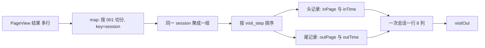

# 从 PageView 聚出 Visit 表模型：一次会话一行的点击流汇总

PageView 表模型把访问日志组织成了会话流，但一次会话仍然摊成多行。运营要看的是更粗粒度的东西：这位访客这次来访从哪进、从哪出、待了多久、看了几页、从哪里跳来的。Visit 表模型就是会话级的汇总表，一次独立访问一行：入口页面、出口页面、进入时间、离开时间、本次访问的 pv 数、来访来源。这一课把 PageView 结果再聚一层，用 session 做分组键，排序后取头取尾，聚出这张表。

## 先给结论

- Visit 一行对应一个 session，session 不会重复：MapReduce 按分组天然把同一 session 的多行 PageView 合并成一行输出。
- 输入是 PageView 作业的结果，Mapper 以 session 为 K2，同一会话的数据落进同一个 reduce 分组。
- 组内按 `visit_step` 排序，第一条记录给入口页与进入时间，最后一条记录给出口页与离开时间，列表长度就是 pv 数。
- 整次会话的来源 referer 取入口页的，出口页的 referer 只代表站内跳转方向。
- 会话时长（离开时间减进入时间）不在这一步算，留给分析层按需计算。

## Visit 表长什么样

PageView 是过程明细，一次访问一行；Visit 是会话汇总，一次访问聚成一行。列序与入仓建表语句 `ods_click_stream_visit` 对应，共 8 列：

| 列 | 含义 | 来源 |
|---|---|---|
| session | 会话标识 | PageView 行首列 |
| remote_addr | 访客 ip | 组内任一条记录 |
| inTime / outTime | 进入、离开时间 | 排序后首尾记录的 time_local |
| inPage / outPage | 入口页、出口页 | 排序后首尾记录的 request |
| referral | 来访来源 | 入口页的 http_referer |
| pageVisits | 本次访问的页面数 | reduce 分组的记录条数 |

上面 3 行示例数据聚出来就是一行（字段以 `\001` 分隔）：

```text
09c1d1b7-6b52-4f9d-9f3a-2f0b1d3c5e7a\001220.181.102.177\0012013-09-18 07:25:11\0012013-09-18 07:26:40\001/course/detail.html\001/course/video.html\001http://study.example.com/index.html\0013
```

session 与 PageView 表里的完全一致，进入时间是三行里最早的，离开时间是最晚的，入口页与出口页分别对应首尾两行的 url，页面数是 3。一次会话一行，表行数就等于会话数，比 PageView 小一个数量级，这张表正是跳出率、平均访问深度、平均会话时长这些经典指标的直接数据源。

数据流是这样的：



PageView 行进 map 后以 session 为 key 发出去，同一 session 聚成一组；组内按步数排序，头尾两条记录各取所需，拼成一行 Visit。

## Mapper：以 session 为分组键

Mapper 读的是上一次作业的输出目录，按 `\001` 切分后正好 11 列，`visit_step` 在下标 5。PageViewsBean 承载一条 PageView 记录，key 换成 session：

```java
static class ClickStreamVisitMapper extends Mapper<LongWritable, Text, Text, PageViewsBean> {
    PageViewsBean pvBean = new PageViewsBean();
    Text k = new Text();

    @Override
    protected void map(LongWritable key, Text value, Context context)
            throws IOException, InterruptedException {
        String line = value.toString();
        // PageView 结果按 \001 切分共 11 列，visit_step 在下标 5
        String[] fields = line.split("\001");
        int step = Integer.parseInt(fields[5]);
        pvBean.set(fields[0], fields[1], fields[2], fields[3], fields[4], step,
                fields[6], fields[7], fields[8], fields[9]);
        // 以 session 作为 key 发给 Reducer，同一会话的数据会聚到一组
        k.set(pvBean.getSession());
        context.write(k, pvBean);
    }
}
```

作业配置里 Map 输出键值是 `Text` 与 `PageViewsBean`，最终输出键值是 `NullWritable` 与 `VisitBean`，输入路径接 `pageViewOut`，输出写到 `visitOut`。本课工程源码未随资料提供，作业骨架按课件画面补全，包名 `com.study.clickstream`：

```java
job.setJarByClass(ClickStreamVisit.class);
String inputPath = "hdfs://node01:9000/weblog/" + DateUtil.getYestDate() + "/pageViewOut";
String outputPath = "hdfs://node01:9000/weblog/" + DateUtil.getYestDate() + "/visitOut";
job.setMapperClass(ClickStreamVisitMapper.class);
job.setReducerClass(ClickStreamVisitReducer.class);
job.setMapOutputKeyClass(Text.class);
job.setMapOutputValueClass(PageViewsBean.class);
job.setOutputKeyClass(NullWritable.class);
job.setOutputValueClass(VisitBean.class);
boolean res = job.waitForCompletion(true);
return res ? 0 : 1;
```

## Reducer：排序后取头取尾

Reducer 的结构与上一课高度相似：深拷贝、排序、加工，只是这次排完序不必逐行输出，取头取尾就够了：

```java
static class ClickStreamVisitReducer
        extends Reducer<Text, PageViewsBean, NullWritable, VisitBean> {
    @Override
    protected void reduce(Text session, Iterable<PageViewsBean> pvBeans, Context context)
            throws IOException, InterruptedException {
        // 迭代器复用同一对象引用，逐条深拷贝再保存
        ArrayList<PageViewsBean> pvBeansList = new ArrayList<>();
        for (PageViewsBean pvBean : pvBeans) {
            PageViewsBean bean = new PageViewsBean();
            try {
                BeanUtils.copyProperties(bean, pvBean);
                pvBeansList.add(bean);
            } catch (Exception e) {
                e.printStackTrace();
            }
        }
        // 按 step 排序，保证头尾抽取正确
        Collections.sort(pvBeansList, new Comparator<PageViewsBean>() {
            @Override
            public int compare(PageViewsBean o1, PageViewsBean o2) {
                return o1.getStep() > o2.getStep() ? 1 : -1;
            }
        });
        // 一次 visit 一行：头记录给入口，尾记录给出口
        VisitBean visitBean = new VisitBean();
        visitBean.setSession(session.toString());
        visitBean.setRemote_addr(pvBeansList.get(0).getRemote_addr());
        visitBean.setInPage(pvBeansList.get(0).getRequest());
        visitBean.setInTime(pvBeansList.get(0).getTimeStr());
        visitBean.setOutPage(pvBeansList.get(pvBeansList.size() - 1).getRequest());
        visitBean.setOutTime(pvBeansList.get(pvBeansList.size() - 1).getTimeStr());
        // 本次访问的页面数就是分组里的记录条数
        visitBean.setPageVisits(pvBeansList.size());
        // 整次会话的来源取入口页的 referer
        visitBean.setReferal(pvBeansList.get(0).getReferal());
        context.write(NullWritable.get(), visitBean);
    }
}
```

VisitBean 同样是实现 Writable 的值对象，八个字段与建表列一一对应。有个小细节：bean 的属性名写作 `referal`，建表语句的列名写作 `referral`，两边拼写不一致是历史遗留，入仓时按建表列序对应即可。

为什么按 step 排序而不是按时间排序？PageView 阶段已经按访问时间生成好了 step，用 step 排序直接复用这个结论，既免去了时间字符串的重复解析，也避开了同一秒内多次访问时时间比较的并列问题。步数是整数比较，开销小、结果稳。

## 为什么在 MapReduce 里聚合而不是进 Hive 再聚合

Visit 的每列其实都能用 Hive SQL 从 PageView 表算出来：按 session 分组后 `min(time_local)`、`max(time_local)`、`count(1)`，首尾页面要用窗口函数或行号技巧。放在 Hive 里做完全可行，课程仍选择在 MapReduce 里聚，理由有三。**第一，数据量提前收敛。** PageView 明细到 Visit 已经缩了一个量级，越早收敛，后续每一步要扫的数据越少。**第二，分组排序一次成型。** session 作为分组键天然按组聚合，MapReduce 的排序能力直接复用，不必在 SQL 里绕窗口函数。**第三，产出即入仓对象。** Visit 结果文件和 PageView 结果文件并列，一起 load 进 Hive 的两张 ODS 表，入仓动作对齐上一篇的三表设计。

两个表模型到此都拿到了。回到总架构图，数据走完了收集与加工两段，接下来的环节是把这两份模型数据存进 Hive 表，交给 SQL 分析，也就是下一篇的内容。

## 常见误区

- **组内按访问时间排序。** 同一秒的多次访问并列时顺序不稳，step 在上一阶段已按时间生成，用整数比较又快又稳。
- **头尾字段取反。** 入口页、进入时间取下标 0，出口页、离开时间取 `size - 1`，取反了整张表的方向感就颠倒，跳出率等指标全部失真。
- **refer 取了出口页的。** 出口页的 referer 描述的是站内跳转关系，整次会话的外部来源只能是入口页的 referer。
- **又忘了深拷贝。** 和 PageView 作业同一批坑，迭代器复用引用，不拷贝就全组串成一条数据。
- **以为 visit 行数等于 session 出现次数。** Reducer 每个分组只写一行，session 天然去重，行数等于会话数而不是 PageView 行数。

## 面试可能被问到的问题

1. 面试官追问：「Visit 表模型和 PageView 表模型的关系？」
   答：PageView 是过程明细，一次页面访问一行，带 session、步数与停留时长；Visit 是会话汇总，一次独立访问一行，记录入口页、出口页、进入与离开时间、pv 数和来源。Visit 由 PageView 聚合而来，粒度从访问级升到会话级。
2. 面试官追问：「Visit 的分组键为什么用 session 而不是 ip？」
   答：输入已经是 PageView 结果，session 在上一阶段划分完成，直接按 session 分组每组就是一个会话，Reducer 每组输出一行天然满足 session 去重。再用 ip 分组反而要重新做会话判断。
3. 面试官追问：「入口页和出口页是怎么取到的？」
   答：组内按 visit_step 排序，取第一条记录的 request 与时间作为入口页与进入时间，取最后一条记录的作为出口页与离开时间；会话时长就是离开时间减进入时间，pageVisits 是分组记录条数。
4. 面试官追问：「为什么在 MapReduce 里做会话聚合，不在 Hive 里写 SQL 聚合？」
   答：MapReduce 阶段聚合让数据量提前收敛，结果文件直接作为 Hive 入仓对象，后续分析不用反复扫明细；SQL 方案要靠窗口函数取首尾，写法绕、代价高。两者都能出结果，选型看管道组织与数据规模。
5. 面试官追问：「跳出率这类指标能从 Visit 表直接算吗？」
   答：能。pageVisits 等于 1 的会话就是跳出会话，跳出率等于这些会话数除以总会话数；平均访问深度等于 pageVisits 求和除以会话数，平均会话时长等于离开时间减进入时间的均值。Visit 表把会话级指标的计算简化成了几条 group by。

## 配套资料

- 讲义：`materials/docs/04/智慧学成-第2章-数据仓库.md`，维度建模与会话级事实表的分层位置，Visit 属于明细事实层向轻度汇总层的过渡。
- 代码：`materials/code/04/buried/`，工程线对照：埋点日志自带 sid，会话直接按 sid 聚合，无需 30 分钟窗口。
- 说明：本课的 ClickStreamVisit 工程源码未随资料提供，正文代码为按课件画面与主流写法补全，包名 `com.study.clickstream`；bean 属性 `referal` 与建表列 `referral` 的拼写差异按课件原样保留。
